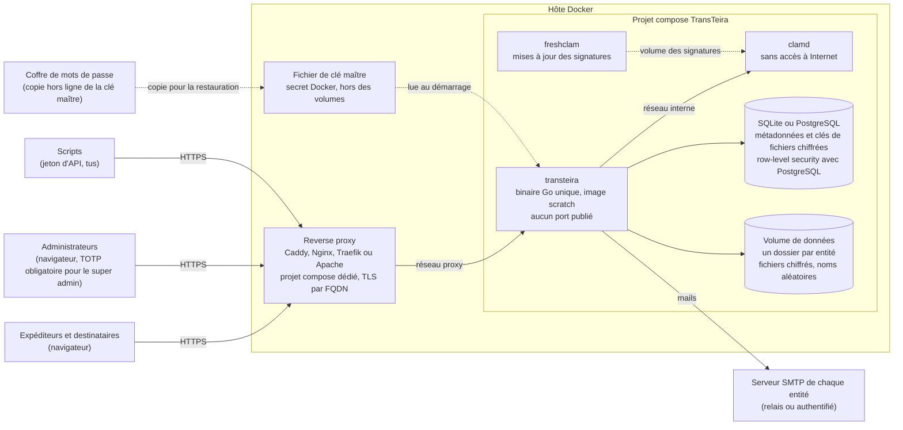
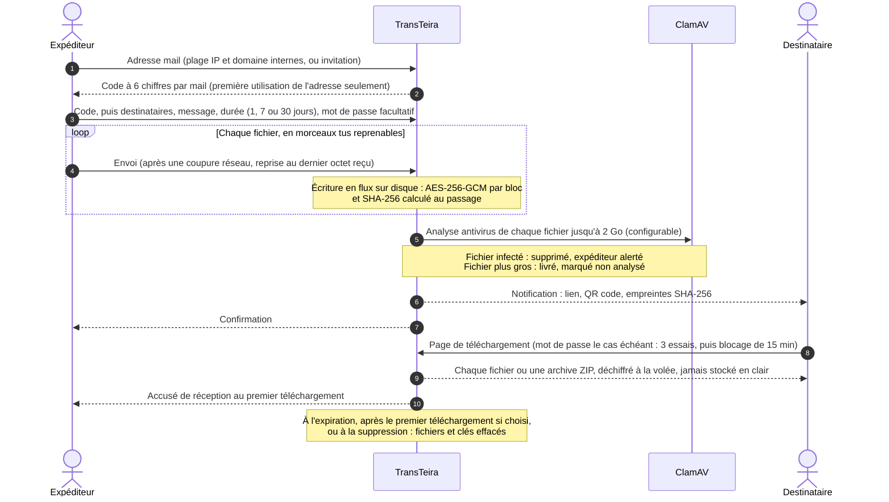
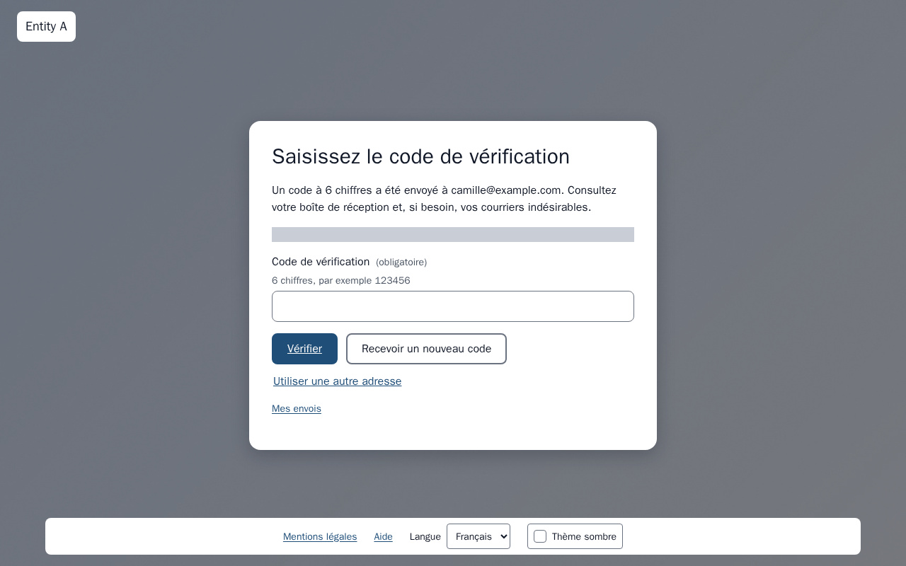
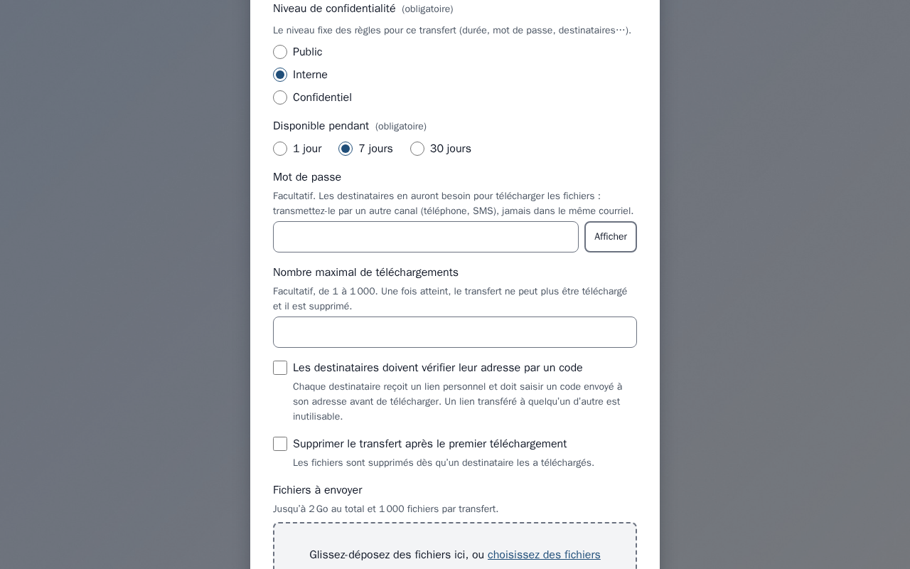
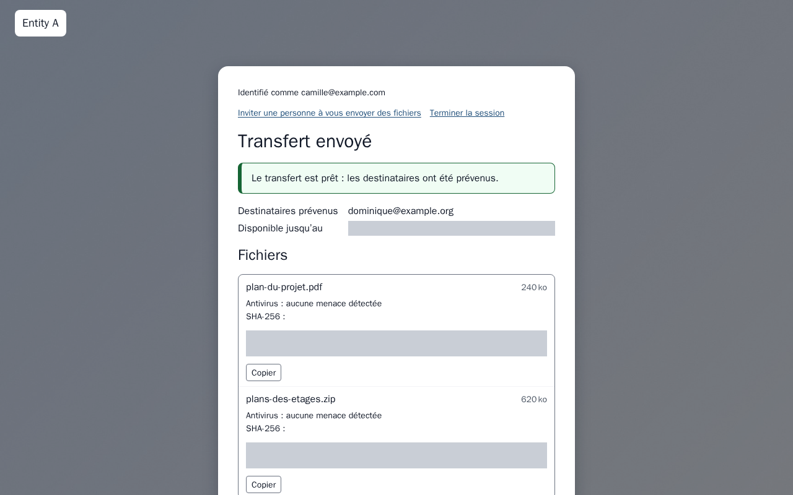
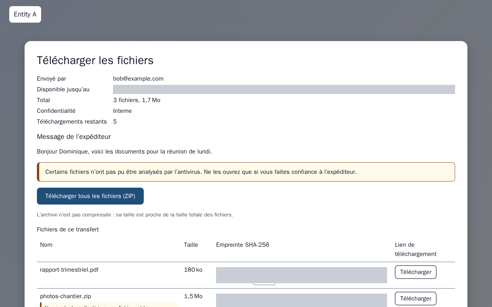
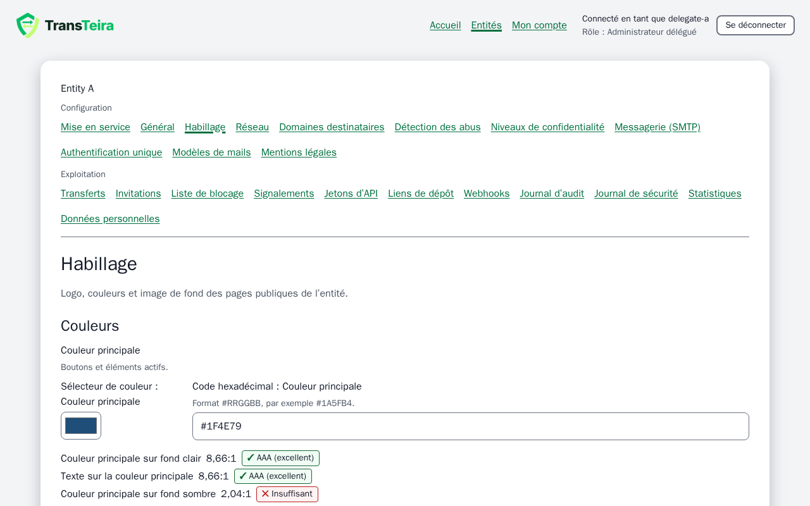
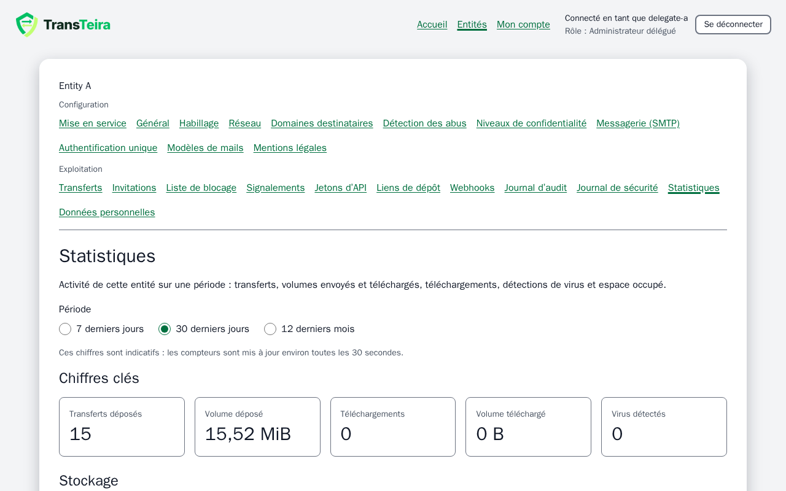
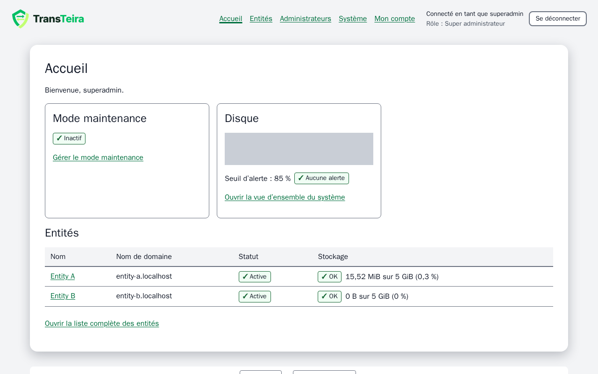

<p align="center">
  <picture>
    <source media="(prefers-color-scheme: dark)" srcset="docs/assets/transteira-horizontal-dark.png">
    
  </picture>
</p>

# TransTeira

[English](README.md) | **Français**

[](LICENSE)
[](CHANGELOG.md)

**TransTeira** est un service de transfert de fichiers volumineux, auto-hébergé et multi-tenant, dans
l'esprit de WeTransfer ou SwissTransfer, conçu pour les organisations composées de plusieurs entités.

> **Statut : stable.** La version 2.0.0 livre le périmètre V1 (le cœur), le périmètre V1.1
> (l'exploitation), le périmètre V1.2 (la mise en service) et le périmètre V2 (l'entreprise) ;
> voir [Versions](#versions).

## Points forts

- **Multi-tenant** : une instance sert plusieurs entités, chacune avec son propre nom de domaine,
  son identité visuelle, sa langue, son serveur SMTP, ses plages IP et domaines de messagerie
  internes, ses quotas et des données strictement cloisonnées.
- **Très gros fichiers** : envois reprenables avec le protocole [tus](https://tus.io), traitement
  en flux de bout en bout, jusqu'à 20 Go par transfert.
- **Sécurité par défaut** : chiffrement au repos (AES-256-GCM, envelope encryption, rotation de la
  clé maître, effacement cryptographique), analyse antivirus ClamAV, authentification des admins avec
  TOTP obligatoire pour le super admin, en-têtes de sécurité HTTP stricts, journal de sécurité prêt
  pour fail2ban et CrowdSec.
- **Simple pour les utilisateurs** : une interface web intégrée au binaire, en français et en
  anglais, avec le logo, les couleurs et l'image de fond de chaque entité ; aucun compte pour les
  déposants (vérification de l'adresse mail par code à usage unique), envois reprenables depuis le
  navigateur, invitations pour les utilisateurs externes, transferts protégés par mot de passe,
  empreintes SHA-256, téléchargement ZIP généré à la volée. Accessible (RGAA : navigation au
  clavier, libellés pour lecteurs d'écran, contrôles de contraste) et servie avec une Content
  Security Policy stricte, sans CDN ni ressource tierce.
- **API first** : API REST documentée ([OpenAPI 3.1](api/openapi.yaml)) avec une documentation
  interactive intégrée au binaire (`/api/docs`, sans CDN, réservée par défaut aux admins), et des
  jetons d'API par entité (hachés, limités aux plages IP autorisées et éventuellement aux adresses
  d'expéditeur autorisées, expiration optionnelle, révocables à tout moment) pour des dépôts
  scriptés et reprenables de gros fichiers.
- **Léger à exploiter** : un binaire Go unique dans une image Docker minimale, SQLite par défaut ou
  PostgreSQL, configuration par variables d'environnement, configurations de reverse proxy pour
  Caddy, Nginx, Traefik et Apache.
- **Administration** : super admin et admins délégués par entité, vue d'ensemble des transferts avec
  suppression anticipée et renvoi des notifications, invitations et liste de blocage, journal
  d'audit, tableau de bord statistique, alertes de quota de stockage ; pour le super admin, mode
  maintenance avec messages par langue, alerte d'espace disque et rotation de la clé maître depuis la
  console avec reconfirmation TOTP.
- **Accessible** : interface conforme à l'esprit du RGAA en français et en anglais, thèmes clair et
  sombre (qui suivent le système, modifiables, mémorisés par un cookie technique).
- **Respectueux du RGPD** : expiration et purges automatiques, recherche et effacement des données
  d'une personne (journal d'audit pseudonymisé), cookies techniques uniquement.
- **Exploitation (V1.1)** : endpoints Prometheus `/metrics` et JSON `/status` avec un tableau de bord
  Grafana et un template Zabbix ([intégrations](integrations/grafana/README.md)), export syslog des
  journaux d'audit et de sécurité, alertes par mail et par webhook (Teams, Slack ou JSON générique).
- **Maîtrise du partage (V1.1)** : liens propres à chaque destinataire avec vérification optionnelle
  du destinataire par code et suivi des téléchargements par destinataire, rappel d'expiration,
  nombre maximal de téléchargements, niveaux de confidentialité et leurs règles, domaines
  destinataires autorisés et interdits.
- **Plus de façons d'envoyer (V1.1)** : « Mes envois » pour lister, prolonger ou supprimer ses
  transferts sans compte, envoi de dossiers avec arborescence conservée, dépôt depuis l'extérieur
  pour les internes vérifiés, réponse à un transfert.
- **Détection des abus (V1.1)** : seuils par expéditeur et alertes de comportement inhabituel,
  quotas externes et limites d'invitations, bouton « Signaler un abus », liste de blocage
  d'adresses, de domaines et d'empreintes SHA-256.
- **Antivirus (V1.1)** : désactivable par instance ou par entité, moteurs interchangeables (clamd,
  ICAP, API HTTP générique) avec auto-test EICAR ([guide](docs/operations/antivirus.md)).
- **Documentation (V1.1)** : guides utilisateur personnalisés avec les règles réelles de chaque
  entité, avec une version imprimable.
- **Mise en service d'une entité (V1.2)** : une nouvelle entité démarre dans un état de
  configuration, avec une liste de contrôle calculée à partir de sa configuration réelle (SMTP
  testé, plages IP et domaines, textes légaux) et des mentions légales et une politique de
  confidentialité proposées ; elle n'est ouverte au public qu'une fois la configuration terminée.
- **Invitation de l'admin délégué (V1.2)** : le lien d'activation d'un nouvel admin délégué est
  envoyé par mail via le SMTP système, et une entité peut être créée avec son premier admin.
- **Habillage (V1.2)** : une bibliothèque de huit images de fond au choix pour chaque entité (ou à la
  création), et un favicon généré à partir du logo de chaque entité.
- **API de provisionnement (V1.2)** : des jetons de provisionnement permettent à un prestataire de
  services managés de créer des entités dans l'état de configuration, avec des certificats TLS
  automatiques grâce au on-demand TLS de Caddy ([guide](docs/api/provisioning.md)).
- **Mises à jour (V1.2)** : la version en cours d'exécution s'affiche dans l'administration, et le
  super admin est prévenu lorsqu'une version plus récente existe (vérification quotidienne, jamais de
  mise à jour automatique ; `TT_UPDATE_CHECK=false` coupe toute connexion sortante).
- **Authentification unique (V2)** : OpenID Connect par entité pour les admins délégués et les
  auditeurs (Microsoft Entra ID, Keycloak), comptes créés au préalable par le super admin, connexion
  par mot de passe refusable par entité ; le super admin garde toujours son compte local avec TOTP
  ([guide](docs/operations/fr/sso.md)).
- **Rôle auditeur (V2)** : accès en lecture seule au journal d'audit, aux événements de sécurité,
  aux statistiques et aux transferts d'une ou plusieurs entités, pour un RSSI ou un audit ISO 27001.
- **Preuves (V2)** : preuves de dépôt et de remise en PDF signées par l'instance (Ed25519),
  vérifiables hors ligne ([guide](docs/operations/fr/proofs.md)).
- **Autres façons de partager (V2)** : liens de dépôt permanents pour collecter des fichiers auprès
  de tiers, transferts par lien seul sans mail, export et import de la configuration d'une entité.
- **Chiffrement de bout en bout en option (V2)** : fichiers chiffrés dans le navigateur de
  l'expéditeur, la clé n'atteint jamais le serveur (l'analyse antivirus est alors impossible, et la
  page de téléchargement l'indique) ; autorisé, imposé ou interdit par entité et par niveau de
  confidentialité.
- **Client en ligne de commande (V2)** : `transteira-cli` pour déposer et télécharger depuis des
  scripts, avec reprise automatique ([guide](docs/api/cli.md)).
- **Publications signées (V2)** : image multi-architecture signée avec cosign et publiée avec son
  SBOM ; kit de conformité avec une fiche de registre des traitements RGPD et une correspondance
  avec l'annexe A de l'ISO 27001 ([docs/compliance](docs/compliance/fr/README.md)).

## Comment ça marche

### Architecture

Un seul conteneur TransTeira sert toutes les entités : il lit l'en-tête `Host` pour identifier
l'entité (`transfer.entity-a.example.com`, `transfer.entity-b.example.com`...) et applique son
habillage, sa langue, son serveur SMTP, ses plages IP, ses domaines de messagerie et ses quotas. Les
noms d'hôte inconnus sont rejetés.



Le reverse proxy est mutualisé avec d'autres services et transmet l'IP réelle du client, à laquelle
on ne fait confiance que depuis les proxys déclarés dans `TT_TRUSTED_PROXIES`. Chaque fichier est
chiffré avec sa propre clé, elle-même chiffrée par la clé maître (envelope encryption) : la rotation
de la clé maître ne réécrit jamais les fichiers, et la suppression d'un transfert détruit ses clés
(effacement cryptographique). Les copies présentes dans les sauvegardes existantes deviennent
illisibles une fois la clé maître remplacée et l'ancienne clé détruite à l'issue de la durée de
rétention des sauvegardes ([détails](docs/operations/master-key.md#crypto-erase)).

### Vie d'un transfert



## Captures d'écran

| | |
|---|---|
|  |  |
| **Vérification de l'adresse mail** par code à usage unique, sans compte | **Nouveau transfert** : destinataires, message, durée, mot de passe |
|  |  |
| **Transfert envoyé**, avec statut antivirus et empreintes | **Page de téléchargement** : chaque fichier ou une archive ZIP |
|  |  |
| **Habillage par entité**, avec contrôles de contraste | **Statistiques** et quota de stockage |

Les captures d'écran sont générées par les tests de bout en bout (`make screenshots`), en anglais et
en français (les [guides utilisateur](docs/user/README.md) les présentent toutes), afin qu'elles
correspondent toujours à l'interface.

## Installation (Docker + reverse proxy)

TransTeira s'exécute sur une VM avec Docker Engine 25+ et Compose 2.24+, derrière un reverse proxy
qui a son propre projet compose (Caddy est la référence ; des configurations Nginx, Traefik et
Apache sont fournies). Prévoir au moins 8 Gio de RAM (ClamAV est limité à 4 Gio, y compris son
espace d'analyse en mémoire), pas de swap ou un swap chiffré, et de l'espace disque pour les quotas
des entités. La version courte, en root sur l'hôte Docker :

```sh
git clone https://github.com/ed-fr/transteira.git /opt/transteira && cd /opt/transteira

# 1. Réseau partagé avec le reverse proxy (sous-réseau fixe), puis démarrage du proxy :
#    voir integrations/reverse-proxy/ (Caddy : integrations/reverse-proxy/caddy/)
docker network create --subnet 172.30.0.0/24 proxy

# 2. Image, construite depuis le dépôt
make docker

# 3. Clé maître (à copier ensuite dans un coffre de mots de passe hors de la VM : obligatoire)
sh deploy/init-secrets.sh

# 4. Configuration : renseigner au minimum TT_ADMIN_HOSTS et TT_TRUSTED_PROXIES
cp deploy/.env.example deploy/.env

# 5. Démarrer TransTeira et ClamAV, puis lire le jeton d'initialisation du premier super admin
docker compose -f deploy/docker-compose.yml up -d
docker compose -f deploy/docker-compose.yml logs transteira | grep "Setup token"
```

Ouvrez ensuite `https://<admin host>/admin/setup`, créez le super admin (TOTP obligatoire) puis les
entités. Le guide pas à pas, avec le DNS, la variante PostgreSQL, la supervision et les sauvegardes,
est [docs/install/fr/docker.md](docs/install/fr/docker.md).
À la place de la construction (étape 2), vous pouvez utiliser l'image multi-architecture
signée publiée avec chaque version, épinglée par condensé et vérifiée avec `cosign` et la clé
`cosign.pub` de ce dépôt (voir la section 5 du même guide).

**Signatures des versions.** Les images et les binaires du client sont signés avec la clé `cosign.pub` de ce dépôt.

cosign.pub SHA-256 fingerprint: 30f33ae8d62c33e510c39079e77f0c68b3068a052da870847414367988a83e77

## Configuration

Les paramètres d'installation sont des variables d'environnement, dans `deploy/.env` pour un
déploiement Docker ; les paramètres de chaque entité (habillage, SMTP, plages IP, domaines,
quotas…) se gèrent dans l'administration. Les variables essentielles :

| Variable | Rôle |
|---|---|
| `TT_ADMIN_HOSTS` | Nom(s) d'hôte dédié(s) de l'administration, jamais le FQDN d'une entité (obligatoire). |
| `TT_TRUSTED_PROXIES` | Adresse exacte du reverse proxy : `X-Forwarded-For` / `X-Real-IP` ne sont pris en compte que depuis celle-ci. |
| `TT_MASTER_KEY_FILE` | Chemin du fichier de clé maître (un secret Docker, hors de tout volume) ; défini par le fichier compose. |
| `TT_DB_DRIVER` | `sqlite` (par défaut) ou `postgres` ; la surcharge PostgreSQL le définit avec ses fichiers de DSN. |
| `TT_SYSTEM_SMTP_HOST`, `TT_SYSTEM_SMTP_FROM`… | Serveur SMTP système pour l'alerte d'espace disque envoyée aux super admins. |
| `TT_SETUP_TOKEN` | Jeton d'initialisation facultatif du premier super admin (sinon affiché dans les journaux). |
| `TT_MAINTENANCE` | Démarrer en mode maintenance (nouveaux dépôts refusés). |
| `TT_CLAMAV_MAX_SCAN_BYTES`, `TT_SCAN_WORKERS` | Limites de l'antivirus, alignées sur `deploy/clamav/clamd.conf`. |
| `TT_BACKUP_TIME`, `TT_BACKUP_KEEP` | Copie nocturne de la base (UTC) et nombre de copies conservées. |

Chaque variable, avec sa valeur par défaut et ses limites, est documentée dans
[`.env.example`](.env.example) ; [`deploy/.env.example`](deploy/.env.example) liste celles qui comptent
pour Docker.

## Documentation

- [Guides utilisateur](docs/user/README.md), en anglais et en français, un par profil : déposant,
  destinataire, administrateur délégué, auditeur et super administrateur. Les mêmes guides sont intégrés à
  l'application comme aide intégrée (`/help` sur chaque hôte d'entité, `/admin/help` sur l'hôte
  d'administration), avec un lien d'aide dans le pied de page et des icônes d'aide contextuelle sur
  les écrans complexes.

  

- [Spécification de l'API](api/openapi.yaml), consultable sur `https://<admin host>/api/docs` sur une
  instance en fonctionnement
- [Guide d'intégration de l'API](docs/api/integration.md) : jetons d'API et envois scriptés et
  reprenables avec tus (exemples bash/curl et PowerShell) ; [codes d'erreur](docs/api/errors.md)
- [Guide du client en ligne de commande](docs/api/cli.md) : `transteira-cli` dépose, télécharge (y compris
  les transferts chiffrés de bout en bout) et vérifie des preuves depuis un terminal ou un script
- [Guide de l'API de provisionnement](docs/api/provisioning.md) : jetons de provisionnement, création
  d'entités pour les prestataires de services managés, TLS à la demande
- [Structure du projet](docs/architecture/project-structure.md)
- [Interface web](web/README.md) : build, boucle de développement, politique de dépendances, règles CSP
- [Modèle de menaces (STRIDE)](docs/security/threat-model.md)
- [Kit de conformité](docs/compliance/fr/README.md) : fiche de registre des traitements RGPD et
  correspondance avec l'annexe A de l'ISO/IEC 27001:2022
- [Publication](docs/operations/release.md) (mainteneurs, en anglais) : étiquette signée,
  `make release`, signatures et SBOM

Installation :

- [Installation Docker](docs/install/fr/docker.md) : guide pas à pas, premier lancement, vérifications
  ([in English](docs/install/docker.md))
- [Reverse proxy](docs/install/reverse-proxy.md) : choix d'un proxy, exigences communes,
  `TT_TRUSTED_PROXIES` ; configurations dans [integrations/reverse-proxy/](integrations/reverse-proxy/README.md)
- [SMTP](docs/install/fr/smtp.md) : serveurs par entité, relais interne, Microsoft 365 via Graph,
  SPF/DKIM/DMARC, SMTP système ([in English](docs/install/smtp.md))
- [Rôles PostgreSQL](docs/install/postgresql.md)

Exploitation :

- [Clé maître](docs/operations/master-key.md) : générer la clé et en conserver une copie dans un
  coffre de mots de passe **avant le premier démarrage** ; sans elle, les fichiers chiffrés ne
  peuvent pas être récupérés.
- [Mise à jour](docs/operations/upgrade.md) : mode maintenance, copie de la base, retour arrière
- [Sauvegarde et restauration](docs/operations/backup.md)
- [Antivirus](docs/operations/antivirus.md) (limites de ClamAV, mises à jour des signatures)
- [Essai avec de gros fichiers](docs/operations/bigfile-trial.md) : test de recette avec de très gros
  fichiers derrière le reverse proxy, dans un vrai navigateur
- [Supervision](docs/operations/supervision.md) (`/healthz`, `/metrics`, `/status`, tableau de bord Grafana et template Zabbix dans [integrations/](integrations/grafana/README.md))
- [Journal de sécurité](docs/operations/security-log.md) (fail2ban, CrowdSec) et [export syslog](docs/operations/syslog.md) (journaux d'audit et de sécurité vers un SIEM)
- [Authentification unique](docs/operations/fr/sso.md) (OpenID Connect pour les admins délégués et auditeurs : Microsoft Entra ID, Keycloak)
- [Preuves de dépôt et de remise](docs/operations/fr/proofs.md) (preuves PDF signées, vérification hors ligne, retrait de la clé de signature)
- [Administration](docs/operations/admin.md) (comptes, opérations sur les entités, jetons d'API,
  journal d'audit, RGPD, statistiques, mode maintenance, alerte disque, SMTP système) et [Entités](docs/operations/tenants.md) (configuration, alertes de quota)

## Développement

Prérequis : Go 1.27+, GNU make, **Node.js 24 et npm 11** (pour construire l'interface web, intégrée
au binaire, et pour le linter OpenAPI), Docker. Sous Windows, lancer `make` depuis Git Bash.

```sh
make hooks         # installe l'analyse des secrets avant push (gitleaks)
make check         # tous les contrôles qualité : vérifications et build web, format, vet, lint, govulncheck,
                   # lint OpenAPI, tests, couverture, tests de bout en bout, puis le test de 5 Go si
                   # la chaîne des gros fichiers a changé ; affiche la durée de chaque contrôle
make check-full    # make check avec le test forcé à 20 Go et le détecteur de courses de Go (avant chaque version)
make bigfile       # envoi et téléchargement de 5 Go à travers Caddy, coupés puis repris (les deux moteurs)
make build         # construit l'interface web, puis le binaire qui l'embarque (bin/)
make web-install   # installe les dépendances web depuis le lockfile (npm ci --ignore-scripts)
make web-check     # contrôles web : types générés, svelte-check, eslint, prettier, vitest, npm audit
make web-build     # construit l'interface web dans web/dist (vérifiée par rapport à la CSP)
make web-gen       # régénère les types d'API web après une modification de api/openapi.yaml
make help          # toutes les cibles
```

`make check` inclut `npm audit`, qui a besoin du registre npm ; hors ligne, `make check NPM_AUDIT=0`
ignore explicitement cette seule étape.

Le dernier contrôle de `make check` est le test automatisé de gros fichier (`make bigfile`,
CLAUDE.md sections 24.2 et 24.4) : un fichier de 5 Gio (20 Gio dans `make check-full`) généré à la
volée est envoyé avec tus à travers le vrai Caddy vers la pile de production, la connexion est
coupée puis reprise pendant l'envoi et pendant le téléchargement, et chaque SHA-256 ainsi que la
mémoire du serveur sont vérifiés, sur SQLite puis PostgreSQL. Il demande Docker Desktop avec **60 à
80 Go de disque** et au moins 7 Gio de mémoire, et dure **environ 30 minutes**. `make check` ne
l'exécute que si la chaîne des gros fichiers (envoi, téléchargement, chiffrement, stockage, ZIP,
analyse, serveur HTTP, image, déploiement, Caddy de référence, le test lui-même) a changé depuis son
dernier passage au vert ; `make check-full` l'exécute toujours et il est obligatoire avant chaque
version ; `make check BIGFILE=0` l'ignore ; `make bigfile BIGFILE_BYTES=1073741824
BIGFILE_DBS=sqlite` est une exécution rapide à 1 Gio. Voir
[test/README.md](test/README.md#big-file-test-testbigfile-make-bigfile). Avant chaque version, un
opérateur réalise aussi l'[essai humain avec de gros fichiers](docs/operations/bigfile-trial.md)
dans un vrai navigateur, derrière le reverse proxy de production.

L'interface web (Svelte 5 et Vite, deux applications statiques : pages publiques sur chaque hôte
d'entité, administration sur l'hôte d'administration) est décrite dans [web/README.md](web/README.md),
y compris la boucle de développement locale avec Caddy et le serveur de développement Vite. Un
binaire construit sans l'interface web (simple `go build`) fonctionne quand même et répond à ses
pages par une page « service indisponible ».

Il n'y a pas de CI : `make check` doit être au vert avant chaque commit.

## Versions

TransTeira suit le [Semantic Versioning](https://semver.org/) : aucun changement incompatible de
l'API (`/api/v1`), de la configuration ou des données sans nouvelle version majeure. La version en
cours est renvoyée par `/api/v1/version` et `/healthz` et affichée par `transteira version` ; le
[journal des modifications](CHANGELOG.md) résume chaque version.

| Périmètre | Contenu |
|---|---|
| V1, le cœur (1.0) | Fonctionnalités de base de transfert, de sécurité, d'administration et d'API. |
| V1.1, l'exploitation (1.1) | Supervision, détection des abus, maîtrise du partage, « Mes envois », mode sombre, moteurs antivirus. |
| V1.2, la mise en service (1.2) | Mise en service des entités, invitation des admins délégués, bibliothèque d'images, API de provisionnement, vérification des mises à jour. |
| **V2, l'entreprise** (2.0, actuelle) | SSO OpenID Connect (Entra ID), rôle auditeur, preuve de dépôt et de remise, export et import de configuration d'entité, liens de dépôt permanents, image signée avec SBOM, client en ligne de commande, option lien seul sans mail, chiffrement de bout en bout en option, kit de conformité. |

La version 2.0 marque le périmètre entreprise. Elle reste compatible avec la 1.x : l'API est
toujours `/api/v1`, avec des ajouts seulement, la configuration et les données sont migrées
automatiquement, et la mise à jour depuis la 1.2 ne demande aucun changement
([guide de mise à jour](docs/operations/upgrade.md)). Prochain périmètre prévu : V2.1, partage de
secrets à usage unique. Une version est le commit étiqueté `vX.Y.Z` ; `make build` et `make docker` prennent
la version depuis cette étiquette.

## Sécurité

Merci de signaler les vulnérabilités de façon privée, voir [SECURITY.md](SECURITY.md).

## Licence

TransTeira est un logiciel libre publié sous la
[GNU Affero General Public License v3.0](LICENSE).
