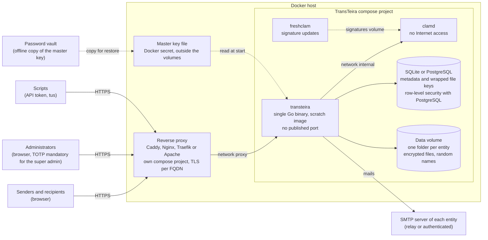
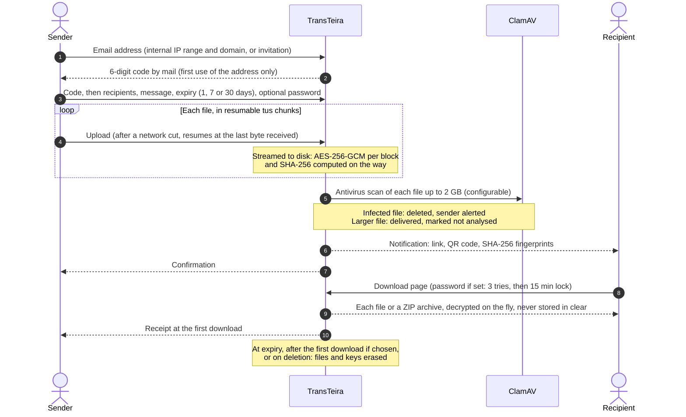

# TransTeira

[](LICENSE)
[](CHANGELOG.md)

**TransTeira** is a self-hosted, multi-tenant large file transfer service, in the spirit of
WeTransfer or SwissTransfer, designed for organisations made of several entities.

> **Status: stable.** Version 1.0.0 delivers the V1 scope (the core); see [Versions](#versions)
> for what comes next.

## Highlights (version 1.0)

- **Multi-tenant**: one instance serves several entities, each with its own domain name,
  branding, language, SMTP server, internal IP ranges and email domains, quotas and strictly
  isolated data.
- **Very large files**: resumable uploads with the [tus](https://tus.io) protocol, end-to-end
  streaming, up to 20 GB per transfer.
- **Security by default**: encryption at rest (AES-256-GCM, envelope encryption, master key
  rotation, crypto-erase), ClamAV antivirus scanning, admin authentication with mandatory TOTP
  for the super admin, strict HTTP security headers, security log ready for fail2ban and CrowdSec.
- **Simple for users**: a web interface embedded in the binary, in French and English, with each
  entity's logo, colours and background image; no account for depositors (email verification by
  one-time code), resumable uploads from the browser, invitations for external users,
  password-protected transfers, SHA-256 fingerprints, ZIP download generated on the fly.
  Accessible (RGAA: keyboard navigation, screen reader labels, contrast checks) and served with a
  strict Content Security Policy, without any CDN or third-party resource.
- **API first**: documented REST API ([OpenAPI 3.1](api/openapi.yaml)) with an interactive
  documentation embedded in the binary (`/api/docs`, no CDN, admins only by default), and
  per-entity API tokens (hashed, restricted to allowed IP ranges and optionally to allowed
  sender addresses, optional expiry, revocable at any time) for scripted, resumable deposits
  of large files.
- **Light to operate**: a single Go binary in a minimal Docker image, SQLite by default or
  PostgreSQL, configuration by environment variables, reverse proxy configurations for Caddy,
  Nginx, Traefik and Apache.
- **Administration**: super admin and delegated admins per entity, transfer overview with early
  deletion and notification resend, invitations and blocklist, audit log, statistics dashboard,
  storage quota alerts; for the super admin, maintenance mode with per-language messages, disk
  space alert and master key rotation from the console with TOTP re-confirmation.
- **Accessible**: RGAA-minded interface in French and English, light and dark themes (following the
  system, switchable, remembered by a technical cookie).
- **GDPR minded**: automatic expiry and purges, data subject search and erasure (audit log
  pseudonymised), technical cookies only.

## How it works

### Architecture

One TransTeira container serves every entity: it reads the `Host` header to find the entity
(`transfer.entity-a.example.com`, `transfer.entity-b.example.com`...) and applies its branding,
language, SMTP server, IP ranges, email domains and quotas. Unknown host names are rejected.



The reverse proxy is shared with other services and forwards the real client IP, trusted only
from the proxies declared in `TT_TRUSTED_PROXIES`. Each file is encrypted with its own key, itself
encrypted by the master key (envelope encryption): rotating the master key never rewrites the
files, and deleting a transfer destroys its keys (crypto-erase). Copies in existing backups
become unreadable once the master key has been rotated and the old key destroyed after the backup
retention period ([details](docs/operations/master-key.md#crypto-erase)).

### Life of a transfer



## Screenshots

| | |
|---|---|
|  |  |
| **Email verification** by one-time code, no account | **New transfer**: recipients, message, expiry, password |
|  |  |
| **Transfer sent**, with antivirus status and fingerprints | **Download page**: each file or a ZIP archive |
|  |  |
| **Branding per entity**, with contrast checks | **Statistics** and storage quota |

The screenshots are generated by the end-to-end tests (`make screenshots`), in English and in
French (the [user guides](docs/user/README.md) show all of them), so that they always match the
interface.

## Installation (Docker + reverse proxy)

TransTeira runs on a VM with Docker Engine 25+ and Compose 2.24+, behind a reverse proxy that
has its own compose project (Caddy is the reference; Nginx, Traefik and Apache configurations are
provided). Plan at least 8 GiB of RAM (ClamAV is limited to 4 GiB, its in-memory scan spool
included), no swap or an encrypted one, and disk space for the tenant quotas. The short version, as root on the Docker host:

```sh
git clone https://github.com/ed-fr/transteira.git /opt/transteira && cd /opt/transteira

# 1. Network shared with the reverse proxy (fixed subnet), then start the proxy:
#    see integrations/reverse-proxy/ (Caddy: integrations/reverse-proxy/caddy/)
docker network create --subnet 172.30.0.0/24 proxy

# 2. Image, built from the repository
make docker

# 3. Master key (then copy it into a password vault outside the VM: mandatory)
sh deploy/init-secrets.sh

# 4. Configuration: set at least TT_ADMIN_HOSTS and TT_TRUSTED_PROXIES
cp deploy/.env.example deploy/.env

# 5. Start TransTeira and ClamAV, then read the setup token of the first super admin
docker compose -f deploy/docker-compose.yml up -d
docker compose -f deploy/docker-compose.yml logs transteira | grep "Setup token"
```

Then open `https://<admin host>/admin/setup`, create the super admin (TOTP is mandatory) and the
entities. The step-by-step guide, with DNS, the PostgreSQL variant, monitoring and backups, is
[docs/install/docker.md](docs/install/docker.md).

## Configuration

Installation settings are environment variables, in `deploy/.env` for a Docker deployment; the
settings of each entity (branding, SMTP, IP ranges, domains, quotas…) are managed in the
administration. The essential variables:

| Variable | Purpose |
|---|---|
| `TT_ADMIN_HOSTS` | Dedicated host name(s) of the administration, never an entity FQDN (required). |
| `TT_TRUSTED_PROXIES` | Exact address of the reverse proxy: `X-Forwarded-For` / `X-Real-IP` are honoured only from it. |
| `TT_MASTER_KEY_FILE` | Path of the master key file (a Docker secret, outside every volume); set by the compose file. |
| `TT_DB_DRIVER` | `sqlite` (default) or `postgres`; the PostgreSQL overlay sets it with its DSN files. |
| `TT_SYSTEM_SMTP_HOST`, `TT_SYSTEM_SMTP_FROM`… | System SMTP server for the disk space alert to the super admins. |
| `TT_SETUP_TOKEN` | Optional setup token of the first super admin (otherwise printed in the logs). |
| `TT_MAINTENANCE` | Start in maintenance mode (new deposits refused). |
| `TT_CLAMAV_MAX_SCAN_BYTES`, `TT_SCAN_WORKERS` | Antivirus limits, aligned with `deploy/clamav/clamd.conf`. |
| `TT_BACKUP_TIME`, `TT_BACKUP_KEEP` | Nightly database copy (UTC) and number of copies kept. |

Every variable, with its default and its limits, is documented in [`.env.example`](.env.example);
[`deploy/.env.example`](deploy/.env.example) lists the ones that matter for Docker.

## Documentation

- [User guides](docs/user/README.md), in English and in French, one per profile: sender,
  recipient, delegated administrator and super administrator. The same guides are built into the
  application as its integrated help (`/help` on every entity host, `/admin/help` on the admin
  host), with a help link in the footer and contextual help icons on the complex screens.

  

- [API specification](api/openapi.yaml), browsable at `https://<admin host>/api/docs` on a
  running instance
- [API integration guide](docs/api/integration.md): API tokens and scripted, resumable uploads
  with tus (bash/curl and PowerShell examples); [error codes](docs/api/errors.md)
- [Project structure](docs/architecture/project-structure.md)
- [Web interface](web/README.md): build, development loop, dependency policy, CSP rules
- [Threat model (STRIDE, in French)](docs/security/threat-model.md)

Installation:

- [Docker installation](docs/install/docker.md): step-by-step guide, first run, checks
  ([en français](docs/install/fr/docker.md))
- [Reverse proxy](docs/install/reverse-proxy.md): choosing a proxy, common requirements,
  `TT_TRUSTED_PROXIES`; configurations in [integrations/reverse-proxy/](integrations/reverse-proxy/README.md)
- [SMTP](docs/install/smtp.md): per-entity servers, internal relay, Microsoft 365 through Graph,
  SPF/DKIM/DMARC, system SMTP ([en français](docs/install/fr/smtp.md))
- [PostgreSQL roles](docs/install/postgresql.md)

Operation:

- [Master key](docs/operations/master-key.md): generate the key and store a copy in a password
  vault **before the first start**; without it, encrypted files cannot be recovered.
- [Upgrade](docs/operations/upgrade.md): maintenance mode, database copy, rollback
- [Backup and restore](docs/operations/backup.md)
- [Antivirus](docs/operations/antivirus.md) (ClamAV limits, signature updates)
- [Big file trial](docs/operations/bigfile-trial.md): acceptance test with very big files
  behind the reverse proxy, in a real browser
- [Supervision](docs/operations/supervision.md) (`/healthz`, `/metrics`, `/status`, Grafana dashboard and Zabbix template in [integrations/](integrations/grafana/README.md))
- [Security log](docs/operations/security-log.md) (fail2ban, CrowdSec) and [Syslog export](docs/operations/syslog.md) (audit and security logs to a SIEM)
- [Administration](docs/operations/admin.md) (accounts, tenant operations, API tokens, audit
  log, GDPR, statistics, maintenance mode, disk alert, system SMTP) and [Tenants](docs/operations/tenants.md) (configuration, quota alerts)

## Development

Requirements: Go 1.27+, GNU make, **Node.js 24 and npm 11** (to build the web interface, which
is embedded in the binary, and for the OpenAPI linter), Docker. On Windows, run `make` from Git
Bash.

```sh
make hooks         # install the pre-push secret scan (gitleaks)
make check         # every quality gate: web checks and build, format, vet, lint, govulncheck,
                   # OpenAPI lint, tests, coverage, end-to-end tests, then the 5 GB test when
                   # the big-file chain changed; prints the duration of every gate
make check-full    # make check with the test forced at 20 GB (before every release)
make bigfile       # 5 GB upload and download through Caddy, cut and resumed (both engines)
make build         # build the web interface, then the binary that embeds it (bin/)
make web-install   # install the web dependencies from the lockfile (npm ci --ignore-scripts)
make web-check     # web gates: generated types, svelte-check, eslint, prettier, vitest, npm audit
make web-build     # build the web interface into web/dist (checked against the CSP)
make web-gen       # regenerate the web API types after a change of api/openapi.yaml
make help          # all targets
```

`make check` includes `npm audit`, which needs the npm registry; offline, `make check NPM_AUDIT=0`
skips that single step explicitly.

The last gate of `make check` is the automated big-file test (`make bigfile`, CLAUDE.md sections
24.2 and 24.4): a 5 GiB file (20 GiB in `make check-full`) generated on the fly is uploaded with tus through the real Caddy to the
production stack, the connection is cut and resumed during the upload and the download, and every
SHA-256 and the memory of the server are checked, on SQLite then PostgreSQL. It needs Docker
Desktop with **60 to 80 GB of disk** and at least 7 GiB of memory, and takes **about 30 minutes**.
`make check` runs it only when the big-file chain (upload, download, encryption, storage, ZIP,
scan, HTTP server, image, deployment, reference Caddy, the test itself) changed since its last
green run; `make check-full` always runs it and is required before every release;
`make check BIGFILE=0` skips it; `make bigfile BIGFILE_BYTES=1073741824
BIGFILE_DBS=sqlite` is a quick 1 GiB run. See [test/README.md](test/README.md#big-file-test-testbigfile-make-bigfile).
Before the V1 is declared done, an operator also runs the human
[big file trial](docs/operations/bigfile-trial.md) in a real browser behind the production
reverse proxy.

The web interface (Svelte 5 and Vite, two static applications: public pages on every entity host,
administration on the admin host) is described in [web/README.md](web/README.md), including the
local development loop with Caddy and the Vite dev server. A binary built without the web
interface (plain `go build`) still runs and answers its pages with a "service unavailable" page.

There is no CI: `make check` must be green before every commit.

## Versions

TransTeira follows [Semantic Versioning](https://semver.org/): no incompatible change to the API
(`/api/v1`), the configuration or the data without a new major version. The running version is
returned by `/api/v1/version` and `/healthz` and printed by `transteira version`; the
[changelog](CHANGELOG.md) summarises each release.

| Scope | Content |
|---|---|
| **V1, the core** (1.0, current) | Everything listed above. |
| V1.1, operations (planned) | Abuse detection, Prometheus metrics and JSON status, Grafana and Zabbix, syslog, webhooks, expiry reminder, maximum number of downloads, "My transfers", recipient verification and tracking, folder upload, deposit from outside for verified internal users, reply to a transfer, confidentiality levels, recipient restrictions, dark mode, per-entity documentation and its PDF export. |
| V2, enterprise (planned) | OpenID Connect SSO (Entra ID), auditor role, proof of deposit and delivery, entity configuration export and import, permanent deposit links, signed image with SBOM, command line client, link-only option without email, optional end-to-end encryption, compliance kit. |

The API reserves the paths and fields of these later scopes, so they are planned as minor
versions (1.x): a new major version is released only for an incompatible change. A release is
the commit tagged `vX.Y.Z`; `make build` and `make docker` take the version from that tag.

## Security

Please report vulnerabilities privately, see [SECURITY.md](SECURITY.md).

## License

TransTeira is free software released under the
[GNU Affero General Public License v3.0](LICENSE).
