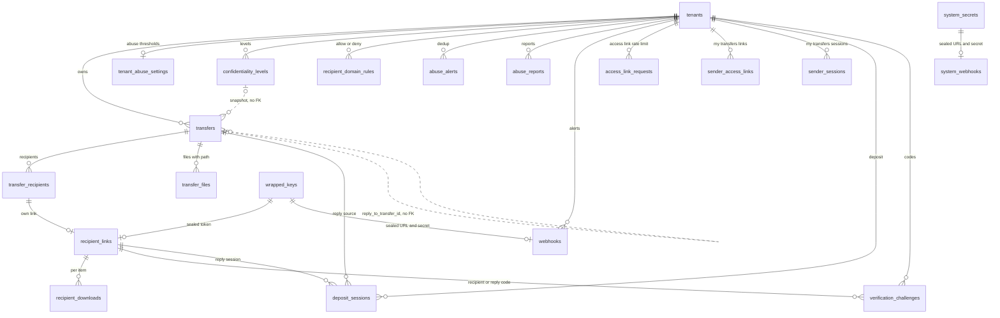

# TransTeira V1.1: data model

> V1.1, step 1, deliverable 2. Status: **proposal, to be validated before any code**.
> Sources: CLAUDE.md (items tagged [V1.1]), the V1.1 design brief, migrations
> `internal/store/migrations/{sqlite,postgres}/0001..0013`, package `internal/store`.
> No migration file is written until this document is approved.

## 1. Principles

All V1 conventions still apply. New rules are marked **new**.

| Topic | Rule |
|---|---|
| Tenant scoping | Every tenant row carries `tenant_id TEXT NOT NULL REFERENCES tenants (id) ON DELETE CASCADE`. It also gets an index that starts with `tenant_id`. References between tenant tables use composite `(tenant_id, x)` foreign keys wherever the engine allows it. Statements are declared with `tenantQuery` (one table, one `tenant_id = ?` slot), `reviewedTenantQuery` (join, after a security review) or `systemQuery` (cross-tenant, with a logged reason). The `Scoped`/`System` executors bind the tenant. |
| PostgreSQL RLS | Each new tenant table gets `ENABLE` + `FORCE ROW LEVEL SECURITY` and the standard policy (template in §3.2). The only system table in V1.1, `system_webhooks`, is open to the system scope only. `DB.Verify` already refuses to start when a tenant table lacks RLS or a policy, so the new tables are covered by the existing check. |
| Types | SQLite tables are `STRICT`. Timestamps are Unix **milliseconds** UTC (`INTEGER` / `BIGINT`). Booleans are `INTEGER 0/1` (SQLite) and `BOOLEAN` (PostgreSQL). Identifiers are `TEXT` (PostgreSQL adds `COLLATE "C"`). Hashes are `BLOB` / `BYTEA` of 32 bytes. JSON is stored as `TEXT` and validated by the store, as in V1 (`allowed_cidrs`, `maintenance_message`). |
| Secrets | Bearer tokens are stored as SHA-256 only. A token that must be shown again or re-mailed also gets a **sealed copy**: a `wrapped_keys` row of purpose `'secret'`, referenced with `ON DELETE SET NULL`, and the store checks that the key belongs to the same tenant. Codes are stored as HMAC (`code_mac`). Webhook URLs and HMAC secrets are sealed in the same way. |
| Crypto-erase | The key is destroyed first, then the row is deleted. Any table referencing `wrapped_keys` follows the `transfer_files` / `download_token_key_id` rule: the store refuses to delete the row while its key exists. `Tenants.Delete` keeps refusing while any wrapped key of the tenant remains (`ErrKeysRemain`). |
| No per-chunk writes | No new table is written per tus chunk or per byte range. Download tracking writes once per **download start**, as V1 `download_count` does. Abuse counters are **computed from `transfers`**. There is no counter table. |
| Retention (spec 20) | Every new table has a purge rule, run by the single lifecycle task (§6). Personal data is never kept longer than the V1 equivalent: 12 months for logs and reports, the transfer row's lifetime for per-transfer data. |
| CHECK changes | PostgreSQL: `DROP CONSTRAINT` / `ADD CONSTRAINT`. SQLite: a table rebuild, as in 0005. **New:** some of the rebuilt tables are *referenced* by other tables. For those, the rebuild must not fire `ON DELETE` actions (§2.1). |
| Parity | Each migration exists for both engines with the same tables, columns and constraints. The migration tests run on both engines and pin the resulting schema. |
| Stateless proofs | The recipient verification cookie `__Host-tt_rv` is MAC-signed like `__Host-tt_dl`, and each entry binds link id, tenant id and expiry (D10). It has **no table**. |
| Names | Problem codes are kebab-case, for example `max-downloads-reached` (D18). Enum values stored in the database are identical to the OpenAPI values. |

## 2. Migration plan

| # | Name | Content |
|---|---|---|
| 0014 | `transfer_options` | Rebuilds `transfers` (SQLite) and adds new transfer columns: wider `sender_kind` with the invitation and reply constraints, link mode, max downloads, recipient verification, confidentiality snapshot, reply source, reminder and extension marks. Rebuilds `transfer_files` (adds `path` and the `not_scanned_disabled` scan status). Adds three tenant flags, including `antivirus_enabled`. |
| 0015 | `recipient_links` | `recipient_links`, `recipient_downloads`, `verification_challenges.purpose` and `recipient_link_id`. Rebuilds `deposit_sessions` (new kinds and reply columns). |
| 0016 | `confidentiality` | `confidentiality_levels` (with seed data) and `recipient_domain_rules`. |
| 0017 | `abuse` | `tenant_abuse_settings` (with seed data), `abuse_alerts`, `abuse_reports`. |
| 0018 | `webhooks` | `webhooks`, `system_webhooks`, the tenant flag `webhook_include_addresses`. Widens the `system_secrets.purpose` check (SQLite rebuild). |
| 0019 | `my_transfers` | `access_link_requests`, `sender_access_links`, `sender_sessions`. |
| 0020 | `mail_templates` | Widens the `tenant_email_templates.template_key` check (SQLite rebuild). |

The grouping departs from the initial sketch for one reason. Every transfer-level change, including the file `path`, the new scan status and the reply column, goes into **one** migration, 0014. That way the large `transfers` table is rebuilt only once. It is also rebuilt **before** any new table references it or `transfer_recipients` (see §2.1).

### 2.1 SQLite: rebuilding a table that other tables reference

Migrations run inside a transaction with `foreign_keys(1)`, and `PRAGMA foreign_keys` cannot be changed inside a transaction. The V1 rebuild pattern (copy, `DROP`, `RENAME`) is safe only for tables that no other table references (`transfer_files` in 0005). Dropping a *parent* table runs an implicit `DELETE FROM`. That delete would **cascade** to `transfer_recipients` and `transfer_files` for `transfers`, and would fail on `admins` for `system_secrets`.

Technique (accepted, D26), used for `transfers` (0014) and `system_secrets` (0018):

```sql
PRAGMA legacy_alter_table = ON;      -- RENAME no longer rewrites FK clauses of other tables
CREATE TABLE transfers_0014 (...);   -- new definition
INSERT INTO transfers_0014 (...) SELECT ... FROM transfers;
ALTER TABLE transfers RENAME TO transfers_old;   -- children still say REFERENCES transfers
ALTER TABLE transfers_0014 RENAME TO transfers;  -- children now resolve to the new table
DROP TABLE transfers_old;            -- no table references it any more: no cascade
-- recreate every index of the table (index names are global, the old ones were dropped)
PRAGMA legacy_alter_table = OFF;
```

Requirements and checks:
- The migrator (`migrate.go`) must run `PRAGMA legacy_alter_table = OFF` on the connection after every SQLite migration, **whether it succeeded or failed**. Pooled connections must never keep the flag. This is a small code change that comes with 0014.
- A migration test runs `PRAGMA foreign_key_check` and `PRAGMA integrity_check` after 0014 and 0018 on a populated V1 database. It also checks that the row counts of `transfer_recipients`, `transfer_files` and `admins` are unchanged.
- No trigger or view references `transfers` or `system_secrets`. The `wrapped_keys` / `system_secrets` triggers live *on* `system_secrets`, so they are dropped with the old table and recreated after the rename.
- Indexes to recreate on `transfers` (state after 0013): `transfers_idempotency_idx`, `transfers_token_idempotency_idx`, `transfers_status_idx`, `transfers_sender_status_idx`, `transfers_invitation_idx`, `transfers_download_token_idx`, `transfers_download_token_global_idx`, `transfers_download_token_key_idx`, `transfers_scanning_idx`, `transfers_delete_after_idx`, `transfers_ended_idx`, `transfers_expiry_idx`, `transfers_rejected_idx`, `transfers_uploading_idx`, `transfers_tenant_created_idx`, `transfers_token_status_idx`. The new ones (§2.2) are created in the same migration.

`deposit_sessions` (0015) and `tenant_email_templates` (0020) are not referenced by any table. They use the plain 0005 pattern.

### 2.2 Migration 0014 `transfer_options`

**Tenant flags** (spec 6.4 and 10). `ALTER TABLE tenants ADD COLUMN` on both engines:

```sql
allow_remote_internal_deposit INTEGER NOT NULL DEFAULT 0 CHECK (allow_remote_internal_deposit IN (0, 1))  -- PG: BOOLEAN NOT NULL DEFAULT false
allow_transfer_reply          INTEGER NOT NULL DEFAULT 0 CHECK (allow_transfer_reply IN (0, 1))
```

**`transfers`: new and changed columns.** On SQLite, the full table is rebuilt with all V1 columns plus the columns below. The checks that 0005–0007 added as column checks become table checks.

```sql
sender_kind            TEXT    NOT NULL CHECK (sender_kind IN ('internal', 'external', 'internal_remote', 'reply')),
reply_to_transfer_id   TEXT,                                   -- source transfer of a reply (no FK, see below)
link_mode              TEXT    NOT NULL DEFAULT 'per_recipient'
                               CHECK (link_mode IN ('shared', 'per_recipient')),
recipient_verification INTEGER NOT NULL DEFAULT 0 CHECK (recipient_verification IN (0, 1)),
max_downloads          INTEGER CHECK (max_downloads BETWEEN 1 AND 1000),   -- NULL = unlimited
confidentiality_level  TEXT    CHECK (length(confidentiality_level) BETWEEN 1 AND 32),  -- key snapshot
confidentiality_label  TEXT,                                   -- JSON {"fr": "...", "en": "..."} snapshot
-- snapshot of the level's RULES as applied at creation (D11), all NULL without a level
rule_expiry_days_mask           INTEGER CHECK (rule_expiry_days_mask BETWEEN 1 AND 7),   -- 1 = 1 d, 2 = 7 d, 4 = 30 d
rule_max_downloads_cap          INTEGER CHECK (rule_max_downloads_cap BETWEEN 1 AND 1000),
rule_require_password           INTEGER CHECK (rule_require_password IN (0, 1)),
rule_require_recipient_verification INTEGER CHECK (rule_require_recipient_verification IN (0, 1)),
rule_internal_recipients_only   INTEGER CHECK (rule_internal_recipients_only IN (0, 1)),
rule_force_delete_after_first_download INTEGER CHECK (rule_force_delete_after_first_download IN (0, 1)),
expiry_reminder_at     INTEGER,                                -- reminder pass done (or skipped) for the current expiry
extension_count        INTEGER NOT NULL DEFAULT 0 CHECK (extension_count >= 0),     -- D3, audit and metrics
extended_at            INTEGER,                                -- last extension through "my transfers"
-- table checks (replacing or adding)
CHECK ((sender_kind = 'external') = (invitation_id IS NOT NULL)),            -- unchanged text, kept
CHECK ((sender_kind = 'reply') = (reply_to_transfer_id IS NOT NULL)),
CHECK (sender_kind IN ('internal', 'internal_remote') OR api_token_id IS NULL),
CHECK (recipient_verification = 0 OR link_mode = 'per_recipient'),
CHECK ((confidentiality_level IS NULL) = (confidentiality_label IS NULL)),
CHECK ((confidentiality_level IS NULL) = (rule_expiry_days_mask IS NULL)),          -- same for every rule_* flag
CHECK ((extension_count = 0) = (extended_at IS NULL)),
CHECK (extension_count = 0 OR expires_at <= created_at + 7776000000),               -- 90-day lifetime cap (D3)
CHECK (status <> 'available' OR (available_at IS NOT NULL
       AND (link_mode = 'per_recipient' OR download_token_hash IS NOT NULL))),   -- replaces transfers_available_check
CHECK (link_mode = 'shared' OR download_token_hash IS NULL),
CHECK (delete_after IS NULL OR (first_downloaded_at IS NOT NULL AND delete_after_first_download = 1)
       OR (max_downloads IS NOT NULL AND download_count >= max_downloads))       -- replaces transfers_delete_after_check
```

- **Backfill:** `link_mode = 'shared'` for every existing row. V1 transfers keep their single `dl_` link, still served, and get no reminder (§5). New transfers default to `'per_recipient'` and never get a transfer-level token. Their recipient links are never shown to the sender or to API tokens (D1). All other new columns stay NULL or 0, which matches V1 behaviour (no level, unlimited downloads).
- **Rule snapshot (D11):** the `rule_*` columns copy the level's rules at creation. Validation at creation, extensions and later checks read the snapshot, never the current level. In the API they are exposed as one `ConfidentialityRules` object. The `rule_*` columns are kept separate rather than stored as JSON, so that the database can check them.
- **Extensions (D3):** the number of extensions is unlimited. Each extension sets `expires_at = now + days`, where `days` must be in `rule_expiry_days_mask` (or 1, 7 or 30 without a level). The total lifetime is capped at 90 days after `created_at`: the service rejects anything beyond with the problem code `extension-limit-reached` (409), and the CHECK above backs it. In the same transaction, an extension increments `extension_count`, sets `extended_at` and **re-arms the reminder**: `expiry_reminder_at` and every `recipient_links.reminder_sent_at` are reset to NULL, which gives one reminder per expiry date. The exception is a new remaining lifetime under 36 h: `expiry_reminder_at` is then set to now, which marks the reminder as skipped (D16).
- `reply_to_transfer_id` has **no foreign key**. A reply can outlive the source row, which is purged 30 days after it ends. `SET NULL` is impossible on a composite key with a NOT NULL `tenant_id`, and `NO ACTION` would block the purge. The store checks, when the reply session opens, that the source belongs to the same tenant and is available. After that the value is informational.
- The `api_token_id` reference stays single-column, as in 0011 (PostgreSQL parity).
- New index: `transfers_sender_created_idx ON transfers (tenant_id, sender_email, created_at, id)`, used by the abuse counters and the "my transfers" list (§5).
- New index: `transfers_reminder_idx ON transfers (expires_at, tenant_id, id) WHERE status = 'available' AND link_mode = 'per_recipient' AND expiry_reminder_at IS NULL`.

**PostgreSQL 0014.** No rebuild is needed:

```sql
ALTER TABLE transfers
    ADD COLUMN reply_to_transfer_id TEXT COLLATE "C",
    ADD COLUMN link_mode TEXT NOT NULL DEFAULT 'shared' CHECK (link_mode IN ('shared', 'per_recipient')),
    ADD COLUMN recipient_verification BOOLEAN NOT NULL DEFAULT false,
    ADD COLUMN max_downloads INTEGER CHECK (max_downloads BETWEEN 1 AND 1000),
    ADD COLUMN confidentiality_level TEXT CHECK (length(confidentiality_level) BETWEEN 1 AND 32),
    ADD COLUMN confidentiality_label TEXT,
    ADD COLUMN rule_expiry_days_mask INTEGER CHECK (rule_expiry_days_mask BETWEEN 1 AND 7),
    ADD COLUMN rule_max_downloads_cap INTEGER CHECK (rule_max_downloads_cap BETWEEN 1 AND 1000),
    ADD COLUMN rule_require_password BOOLEAN,
    ADD COLUMN rule_require_recipient_verification BOOLEAN,
    ADD COLUMN rule_internal_recipients_only BOOLEAN,
    ADD COLUMN rule_force_delete_after_first_download BOOLEAN,
    ADD COLUMN expiry_reminder_at BIGINT,
    ADD COLUMN extension_count INTEGER NOT NULL DEFAULT 0 CHECK (extension_count >= 0),
    ADD COLUMN extended_at BIGINT;
ALTER TABLE transfers ALTER COLUMN link_mode SET DEFAULT 'per_recipient';   -- backfill 'shared', then new default
ALTER TABLE transfers
    DROP CONSTRAINT transfers_sender_kind_check,
    ADD  CONSTRAINT transfers_sender_kind_check CHECK (sender_kind IN ('internal', 'external', 'internal_remote', 'reply')),
    ADD  CONSTRAINT transfers_reply_check CHECK ((sender_kind = 'reply') = (reply_to_transfer_id IS NOT NULL)),
    ADD  CONSTRAINT transfers_api_token_kind_check CHECK (sender_kind IN ('internal', 'internal_remote') OR api_token_id IS NULL),
    ADD  CONSTRAINT transfers_recipient_verification_check CHECK (NOT recipient_verification OR link_mode = 'per_recipient'),
    ADD  CONSTRAINT transfers_confidentiality_check CHECK ((confidentiality_level IS NULL) = (confidentiality_label IS NULL)),
    ADD  CONSTRAINT transfers_link_mode_check CHECK (link_mode = 'shared' OR download_token_hash IS NULL),
    ADD  CONSTRAINT transfers_rules_check CHECK ((confidentiality_level IS NULL) = (rule_expiry_days_mask IS NULL)),  -- one per rule_* column
    ADD  CONSTRAINT transfers_extension_check CHECK ((extension_count = 0) = (extended_at IS NULL)),
    ADD  CONSTRAINT transfers_lifetime_check CHECK (extension_count = 0 OR expires_at <= created_at + 7776000000),
    DROP CONSTRAINT transfers_available_check,
    ADD  CONSTRAINT transfers_available_check CHECK (status <> 'available' OR (available_at IS NOT NULL
         AND (link_mode = 'per_recipient' OR download_token_hash IS NOT NULL))),
    DROP CONSTRAINT transfers_delete_after_check,
    ADD  CONSTRAINT transfers_delete_after_check CHECK (delete_after IS NULL
         OR (first_downloaded_at IS NOT NULL AND delete_after_first_download)
         OR (max_downloads IS NOT NULL AND download_count >= max_downloads));
```

The invitation check `(sender_kind = 'external') = (invitation_id IS NOT NULL)` is semantically unchanged and is **kept as is** on PostgreSQL. It is auto-named (`transfers_check`), so nothing needs to drop it. If a reviewer prefers to rename it, a `DO` block can locate it by `pg_get_constraintdef` with `SELECT ... INTO STRICT`, which fails unless exactly one constraint matches. The migration test asserts the final set of constraints on both engines.

**Antivirus switch per tenant** (spec 11.1, brief item 18). `ALTER TABLE tenants ADD COLUMN` on both engines:

```sql
antivirus_enabled INTEGER NOT NULL DEFAULT 1 CHECK (antivirus_enabled IN (0, 1))   -- PG: BOOLEAN NOT NULL DEFAULT true
```

Only the super admin may change it (system-scope `UPDATE`, audited as `tenant.antivirus_disabled` or `tenant.antivirus_enabled`). The effective state is `antivirus_enabled AND TT_ANTIVIRUS_ENGINE <> 'none'`. It is computed by the service, never stored, and exposed as `antivirusEffective`.

Timing (D8): the tenant flag is read **at finalization**, and the file's status is frozen then. Files already waiting when the flag is turned off keep waiting for the engine. With the instance engine `none`, the files still waiting at startup are released as `not_scanned_disabled` by a system sweep (`transfers_scanning_idx`), with a system audit event. Re-enabling the antivirus never rescans past files. **Engine configuration is env-only** (`TT_ANTIVIRUS_ENGINE` = clamd, icap, http or none, plus `TT_CLAMD_*`, `TT_ICAP_*` and `TT_AVHTTP_*`), so no table is needed. The antivirus alert state (`system_settings.antivirus_alert_mailed_at`, 0013) is engine-agnostic and unchanged.

**`transfer_files`: `path` and scan status `not_scanned_disabled`.** No table references `transfer_files` (`recipient_downloads.item` deliberately has no FK). SQLite therefore rebuilds it with the **plain 0005 pattern**, in the same migration as `transfers`, after the `transfers` rename so that the new table references the new parent. It then recreates `transfer_files_tenant_id_idx`. PostgreSQL uses `ADD COLUMN` plus `DROP`/`ADD CONSTRAINT transfer_files_scan_status_check`.

```sql
path        TEXT NOT NULL DEFAULT '' CHECK (octet_length(path) <= 1024),
scan_status TEXT NOT NULL DEFAULT 'pending'
            CHECK (scan_status IN ('pending', 'scanning', 'clean', 'infected', 'not_scanned_too_large',
                                   'not_scanned_encrypted', 'not_scanned_disabled', 'scan_error')),
-- unchanged: CHECK ((scanned_at IS NULL) = (scan_status IN ('pending', 'scanning')))
```

- `not_scanned_disabled` is a final status. `scanned_at` is set at the time of the decision, which is finalization: the transfer goes from scanning to available without contacting any engine. A file that is disabled, too large or encrypted is delivered and flagged. The file-not-scanned mail and the download page show the reason.
- `path`: `''` means the root. The value is a relative directory with segments separated by `/`, at most 16 segments, and each segment is validated like a file name by `internal/filename` (store and API). There is no unique constraint on `(transfer_id, path, name)`, because uniqueness depends on Unicode normalisation that SQL cannot express on both engines. Duplicates are detected case-insensitively after NFC normalisation when the list and the ZIP are built. A conflict between a file name and a folder name is resolved by suffixing the file ("name (2)") (D25).

### 2.3 Migration 0015 `recipient_links`

**`recipient_links`**: one link per recipient of a `per_recipient` transfer, created in the transaction that makes the transfer available. This is where V1 sets `download_token_hash`.

```sql
CREATE TABLE recipient_links (
    id                  TEXT    NOT NULL PRIMARY KEY,                -- "rcl_" + ULID (admin and "my transfers" views)
    tenant_id           TEXT    NOT NULL REFERENCES tenants (id) ON DELETE CASCADE,
    transfer_id         TEXT    NOT NULL,
    position            INTEGER NOT NULL CHECK (position >= 0),     -- = transfer_recipients.position
    token_hash          BLOB    NOT NULL CHECK (length(token_hash) = 32),   -- SHA-256 of the "dl_" token
    token_key_id        TEXT    REFERENCES wrapped_keys (id) ON DELETE SET NULL,  -- sealed copy (resend)
    verified_at         INTEGER,                                     -- last successful recipient code
    first_downloaded_at INTEGER,                                     -- first download start through this link
    last_downloaded_at  INTEGER,
    completed_at        INTEGER,                                     -- first COMPLETE download (D2)
    download_count      INTEGER NOT NULL DEFAULT 0 CHECK (download_count >= 0),
    reminder_sent_at    INTEGER,                                     -- at most one expiry reminder
    created_at          INTEGER NOT NULL,
    UNIQUE (tenant_id, id),
    UNIQUE (tenant_id, transfer_id, position),
    CHECK ((first_downloaded_at IS NULL) = (last_downloaded_at IS NULL)),
    CHECK (completed_at IS NULL OR first_downloaded_at IS NOT NULL),
    FOREIGN KEY (tenant_id, transfer_id, position)
        REFERENCES transfer_recipients (tenant_id, transfer_id, position) ON DELETE CASCADE
) STRICT;
CREATE UNIQUE INDEX recipient_links_token_global_idx ON recipient_links (token_hash);
CREATE UNIQUE INDEX recipient_links_token_idx        ON recipient_links (tenant_id, token_hash);
CREATE UNIQUE INDEX recipient_links_token_key_idx    ON recipient_links (token_key_id);
```

- The sealed copy (`token_key_id`) is used only to **re-mail** a link to its own recipient (admin resend). A link is never returned to the sender, to an admin or to an API token (D1).
- The recipient address is **not duplicated**. It is read from `transfer_recipients`, and the composite FK guarantees the match. Removing a recipient (data-subject erasure) cascades to its link, once its token key has been destroyed.
- Token format: the public route `/downloads/{linkToken}` is unchanged. A link token uses the same `dl_` format (256 bits), so its shape does not reveal whether it is a V1 link or a recipient link. Resolution in the tenant scope looks up `recipient_links` (`tenant_id, token_hash`) first, then `transfers.download_token_hash`.
- `verified_at` is for display only (`RecipientTracking.verifiedAt`). The proof is the stateless `__Host-tt_rv` cookie (D10), so verification is required again in a new browser.
- **Completion (D2):** `completed_at` is set once, by a conditional update, when every byte of every deliverable file, or the whole archive, has been served through this link. The served-range state is kept **on disk per link**, as V1 does per transfer, so the database is still written only at download start and at completion. In the same transaction:
  - `transfers.first_downloaded_at` is set if it is still NULL. This triggers the receipt to the sender, which names the recipient.
  - For a `delete_after_first_download` transfer, `transfers.delete_after` is set once **no link of the transfer** has `completed_at IS NULL`, through the existing grace path.
  - Expiry still applies in all cases. `shared` transfers keep the V1 rule.

**`recipient_downloads`**: per-recipient tracking (spec 10).

```sql
CREATE TABLE recipient_downloads (
    tenant_id         TEXT    NOT NULL REFERENCES tenants (id) ON DELETE CASCADE,
    recipient_link_id TEXT    NOT NULL,
    item              TEXT    NOT NULL CHECK (item = 'archive' OR item GLOB 'fil_*'),  -- file id or the ZIP
    first_at          INTEGER NOT NULL,
    last_at           INTEGER NOT NULL,
    count             INTEGER NOT NULL DEFAULT 1 CHECK (count >= 1),
    completed_at      INTEGER,                                    -- item fully served once
    PRIMARY KEY (tenant_id, recipient_link_id, item),
    FOREIGN KEY (tenant_id, recipient_link_id) REFERENCES recipient_links (tenant_id, id) ON DELETE CASCADE
) STRICT, WITHOUT ROWID;
```

There is one upsert per download start, in the transaction that increments `transfers.download_count` and the link counters, and one update at completion. `item` is used instead of a nullable `file_id`, so that the key stays a plain primary key usable by `ON CONFLICT` on both engines. The API maps `'archive'` to `fileId: null`. PostgreSQL uses `CHECK (item = 'archive' OR item LIKE 'fil\_%')`.

**`verification_challenges`**: generalised (spec 10, brief §2). `ADD COLUMN` on both engines. The checks are column checks that reference other columns, as in 0005:

```sql
purpose TEXT NOT NULL DEFAULT 'deposit'
        CHECK (purpose IN ('deposit', 'recipient')                       -- D21: no 'my_transfers', no 'reply'
               AND (purpose = 'deposit' OR invitation_id IS NULL)),
recipient_link_id TEXT REFERENCES recipient_links (id) ON DELETE CASCADE
        CHECK ((recipient_link_id IS NOT NULL) = (purpose = 'recipient')),
recipient_intent  TEXT CHECK (recipient_intent IN ('download', 'reply')
        AND (recipient_intent IS NULL) = (purpose = 'deposit'))         -- RecipientVerificationStart.purpose
CREATE INDEX verification_challenges_link_idx ON verification_challenges (tenant_id, recipient_link_id, created_at)
    WHERE recipient_link_id IS NOT NULL;
```

- SQLite cannot add a composite FK, so the FK is single-column, as with `api_token_id` in 0011, and the store checks that the link is in the same tenant. PostgreSQL uses the same single-column FK for parity. A reply verification is a `recipient` challenge with `recipient_intent = 'reply'` (D21).
- **Code budgets per purpose (D22):**
  - Deposit codes: 5 per hour per address, counted on `purpose = 'deposit'` through the existing `(tenant_id, email, created_at)` index plus a filter on `purpose`.
  - Recipient codes: their own budget of 5 per hour per (address, link), counted through `verification_challenges_link_idx`. A link fixes its address.
  - IP budget: 20 per hour, shared by all purposes (existing `_ip_idx`).
  - A recipient challenge's `email` is the link's recipient address.

**`deposit_sessions`**: rebuilt on SQLite with the 0005 pattern (no table references it). PostgreSQL uses `DROP`/`ADD CONSTRAINT deposit_sessions_kind_check` and `ADD COLUMN`.

```sql
kind                 TEXT NOT NULL CHECK (kind IN ('internal', 'external', 'internal_remote', 'reply')),
reply_to_transfer_id TEXT,     -- source transfer of a reply session
recipient_link_id    TEXT,     -- link whose recipient replies
CHECK ((kind = 'reply') = (reply_to_transfer_id IS NOT NULL)),
CHECK ((kind = 'reply') = (recipient_link_id IS NOT NULL)),
FOREIGN KEY (tenant_id, reply_to_transfer_id) REFERENCES transfers (tenant_id, id) ON DELETE CASCADE,
FOREIGN KEY (tenant_id, recipient_link_id) REFERENCES recipient_links (tenant_id, id) ON DELETE CASCADE
CREATE INDEX deposit_sessions_reply_idx ON deposit_sessions (tenant_id, reply_to_transfer_id)
    WHERE reply_to_transfer_id IS NOT NULL;
```

A reply session dies with the source transfer row or with the link. Its `expires_at` is capped by the store at the source transfer's `expires_at`. The source's availability is checked again when the reply transfer is created and when it is finalized. A reply is never offered on a transfer whose `sender_kind = 'reply'` (D9). Remote internal sessions (`internal_remote`) need no extra column, because a fresh code is required for each session (spec 6.4).

### 2.4 Migration 0016 `confidentiality`

```sql
CREATE TABLE confidentiality_levels (
    tenant_id                      TEXT    NOT NULL REFERENCES tenants (id) ON DELETE CASCADE,
    key                            TEXT    NOT NULL CHECK (length(key) BETWEEN 1 AND 32),  -- ^[a-z][a-z0-9_-]{0,31}$ (store, D15)
    position                       INTEGER NOT NULL CHECK (position BETWEEN 0 AND 9),
    labels                         TEXT    NOT NULL,       -- JSON {"fr": "...", "en": "..."}, both required, 1-50 chars
    descriptions                   TEXT    NOT NULL DEFAULT '{}',  -- JSON per language, exposed in the API (D15)
    is_default                     INTEGER NOT NULL DEFAULT 0 CHECK (is_default IN (0, 1)),
    require_recipient_verification INTEGER NOT NULL DEFAULT 0 CHECK (require_recipient_verification IN (0, 1)),
    require_password               INTEGER NOT NULL DEFAULT 0 CHECK (require_password IN (0, 1)),
    allowed_validity_days          INTEGER NOT NULL DEFAULT 7 CHECK (allowed_validity_days BETWEEN 1 AND 7),
                                   -- bit mask: 1 = 1 day, 2 = 7 days, 4 = 30 days
    internal_recipients_only       INTEGER NOT NULL DEFAULT 0 CHECK (internal_recipients_only IN (0, 1)),
    force_delete_after_download    INTEGER NOT NULL DEFAULT 0 CHECK (force_delete_after_download IN (0, 1)),
    max_downloads_cap              INTEGER CHECK (max_downloads_cap BETWEEN 1 AND 1000),
    updated_at                     INTEGER NOT NULL,
    updated_by                     TEXT    NOT NULL DEFAULT '' CHECK (length(updated_by) <= 64),
    PRIMARY KEY (tenant_id, key),
    UNIQUE (tenant_id, position)
) STRICT, WITHOUT ROWID;
CREATE UNIQUE INDEX confidentiality_levels_default_idx ON confidentiality_levels (tenant_id) WHERE is_default = 1;
```

- The admin `PUT` replaces the whole list in one transaction: delete all rows, then insert all rows. The store enforces 1 to 10 levels (an empty list is refused) and **exactly one** default (D15). The partial unique index guarantees at most one default. With a single level, the selector is hidden.
- Transfers keep a snapshot (key, labels and rules, D11) and have no FK, so renaming, editing or removing a level never touches past transfers.
- **Seed data** for every existing tenant (`INSERT ... SELECT id ... FROM tenants`). `Tenants.Create` seeds the same rows in its own transaction for future tenants. The default level is `internal` with **no rules**, so upgrading changes nothing for users. `confidential` follows the spec example (D15).

| key | pos | default | verification | password | validity | internal only | labels fr / en |
|---|---|---|---|---|---|---|---|
| `public` | 0 | no | no | no | 7 (all) | no | Public / Public |
| `internal` | 1 | **yes** | no | no | 7 (all) | no | Interne / Internal |
| `confidential` | 2 | no | yes | yes | 3 (1 and 7 days) | **yes** | Confidentiel / Confidential |

```sql
CREATE TABLE recipient_domain_rules (
    tenant_id  TEXT    NOT NULL REFERENCES tenants (id) ON DELETE CASCADE,
    kind       TEXT    NOT NULL CHECK (kind IN ('allow', 'deny')),
    domain     TEXT    NOT NULL CHECK (length(domain) BETWEEN 1 AND 253),  -- lower-case A-label, no dot prefix
    created_at INTEGER NOT NULL,
    PRIMARY KEY (tenant_id, kind, domain)
) STRICT, WITHOUT ROWID;
```

A rule for `example.com` also matches every subdomain (`*.example.com`). A deny rule wins over an allow rule. A non-empty allow list means that only those domains are accepted. Each kind holds at most 500 entries (store). These rows contain no personal data. A refusal (`recipient-domain-refused`) goes to the audit log only, never to the security log (D17).

### 2.5 Migration 0017 `abuse`

```sql
CREATE TABLE tenant_abuse_settings (          -- one row per tenant; a NULL threshold = rule disabled
    tenant_id                      TEXT    NOT NULL PRIMARY KEY REFERENCES tenants (id) ON DELETE CASCADE,
    max_daily_bytes_per_sender     INTEGER CHECK (max_daily_bytes_per_sender > 0),
    max_daily_transfers_per_sender INTEGER CHECK (max_daily_transfers_per_sender > 0),
    max_recipients_per_transfer    INTEGER CHECK (max_recipients_per_transfer > 0),
    block_on_exceed                INTEGER NOT NULL DEFAULT 0 CHECK (block_on_exceed IN (0, 1)),
    unusual_volume_pct             INTEGER CHECK (unusual_volume_pct BETWEEN 150 AND 10000),  -- API unusualVolumeFactor x 100 (D14)
    unusual_min_history_days       INTEGER NOT NULL DEFAULT 7 CHECK (unusual_min_history_days BETWEEN 1 AND 30),
    large_external_transfer_bytes  INTEGER CHECK (large_external_transfer_bytes > 0),
    office_start_minute            INTEGER CHECK (office_start_minute BETWEEN 0 AND 1439),
    office_end_minute              INTEGER CHECK (office_end_minute BETWEEN 1 AND 1440),   -- 1440 = "24:00"
    office_weekdays                INTEGER NOT NULL DEFAULT 31 CHECK (office_weekdays BETWEEN 0 AND 127),  -- bit 0 = Monday
    time_zone                      TEXT    NOT NULL DEFAULT 'UTC' CHECK (length(time_zone) BETWEEN 1 AND 64),  -- IANA
    max_invitations_per_inviter    INTEGER NOT NULL DEFAULT 20 CHECK (max_invitations_per_inviter BETWEEN 1 AND 1000),
    external_max_daily_bytes       INTEGER CHECK (external_max_daily_bytes > 0),
    external_max_daily_deposits    INTEGER CHECK (external_max_daily_deposits > 0),
    updated_at                     INTEGER NOT NULL,
    updated_by                     TEXT    NOT NULL DEFAULT '' CHECK (length(updated_by) <= 64),
    CHECK ((office_start_minute IS NULL) = (office_end_minute IS NULL)),
    CHECK (office_start_minute IS NULL OR office_start_minute < office_end_minute)
) STRICT;
```

- **Seed data:** one row per existing tenant (`updated_at = 0`) with every threshold NULL and `max_invitations_per_inviter = 20`, the V1 `deposit.MaxInvitationsPerInviter` limit, still counted per **rolling hour** (D29). V1 behaviour is therefore unchanged. `Tenants.Create` inserts the same row. Office hours spanning midnight are not supported (`start < end`).
- API mapping (D14): `unusualVolumeFactor` (1.5 to 100, multipleOf 0.1) is stored as an integer percent. `unusualMinHistoryDays` maps to `unusual_min_history_days`, and `timeZone` (top level, IANA, default `"UTC"`) to `time_zone`.
- **"Per day"** means the calendar day in `time_zone`, for both the daily counters and office hours (D14). The service computes the `[start, end)` millisecond bounds, and the database only compares `created_at`.
- **Counters are computed** from `transfers`. Sender volume and count for the day: `SUM(total_bytes)`, `COUNT(*)` with `tenant_id = ? AND sender_email = ? AND created_at >= ? AND created_at < ?` over all statuses, with declared sizes counted at creation. The 30-day average uses the same query over 30 days. Transfer rows survive at least 31 days after creation (end plus 30 days), so the window is always complete except after a data-subject erasure. The external quota is the same query restricted to `sender_kind IN ('external', 'reply')`.

```sql
CREATE TABLE abuse_alerts (                   -- deduplication: one alert per sender, rule and day
    tenant_id    TEXT    NOT NULL REFERENCES tenants (id) ON DELETE CASCADE,
    sender_email TEXT    NOT NULL,
    rule         TEXT    NOT NULL CHECK (rule IN ('daily_bytes', 'daily_transfers', 'recipients', 'unusual_volume',
                                                  'large_external', 'off_hours', 'invitations', 'external_quota')),
    day          TEXT    NOT NULL CHECK (length(day) = 10),     -- 'YYYY-MM-DD' in the tenant time zone
    created_at   INTEGER NOT NULL,
    PRIMARY KEY (tenant_id, sender_email, rule, day)
) STRICT, WITHOUT ROWID;
CREATE INDEX abuse_alerts_created_idx ON abuse_alerts (tenant_id, created_at);
```

`abuse_alerts` is **only a deduplication table** with short retention (D28). The alerts themselves are the audit events (`abuse.threshold_exceeded`, `abuse.unusual_activity`), kept 12 months. `INSERT ... ON CONFLICT DO NOTHING`: the mail and webhook are sent only when the insert affected a row, while the audit event is written every time.

```sql
CREATE TABLE abuse_reports (
    id                TEXT    NOT NULL PRIMARY KEY,               -- "abr_" + ULID
    tenant_id         TEXT    NOT NULL REFERENCES tenants (id) ON DELETE CASCADE,
    transfer_id       TEXT    NOT NULL,                           -- snapshot, no FK: outlives the transfer
    recipient_link_id TEXT,                                       -- snapshot, NULL for a V1 shared link
    sender_email      TEXT    NOT NULL,                           -- snapshot of the reported sender
    recipient_position INTEGER CHECK (recipient_position >= 0),   -- "via the link of recipient #n", NULL for a shared link
    reporter_email    TEXT,                                       -- set ONLY when a valid __Host-tt_rv entry proves it
    reporter_verified INTEGER NOT NULL DEFAULT 0 CHECK (reporter_verified IN (0, 1)),
    reporter_ip       TEXT    NOT NULL,
    category          TEXT    NOT NULL CHECK (category IN ('malware', 'phishing', 'illegal_content', 'spam', 'unknown_sender', 'other')),
    message           TEXT    NOT NULL DEFAULT '' CHECK (length(message) <= 1000),
    status            TEXT    NOT NULL DEFAULT 'open' CHECK (status IN ('open', 'closed')),
    closed_at         INTEGER,
    closed_by         TEXT    CHECK (length(closed_by) <= 64),
    note              TEXT    NOT NULL DEFAULT '' CHECK (length(note) <= 1000),
    created_at        INTEGER NOT NULL,
    UNIQUE (tenant_id, id),
    CHECK ((recipient_link_id IS NULL) = (recipient_position IS NULL)),
    CHECK ((reporter_email IS NOT NULL) = (reporter_verified = 1)),
    CHECK (reporter_verified = 0 OR recipient_link_id IS NOT NULL),
    CHECK ((status = 'closed') = (closed_at IS NOT NULL)),
    CHECK ((closed_at IS NULL) = (closed_by IS NULL))
) STRICT;
CREATE INDEX abuse_reports_list_idx ON abuse_reports (tenant_id, status, created_at, id);
CREATE INDEX abuse_reports_link_rate_idx ON abuse_reports (tenant_id, recipient_link_id, created_at)
    WHERE recipient_link_id IS NOT NULL;                         -- 3 per recipient link per day (D13)
CREATE INDEX abuse_reports_shared_rate_idx ON abuse_reports (tenant_id, transfer_id, created_at)
    WHERE recipient_link_id IS NULL;                             -- same limit for a V1 shared link
CREATE INDEX abuse_reports_ip_rate_idx ON abuse_reports (tenant_id, reporter_ip, created_at);   -- 5 per IP per hour
CREATE INDEX abuse_reports_sender_idx ON abuse_reports (tenant_id, sender_email);
CREATE INDEX abuse_reports_reporter_idx ON abuse_reports (tenant_id, reporter_email) WHERE reporter_email IS NOT NULL;
```

- The categories are the spec's values, identical to the OpenAPI `AbuseReportCategory` enum (x-extensible-enum, D13). `message` and `note` are limited to 1000 characters, plain text, sanitised before storage and escaped on display.
- **Reporter (D13):** without a valid `__Host-tt_rv` entry for the link, the report is recorded as unverified: `reporter_email` stays NULL, and the admin view shows "via the link of recipient #n" from `recipient_position`.
- A closed report may be reopened (audit `abuse.report_reopened`). The store sets `status = 'open'` and clears `closed_at` and `closed_by`, and keeps `note`.

### 2.6 Migration 0018 `webhooks`

```sql
CREATE TABLE webhooks (
    id                   TEXT    NOT NULL PRIMARY KEY,              -- "whk_" + ULID
    tenant_id            TEXT    NOT NULL REFERENCES tenants (id) ON DELETE CASCADE,
    name                 TEXT    NOT NULL CHECK (length(name) BETWEEN 1 AND 100),
    kind                 TEXT    NOT NULL CHECK (kind IN ('teams', 'slack', 'generic')),
    url_key_id           TEXT    REFERENCES wrapped_keys (id) ON DELETE SET NULL,   -- sealed URL
    url_hint             TEXT    NOT NULL CHECK (length(url_hint) <= 300),        -- scheme://host/… for display
    secret_key_id        TEXT    REFERENCES wrapped_keys (id) ON DELETE SET NULL,   -- HMAC secret (generic only)
    events               TEXT    NOT NULL,                          -- JSON array of WebhookEventType, non-empty
    enabled              INTEGER NOT NULL DEFAULT 1 CHECK (enabled IN (0, 1)),
    created_at           INTEGER NOT NULL,
    created_by           TEXT    NOT NULL CHECK (length(created_by) <= 64),
    updated_at           INTEGER NOT NULL,
    last_delivery_at     INTEGER,
    last_status          TEXT    CHECK (last_status IN ('success', 'failure')),
    last_http_status     INTEGER CHECK (last_http_status BETWEEN 100 AND 599),
    last_duration_ms     INTEGER CHECK (last_duration_ms >= 0),
    last_error           TEXT    CHECK (length(last_error) <= 300),   -- coarse category, never the URL (D5)
    consecutive_failures INTEGER NOT NULL DEFAULT 0 CHECK (consecutive_failures >= 0),
    circuit_open_until   INTEGER,
    UNIQUE (tenant_id, id),
    CHECK (kind = 'generic' OR secret_key_id IS NULL)
) STRICT;
CREATE INDEX webhooks_tenant_idx ON webhooks (tenant_id, created_at, id);
CREATE UNIQUE INDEX webhooks_url_key_idx ON webhooks (url_key_id);
CREATE UNIQUE INDEX webhooks_secret_key_idx ON webhooks (secret_key_id);
```

`system_webhooks` has the same columns **without `tenant_id`**. `url_secret_id` and `hmac_secret_id` reference `system_secrets (id) ON DELETE SET NULL`. On PostgreSQL the table gets the system-only policy (`USING/WITH CHECK (current_setting('app.system_scope', true) = 'on')`).

- **Event filters (D4):** a tenant webhook accepts tenant event types only. A system webhook accepts **instance event types only** (`disk.*`, `antivirus.*` and the other instance-level events) and never receives a tenant event. The store validates the JSON list against the type lists of `internal/events`. A SQL CHECK on JSON content is not portable.
- **Payload privacy (D4):** a new tenant column in 0018, `webhook_include_addresses INTEGER NOT NULL DEFAULT 0 CHECK (... IN (0, 1))` (PostgreSQL: `BOOLEAN NOT NULL DEFAULT false`), maps to the API `webhookIncludeAddresses` and is set by the delegated admin. When it is off, payloads carry no e-mail address.
- **Key material (D23):** deleting a webhook (tenant or system) destroys its sealed URL and secret first (`wrapped_keys` / `system_secrets` rows), then the row. The store refuses to delete a row whose keys still exist. Rotating the secret seals the new one and destroys the old key in the same transaction.

- **`system_secrets.purpose`**: widened to `('admin-totp', 'webhook')`. SQLite rebuilds the table with the technique of §2.1, because `admins` references it, then recreates `system_secrets_key_id_idx` and the two retired-key triggers. PostgreSQL drops and re-adds `system_secrets_purpose_check`. The master key rotation already rewraps every `wrapped_keys` and `system_secrets` row, so it needs no change.
- Delivery state is updated once per delivery attempt and never per event fan-out. There is **no persistent outbox** in V1.1: the queue is in memory, bounded, with retries and backoff. Losing pending deliveries on restart is an accepted residual risk, since audit and mail are unaffected (D27).

### 2.7 Migration 0019 `my_transfers`

```sql
CREATE TABLE access_link_requests (          -- rate limit of POST /me/access-links, known AND unknown addresses (D12)
    tenant_id   TEXT    NOT NULL REFERENCES tenants (id) ON DELETE CASCADE,
    id          TEXT    NOT NULL,                             -- ULID
    address_mac BLOB    NOT NULL CHECK (length(address_mac) = 32),  -- HMAC-SHA256 of the normalised address
    client_ip   TEXT    NOT NULL,
    created_at  INTEGER NOT NULL,
    PRIMARY KEY (tenant_id, id)
) STRICT, WITHOUT ROWID;
CREATE INDEX access_link_requests_mac_idx ON access_link_requests (tenant_id, address_mac, created_at);  -- 5/h
CREATE INDEX access_link_requests_ip_idx  ON access_link_requests (tenant_id, client_ip, created_at);    -- 20/h

CREATE TABLE sender_access_links (           -- one-time "my transfers" links (spec 8.7), token "mta_..."
    id          TEXT    NOT NULL PRIMARY KEY,                 -- "sal_" + ULID
    tenant_id   TEXT    NOT NULL REFERENCES tenants (id) ON DELETE CASCADE,
    token_hash  BLOB    NOT NULL UNIQUE CHECK (length(token_hash) = 32),
    email       TEXT    NOT NULL,
    created_at  INTEGER NOT NULL,
    expires_at  INTEGER NOT NULL,                             -- created_at + 15 min
    consumed_at INTEGER,
    CHECK (expires_at > created_at)
) STRICT;
CREATE UNIQUE INDEX sender_access_links_token_idx ON sender_access_links (tenant_id, token_hash);
CREATE INDEX sender_access_links_email_idx ON sender_access_links (tenant_id, email);

CREATE TABLE sender_sessions (                -- cookie sessions of "my transfers", 1 h
    id         TEXT    NOT NULL PRIMARY KEY,
    tenant_id  TEXT    NOT NULL REFERENCES tenants (id) ON DELETE CASCADE,
    token_hash BLOB    NOT NULL UNIQUE CHECK (length(token_hash) = 32),
    email      TEXT    NOT NULL,
    created_at INTEGER NOT NULL,
    expires_at INTEGER NOT NULL,
    ended_at   INTEGER,
    CHECK (expires_at > created_at)
) STRICT;
CREATE INDEX sender_sessions_email_idx ON sender_sessions (tenant_id, email);
CREATE INDEX sender_sessions_expires_idx ON sender_sessions (tenant_id, expires_at);
```

- **Identical request path (D12):** for every request, known or unknown address, the handler validates the input, counts and inserts one `access_link_requests` row (5 per hour per `address_mac`, 20 per hour per IP, all in one scoped transaction), enqueues a job and answers `202`. The **async worker** then looks up `verified_addresses` and, only for a verified address, inserts the `sender_access_links` row, writes the audit event and mails the link. Timing and writes on the request path therefore do not depend on whether the address exists.
- `address_mac` uses a dedicated HMAC key derived from the master key (purpose `access-rate`, the same derivation as the code MAC). The raw address is never stored in this table.
- No sealed copy of the access token is kept: it is mailed once and never shown again.

### 2.8 Migration 0020 `mail_templates`

`tenant_email_templates.template_key` is widened with `expiry-reminder`, `abuse-alert`, `abuse-report`, `my-transfers-link` and `recipient-verification-code`. SQLite rebuilds the table with the 0005 pattern (`WITHOUT ROWID`, not referenced by any table). PostgreSQL drops and re-adds `tenant_email_templates_template_key_check`. No backfill is needed: without a row, the default template applies.

### 2.9 Unchanged

- The `admins.role` check is untouched (V2 `auditor`).
- `audit_events.action` has no check, so new actions need no migration.
- The security log is a file and needs no migration.
- `wrapped_keys.purpose` stays `('dek', 'secret')`: all new tenant secrets are `'secret'`.
- Metrics, status, syslog, antivirus engine selection, dark mode and the per-tenant help need **no table**. The configuration they use comes from environment variables or from the columns above.

## 3. RLS and Go ownership

### 3.1 Ownership and query scope

| Table | Store repository (file) | Consumers | Tenant-scoped queries | System queries |
|---|---|---|---|---|
| `transfers` (new columns) | `Transfers` (`transfers.go`, `cleanup.go`) | transfer, download, mytransfers, abuse, lifecycle | create, get, list by sender, abuse sums, extend, max-downloads update | reminder sweep (`transfers_reminder_idx`), existing sweeps |
| `transfer_files` (`path`, new status) | `TransferFiles` | upload, scan, download, zipstream | all | existing scanning sweep |
| `tenants.antivirus_enabled` | `Tenants` (`tenants.go`) | scan, tenantadmin (read only), public `/tenant` | read own row | super-admin update |
| `recipient_links` | `RecipientLinks` (`recipientlinks.go`, new) | scan (creation), download, notify, lifecycle | lookup by token hash, list by transfer, mark verified, record download, mark reminded, erase token key | none |
| `recipient_downloads` | `RecipientLinks` (same file) | download, mytransfers, tenantops | upsert, list by link or transfer | none |
| `verification_challenges` | `Challenges` (`challenges.go`) | deposit, download, mytransfers | all, with purpose as a parameter | none |
| `deposit_sessions` | `DepositSessions` | deposit, download (reply) | all | none |
| `confidentiality_levels` | `ConfidentialityLevels` (`confidentiality.go`, new) | transfer, tenantadmin, public `/tenant` | get list, replace list (one tx) | seed in `Tenants.Create` (system tx) |
| `recipient_domain_rules` | `RecipientRules` (`recipientrules.go`, new) | transfer, tenantadmin | get, replace | none |
| `tenant_abuse_settings` | `AbuseSettings` (`abuse.go`, new) | abuse, deposit, tenantadmin | get, put | seed in `Tenants.Create` |
| `abuse_alerts` | `AbuseAlerts` (`abuse.go`) | abuse | insert-if-absent, purge, erase by email | none |
| `abuse_reports` | `AbuseReports` (`abuse.go`) | download, tenantops | create, rate counts, list, close, purge, erase | super-admin global list (system) |
| `webhooks` | `Webhooks` (`webhooks.go`, new) | webhook, tenantadmin | CRUD, delivery state | dispatcher loads by `(tenant, id)` in a scoped tx |
| `system_webhooks` | `SystemWebhooks` (`webhooks.go`) | webhook, systemsettings | none | CRUD and delivery state, reason `"system webhooks"` |
| `access_link_requests`, `sender_access_links`, `sender_sessions` | `SenderAccess` (`senderaccess.go`, new) | mytransfers (new package, request handler and async worker) | all | none |

Notes:
- **Joins that need `reviewedTenantQuery`**: listing the links of a transfer together with the recipient addresses (`recipient_links` joined with `transfer_recipients` on `(tenant_id, transfer_id, position)`, with both `tenant_id` predicates bound), and the admin and "my transfers" tracking view (links joined with downloads). Everything else is single-table.
- The reminder sweep is the only new cross-tenant read. It returns `(tenant_id, transfer_id)` pairs, and each transfer is then handled in a scoped transaction, like `DueExpirations`.
- Isolation tests (100 % coverage target): every new repository method gets a cross-tenant case, and `isolation_fuzz_test.go` covers the new token lookups (recipient link, access link, sender session).

### 3.2 PostgreSQL policies

The standard policy below applies to `recipient_links`, `recipient_downloads`, `confidentiality_levels`, `recipient_domain_rules`, `tenant_abuse_settings`, `abuse_alerts`, `abuse_reports`, `webhooks`, `access_link_requests`, `sender_access_links` and `sender_sessions`:

```sql
ALTER TABLE <t> ENABLE ROW LEVEL SECURITY;
ALTER TABLE <t> FORCE ROW LEVEL SECURITY;
CREATE POLICY <t>_isolation ON <t>
    USING (tenant_id = current_setting('app.tenant_id', true)
           OR current_setting('app.system_scope', true) = 'on')
    WITH CHECK (tenant_id = current_setting('app.tenant_id', true)
                OR current_setting('app.system_scope', true) = 'on');
```

`system_webhooks` gets `system_webhooks_system` (system scope only), like `system_settings`. The policies already on `transfers`, `transfer_files`, `verification_challenges`, `deposit_sessions`, `tenants`, `system_secrets` and `tenant_email_templates` cover their new columns. The runtime-role grants are reapplied after every migration run, as in V1.

## 4. Index summary

| Need | Index | Engine notes |
|---|---|---|
| Abuse counters per sender per day, external quota, 30-day average | `transfers_sender_created_idx (tenant_id, sender_email, created_at, id)` | Range scan. `total_bytes` is read from the row, which is cheap because a sender has at most a few dozen rows over 30 days. |
| "My transfers" list, newest first | same index, scanned backwards | Keyset pagination on `(created_at, id)`. |
| Expiry reminder scan | `transfers_reminder_idx (expires_at, tenant_id, id) WHERE status = 'available' AND link_mode = 'per_recipient' AND expiry_reminder_at IS NULL` | Then `recipient_links (tenant_id, transfer_id, position)` for each transfer. |
| Recipient link by token | `recipient_links_token_idx (tenant_id, token_hash)` (scoped lookup) and `recipient_links_token_global_idx (token_hash)` (global uniqueness) | Same pair as V1 `transfers_download_token_*`. |
| Invitations per inviter | existing `invitations_inviter_idx` | Unchanged. |
| Code rate limits | existing `verification_challenges_email_idx` (deposit, filtered on purpose) and `_ip_idx` (shared), plus `verification_challenges_link_idx` (recipient budget, D22) | |
| Abuse report rate limits | `abuse_reports_link_rate_idx` (keyed on the link), `abuse_reports_shared_rate_idx`, `abuse_reports_ip_rate_idx` | D13 |
| Access-link request limits | `access_link_requests_mac_idx`, `access_link_requests_ip_idx` | D12 |
| FK child lookups (cascades) | `verification_challenges_link_idx`, `deposit_sessions_reply_idx`, the `recipient_links` composite unique | PostgreSQL does not index FK columns automatically. |
| GDPR search by address | existing `transfer_recipients_email_idx`, plus `abuse_reports_sender_idx`, `abuse_reports_reporter_idx`, `sender_*_email_idx`, and the `abuse_alerts` primary key | |

## 5. Lifecycle, erasure and tenant deletion

### 5.1 Purge rules (lifecycle task, per tenant unless stated otherwise)

| Table | Rule |
|---|---|
| `recipient_links` | When the transfer ends (expired, deleted or rejected), the token keys are destroyed in the same erase sequence as `download_token_key_id`: keys first, then status. The rows go with the transfer row, 30 days after `ended_at`, through the cascade from `transfer_recipients`. |
| `recipient_downloads` | Cascades with its link. |
| `verification_challenges` | Existing rule, unchanged: deleted after use or expiry, kept at least 1 h for the rate limits. |
| `deposit_sessions` | Existing rule. Reply sessions also cascade with the source transfer. |
| `confidentiality_levels`, `recipient_domain_rules`, `tenant_abuse_settings`, `webhooks` | Configuration, kept for the tenant's lifetime. |
| `abuse_alerts` | Deleted 2 days after `created_at` (the deduplication only needs the current day). |
| `abuse_reports` | Deleted 12 months after `created_at`, whatever the status (same as the logs, spec 20). |
| `access_link_requests` | Deleted 1 h after `created_at` (rate-limit window). |
| `sender_access_links` | Deleted once expired or consumed (`max(expires_at, consumed_at)`). |
| `sender_sessions` | Deleted after `expires_at`, or after `ended_at` plus 1 h. |
| `system_webhooks` | Configuration (system). |

**Expiry reminder task** (lifecycle, every 15 min). It selects transfers with `expires_at <= now + 24 h` through `transfers_reminder_idx`. For each one, in a scoped transaction, it mails every link with `first_downloaded_at IS NULL AND reminder_sent_at IS NULL` and sets `reminder_sent_at`, then sets `transfers.expiry_reminder_at`. The mail is queued after the commit. If the queue fails, `reminder_sent_at` is reset (best effort), as V1 does for invitations. V1 `shared` transfers are excluded by the index predicate.

- **Skip rule (D16):** when the remaining lifetime at availability is under 36 h (1-day transfers), the availability transaction sets `expiry_reminder_at = available_at`, so the transfer never enters the index.
- **Re-arm (D3):** an extension resets the marks (§2.2), which gives one reminder per expiry date.

**Max downloads**: when a download start makes `download_count >= max_downloads`, the same conditional update sets `delete_after = now + grace`. The existing `transfers_delete_after_idx` sweep then erases the transfer. Starts beyond the limit are refused (`max-downloads-reached`).

### 5.2 Data-subject erasure (spec 20, `internal/datasubject`), for address X in tenant T

| Data | Action |
|---|---|
| Transfers sent by X (including replies and `internal_remote` transfers) | Erased (V1 path). The erase now also destroys the `recipient_links.token_key_id` keys. |
| X as a recipient of a transfer | Sole recipient: the transfer is erased (V1). Otherwise: destroy X's link token key, then delete the `transfer_recipients` row, which cascades to the link and its `recipient_downloads`. |
| `verification_challenges` with email X (all purposes) | Deleted (existing `DeleteByEmailTx`, purpose-agnostic). |
| `deposit_sessions` of X (all kinds) | Deleted (existing). |
| `sender_access_links`, `sender_sessions` of X | Deleted (new `SenderAccess.DeleteByEmailTx`). |
| `access_link_requests` with `address_mac` = HMAC(X) | Deleted. |
| `abuse_alerts` with `sender_email` X | Deleted. |
| `abuse_reports` with `reporter_email` X | `reporter_email` replaced by the erasure pseudonym (`erased-<16 hex>`). `reporter_verified` stays 1 (D13). |
| `abuse_reports` with `sender_email` X | `sender_email` replaced by the same pseudonym, as for the audit log (D13). |
| Configuration tables, webhooks | No personal data: untouched. |

`DataSubjectEraseReport` gains `abuseReports` and `accessLinks` counters, as optional fields in the API (D13).

### 5.3 Tenant deletion

Every new tenant table cascades from `tenants`. The prerequisite is unchanged: `lifecycle` destroys every wrapped key of the tenant (`WrappedKeys.ListIDs`), which now also covers recipient link tokens and webhook URLs and secrets, before `Tenants.Delete`. Unlike `audit_events`, `abuse_reports` are deleted with the tenant. `system_webhooks` are not affected.

## 6. ER summary



## 7. Decisions

The open questions of the first draft are settled by the review resolutions (`v11-decisions.md`):

| Topic | Decision | Where |
|---|---|---|
| Sealed token per recipient link (one `wrapped_keys` row per link) | Kept, as in the brief | §2.3 |
| SQLite rename technique for referenced tables | Accepted. The `migrate.go` change ships in step 2 (D26) | §2.1 |
| Delete after the first download with per-recipient links | Deleted once **every** link has a completed download, bounded by expiry (D2) | §2.3 |
| Extensions and reminders | Unlimited extensions, within the snapshotted level, at most 90 days of lifetime, re-arm the reminder (D3). Reminder skipped under 36 h at availability (D16) | §2.2, §5.1 |
| Challenge purposes | `deposit` and `recipient` only, with `recipient_intent` for replies (D21). Separate code budgets (D22) | §2.3 |
| Webhook queue | In memory, no outbox, accepted residual risk (D27). Payload without addresses unless `webhook_include_addresses` is set. System webhooks get system events only (D4). Keys destroyed on delete or rotation (D23) | §2.6 |
| Abuse reports | Verified reporter only through `__Host-tt_rv`, link-keyed limits, spec categories, pseudonymisation on erasure (D13) | §2.5, §5.2 |
| Default `confidential` level | `internal_recipients_only` on. 1 to 10 levels, key `^[a-z][a-z0-9_-]{0,31}$` (D15). Rules snapshotted on the transfer (D11) | §2.4, §2.2 |
| Abuse day boundary | Tenant `time_zone`, factor stored as percent (D14). `abuse_alerts` is dedup only (D28) | §2.5 |
| Invitation limit | Rolling hour, configurable, default 20 (D29) | §2.5 |
| `max_downloads` | 1 to 1000 everywhere (D30) | §2.2 |
| Antivirus disable timing | Frozen at finalization. Engine `none` releases waiting files at startup. No rescan (D8) | §2.2 |
| Recipient verification cookie | Stateless `__Host-tt_rv`, no table (D10) | §1 |
| "My transfers" requests | Identical request path, async worker, limits counted for unknown addresses too (D12) | §2.7 |
| Folder duplicates | Case-insensitive after NFC, file suffixed on a file/folder conflict (D25) | §2.2 |
| Problem codes | kebab-case (D18) | §1 |
| Per-link served-range state | One small range-state file per (transfer, link) on disk, same mechanism as V1 per transfer, removed with the transfer; the database is still written only at download start and completion (D2) | §2.3 |
