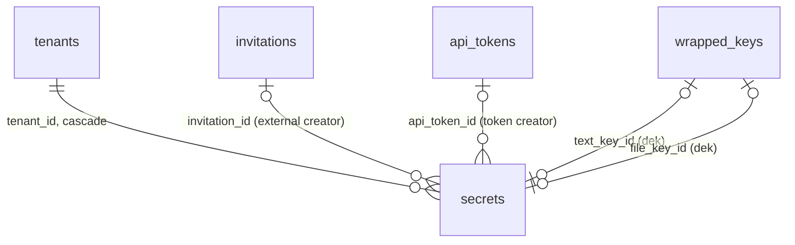

# TransTeira V2.1: data model

> V2.1, step 1, data part. Status: **proposal, to be validated before any code**.
> Sources: CLAUDE.md (sections 2 and 22.1), the V2.1 step 1 design brief (sections 2, 3, 6, 7
> and 9), `docs/architecture/data-model-v2.md`, `docs/architecture/e2e-format.md` (section 3.3,
> secret format), migrations `internal/store/migrations/{sqlite,postgres}/0001..0034`, package
> `internal/store`, `internal/masterkey`. The migration 0033 is written alongside this document
> (it applies on both engines and passes the store tests); the Go store code that uses it comes
> with the implementation steps.

## 1. Principles

All V1, V1.1, V1.2 and V2 conventions still apply (see `data-model-v1.1.md`, section 1,
`data-model-v1.2.md`, section 1, and `data-model-v2.md`, section 1). V2.1 is purely additive:
one new tenant table and new tenant columns. One check is widened (0034, section 2.2), so **one
SQLite table is rebuilt**: `tenant_email_templates`.

| Topic | Rule |
|---|---|
| Defaults | The module is **on by default**, for new and existing tenants (brief section 9, point 4, and the V2.1 decisions): `secrets_enabled = 1`, durations `1h,1d,7d`, file allowed up to 10 MiB, e-mail delivery allowed. Every other new column is nullable or has a default; no existing insert changes. |
| Additive only | SQLite `ALTER TABLE tenants ADD COLUMN` with a constant default and a check on the new column (or on an earlier column, which SQLite accepts), plus `CREATE TABLE secrets`. PostgreSQL alters `tenants` in place (its policies are kept) and creates `secrets` with its policy. |
| Tenant scoping | `secrets` carries `tenant_id` and gets the usual isolation policy (`secrets_isolation`); `DB.Verify` (`verifyRLS`) and `test/isolation/rls_test.go` find it through its `tenant_id` column. The tenant settings are `tenants` columns, written in the system scope (`tenants_system`), like the other tenant settings. |
| Zero knowledge | The database never holds the secret token (SHA-256 only), the fragment key `K`, the proofs (only `verifier = SHA-256(proof)` and `key_verifier = SHA-256(keyProof)`), the passphrase, nor any plaintext. The text and the file are browser ciphertext (TTE2), encrypted **again** at rest by the server with per-secret data keys. |
| Keys | The two server data keys of a secret (`text_key_id`, `file_key_id`) are `wrapped_keys` rows of purpose **`dek`**, exactly like `transfer_files.dek_key_id` (`Vault.NewDEKTx`, unique reference, `ON DELETE SET NULL`). Destroying the row (`Vault.DestroyTx`) is the cryptographic erasure of the server layer: backups taken **after** it can no longer open the stored copy, but a backup taken **while the secret was live** keeps the sealed text, its wrapped key, the verifiers and the salt (decision D3); the real protection of the text is `K`. The master key rotation rewraps them with no new code path. No new purpose, so the `wrapped_keys` check is not touched (section 2.1). |
| Tombstones | A secret that is no longer readable keeps a row without content for 30 days (audit, read receipt, the recipient's "already read" answer). The content columns are NULL outside `pending` and `active`: enforced by checks, not only by the store. |
| Types | SQLite `STRICT`, Unix **milliseconds** UTC, `TEXT` ids (`COLLATE "C"` on PostgreSQL), booleans `INTEGER 0/1` / `BOOLEAN`, hashes and binary blobs `BLOB` / `BYTEA` with a length check. No GRANT in migrations. |
| Parity | The migration exists for both engines with the same columns, constraints and named indexes (`TestLiveSchemaMatches` compares the columns). |

## 2. Migration plan

| # | Name | Content |
|---|---|---|
| 0033 | `secrets` | `tenants`: `secrets_enabled`, `secret_durations`, `secret_default_duration`, `secret_file_allowed`, `secret_file_max_bytes`, `secret_email_allowed`, `secret_email_requires_passphrase`. New table `secrets` (one-time secrets, their optional file and its one-time download grant). |
| 0034 | `secret_mail_templates` | `tenant_email_templates.template_key` check widened with `secret-notification` and `secret-receipt` (the two secret mails become customizable per entity, brief 12.3). SQLite rebuilds the table, PostgreSQL alters the named check. |

### 2.1 Migration 0033 `secrets`

**Tenant settings.**

```sql
-- tenants
secrets_enabled         INTEGER NOT NULL DEFAULT 1 CHECK (secrets_enabled IN (0, 1))          -- PG BOOLEAN DEFAULT true
secret_durations        TEXT    NOT NULL DEFAULT '1h,1d,7d'
    CHECK (length(secret_durations) BETWEEN 2 AND 19
           AND replace(...replace(',' || secret_durations || ',', ',1h,', ',')..., ',30d,', ',') = ',')
                                                                     -- PG: tenants_secret_durations_check
secret_default_duration TEXT    CHECK (secret_default_duration IS NULL
                                       OR (secret_default_duration IN ('1h', '12h', '1d', '3d', '7d', '30d')
                                           AND instr(',' || secret_durations || ',', ',' || secret_default_duration || ',') > 0))
                                                                     -- PG: strpos, tenants_secret_default_duration_check
secret_file_allowed     INTEGER NOT NULL DEFAULT 1 CHECK (secret_file_allowed IN (0, 1))      -- PG BOOLEAN DEFAULT true
secret_file_max_bytes   INTEGER NOT NULL DEFAULT 10485760
    CHECK (secret_file_max_bytes BETWEEN 1048576 AND 26214400)        -- PG BIGINT, tenants_secret_file_max_bytes_check
secret_email_allowed    INTEGER NOT NULL DEFAULT 1 CHECK (secret_email_allowed IN (0, 1))     -- PG BOOLEAN DEFAULT true
secret_email_requires_passphrase INTEGER NOT NULL DEFAULT 0
    CHECK (secret_email_requires_passphrase IN (0, 1))                -- PG BOOLEAN DEFAULT false
```

- **Durations.** A comma-separated list of the duration codes `1h`, `12h`, `1d`, `3d`, `7d`,
  `30d` the creators may choose (`expiresIn` of `POST /secrets`), the same codes as
  `secrets.duration_code`. The check is portable (only `replace` and `length`, identical on both
  engines): it removes every known code surrounded by commas and expects a single comma left, so
  an empty list, an unknown code, a duplicate, a space, an upper-case code or a stray comma are
  refused. The store writes the codes in ascending order of duration; the API exposes the list
  as an array (`durations[]`). A CSV column rather than a child table or one boolean per code:
  six fixed values, always read and written as a whole with the other settings, and exported
  with them (`ConfigExport.secretSettings`).
- **Default duration.** `secret_default_duration` is the code the web app preselects
  (`defaultDuration` of the settings, optional in the brief): NULL means the shortest offered
  code. It must be offered (check with `instr` on SQLite, `strpos` on PostgreSQL): removing its
  code from the list requires clearing or changing it in the same update (store rule: the
  service resets it to NULL when it is no longer offered, rather than refusing).
- **File.** `secret_file_allowed` and `secret_file_max_bytes` (ciphertext bytes, 1 MiB to
  25 MiB, default 10 MiB, brief section 6 and point 1). The instance hard limit of 25 MiB is
  also the bound of `secrets.file_size`.
- **E-mail delivery.** `secret_email_allowed`; when off, only link delivery is offered, which
  also closes the module to invited externals (they can only send by e-mail to their inviter,
  section "Origin" below).
- **Passphrase for the e-mail delivery** (P83, section 7 point 9).
  `secret_email_requires_passphrase`, off by default: when on, an e-mail secret must carry a
  passphrase descriptor (`kdf_salt`), checked by the store at creation.
- **Writers.** The delegated admin of the tenant and the super admin (brief point 4), through
  `GET|PUT /admin/tenants/{tenantId}/secret-settings`, audited `secret.settings_updated`. On
  PostgreSQL the update runs in the system scope (`tenants_system`), like the other tenant
  settings. Exported and imported with the tenant configuration (F4); the import validates the
  same bounds.

**Secrets.**

```sql
CREATE TABLE secrets (
    id                    TEXT    NOT NULL PRIMARY KEY,                               -- "sec_" + ULID
    tenant_id             TEXT    NOT NULL REFERENCES tenants (id) ON DELETE CASCADE,
    token_hash            BLOB    NOT NULL UNIQUE CHECK (length(token_hash) = 32),    -- SHA-256 of "tts_..."
    state                 TEXT    NOT NULL CHECK (state IN ('pending', 'active', 'read', 'expired', 'deleted', 'locked')),
    creator_kind          TEXT    NOT NULL CHECK (creator_kind IN ('internal', 'internal_remote', 'external', 'api_token')),
    sender_email          TEXT    NOT NULL CHECK (length(sender_email) BETWEEN 3 AND 320),
    api_token_id          TEXT,
    invitation_id         TEXT,
    delivery              TEXT    NOT NULL CHECK (delivery IN ('link', 'email')),
    recipient_email       TEXT    CHECK (recipient_email IS NULL OR length(recipient_email) BETWEEN 3 AND 320),
    read_receipt          INTEGER NOT NULL DEFAULT 0 CHECK (read_receipt IN (0, 1)),   -- PG BOOLEAN
    receipt_sent_at       INTEGER,
    verifier              BLOB    CHECK (verifier IS NULL OR length(verifier) = 32),   -- SHA-256(proof)
    key_verifier          BLOB    CHECK (key_verifier IS NULL OR length(key_verifier) = 32),  -- SHA-256(keyProof)
    kdf_salt              BLOB    CHECK (kdf_salt IS NULL OR length(kdf_salt) = 16),
    kdf_iterations        INTEGER CHECK (kdf_iterations IS NULL OR kdf_iterations = 600000),
    text_sealed           BLOB    CHECK (text_sealed IS NULL OR length(text_sealed) BETWEEN 1 AND 65536),
    text_key_id           TEXT    UNIQUE REFERENCES wrapped_keys (id) ON DELETE SET NULL,  -- purpose 'dek'
    duration_code         TEXT    NOT NULL CHECK (duration_code IN ('1h', '12h', '1d', '3d', '7d', '30d')),
    created_at            INTEGER NOT NULL,
    activated_at          INTEGER,
    expires_at            INTEGER,
    read_at               INTEGER,
    ended_at              INTEGER,
    end_reason            TEXT    CHECK (end_reason IS NULL OR end_reason IN
                                         ('read', 'expired', 'locked', 'deleted_by_creator', 'deleted_by_admin')),
    failed_proofs         INTEGER NOT NULL DEFAULT 0 CHECK (failed_proofs BETWEEN 0 AND 5),
    file_size             INTEGER CHECK (file_size IS NULL OR file_size BETWEEN 1 AND 26214400),  -- ciphertext
    file_metadata         TEXT    CHECK (file_metadata IS NULL OR octet_length(file_metadata) BETWEEN 1 AND 5462),
    file_storage_name     TEXT    CHECK (file_storage_name IS NULL OR length(file_storage_name) = 32),
    file_key_id           TEXT    UNIQUE REFERENCES wrapped_keys (id) ON DELETE SET NULL,  -- purpose 'dek'
    file_uploaded_at      INTEGER,
    file_grant_hash       BLOB    CHECK (file_grant_hash IS NULL OR length(file_grant_hash) = 32),
    file_grant_expires_at INTEGER,
    file_downloaded_at    INTEGER,
    UNIQUE (tenant_id, id),
    -- Origin
    CHECK ((creator_kind = 'external') = (invitation_id IS NOT NULL)),          -- PG secrets_external_check
    CHECK ((creator_kind = 'api_token') = (api_token_id IS NOT NULL)),          -- PG secrets_api_token_check
    CHECK (creator_kind <> 'external' OR delivery = 'email'),                   -- PG secrets_external_delivery_check
    -- Delivery and receipt
    CHECK ((delivery = 'email') = (recipient_email IS NOT NULL)),               -- PG secrets_recipient_check
    CHECK (read_receipt = 1 OR receipt_sent_at IS NULL),                        -- PG secrets_receipt_check
    CHECK (receipt_sent_at IS NULL OR state IN ('read', 'expired', 'locked')),  -- PG secrets_receipt_state_check
    -- Passphrase parameters
    CHECK ((kdf_salt IS NULL) = (kdf_iterations IS NULL)),                      -- PG secrets_kdf_check
    -- Content and secret material exist in pending and active only
    CHECK ((state IN ('pending', 'active')) = (text_sealed IS NOT NULL)),       -- PG secrets_text_check
    CHECK ((state IN ('pending', 'active')) = (verifier IS NOT NULL)),          -- PG secrets_verifier_live_check
    CHECK ((state IN ('pending', 'active')) = (key_verifier IS NOT NULL)),      -- PG secrets_key_verifier_live_check
    CHECK (state IN ('pending', 'active') OR kdf_salt IS NULL),                 -- PG secrets_kdf_live_check
    CHECK ((state IN ('pending', 'active')) = (text_key_id IS NOT NULL)),       -- PG secrets_text_key_check
    CHECK (state IN ('pending', 'active') OR file_metadata IS NULL),            -- PG secrets_file_metadata_live_check
    CHECK (state IN ('pending', 'active') OR (state = 'read' AND file_grant_hash IS NOT NULL)
           OR (file_storage_name IS NULL AND file_key_id IS NULL)),             -- PG secrets_file_content_check
    -- File
    CHECK (state NOT IN ('pending', 'active')
           OR ((file_size IS NULL) = (file_metadata IS NULL)
               AND (file_size IS NULL) = (file_storage_name IS NULL))),         -- PG secrets_file_live_check
    CHECK (file_size IS NOT NULL OR (file_storage_name IS NULL AND file_uploaded_at IS NULL
           AND file_grant_hash IS NULL AND file_downloaded_at IS NULL)),        -- PG secrets_no_file_check
    CHECK (file_uploaded_at IS NULL OR file_storage_name IS NOT NULL
           OR state NOT IN ('pending', 'active')),                              -- PG secrets_file_uploaded_check
    CHECK (state <> 'active' OR file_size IS NULL OR file_uploaded_at IS NOT NULL), -- PG secrets_file_active_check
    CHECK (state NOT IN ('pending', 'active') OR file_uploaded_at IS NULL
           OR file_key_id IS NOT NULL),                                         -- PG secrets_file_key_live_check
    -- One-time file grant
    CHECK ((file_grant_hash IS NULL) = (file_grant_expires_at IS NULL)),        -- PG secrets_grant_check
    CHECK (file_grant_hash IS NULL OR (state = 'read' AND file_storage_name IS NOT NULL)), -- PG secrets_grant_state_check
    CHECK (file_downloaded_at IS NULL OR state = 'read'),                       -- PG secrets_downloaded_check
    -- Lifecycle
    CHECK ((activated_at IS NULL) = (expires_at IS NULL)),                      -- PG secrets_activation_check
    CHECK (expires_at IS NULL OR expires_at > activated_at),                    -- PG secrets_expiry_check
    CHECK (state <> 'pending' OR activated_at IS NULL),                         -- PG secrets_pending_check
    CHECK (state IN ('pending', 'deleted') OR activated_at IS NOT NULL),        -- PG secrets_activated_check
    CHECK ((state = 'read') = (read_at IS NOT NULL)),                           -- PG secrets_read_check
    CHECK ((state IN ('pending', 'active')) = (ended_at IS NULL)),              -- PG secrets_ended_check
    CHECK ((ended_at IS NULL) = (end_reason IS NULL)),                          -- PG secrets_end_reason_set_check
    CHECK (end_reason IS NULL OR end_reason = state
           OR (state = 'deleted' AND end_reason IN ('deleted_by_creator', 'deleted_by_admin'))),
                                                                                -- PG secrets_end_reason_state_check
    CHECK (state <> 'locked' OR failed_proofs = 5),                             -- PG secrets_locked_check
    CHECK (failed_proofs < 5 OR state IN ('active', 'locked')),                 -- PG secrets_failed_proofs_slot_check
    FOREIGN KEY (tenant_id, invitation_id) REFERENCES invitations (tenant_id, id),   -- no action
    FOREIGN KEY (tenant_id, api_token_id) REFERENCES api_tokens (tenant_id, id)      -- no action
) STRICT;

CREATE INDEX secrets_tenant_created_idx ON secrets (tenant_id, created_at, id);
CREATE INDEX secrets_sender_created_idx ON secrets (tenant_id, sender_email, created_at, id);
CREATE INDEX secrets_token_created_idx  ON secrets (tenant_id, api_token_id, created_at) WHERE api_token_id IS NOT NULL;
CREATE INDEX secrets_recipient_idx      ON secrets (tenant_id, recipient_email) WHERE recipient_email IS NOT NULL;
CREATE INDEX secrets_invitation_idx     ON secrets (tenant_id, invitation_id) WHERE invitation_id IS NOT NULL;
CREATE INDEX secrets_pending_idx        ON secrets (created_at, tenant_id, id) WHERE state = 'pending';
CREATE INDEX secrets_expiry_idx         ON secrets (expires_at, tenant_id, id) WHERE state = 'active';
CREATE INDEX secrets_grant_idx          ON secrets (file_grant_expires_at, tenant_id, id) WHERE file_grant_hash IS NOT NULL;
CREATE INDEX secrets_ended_idx          ON secrets (tenant_id, ended_at, id) WHERE ended_at IS NOT NULL;
CREATE UNIQUE INDEX secrets_file_storage_idx ON secrets (tenant_id, file_storage_name) WHERE file_storage_name IS NOT NULL;
```

- **Identifiers and token.** `id` (`sec_` + ULID) is the management identifier (creator list,
  administration, audit). The recipient link carries a separate bearer token (`tts_` + 43 base62
  characters, about 256 bits) in the path of `/s/<token>`; only its SHA-256 is stored
  (`token_hash`, unique on the whole instance, like the drop link and download tokens). The
  public calls look the token up in the tenant scope of the host: a token of another tenant is
  simply unknown there (404 and `secret_invalid`). No sealed copy of the token is kept: the
  creator gets it once in `SecretCreated`; a lost link is a lost secret (the creator deletes it
  and creates another one). For the e-mail delivery the creator sends the token back once, in
  the body of `POST /secrets/{id}/send`: the server compares its SHA-256 with `token_hash` in
  constant time (another token: 404, like a secret of another creator) and uses it only to
  compose the link of the mail; it is still never stored.
- **Origin.** `creator_kind` reuses the depositor vocabulary of `transfers.sender_kind` and
  `deposit_sessions.kind` (`internal`, `internal_remote` for an internal from outside, V1.1 6.4,
  `external` for an invited external), plus `api_token` (`api_token_id` set; `sender_email` is
  the declared sender, same rule as a transfer's). The brief's `remote_internal` is spelled
  `internal_remote` to match the existing value (section 7, decision D1). An invited external has
  `invitation_id` set and must use e-mail delivery (check); the store also forces
  `recipient_email` to the inviter (`invitations.invited_by`). Drop links and transfer replies
  cannot create secrets (no kind). The composite foreign keys keep the invitation and the token
  in the tenant; they have no `ON DELETE` action, like `transfers`: API tokens are only revoked,
  invitations are purged once they are revoked or expired (an invitation expires 12 months
  after its last use) and older than the rate-limit retention, **and no transfer and no secret
  references them any more**: the purge skips an invitation that a secret still references,
  tombstone included (a secret lives at most 30 days, then its tombstone 30 days, so the
  invitation goes after that), and the data-subject erasure deletes the secrets of an address before its
  invitations.
- **Creator identity** (no session column). A secret records who created it, not which session:
  there is no `deposit_session_id`. The creator side operations are therefore allowed to the
  same **creator identity**: for a deposit session, the same verified sender address
  (`sender_email`) **and** the same creator kind (`creator_kind`: an internal session cannot act
  on the secret of an external session of the same address, nor conversely), so another deposit
  session of that address in the same tenant also qualifies; for an API token, the same token
  (`api_token_id`). A session never acts on an `api_token` secret, and a token never acts on a
  secret created by a session. The upload and the send call follow this rule (`404` otherwise).
  The "My transfers" session proves the address only: `/me/secrets` lists and deletes the
  secrets of that address created by a deposit session (any non-`api_token` kind), never those
  of an API token.
- **Delivery.** `link`: the creator hands out the link; no recipient is recorded. `email`:
  exactly one `recipient_email` (check), mailed by `POST /secrets/{id}/send`, which receives the
  secret token and the fragment key `K` once, only to compose the link of the mail
  (`https://<registered fqdn>/s/<token>#k=<K>`, `e2e-format.md` §3.3.6). **Neither the token
  nor `K` is ever stored, logged or audited**; no column can hold them. At the creation, the
  recipient goes through the blocklist and the recipient domain rules of the tenant, as the
  recipients of a transfer (`403 recipient-domain-refused`, audited `transfer.recipient_refused`
  with `details.object = secret`); the inviter imposed on an invited external is not checked.
- **Receipt.** `read_receipt` is the creator's choice; `receipt_sent_at` is set when the
  receipt mail left, only for a secret asked with a receipt and ended as `read`, `expired`
  (unread) or `locked` (brief point 8), never for `deleted` (the creator or an admin did it).
  It makes the mail idempotent when the lifecycle task retries.
- **Proofs and passphrase** (`e2e-format.md` §3.3.4). Two verifiers are sent at creation, both
  32 bytes: `verifier = SHA-256(proof)`, the proof derived from the secret root key `K'` (so from
  `K` **and** the passphrase), and `key_verifier = SHA-256(keyProof)`, the key proof derived from
  `K` alone (`HKDF(K, "transteira/tte2/v1/secret/key-proof")`). The reveal receives both proofs
  and compares their hashes in constant time:
  - **wrong key proof**: refused (`403 secret-proof-invalid`) and **not counted** in
    `failed_proofs`: the caller does not hold the link (a truncated or mistyped link, a scanner,
    a guess); counting it would let anyone holding only the token lock the secret. Rate limited
    per IP like every reveal;
  - **right key proof, wrong proof**: a wrong passphrase; counted, the fifth locks
    (`failed_proofs = 5`, state `locked`, brief point 2);
  - both right: the secret is revealed.

  **Attempt slots** (`e2e-format.md` §3.3.4). The count must hold under concurrency, so the
  reveal **claims a slot before comparing the proof**: the key proof is checked first (read with
  the row, not counted), then, in the reveal transaction,
  `UPDATE secrets SET failed_proofs = failed_proofs + 1 WHERE id = ? AND state = 'active' AND
  expires_at > ? AND failed_proofs < 5`. No row updated: the secret is no longer active (answer
  from its state). The claim holds the row until the end of the transaction (PostgreSQL row
  lock; SQLite single writer, the write transaction is `BEGIN IMMEDIATE`), so concurrent
  reveals of a secret are serialized and **at most 5 proofs are ever compared**. The proof is
  compared inside the transaction: right, the reveal releases the slot as part of its update
  (`failed_proofs = failed_proofs - 1`, state `read`); wrong, the slot stays (a counted
  failure) and the fifth also sets `locked` in the same transaction; a rollback releases it.
  The checks allow `failed_proofs = 5` in `active` only for that transient claimed slot (the
  store never commits it: a check cannot see the transaction boundary), require 5 in `locked`
  and at most 4 in the other tombstones. Test: 50 wrong and 1 right reveal in parallel, at most
  5 proofs evaluated, on both engines.

  Without a passphrase both proofs come from `K` only and a wrong `proof` with a right key proof
  cannot happen with an honest client; it is counted like a wrong passphrase. `kdf_salt`
  (16 bytes) and `kdf_iterations` describe the optional passphrase (PBKDF2-HMAC-SHA-256): both
  NULL without passphrase, both set otherwise, and the count is exactly 600 000 (a constant of
  the format, clients refuse any other one, so a server cannot downgrade it; the column records
  it so that the status call returns what the row says, and a future format can widen the
  check). The salt is public while the secret is live (returned by
  `GET /secret-links/{token}`).
  **Both verifiers, the salt and the iteration count are NULL in a tombstone** (checks): with an
  old link (hence `K`) and a later leak of the database, they would give an offline passphrase
  oracle; nothing is left to prove once the secret ended (decision D3). This protects a database
  read **after** the end only: a backup taken while the secret was live keeps them, with the
  sealed text and its wrapped key (D3, residual risk).
- **Nothing sealed before the reveal** (`e2e-format.md` §3.3, rule). Any value computed from
  `K'` is an offline passphrase oracle to whoever has `K`. The public calls therefore return,
  before a successful reveal, only `expires_at`, the passphrase descriptor (`kdf_salt`,
  `kdf_iterations`) and `file_size`; `text_sealed` and `file_metadata` are returned by the
  reveal only, in the transaction that NULLs them (state `read` requires both NULL, so the
  reveal reads them and clears them in one statement sequence). The verifiers are never
  returned.
- **Expiry checked on read.** The status call and the reveal check `expires_at` themselves
  (`410 secret-gone`, reason `expired`, before the lifecycle task has swept the row), like the
  guard of the reveal update; the file download checks `file_grant_expires_at`.
- **Sealed text.** `text_sealed` is the sealed text string sent by the browser (base64url,
  at most 53 372 characters, `secret-format-invalid` otherwise), encrypted again at rest with a
  per-secret data key (`text_key_id`). The bound of the column (64 KiB) covers the string plus
  the server encryption overhead; the store and the API enforce the exact limits. Stored as a
  binary blob, the at-rest ciphertext. **Residual risk (backups):** the server layer is erased
  at the reveal, but a backup of the database taken while the secret was live keeps
  `text_sealed` and its wrapped key (`wrapped_keys`), which the master key opens; what is left is
  the browser ciphertext, protected by `K` (and the passphrase). Whoever later obtains that
  backup, the master key and the link (an old mail, for the e-mail delivery) reads a secret
  without passphrase. Recommendation, written in the guides and the interface: short durations,
  and a passphrase sent by another channel for the e-mail delivery (decision D3, threat model
  T-351, T-355, P71).
- **Wrapped keys.** `text_key_id` and `file_key_id` reference `wrapped_keys` rows of purpose
  `dek`, created by `Vault.NewDEKTx` in the creation transaction (the file key with the file
  upload). Unique, like `transfer_files.dek_key_id`: a key row protects one thing. `ON DELETE
  SET NULL`: destroying the row (`Vault.DestroyTx`) is the cryptographic erasure. **No new vault
  purpose**: the purposes are a database check on `wrapped_keys` (`'dek'`, `'secret'`, migration
  0002), and both keys are data keys (random 32 bytes encrypting data at rest), which is exactly
  what `dek` means; the envelope AAD already binds the purpose, the tenant and the key row ID,
  so the keys of a secret cannot be swapped with another row's. A dedicated `secret-dek`
  purpose would require rebuilding `wrapped_keys` on SQLite (two triggers, referenced by several
  tables) for no security gain (decision D2).
- **States and transitions.**

  | From | To | Statement (one transaction) |
  |---|---|---|
  | (none) | `pending` | Created with a file declared or `delivery = 'email'`. `activated_at`, `expires_at` NULL. |
  | (none) | `active` | Link delivery without file: created and activated in one call. |
  | `pending` | `active` | File uploaded (`file_uploaded_at`) and, for e-mail delivery, the send call: `activated_at = now`, `expires_at = now + duration`. |
  | `active` | `read` | Reveal, after the key proof and the claimed attempt slot (above), guarded `UPDATE … SET state = 'read', failed_proofs = failed_proofs - 1 … WHERE id = ? AND state = 'active' AND expires_at > ?`: returns the sealed text and, with a file, the sealed file metadata, NULLs `text_sealed`, `text_key_id`, `verifier`, `key_verifier`, `kdf_salt`, `kdf_iterations`, `file_metadata`, destroys the text key, creates the file grant (if file). Exactly one concurrent winner. |
  | `active` | `expired` | Lifecycle task at `expires_at` (receipt if asked). Content and keys destroyed, file deleted. |
  | `pending`, `active` | `deleted` | Creator (`/me/secrets`) or admin; `end_reason` `deleted_by_creator` / `deleted_by_admin`. |
  | `active` | `locked` | Fifth wrong passphrase proof (right key proof, fifth claimed slot, wrong proof: `failed_proofs = 5`), in the claiming transaction; content destroyed (receipt if asked). A wrong key proof is never counted. |
  | `pending` | (row deleted) | Abandoned for one hour: nothing was delivered, the row, its file and keys go (no tombstone). |
  | tombstone | (row deleted) | 30 days after `ended_at`. |

  Checks: `ended_at` and `end_reason` are set exactly in the four tombstone states;
  `end_reason` equals the state except for `deleted`, which names its actor; `read_at` is set
  exactly in `read`; a `pending` secret has no activation, and every tombstone but `deleted` (a
  pending secret may be deleted) has one; `locked` has `failed_proofs = 5`, the other tombstones at
  most 4, and `active` reaches 5 only for the slot a reveal has claimed inside its transaction
  (wrong proofs never consume the secret, the fifth wrong passphrase proof locks).
- **No content in a tombstone (checks).** Outside `pending` and `active`: `text_sealed`,
  `verifier`, `key_verifier`, `kdf_salt`, `kdf_iterations`, `text_key_id` and `file_metadata`
  are NULL, and `file_storage_name` and
  `file_key_id` too, except in `read` while the one-time file grant exists. The store NULLs the
  columns and destroys the keys in the same transaction as the state change.
- **Keys present while live (hardening checks).** A `pending` or `active` secret has its text
  key (`text_key_id` NOT NULL), and its file key once the file is uploaded (`file_uploaded_at`
  set implies `file_key_id` NOT NULL). A live row can therefore never lose its key silently: a
  `DestroyTx` of a live secret's key (`ON DELETE SET NULL`) violates the check and fails. Every
  path that ends or removes a secret changes the row first, in the same transaction: a state
  change NULLs the key columns, then destroys the keys; a deletion of a live row (pending purge,
  data-subject erasure, tenant deletion) deletes the row, then destroys its keys; no path may
  leave an unreferenced `dek` row behind (step 2 checklist, section 8).
- **File.** Declared at creation (`file_size`: ciphertext bytes, bounded by
  `tenants.secret_file_max_bytes` in the store and by 25 MiB in the check; `file_metadata`: the
  sealed metadata, at most 4 KiB decoded, the same bound as `transfer_files.e2e_metadata`). The
  storage name (32 random hex characters, like `transfer_files.storage_name`, unique per tenant)
  is set at creation (it reserves the file in the storage quota) and drawn afresh by each upload
  attempt, in the transaction that attaches the file key, so that the row always names the file
  of the current attempt and an abandoned partial upload is found and removed by the pending
  purge; the file of an earlier failed attempt, named by no row, is left to the orphan sweep,
  which can therefore never remove the file of a new attempt (no name reuse, threat model
  T-360). The file lives at `<tenant dir>/secrets/<file_storage_name>`, never a name derived
  from the token or the ID. `file_uploaded_at` marks a complete upload, validated by the
  keyless TTE2 validator; an `active` secret with a file has it (check). The stored file is
  encrypted again at rest with `file_key_id` (TTEF, like transfer files). The file counts in the
  tenant storage quota while `file_storage_name` is set. `file_size` stays in the tombstone
  (statistics, no content); in a tombstone, `hasFile` and `fileSize` of the API describe what was
  declared, not that a file still exists. `file_metadata` is sealed under `K'`: the status call
  never returns it (only `file_size`), the reveal returns it once and NULLs it.
- **One-time file grant.** The reveal of a secret with a file draws a random grant, returned
  once, and stores its SHA-256 (`file_grant_hash`) with `file_grant_expires_at` (10 minutes).
  `GET /secret-links/{token}/file` finds the secret by token, compares the grant in constant
  time, checks the expiry, streams the file and, at the first **complete** download, sets
  `file_downloaded_at` and NULLs the grant, the storage name and the file key (destroyed, file
  deleted) in one transaction. An expired grant is cleaned the same way by the lifecycle task
  (`secrets_grant_idx`), without `file_downloaded_at`.
- **Limits per creator** (brief section 6, point 1): at most 50 secrets `pending` or `active`
  and 200 creations in the rolling 24 hours per creator address, or per API token for a token.
  Counted in the creation transaction under the tenant lock, through
  `secrets_sender_created_idx` / `secrets_token_created_idx` (the 24-hour count includes deleted
  rows of the period: a purge does not reset it, since tombstones live 30 days and pending rows
  one hour; the pending purge can lower the count by abandoned secrets, accepted).
- **RLS.** `secrets_isolation` (usual tenant template, ENABLE + FORCE). Public lookups by token
  run in the tenant scope of the host; the lifecycle sweeps across tenants run in the system
  scope and switch to the tenant scope per secret, as the transfer sweeps do.

### 2.2 Migration 0034 `secret_mail_templates`

Deviation from "no widened check, no table rebuilt": a mail template an entity can customize is a
row of `tenant_email_templates`, whose `template_key` check lists the known keys (0009, widened
by 0020). The two new mails `secret_notification` and `secret_receipt` need the keys
`secret-notification` and `secret-receipt`.

- **SQLite**: SQLite cannot alter a check, so the table is rebuilt exactly as in 0020
  (`tenant_email_templates_0034`, `STRICT, WITHOUT ROWID`, same columns, primary key and foreign key
  to `tenants`; rows copied; old table dropped; copy renamed). No other table references it and it
  has no secondary index. No backfill: without a row the default template applies.
- **PostgreSQL**: `ALTER TABLE ... DROP CONSTRAINT tenant_email_templates_template_key_check, ADD
  CONSTRAINT ...` with the full list. The table and its isolation policy are untouched.
- The Go side adds `EmailTemplateSecretNotification` and `EmailTemplateSecretReceipt` to
  `store.EmailTemplateKeys()` (14 keys) and the OpenAPI `EmailTemplateKey` enum.

## 3. PostgreSQL RLS summary

| Table | Change | RLS |
|---|---|---|
| `tenants` | 7 columns, 3 named checks | Unchanged (`tenants_read_own`, `tenants_system`); written in the system scope. |
| `secrets` | New | `secrets_isolation` (tenant template); found by `verifyRLS` and `TestRLSRoleCannotBypass` through `tenant_id`; listed in `TestRLSOwnerCannotDisablePolicies`. |

The foreign keys of `secrets` to `wrapped_keys`, `invitations` and `api_tokens` are all tenant
tables of the same tenant (the composite keys enforce it for invitations and tokens; the store
checks the tenant of a wrapped key, and the vault refuses another tenant's key row).

## 4. Purge and retention (spec 20)

| Data | Rule |
|---|---|
| `secrets` `pending` | Deleted (row, then its keys in the same transaction, then the file) **1 hour** after `created_at` (`secrets_pending_idx`). |
| `secrets` `active` | At `expires_at` (1 hour to 30 days after activation): becomes `expired` (content, keys and file destroyed; receipt if asked) (`secrets_expiry_idx`). |
| File grant | At `file_grant_expires_at` (10 minutes after the reveal): file and key destroyed, grant cleared (`secrets_grant_idx`). |
| Tombstones (`read`, `expired`, `deleted`, `locked`) | Deleted **30 days** after `ended_at` (`secrets_ended_idx`, per tenant), like ended transfers. Hold the sender and recipient addresses, the dates and the file size, no content. The store deletes a tombstone only when its file key is gone (a `read` row whose grant is still pending is first cleaned by the grant sweep). |
| Data-subject erasure | Deletes, in its tenant scope, every secret whose `sender_email` or `recipient_email` is the address (rows deleted, then their keys destroyed in the same transaction, files removed), counted in `DataSubjectEraseReport.secretsDeleted`; `DataSubjectSummary.secrets` counts them. Runs before the invitations of the address are deleted (foreign key). |
| Tenant deletion | `Tenants.Delete` requires every wrapped key of the tenant destroyed first: the deletion deletes the tenant's `secrets` rows before that key loop (a live row would otherwise fail the hardening check), then the cascade; the tenant directory, `secrets/` included, is removed with it. |
| `tenants.secret_*` | Configuration, tenant lifetime. |

**Erasure delay.** The secret sweeps have no schedule of their own: the expiry and tombstone
sweeps run with the `expire` task (every `DefaultInterval`, 1 minute) and the pending-secret
sweep with the `abandoned-uploads` task (every 15 minutes by default). A secret is therefore
erased at most about one task interval after it is due (about 1 minute after `expires_at`, up
to about 1 hour 15 minutes for an abandoned `pending` secret), and its key is destroyed in
the same sweep. The reveal and the status never depend on it: an active secret past
`expires_at` is already answered `410 secret-gone` (`expired`) by the store.

The audit events (`secret.*`) and the security events follow their own 12-month retention and
never carry content, key, proof, verifier or token.

## 5. Impact on existing behaviour

- **Store inserts.** Unchanged: the new tenant columns all have defaults (`Tenants.Create` keeps
  working; the tenants it creates have the module on). One check is widened (0034, section 2.2),
  so `tenant_email_templates` is rebuilt on SQLite; no other table is.
- **Upgrade tests.** The tests that count applied migrations now expect 21 from a V1 database
  (0014 to 0034) and 14 from 0020; `migrate` from scratch applies 34.
  `TestV21SchemaConstraints` (`internal/store/migrate_v21_internal_test.go`) checks the V2.1
  invariants on both engines.
- **Abuse detection (T-340).** `Transfers.SenderActivity(Tx)` (the store query behind
  `abuse.repo.activity(Tx)`) adds the secrets the address created in the window (`state <>
  'pending'`, `created_at` in the window, creator kind `api_token` counted as `internal`) to the
  **number** of transfers, never to the volume.
- **RLS tests.** `secrets` is added to `TestRLSOwnerCannotDisablePolicies`; `verifyRLS` and
  `TestRLSRoleCannotBypass` already cover every table with a `tenant_id` column.
- **Quota.** At step 2 the tenant storage usage adds the sizes of the stored secret files
  (`file_storage_name IS NOT NULL`), and the orphan file sweep of the tenant directory learns the
  `secrets/` subdirectory (`secrets_file_storage_idx`).
- **Master key rotation.** Unchanged: the secret keys are ordinary `dek` rows of `wrapped_keys`.

## 6. ER summary



## 7. Decisions

Choices made in this design beyond the brief, validated with it on 2026-11-09:

| # | Topic | Choice | Where |
|---|---|---|---|
| D1 | Creator kind spelling | `internal_remote` (the existing value of `transfers.sender_kind`), not the brief's `remote_internal` | §2.1 Origin |
| D2 | Vault purpose | Both keys are `wrapped_keys` rows of the existing purpose `dek`; no new purpose, no rebuild of `wrapped_keys` | §2.1 Wrapped keys |
| D3 | Verifiers and passphrase parameters in tombstones | `verifier`, `key_verifier`, `kdf_salt`, `kdf_iterations` NULL outside `pending` / `active` (no offline passphrase oracle after a database leak; review correction). **Residual risk:** a backup taken while the secret was live keeps `text_sealed`, its wrapped key, the verifiers and the salt; the erasure at the reveal does not reach it, the text stays protected by `K` (and the passphrase) only. Recommendation: short durations, passphrase for the e-mail delivery | §2.1 Proofs, Sealed text |
| D10 | Key verifier | `key_verifier = SHA-256(keyProof)` (from `K` only, `e2e-format.md` §3.3.4); a wrong key proof is refused and not counted, only wrong passphrase proofs count toward the lock | §2.1 Proofs |
| D4 | Storage name and upload mark | `file_storage_name` set at creation and drawn afresh by each upload attempt, `file_uploaded_at` added (not in the brief), so a partial upload is always found and a name is never reused | §2.1 File |
| D5 | `end_reason` values | `read`, `expired`, `locked`, `deleted_by_creator`, `deleted_by_admin`. API mapping: `endReason` (and the `reason` of `410 secret-gone`) is `deleted` for both `deleted_by_*` values, the others unchanged; the actor (creator or admin) is in the `secret.deleted` audit entry, never in the public answer | §2.1 States |
| D6 | Abandoned pending secrets | Deleted outright after 1 hour (no tombstone) | §2.1 States, §4 |
| D7 | Default duration | Deviation from the brief, which only hinted at an optional `defaultDuration`: optional column `secret_default_duration` (NULL: the shortest offered), exposed as `defaultDuration` in `SecretSettings` and `features.secrets` | §2.1 Tenant settings |
| D8 | Durations storage | CSV of codes on `tenants`, checked portably | §2.1 Tenant settings |
| D9 | `file_size` in tombstones | Kept (statistics), content columns cleared; `hasFile` / `fileSize` of a tombstone describe what was declared | §2.1 File |
| D11 | Attempt slots | The reveal claims a slot (`failed_proofs + 1` while below 5) before comparing the proof and releases it on success; checks allow 5 in `active` only for that transient slot (review correction: at most 5 proofs compared under concurrency) | §2.1 Proofs |
| D12 | Nothing sealed before the reveal | The status call returns `file_size` only; `file_metadata` comes with the reveal (review correction: a sealed value under `K'` is an offline oracle for the link holder) | §2.1 Nothing sealed |
| D13 | Keys present while live | Hardening checks: live rows reference their text key, and their file key once uploaded; deletion paths remove the row before destroying its keys | §2.1 Keys present |

Points to decide (brief section 9), all **Validated (2026-11-09)**; the recommendation is the
one applied in the design and in migration 0033:

1. **Limits**: 50 open (`pending` + `active`) secrets and 200 creations per rolling 24 hours per
   creator (address or API token); text 10 000 characters; file 10 MiB by default, at most
   25 MiB. **Recommendation: as is.** In the schema: `secret_file_max_bytes` default 10 MiB,
   check 1 MiB to 25 MiB, `file_size` at most 25 MiB; the counts are store rules on
   `secrets_sender_created_idx` / `secrets_token_created_idx`. Validated (2026-11-09).
2. **Proof attempts**: 5 wrong passphrase proofs, then `locked` (a wrong key proof is refused
   but not counted, D10). **Recommendation: as is.** In the schema: `failed_proofs` 0 to 5,
   `(failed_proofs = 5) = (state = 'locked')`. Validated (2026-11-09).
3. **Tombstone retention**: 30 days after the end, like ended transfers. **Recommendation: as
   is.** `secrets_ended_idx`. Validated (2026-11-09).
4. **Settings owner**: the delegated admin manages every secret setting, `enabled` included; the
   super admin can too. **Recommendation: as is** (the module needs no instance resource beyond
   the quota). Columns on `tenants`, written in the system scope. Validated (2026-11-09).
5. **File allowed by default**: yes, 10 MiB. **Recommendation: as is.** `secret_file_allowed`
   default 1, `secret_file_max_bytes` default 10 485 760. Validated (2026-11-09).
6. **Creator list and deletion in "My transfers"** (`/me/secrets`). **Recommendation: yes** (wrong
   recipient). `secrets_sender_created_idx`, `end_reason = 'deleted_by_creator'`. Validated (2026-11-09).
7. **`410 secret-gone` with a reason during the tombstone** instead of a uniform 404.
   **Recommendation: yes** (tells the recipient a secret was intercepted; the token has 256 bits,
   so the answer has no enumeration value). The tombstone keeps `token_hash` and the state for
   30 days for that purpose. Validated (2026-11-09).
8. **Read receipt also on `locked`**, besides `read` and `expired` unread.
   **Recommendation: yes.** `secrets_receipt_state_check` allows `receipt_sent_at` in `read`,
   `expired` and `locked`. Validated (2026-11-09).
9. **Per-entity option: passphrase required for the e-mail delivery** (open decision, threat
   model P83). The e-mail delivery puts `K` in the mailbox, the mail chain and the mail security
   sandboxes, some of which run JavaScript and click (T-349, residual "Medium" without
   passphrase); only a passphrase sent by another channel protects against them.
   **Decision: offer a tenant setting `emailRequiresPassphrase`, off by default**, refusing an
   e-mail secret without passphrase descriptor. Validated (2026-11-09): added at step 2 (column `tenants.secret_email_requires_passphrase` in 0033, `SecretSettings`/`SecretFeatures` member, export/import).

## 8. Step 2 checklist

Items the implementation (step 2) must carry, found at the review of this design:

- P83 validated: add `secret_email_requires_passphrase` (default false) to migration 0033 on both engines (**done**: column, `tenant.SecretSettings.EmailRequiresPassphrase`, store refusal `store.ErrSecretPassphraseRequired`), `emailRequiresPassphrase` to `SecretSettings`, `SecretFeatures` and the configuration export/import, and the refusal of an e-mail secret without passphrase descriptor (problem code to add to the spec).

- **Authenticated cross-tenant isolation tests** for every `/secrets*`, `/secret-links/*` and
  `/me/secrets*` operation and the admin secret operations, replacing the interim tolerance of
  `401` on `/secrets*` in `test/isolation/http/operations_test.go`.
- **Auditor**: `listTenantSecrets` added to `adminauth.AuditorOperations`, and to the
  `tenantRead` set of `test/isolation/http/roles_test.go`.
- **Web routes**: the `/s/` page route in `internal/httpserver/webui.go` and the API prefix in
  `robotsAPIPrefixes`, answered with `X-Robots-Tag: noindex`, `Cache-Control: no-store` and
  `Referrer-Policy: no-referrer`.
- **Upload limits**: `PUT /secrets/{secretId}/file` gets a body limit of 25 MiB and a deadline
  in `routePolicies` of `internal/httpserver/server.go`.
- **Key erasure on every deletion path (L6)**: every path that deletes `secrets` rows (pending
  purge, tombstone purge, data-subject erasure, tenant deletion) destroys the keys they
  reference with `DestroyTx` in the same transaction, after deleting the row (the hardening
  checks forbid NULLing a live row's key); `Tenants.Delete`, whose key loop runs before the
  cascade, must delete the secrets of the tenant first. A test checks, after each path, that no
  unreferenced `dek` row remains. **Store side done** (`store.Secrets`: `PurgePending`,
  `ExpireDue`, `PurgeTombstones`, `DeleteByAddressTx`, `DeleteTenant`, `DeleteByCreator`,
  `DeleteByAdmin`, reveal and lock); the lifecycle task and the data-subject service call them
  in the next wave (`Secrets.DeleteTenant` before the tenant's key loop).
- **Hardening checks** of migration 0033 (`secrets_text_key_check`,
  `secrets_file_key_live_check`) respected by the store: keys created in the creation and upload
  transactions, never destroyed before the row changes.
- **Attempt slots**: the reveal implements the claim of section 2.1 (key proof first, claim,
  compare, release on success), with the concurrency test (50 wrong + 1 right in parallel, at
  most 5 proofs evaluated) on SQLite and PostgreSQL. **Done** (`store.Secrets.Reveal`,
  `TestSecretsConcurrentReveal`).
- **Nothing sealed before the reveal**: contract test that `SecretStatus` and every error body of
  the public secret operations have no sealed member; the reveal returns `encryptedMetadata`.
