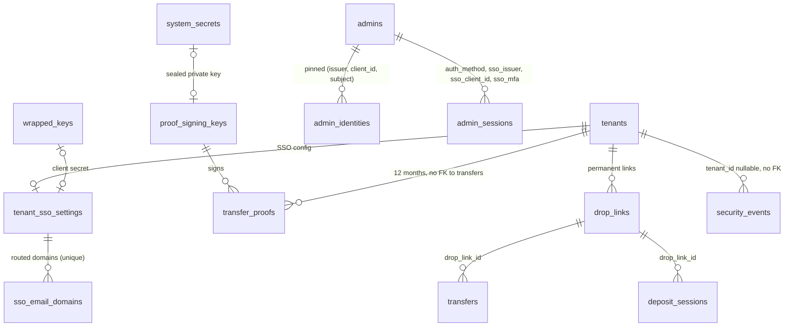

# TransTeira V2: data model

> V2, step 1, data part. Status: **proposal, to be validated before any code**.
> Sources: CLAUDE.md (sections 2, 6.5, 8.2 and 22), the V2 design brief (features F1 to F10 and
> its amendments A1 to A9), `docs/architecture/data-model-v1.1.md`, `data-model-v1.2.md`,
> migrations `internal/store/migrations/{sqlite,postgres}/0001..0025`, package `internal/store`.
> The migrations 0026 to 0029 are written alongside this document (0030 was added during the
> implementation of F4, section 2.5) (they apply on both engines
> and pass the store tests); the Go store code that uses them comes with the implementation steps.

## 1. Principles

All V1, V1.1 and V1.2 conventions still apply (see `data-model-v1.1.md`, section 1, and
`data-model-v1.2.md`, section 1). V2 is additive for the data it keeps, but widens four checks,
so SQLite rebuilds four tables (`admins`, `system_secrets`, `transfers`, `transfer_files`) and one
unreferenced one (`deposit_sessions`).

| Topic | Rule |
|---|---|
| Defaults reproduce 1.2 | Every new column is nullable or has a default that reproduces the 1.2 behaviour: no link-only (`tenants.link_only_allowed = 0`), no end-to-end encryption (`e2e_policy = 'forbidden'`), sessions opened by password, no SSO configuration, no drop link, no proof. |
| Check changes | PostgreSQL: `DROP CONSTRAINT` / `ADD CONSTRAINT` under the existing name. SQLite: table rebuild with the foreign-keys-off procedure of `data-model-v1.1.md` §2.1 (the migrator disables foreign keys for every SQLite migration and runs `PRAGMA foreign_key_check` before recording it). Every index and trigger of a rebuilt table is recreated. |
| Tenant scoping | New tenant tables carry `tenant_id` and get the usual isolation policy (`tenant_sso_settings`, `sso_email_domains`, `transfer_proofs`, `drop_links`) or a read-only tenant policy (`security_events`). New instance tables (`admin_identities`, `proof_signing_keys`) have no `tenant_id`, are reached through `systemQuery` only and are added to the instance list of `DB.Verify` (`verifyRLS`). |
| Secrets | The SSO client secret is a tenant wrapped secret (`wrapped_keys`, purpose `secret`), exactly like the SMTP password. The proof signing private key is a system secret (`system_secrets`, new purpose `proof-signing`), like the TOTP secrets and instance webhook secrets. Both are therefore rewrapped by the master key rotation with no new code path, and deleting the row is their cryptographic erasure. A drop link token is stored as SHA-256 only. |
| Enums owned by the code | Security event types are not constrained (the set lives in `internal/securitylog`). Closed sets are constrained: roles, depositor kinds, scan status, proof kind, E2E policy, session auth method. |
| Types | SQLite `STRICT`, Unix **milliseconds** UTC, `TEXT` ids (`COLLATE "C"` on PostgreSQL), booleans `INTEGER 0/1` / `BOOLEAN`, hashes and keys `BLOB` / `BYTEA` with a length check, JSON as `TEXT` validated by the store. Exception: `drop_links.recipients` is also checked by the database (SQLite `json_valid` and `json_type = 'array'`; PostgreSQL `JSONB` with `jsonb_typeof = 'array'`, no version-specific function). No GRANT in migrations. |
| Parity | Each migration exists for both engines with the same columns, constraints and named indexes. |

## 2. Migration plan

| # | Name | Feature | Content |
|---|---|---|---|
| 0026 | `auditor` | F1 | `admins.role` accepts `auditor` (SQLite rebuild of `admins`). New table `security_events`. |
| 0027 | `sso` | F2, A1 | New tables `tenant_sso_settings`, `sso_email_domains`, `admin_identities` (keyed by issuer, client ID and subject). `admin_sessions`: `auth_method`, `sso_issuer`, `sso_client_id`, `sso_mfa`. |
| 0028 | `proofs` | F3, A8 | `system_secrets.purpose` accepts `proof-signing` (SQLite rebuild). New tables `proof_signing_keys`, `transfer_proofs` (immutable). |
| 0029 | `transfer_options_v2` | F5, F6, F7, A7, A9 | `tenants`: `link_only_allowed`, `e2e_policy`. `confidentiality_levels`: `link_only_allowed`, `e2e_policy`. New table `drop_links`. `transfers`: `link_only`, `e2e`, `e2e_message`, `drop_link_id`, `sender_kind` `drop_link`. `transfer_files`: `e2e_metadata`, scan status `not_scanned_e2e`. `deposit_sessions`: `drop_link_id`, kind `drop_link`. |
| 0030 | `network_review` | F4, T-307 | `tenants`: `network_reviewed_at`, backfilled for the tenants that have network rules. Added during the implementation of F4 (decision of 2026-11-05, section 2.5). |

F8 (CLI), F9 (signed image) and F10 (compliance kit) need no schema change; F4 (export / import) only needs 0030.
Every transfer-level change is in 0029, so that `transfers` is rebuilt once on SQLite, after
`drop_links` exists (its composite foreign key target).

### 2.1 Migration 0026 `auditor` (F1, A3)

```sql
role TEXT NOT NULL CHECK (role IN ('super_admin', 'delegated_admin', 'auditor'))   -- admins

CREATE TABLE security_events (
    id           TEXT    NOT NULL PRIMARY KEY,           -- "sev_" + ULID
    at           INTEGER NOT NULL,                       -- first occurrence
    tenant_id    TEXT,                                   -- NULL: no tenant (unknown FQDN, admin host); no FK
    event_type   TEXT    NOT NULL CHECK (length(event_type) BETWEEN 1 AND 64),
    reason       TEXT    CHECK (reason IS NULL OR length(reason) BETWEEN 1 AND 64),
    ip           TEXT    CHECK (ip IS NULL OR length(ip) BETWEEN 2 AND 64),
    details      TEXT    CHECK (details IS NULL OR octet_length(details) <= 2048),  -- JSON: scope, purpose, host
    occurrences  INTEGER NOT NULL DEFAULT 1 CHECK (occurrences >= 1),
    last_seen_at INTEGER NOT NULL,
    CHECK (last_seen_at >= at)
) STRICT;
CREATE INDEX security_events_tenant_at_idx ON security_events (tenant_id, at, id);
CREATE INDEX security_events_at_idx ON security_events (at, id);
```

- **Auditor.** Only the role check changes. An auditor is attached to tenants through `admin_tenants`, like a delegated admin; `require_totp` defaults to 1 and stays optional (only a super admin is forced, unchanged check). No other check lists roles (`admin_sessions`, `audit_events.actor_kind` and `admin_tenants` have none). The Go constant `store.RoleAuditor` exists; `normalizeAdmin` still refuses it until the auditor step implements it.
- **SQLite rebuild of `admins`.** `admins` is referenced by `admin_tenants`, `admin_sessions`, `admin_recovery_codes`, `admin_activations` (and, after 0027, `admin_identities`). Plain pattern with foreign keys off: `CREATE admins_0026`, copy, `DROP`, `RENAME`, recreate `admins_role_idx`. No trigger or view references `admins`. PostgreSQL: `DROP CONSTRAINT admins_role_check` / `ADD CONSTRAINT admins_role_check`.
- **Security events.** One row mirrors one (or several coalesced) security log line(s); the file log, its format and its tests are unchanged (fail2ban, CrowdSec). Written through an asynchronous bounded queue that coalesces identical events (same type, reason, IP and tenant inside a window, A3): the row keeps the first time (`at`), the last (`last_seen_at`) and the count. Queue overflow drops database copies only. `event_type` and `reason` are the stable tokens of the log (`sso_failed`, `drop_link_invalid` added by V2); the other fields (`scope`, `purpose`, `host`) go to `details`. `host` of an unknown FQDN is the attacker-supplied, already normalised and truncated value the log writes; it is never an e-mail address. **No e-mail address is ever stored.**
- **Tenant resolution.** The security log identifies a tenant by FQDN; the writer passes the tenant ID it already has in the request context. `tenant_id` is not a foreign key (like `audit_events`): events of a deleted tenant stay readable by the super admin until the purge.
- **RLS.** `security_events_system` (all commands, system scope) and `security_events_tenant_select` (SELECT of its own tenant's rows). There is no tenant INSERT policy: events are written by the queue in the system scope. Pagination `(at, id)` as for audit events; the type filter scans the tenant/time range (no extra index: few rows per tenant).

### 2.2 Migration 0027 `sso` (F2, A1)

```sql
CREATE TABLE tenant_sso_settings (
    tenant_id            TEXT    NOT NULL PRIMARY KEY REFERENCES tenants (id) ON DELETE CASCADE,
    enabled              INTEGER NOT NULL DEFAULT 0 CHECK (enabled IN (0, 1)),
    issuer               TEXT    NOT NULL CHECK (length(issuer) BETWEEN 9 AND 512 AND issuer LIKE 'https://%'),
    client_id            TEXT    NOT NULL CHECK (length(client_id) BETWEEN 1 AND 255),
    client_secret_key_id TEXT    REFERENCES wrapped_keys (id) ON DELETE SET NULL,   -- as tenant_smtp_settings.password_key_id
    enforced             INTEGER NOT NULL DEFAULT 0 CHECK (enforced IN (0, 1)),
    require_mfa          INTEGER NOT NULL DEFAULT 1 CHECK (require_mfa IN (0, 1)),
    created_at           INTEGER NOT NULL,
    updated_at           INTEGER NOT NULL,
    updated_by           TEXT    NOT NULL DEFAULT '' CHECK (length(updated_by) <= 64)
) STRICT;
CREATE UNIQUE INDEX tenant_sso_settings_secret_idx ON tenant_sso_settings (client_secret_key_id)
    WHERE client_secret_key_id IS NOT NULL;

CREATE TABLE sso_email_domains (
    domain    TEXT NOT NULL PRIMARY KEY CHECK (length(domain) BETWEEN 1 AND 253 AND domain = lower(domain)),
    tenant_id TEXT NOT NULL REFERENCES tenant_sso_settings (tenant_id) ON DELETE CASCADE
) STRICT, WITHOUT ROWID;
CREATE INDEX sso_email_domains_tenant_idx ON sso_email_domains (tenant_id, domain);

CREATE TABLE admin_identities (
    id           TEXT    NOT NULL PRIMARY KEY,           -- "aid_" + ULID
    admin_id     TEXT    NOT NULL REFERENCES admins (id) ON DELETE CASCADE,
    issuer       TEXT    NOT NULL CHECK (length(issuer) BETWEEN 9 AND 512),
    client_id    TEXT    NOT NULL CHECK (length(client_id) BETWEEN 1 AND 255),   -- application of the login
    subject      TEXT    NOT NULL CHECK (length(subject) BETWEEN 1 AND 255),
    created_at   INTEGER NOT NULL,
    last_used_at INTEGER,
    UNIQUE (issuer, client_id, subject),
    UNIQUE (admin_id, issuer, client_id)
) STRICT;

-- admin_sessions (A1, review S1)
auth_method   TEXT    NOT NULL DEFAULT 'password' CHECK (auth_method IN ('password', 'oidc'))
sso_issuer    TEXT    CHECK (sso_issuer IS NULL OR length(sso_issuer) BETWEEN 9 AND 512)
sso_client_id TEXT    CHECK (sso_client_id IS NULL OR length(sso_client_id) BETWEEN 1 AND 255)
sso_mfa       INTEGER CHECK (sso_mfa IS NULL OR sso_mfa IN (0, 1))                 -- PG BOOLEAN
CHECK ((auth_method = 'oidc') = (sso_issuer IS NOT NULL))                          -- the three SSO columns:
CHECK ((auth_method = 'oidc') = (sso_client_id IS NOT NULL))                       -- set for oidc only
CHECK ((auth_method = 'oidc') = (sso_mfa IS NOT NULL))
CHECK (auth_method = 'password' OR state = 'authenticated')
```

- **Client secret.** Same mechanism as the SMTP password (0003): a `wrapped_keys` row of the tenant, purpose `secret`, referenced by `client_secret_key_id`; the store checks the key's tenant, the master key rotation rewraps it with every wrapped key, deleting the key is the erasure and leaves the configuration without secret (the store refuses `enabled = 1` then). The unique index forbids two configurations sharing a secret row. Never exported (A2: the SSO configuration is not exported at all).
- **Issuer.** The check only bounds the value and requires `https://`; the Entra multi-tenant refusal (`/common`, `/organizations`, `/consumers` → `sso-issuer-not-allowed`) is a store/service rule.
- **E-mail domains.** Not duplicated as JSON in `tenant_sso_settings`: the rows of `sso_email_domains` are the list (≥ 1 when enabled, store rule). The primary key on `domain` alone gives the instance-wide uniqueness of the brief (`sso-domain-conflict`, mapped from the unique violation); unique constraints are enforced whatever the RLS scope. The rows follow the configuration (`ON DELETE CASCADE` from `tenant_sso_settings`, itself cascaded from `tenants`). Domains are stored lower case, IDNA A-label (store).
- **Identities.** Instance table, like `admins` (an account can be attached to several tenants; the tenant whose configuration was used is recorded in the audit `admin.identity_linked`). Entra ID `sub` values are pairwise per application, so the same person has a different subject in two app registrations: an identity is keyed by `(issuer, client_id, subject)` and matching after the first login is by that triple only; an account has at most one identity per `(issuer, client_id)`. `DELETE /admin/admins/{id}/identities/{identityId}` deletes the row. A super admin never gets an identity (service rule).
- **SSO-only accounts (`delivery: none`).** No activation row is created: such an account has `password_hash` NULL and no pending `admin_activations` row. **`admin_activations.delivery` is therefore not widened** (a row needs a token hash, which a link-less account does not have). Decided 2026-11-04: the state is explicit, `admins.sso_only` (migration 0026: `INTEGER`/boolean NOT NULL DEFAULT 0/false; CHECKs: `sso_only` implies `password_hash IS NULL` and `role <> 'super_admin'`; existing rows get 0). The API exposes it as the read-only `Admin.ssoOnly`.
- **Sessions (A1, review S1).** `auth_method`, `sso_issuer`, `sso_client_id` and `sso_mfa` are added to `admin_sessions` (`ADD COLUMN`, no rebuild: SQLite accepts a column check referring to an earlier column); the three SSO columns are set for an `oidc` session only. Existing sessions are `password`. An SSO session is opened directly `authenticated` (MFA delegated to the IdP; `sso_mfa` records whether the ID token proved it) and a tenant is in its scope only if, on every request, the tenant's `tenant_sso_settings` row is `enabled`, has `issuer = sso_issuer` **and** `client_id = sso_client_id`, and its `require_mfa` is satisfied (`require_mfa = 0 OR sso_mfa = 1`). A later change of the configuration (disabled, other issuer or application, MFA newly required) cuts the session off from that tenant at once.
- **RLS.** `tenant_sso_settings_isolation` and `sso_email_domains_isolation` (usual tenant template). The SSO login, on an admin host, resolves the domain in the system scope (no tenant yet). Writes are super-admin-only (A1) and done in the system scope; the delegated admin and auditor read. `admin_identities_system` (system scope only). `admin_sessions` keeps `admin_sessions_system`.

### 2.3 Migration 0028 `proofs` (F3, A8)

```sql
purpose TEXT NOT NULL CHECK (purpose IN ('admin-totp', 'webhook', 'proof-signing'))   -- system_secrets

CREATE TABLE proof_signing_keys (
    id                    TEXT    NOT NULL PRIMARY KEY,                                -- "psk_" + ULID (kid)
    public_key            BLOB    NOT NULL UNIQUE CHECK (length(public_key) = 32),     -- raw Ed25519
    private_key_secret_id TEXT    UNIQUE REFERENCES system_secrets (id) ON DELETE SET NULL,
    created_at            INTEGER NOT NULL,
    retired_at            INTEGER,
    CHECK (retired_at IS NOT NULL OR private_key_secret_id IS NOT NULL),
    CHECK (retired_at IS NULL OR retired_at >= created_at)
) STRICT;
CREATE UNIQUE INDEX proof_signing_keys_one_active_idx ON proof_signing_keys ((retired_at IS NULL))
    WHERE retired_at IS NULL;

CREATE TABLE transfer_proofs (
    id                TEXT    NOT NULL PRIMARY KEY,                                    -- "prf_" + ULID
    tenant_id         TEXT    NOT NULL REFERENCES tenants (id) ON DELETE CASCADE,
    transfer_id       TEXT    NOT NULL,                                                -- no FK: outlives the transfer
    kind              TEXT    NOT NULL CHECK (kind IN ('deposit', 'delivery')),
    recipient_link_id TEXT,                                                            -- per-recipient delivery; no FK
    statement         TEXT    NOT NULL CHECK (octet_length(statement) BETWEEN 2 AND 4194304),  -- RFC 8785 JSON
    signature         BLOB    NOT NULL CHECK (length(signature) = 64),                -- Ed25519
    key_id            TEXT    NOT NULL REFERENCES proof_signing_keys (id),
    created_at        INTEGER NOT NULL,
    expires_at        INTEGER NOT NULL,                                                -- created_at + 12 months
    CHECK (kind = 'delivery' OR recipient_link_id IS NULL),
    CHECK (expires_at > created_at)
) STRICT;
CREATE UNIQUE INDEX transfer_proofs_transfer_idx ON transfer_proofs (tenant_id, transfer_id, kind)
    WHERE recipient_link_id IS NULL;
CREATE UNIQUE INDEX transfer_proofs_recipient_idx ON transfer_proofs (tenant_id, transfer_id, recipient_link_id)
    WHERE recipient_link_id IS NOT NULL;
CREATE INDEX transfer_proofs_expires_idx ON transfer_proofs (expires_at, id);
CREATE INDEX transfer_proofs_key_idx ON transfer_proofs (key_id);
-- plus an UPDATE-refusing trigger (immutability)
```

- **Signing keys.** The private key is a system secret (new purpose `proof-signing`): sealed by the master key, rewrapped by its rotation like the TOTP secrets. SQLite rebuilds `system_secrets` exactly as 0018 did (referenced by `admins` and `system_webhooks`, foreign keys off, index and both retired-key triggers recreated); PostgreSQL replaces `system_secrets_purpose_check`, keeping the trigger and the policy. At most one active key (partial unique index on an expression, identical on both engines), created on first use. A retired key keeps its public key for ever (published by `/proof-keys`, A8); its private key may be erased (`ON DELETE SET NULL`), never while active (the check makes that delete fail). Key rows are never deleted (`transfer_proofs.key_id` has no `ON DELETE`).
- **Proofs are immutable (A8).** One row per fact: the deposit proof at finalization (after the antivirus verdict), one overall `delivery` row at the first download, then one `delivery` row per recipient link at that recipient's first download. No row is ever updated: triggers refuse `UPDATE` on both engines (SQLite `RAISE(ABORT, 'transteira: proofs are immutable')`, PostgreSQL SQLSTATE `TTP01`), in every scope. The two partial unique indexes do not contradict A8: they enforce **one row per fact** (one deposit, one overall first delivery, one first delivery per recipient link), so that a retried or concurrent insert of the same fact is a conflict instead of a second, diverging signed statement.
- **Retention.** `expires_at = created_at + 12 months`, purged by the lifecycle task through `transfer_proofs_expires_idx`, independently of the transfer (no foreign key on `transfer_id`, nor on `recipient_link_id`). Deleting the tenant deletes its proofs (cascade, decided 2026-11-04).
- **Cross-scope foreign key.** `transfer_proofs` (tenant scope) references `proof_signing_keys` (system scope). PostgreSQL referential integrity checks are not filtered by row-level security, so a tenant-scoped insert works; the tenant scope still cannot read the key table. Signing itself (reading the private key) is a system-scope operation done before the tenant-scoped insert.
- **Data-subject erasure.** Statements name the sender and recipients. The erasure deletes, in its tenant scope, the proofs whose statement names the address: SQL prefilter on `lower(statement)` (`instr` on SQLite, `strpos` on PostgreSQL) looking for the normalized address, or for its `@domain` part when the address holds a character that a JSON encoding may escape (the prefilter only has to select a superset), then confirmation by parsing the JSON in Go (sender, recipients and recipient downloads; no false positive deletes another person's proof). No address column is added (minimisation, decided 2026-11-04). **Implemented as designed, with two precisions:** the statement must be **valid JSON at insert** (`json.Valid`, within a size range; the signature is checked at 64 bytes), and the prefilter is the lower-cased one above rather than a plain `instr(statement, <address>)`.
- **E2E transfers (F7).** The statement carries the ciphertext hashes and `endToEndEncrypted: true`; no schema impact.
- **RLS.** `proof_signing_keys_system` (system only, added to the `verifyRLS` instance list) and `transfer_proofs_isolation` (usual tenant template).

### 2.4 Migration 0029 `transfer_options_v2` (F5, F6, F7, A7, A9)

**Policies.**

```sql
-- tenants
link_only_allowed INTEGER NOT NULL DEFAULT 0 CHECK (link_only_allowed IN (0, 1))           -- PG BOOLEAN DEFAULT false
e2e_policy        TEXT    NOT NULL DEFAULT 'forbidden' CHECK (e2e_policy IN ('forbidden', 'allowed', 'required'))
-- confidentiality_levels
link_only_allowed INTEGER NOT NULL DEFAULT 1 CHECK (link_only_allowed IN (0, 1))           -- PG BOOLEAN DEFAULT true
e2e_policy        TEXT    CHECK (e2e_policy IS NULL OR e2e_policy IN ('forbidden', 'allowed', 'required'))
```

The defaults reproduce 1.2 (nothing new allowed). The tenant columns are written by the super
admin only (like `antivirus_enabled`: `e2e_policy = 'required'` means no antivirus for the
tenant), audited. The level columns may be written by the delegated admin, but only tighten the
tenant: the effective policy is computed by the store at transfer creation (a level `NULL`
follows the tenant; a tenant `forbidden` stays forbidden whatever the level; a tenant `required`
is a floor that stays required whatever the level; with a tenant `allowed`, the level may set
`forbidden` or `required`). The database only bounds the values, because the tenant policy can
change after the levels were written. The defaults are kept on PostgreSQL
(unlike `setup_state` in 0022, the default is the safe value). These are configuration, exported
by F4.

**Drop links (F5).**

```sql
CREATE TABLE drop_links (
    id                    TEXT    NOT NULL PRIMARY KEY,                              -- "drl_" + ULID
    tenant_id             TEXT    NOT NULL REFERENCES tenants (id) ON DELETE CASCADE,
    token_hash            BLOB    NOT NULL UNIQUE CHECK (length(token_hash) = 32),   -- SHA-256 of "ttd_..."
    label                 TEXT    NOT NULL CHECK (length(label) BETWEEN 1 AND 100),
    recipients            TEXT    NOT NULL CHECK (octet_length(recipients) BETWEEN 2 AND 65536
                                  AND json_valid(recipients) AND json_type(recipients) = 'array'),
                                  -- PG: JSONB CHECK (octet_length(recipients::text) BETWEEN 2 AND 65536
                                  --                  AND jsonb_typeof(recipients) = 'array')
    validity_days         INTEGER NOT NULL CHECK (validity_days IN (1, 7, 30)),
    confidentiality_level TEXT    CHECK (confidentiality_level IS NULL OR length(confidentiality_level) BETWEEN 1 AND 32),
    enabled               INTEGER NOT NULL DEFAULT 1 CHECK (enabled IN (0, 1)),
    created_by            TEXT    NOT NULL CHECK (length(created_by) BETWEEN 1 AND 64),  -- admin ID, no FK
    created_at            INTEGER NOT NULL,
    updated_at            INTEGER NOT NULL,
    last_used_at          INTEGER,
    revoked_at            INTEGER,
    UNIQUE (tenant_id, id)
) STRICT;
CREATE INDEX drop_links_tenant_created_idx ON drop_links (tenant_id, created_at, id);
```

- **Token.** Lookup by `token_hash` (unique, global) on the tenant host, then the tenant, `enabled` and `revoked_at` are checked: unknown, revoked and disabled answer the same 404 `drop-link-invalid`. Rotation replaces `token_hash` in place (the old token dies at once). No `prefix` column: the brief shows the token only at creation and rotation.
- **`confidentiality_level`** (named after `transfers.confidentiality_level`; the brief's `confidentiality_level_id` does not exist because levels are keyed by `(tenant_id, key)`): `drop_links` references the level **by its key** (`confidentiality_levels.key` of the same tenant), not by a row ID, and not through a foreign key. A composite `ON DELETE SET NULL` would null `tenant_id` too, which SQLite cannot avoid. When a level is deleted, the store refuses the deletion while enabled drop links use it (decided 2026-11-04).
- **`recipients`**: JSON array of internal addresses, non-empty, each in an internal domain of the tenant (store); the database checks that it is valid JSON and an array (SQLite `json_valid`/`json_type`, PostgreSQL `JSONB`). `last_used_at` is written at most once per minute (store rule, like API tokens). Max 100 links per tenant (store, `drop-link-limit-reached`).
- **Revoke, never delete**: `DELETE` sets `revoked_at`. The row stays, so the transfers keep their reference; the tenant deletion removes everything.
- **RLS.** `drop_links_isolation` (usual tenant template). The public lookup runs in the tenant scope of the host.

**Transfers.**

```sql
sender_kind  TEXT    NOT NULL CHECK (sender_kind IN ('internal', 'external', 'internal_remote', 'reply', 'drop_link')),
link_only    INTEGER NOT NULL DEFAULT 0 CHECK (link_only IN (0, 1)),           -- PG BOOLEAN
e2e          INTEGER NOT NULL DEFAULT 0 CHECK (e2e IN (0, 1)),                 -- PG BOOLEAN
drop_link_id TEXT,
e2e_message  TEXT    CHECK (e2e_message IS NULL OR octet_length(e2e_message) BETWEEN 1 AND 32768),
CHECK ((sender_kind = 'drop_link') = (drop_link_id IS NOT NULL)),
CHECK (link_only = 0 OR link_mode = 'shared'),
CHECK (e2e = 1 OR e2e_message IS NULL),
CHECK (e2e = 0 OR message = ''),
CHECK (e2e = 0 OR sender_kind <> 'drop_link'),
FOREIGN KEY (tenant_id, drop_link_id) REFERENCES drop_links (tenant_id, id)    -- no action
CREATE INDEX transfers_drop_link_idx ON transfers (tenant_id, drop_link_id, created_at) WHERE drop_link_id IS NOT NULL;
```

- **Origin `drop_link`.** No invitation, no API token (the existing `api_token_id` check already restricts tokens to internal kinds), no reply source. The composite foreign key keeps the link in the same tenant; it has no `ON DELETE` action, as for invitations, which is safe because links are only revoked.
- **Link-only (F6).** `link_only = 1` requires `link_mode = 'shared'` (check `link_only = 0 OR link_mode = 'shared'`). A link-only transfer has exactly one link, returned once by finalize: it uses the shared token (`download_token_hash`), which also excludes recipient verification (existing check `recipient_verification = 0 OR link_mode = 'per_recipient'`, hence `link-only-conflict`). Recipients may still be recorded in `transfer_recipients`; they are not mailed. **Reissue (A9)**: `POST /me/transfers/{id}/link` replaces `download_token_hash` (and its sealed copy `download_token_key_id`, if any) in place, which kills the old link: no column.
- **E2E (F7, A7).** `e2e` marks a browser-encrypted transfer. The free-text message is encrypted too: `e2e_message` holds the base64url blob (5000 characters of plaintext, up to 4 bytes each, plus framing, fit in 32 KiB) and `message` stays `''` (checks). Drop links refuse E2E in 2.0 (check). No transfer-level rule snapshot is added for the link-only and E2E policies: they only matter at creation, and the outcome is recorded by `link_only` / `e2e`.
- **SQLite rebuild.** `transfers` is rebuilt (`transfers_0029`) with every column of 0025 plus the new ones, and its 19 indexes are recreated (list in `data-model-v1.1.md` §2.1, plus `transfers_sender_created_idx`, `transfers_reminder_idx` and the new `transfers_drop_link_idx`). PostgreSQL: `ALTER TABLE` with `transfers_sender_kind_check` replaced and named constraints `transfers_drop_link_check`, `transfers_link_only_check`, `transfers_e2e_only_message_check`, `transfers_e2e_plain_message_check`, `transfers_e2e_drop_link_check`, `transfers_drop_link_fkey`.

**Files.**

```sql
scan_status  TEXT NOT NULL DEFAULT 'pending' CHECK (scan_status IN ('pending', 'scanning', 'clean', 'infected',
             'not_scanned_too_large', 'not_scanned_encrypted', 'not_scanned_disabled', 'scan_error', 'not_scanned_e2e')),
e2e_metadata TEXT CHECK (e2e_metadata IS NULL OR octet_length(e2e_metadata) BETWEEN 1 AND 5462),
CHECK (scan_status <> 'not_scanned_e2e' OR e2e_metadata IS NOT NULL)
```

- An E2E file gets `not_scanned_e2e` at finalization (like `not_scanned_disabled`), so `scanned_at` is set as the existing check requires. Decided: the value is the flat `not_scanned_e2e` everywhere (database, `ScanStatus` of the API, threat model), like `not_scanned_disabled`; there is no separate reason field.
- `e2e_metadata` is the base64url `encryptedMetadata` (≤ 4 KiB decoded, so ≤ 5462 characters encoded; the store enforces the exact limit). For an E2E file, `name` is the generic `file-<n>.tte2`, `media_type` is `''`, and `sha256` is the SHA-256 of the ciphertext the server computes. At rest the ciphertext is still TTEF-encrypted with a per-file key, so cryptographic erasure is unchanged.
- SQLite rebuilds `transfer_files` (not referenced by any table; index `transfer_files_tenant_id_idx` recreated). PostgreSQL replaces `transfer_files_scan_status_check` and adds `transfer_files_e2e_check`.

**Deposit sessions.**

```sql
kind         TEXT NOT NULL CHECK (kind IN ('internal', 'external', 'internal_remote', 'reply', 'drop_link')),
drop_link_id TEXT,
CHECK ((kind = 'drop_link') = (drop_link_id IS NOT NULL)),
FOREIGN KEY (tenant_id, drop_link_id) REFERENCES drop_links (tenant_id, id) ON DELETE CASCADE
CREATE INDEX deposit_sessions_drop_link_idx ON deposit_sessions (tenant_id, drop_link_id) WHERE drop_link_id IS NOT NULL;
```

The e-mail code is required at every drop link use: a `drop_link` session is never reused for a
second deposit (store rule, like `internal_remote`). SQLite rebuilds `deposit_sessions` (not
referenced); PostgreSQL replaces `deposit_sessions_kind_check`. `store.DepositorKind` gains
`drop_link` at the drop link step.

### 2.5 Migration 0030 `network_review` (F4, T-307)

Added during the implementation of F4, after the human review of 2026-11-05: the internal IP
ranges and mail domains written by a configuration import come from another tenant and would
make the users of its networks "internal"; they must be confirmed before the new tenant leaves
`setup`.

```sql
network_reviewed_at INTEGER   -- PG: BIGINT, NULL = never saved by an admin
```

- **Meaning.** The last time an administrator saved the network rules of the tenant
  (`PUT /admin/tenants/{id}/network`, even unchanged), written by
  `store.NetworkRules.ReplaceReviewed` in the transaction that replaces the rules, under the
  tenant lock. `NetworkRules.Replace` and `ReplaceTx` (the import path) never write it; the
  tenant creation writes NULL; the general update never touches it; the export never carries it.
- **Use.** The `internal_networks` and `internal_domains` items of the setup checklist are done
  only when rules exist **and** the column is set, and the guarded statement of
  `Tenants.CompleteSetup` (completion that is not forced) requires `network_reviewed_at IS NOT
  NULL` next to its existing rule checks. The forced completion of the super admin ignores it.
  Exposed as `networkReviewedAt` (date-time, null when never) in `TenantSetup`.
- **Backfill.** Every existing tenant having at least one network rule (range or domain) gets
  its `updated_at`: those rules were entered by hand, and no existing checklist changes. A
  tenant without any rule stays NULL (its items are not done anyway).
- **PostgreSQL.** `ALTER TABLE tenants ADD COLUMN`: the row-level security and the policies of
  `tenants` (0001) are kept. The column is written in the system scope only
  (`tenants_system` policy); `ReplaceReviewed` then switches the same transaction to the tenant
  scope (`SystemTx.WithTenant`) to replace the rules under `tenant_network_rules_isolation`.
- **Tests.** `TestMigration0030Upgrade` (backfill, both engines), `TestNetworkRulesReplaceReviewed`
  and `TestTenantsCompleteSetup` (store), `TestSetupNetworkReview` and `TestImportRoundTrip`
  (tenantadmin), `TestTenantConfigRoundTrip` (integration).
- **Retention.** Configuration, kept for the tenant's lifetime.

## 3. PostgreSQL RLS summary

Templates: tenant isolation (`tenant_id = app.tenant_id OR system scope`, as `tenant_network_rules`),
instance (`system scope` only, as `admins_system`), read-only tenant (system policy + tenant
SELECT, as `audit_events` without the tenant INSERT).

| Table | Change | RLS |
|---|---|---|
| `admins` | role check | Unchanged (`admins_system`). |
| `security_events` | New | `security_events_system` + `security_events_tenant_select`. |
| `tenant_sso_settings` | New | `tenant_sso_settings_isolation`. |
| `sso_email_domains` | New | `sso_email_domains_isolation`. |
| `admin_identities` | New | `admin_identities_system`; added to the `verifyRLS` instance list. |
| `admin_sessions` | 4 columns | Unchanged (`admin_sessions_system`). |
| `system_secrets` | purpose check | Unchanged (`system_secrets_system`). |
| `proof_signing_keys` | New | `proof_signing_keys_system`; added to the `verifyRLS` instance list. |
| `transfer_proofs` | New | `transfer_proofs_isolation` + immutability trigger. |
| `drop_links` | New | `drop_links_isolation`. |
| `tenants`, `confidentiality_levels`, `transfers`, `transfer_files`, `deposit_sessions` | columns, checks | Unchanged. |

`DB.Verify` and `test/isolation/rls_test.go` cover every new table (new tenant tables through
their `tenant_id` column, new instance tables through the explicit list).

## 4. Purge and retention (spec 20)

| Data | Rule |
|---|---|
| `security_events` | **12 months** after `at`, purged with the audit log (`security_events_at_idx`). Holds client IPs (personal data), never an e-mail. Not touched by the data-subject erasure (no address). |
| `tenant_sso_settings`, `sso_email_domains` | Configuration, tenant lifetime. Deleting the configuration erases its secret (store deletes the wrapped key) and its domains (cascade). |
| `admin_identities` | Account lifetime (cascade from `admins`); unpinned by the super admin. Holds the IdP subject (pseudonymous identifier). |
| `admin_sessions.auth_method`, `sso_issuer`, `sso_client_id`, `sso_mfa` | Follow the session (existing purge). |
| `proof_signing_keys` | Kept for ever (public keys must keep verifying old PDFs). The private key of a retired key may be erased. No personal data. |
| `transfer_proofs` | **12 months** after creation (`expires_at`), independent of the transfer; deleted by the data-subject erasure when the statement names the address; deleted with the tenant. |
| `drop_links` | Configuration, kept while active; **purged 12 months after revocation** (`revoked_at`) by the lifecycle task through `drop_links_revoked_idx` (partial, migration 0029), once no transfer references the link (otherwise the link is kept until its transfers are purged). `recipients` holds internal addresses: the data-subject erasure removes the address from the list and disables the link when the list becomes empty. |
| `transfers.e2e_message`, `transfer_files.e2e_metadata` | Follow the transfer (existing purge). Ciphertext only: unreadable by the server. |

## 5. Impact on existing behaviour

- **Store inserts.** `INSERT INTO transfers`, `transfer_files`, `deposit_sessions`, `admin_sessions` keep working unchanged (every new column has a default or is nullable). Raw test inserts on `security_events` must give `last_seen_at`.
- **Upgrade tests.** The tests that count applied migrations now expect 17 from a V1 database (0014 to 0030) and 10 from 0020; `migrate` from scratch applies 30. The index check of the rebuilt SQLite tables now includes `admins` and the two new indexes. `TestV2SchemaConstraints` (`internal/store/migrate_v2_internal_test.go`) checks the V2 invariants on both engines.
- **Schema parity.** The new named indexes exist on both engines.
- **Rebuilt tables on SQLite.** `admins`, `system_secrets`, `transfers`, `transfer_files`, `deposit_sessions` keep their rows; the V1.1 upgrade test (populated V1 database, row counts, foreign key and integrity checks) now runs through 0030.

## 6. ER summary



## 7. Decisions

| Topic | Decision | Where |
|---|---|---|
| Grouping | Four migrations, one per feature group; one rebuild of `transfers` | §2 |
| SSO secret | `wrapped_keys` row, like the SMTP password | §2.2 |
| Proof private key | `system_secrets` purpose `proof-signing` | §2.3 |
| Proof immutability | Triggers refuse UPDATE; partial unique indexes = one row per fact | §2.3 |
| Session scope (A1, S1) | `admin_sessions.auth_method`, `sso_issuer`, `sso_client_id`, `sso_mfa`; enabled config with same issuer and client ID, MFA satisfied | §2.2 |
| Identity key (S1) | `admin_identities` unique `(issuer, client_id, subject)` and `(admin_id, issuer, client_id)` | §2.2 |
| Tenant policies (S2) | `link_only_allowed`, `e2e_policy` of the tenant: super admin only; a level only tightens, tenant `forbidden` and `required` both hold | §2.4 |
| Scan status (C2) | Flat `not_scanned_e2e` | §2.4 |
| Link-only | Shared link token; reissue replaces it | §2.4 |
| E2E message (A7) | `transfers.e2e_message`, plaintext `message` empty | §2.4 |

Points that were open, all **decided (2026-11-04)** with the validation of the design:

1. **Proof retention**: 12 months after the fact, kept even after the transfer is deleted, erased by the data-subject erasure.
2. **Proof erasure by address**: text prefilter on `statement` plus JSON confirmation, no address column.
3. **Proofs and tenant deletion**: deleted with their tenant (cascade).
4. **Revoked drop links**: purged 12 months after revocation (lifecycle purge, `drop_links_revoked_idx` on `(revoked_at, id) WHERE revoked_at IS NOT NULL`, both engines).
5. **Scan status value**: the flat `not_scanned_e2e`, in the database, the API `ScanStatus` and the threat model, like `not_scanned_disabled`.
6. **SSO-only accounts**: explicit column `admins.sso_only` (migration 0026), no activation row for `delivery: none`, `admin_activations.delivery` not widened.
7. **Drop link level**: stored as the level key without foreign key; the store refuses deleting a level used by an enabled drop link.
8. **Brief points 2 to 5**: the auditor sees the transfer list (metadata, no message, no file) to find proofs; E2E recipient mails carry the link without the key and the sender hands the key out of band; `link_only_allowed` defaults to false; `require_mfa` defaults to true, to be checked against Entra ID tokens at the SSO step (A6: v2 ID tokens may not carry `amr`; an Entra optional claim or conditional access configuration may be needed).
9. **Security event coalescing** (A3) keeps one row per window; `from`/`to` filters compare `at` (first occurrence).
