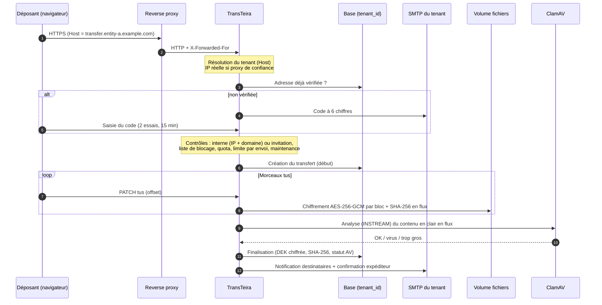
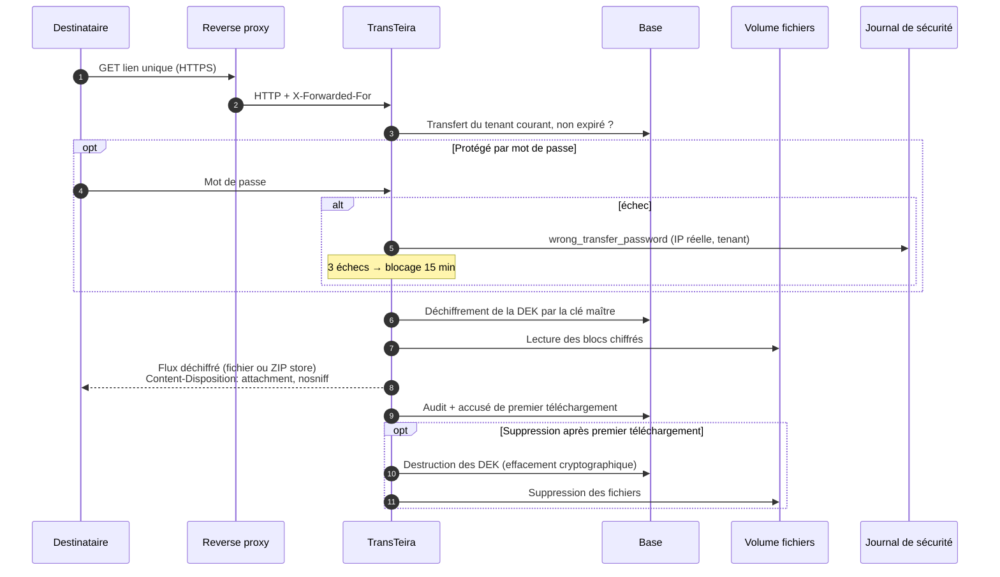
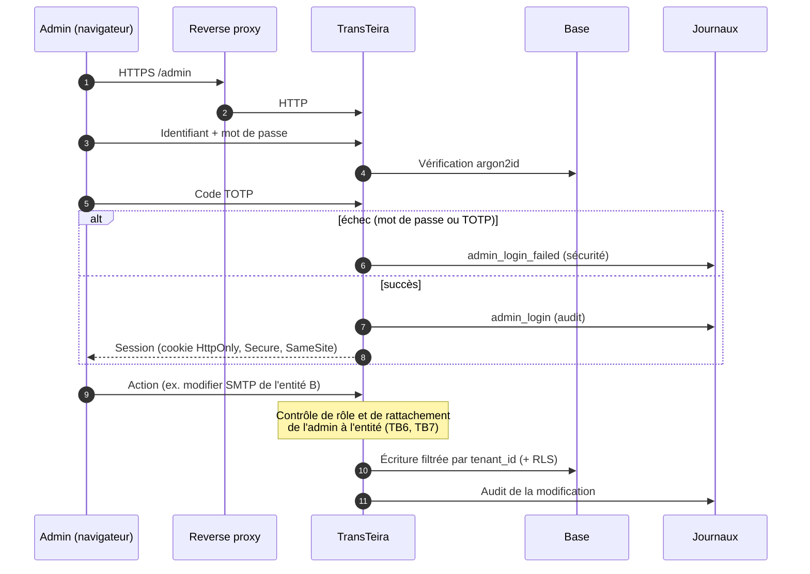

# TransTeira : modèle de menaces (STRIDE)

| Champ | Valeur |
|---|---|
| Version du document | **0.2 (brouillon pour la V1, décisions du 2026-10-19 intégrées)** |
| Périmètre | TransTeira V1 (le cœur), avec anticipation V1.1 / V2 (section 10) |
| Méthode | STRIDE (Spoofing, Tampering, Repudiation, Information disclosure, Denial of service, Elevation of privilege) |
| Référence fonctionnelle | `CLAUDE.md` (cahier des charges). Les renvois de la forme « §16.1 » désignent ses sections. |
| Statut | À valider par relecture humaine avant toute écriture de code applicatif (§27.1, §27.4) |

---

## 1. Objet, périmètre et maintenance

### 1.1 Objet

Ce document identifie les actifs de TransTeira, les acteurs qui interagissent avec lui, les frontières de confiance et les flux de données, puis recense, composant par composant, les menaces selon la méthode STRIDE et les mesures qui y répondent dans le cahier des charges.

Il sert :

- de **référence à l'agent de sécurité**, qui s'en sert pour relire chaque étape avant commit (§27.3) ;
- de **guide à l'agent de tests**, grâce à la table de correspondance menace → type de test (section 9) ;
- de **base au kit de conformité** V2 (registre RGPD, correspondance ISO 27001 annexe A, §22).

### 1.2 Périmètre

Inclus (V1) :

- le binaire Go (API REST `/api/v1`, interface publique, administration, aide intégrée, documentation OpenAPI) ;
- le stockage des fichiers chiffrés (volume Docker, un dossier par tenant) ;
- la base de métadonnées (SQLite par défaut, PostgreSQL en option avec RLS) ;
- le conteneur ClamAV et le dialogue clamd ;
- l'envoi de mails via le SMTP de chaque tenant (y compris un relais interne sans authentification) ;
- la gestion de la clé maître (secret Docker), sa rotation et l'effacement cryptographique ;
- le journal de sécurité (fail2ban, CrowdSec), le journal d'audit, le mode maintenance, la tâche de nettoyage, la copie de sauvegarde de la base ;
- les configurations de reverse proxy fournies (Caddy de référence, Nginx, Traefik, Apache) ;
- la chaîne de construction locale (image Docker, dépendances, `make check`, hook pre-push).

Exclus : voir section 7 (hypothèses et hors périmètre).

### 1.3 Maintenance du document

- Mis à jour **à chaque version** (V1, V1.1, V2) et à chaque changement d'architecture touchant une frontière de confiance.
- Toute nouvelle fonctionnalité ajoute ses menaces (identifiant `T-xx` non réutilisé) et ses tests (section 9).
- Les menaces retirées sont marquées « obsolète » plutôt que supprimées, pour conserver l'historique.
- Les points ouverts (section 8.2) sont fermés par une décision tracée dans ce document.

---

## 2. Actifs

Sensibilité : **C** = confidentialité, **I** = intégrité, **D** = disponibilité. Échelle : H (haute), M (moyenne), B (basse).

| ID | Actif | Description | C | I | D |
|---|---|---|---|---|---|
| A1 | Contenu des fichiers déposés | Données métier potentiellement sensibles, jusqu'à 20 Go par envoi, stockées chiffrées (§16.1). | H | H | M |
| A2 | Clés par fichier (DEK) | Clé AES-256 propre à chaque fichier, chiffrée par la clé maître et stockée en base (envelope encryption). | H | H | H |
| A3 | Clé maître (KEK) | Fournie par secret Docker ou fichier monté hors volume de données ; copie dans un coffre hors VM. Sa perte rend toutes les données illisibles. | H | H | H |
| A4 | Métadonnées des transferts | Adresses mail (expéditeurs, destinataires, invités), noms de fichiers, tailles, empreintes SHA-256, messages, dates, IP. Données personnelles (RGPD). | H | H | M |
| A5 | Codes de vérification (OTP) | Codes à 6 chiffres, 15 min, 2 essais (§7). | H | H | B |
| A6 | Mots de passe de transfert | Stockés sous forme de hachés ; protègent l'accès à un transfert (§10). | H | H | B |
| A7 | Identifiants admins | Hachés argon2id, secrets TOTP, codes de secours éventuels (§6.5). | H | H | M |
| A8 | Jetons d'API | Stockés hachés, par tenant, révocables (§16.4). | H | H | M |
| A9 | Mots de passe SMTP | Chiffrés en base (§12.1). | H | H | M |
| A10 | Sessions admin et jetons d'accès publics | Cookies de session, liens de téléchargement, liens d'invitation, états de vérification. | H | H | M |
| A11 | Journal d'audit | Traçabilité des actions (§21.1), 12 mois. Contient des données personnelles. | M | H | M |
| A12 | Journal de sécurité | Alimente fail2ban / CrowdSec (§16.3) ; son intégrité conditionne les bannissements. | M | H | M |
| A13 | Configuration des tenants | FQDN, plages IP, domaines internes, quotas, modèles de mails, liste de blocage, habillage (§5). | B | H | M |
| A14 | Sauvegardes | Copie `VACUUM INTO` / `pg_dump` et sauvegarde VM des volumes (§23). Contiennent A2, A4, A7, A8, A9 et les fichiers chiffrés. | H | H | M |
| A15 | Disponibilité du service et espace disque | Capacité à recevoir et servir des transferts ; volume de données partagé entre tenants. | B | M | H |
| A16 | Réputation des domaines d'envoi | Les mails partent avec le domaine de chaque entité (SPF, DKIM, DMARC). Un abus nuit à la délivrabilité de toute l'entité. | B | H | M |
| A17 | Code source et chaîne de construction | Dépôt public, image Docker, dépendances Go. | B | H | M |

---

## 3. Acteurs

| ID | Acteur | Confiance | Capacités et intentions supposées |
|---|---|---|---|
| AC1 | Utilisateur anonyme d'Internet | Aucune | Accède aux pages publiques, tente l'énumération, le bruteforce, le déni de service, l'injection. |
| AC2 | Déposant interne | Partielle | IP dans une plage du tenant et domaine autorisé, adresse vérifiée. Peut déposer et inviter. Peut être malveillant (fuite de données, spam). |
| AC3 | Externe invité | Faible | Détient un lien d'invitation et une adresse vérifiée. Peut déposer vers l'interne qui l'a invité uniquement. |
| AC4 | Destinataire | Faible | Détient un lien de téléchargement (et éventuellement un mot de passe). Peut retransmettre le lien. |
| AC5 | Admin délégué | Élevée sur ses entités | Gère la configuration de ses entités, consulte leurs transferts. Ne doit jamais atteindre une autre entité. |
| AC6 | Super admin | Très élevée | Toutes les entités, quotas, mode maintenance, rotation de clé. |
| AC7 | Client d'API | Partielle | Script ou logiciel tiers muni d'un jeton d'API d'une entité. |
| AC8 | Exploitant de la VM | Totale (hors modèle) | Accès root à l'hôte, à Docker, aux volumes et au secret de la clé maître. Considéré de confiance (section 7). |
| AC9 | Admin d'entité malveillant | Élevée mais hostile | Admin délégué cherchant à lire les données d'une autre entité ou à élever ses privilèges. |
| AC10 | Reverse proxy compromis ou mal configuré | Intermédiaire | Peut forger `X-Forwarded-For`, `Host`, lire le trafic en clair après terminaison TLS. |
| AC11 | Attaquant ayant accès aux sauvegardes | Aucune | Lit les copies de volumes ou de base (vol de sauvegarde, prestataire). N'a pas la clé maître. |
| AC12 | Autre service sur le réseau Docker partagé `proxy` | Faible | Conteneur tiers relié au même réseau que le reverse proxy, pouvant joindre l'application directement. |

---

## 4. Frontières de confiance

| ID | Frontière | Description | Contrôles principaux |
|---|---|---|---|
| TB1 | Internet ↔ reverse proxy | Terminaison TLS, HSTS, transmission de l'IP réelle. | TLS par FQDN, HSTS au proxy (§16.2, §18.2), fail2ban / CrowdSec en amont. |
| TB2 | Reverse proxy ↔ application (réseau `proxy` partagé) | Trafic HTTP en clair sur un réseau Docker partagé avec d'autres services. | Aucun port exposé sur l'hôte (§18.1), liste des proxys de confiance (§8.1), résolution stricte du tenant (§4). |
| TB3 | Application ↔ réseau interne | ClamAV (clamd), PostgreSQL, relais SMTP sans authentification. | Réseau Docker interne non visible du proxy (§18.1), chaînes de connexion par variables d'environnement. |
| TB4 | Application ↔ volumes de fichiers | Écriture et lecture des fichiers chiffrés, base SQLite, journaux. | Chiffrement AES-256-GCM par blocs, noms aléatoires, dossier par tenant (§5, §16.1). |
| TB5 | Application ↔ secret de clé maître | Lecture du secret Docker ou du fichier monté hors volume. | Montage en lecture seule, hors volumes sauvegardés (§16.1, §18.1). |
| TB6 | Tenant ↔ tenant (logique) | Cloisonnement des données dans une instance et une base uniques. | `tenant_id` obligatoire dans la couche d'accès, RLS PostgreSQL, tests à 100 % (§5, §17, §24.3). |
| TB7 | Espace public ↔ espace d'administration | Utilisateurs sans compte d'un côté, admins authentifiés de l'autre. | argon2id + TOTP, sessions, rôles, rate limiting (§6.5, §16.2). |
| TB8 | Hôte / VM ↔ sauvegardes | Les volumes et copies de base sortent de la VM vers le système de sauvegarde. | Fichiers chiffrés, DEK chiffrées par la clé maître non sauvegardée avec les données, effacement cryptographique (§16.1, §23). |

---

## 5. Diagrammes de flux de données

Les diagrammes utilisent Mermaid. Les sous-graphes matérialisent les frontières de confiance.

### 5.1 Diagramme de contexte global

```mermaid
flowchart LR
    subgraph INTERNET["Internet (non fiable)"]
        U1[Déposant interne / externe]
        U2[Destinataire]
        U3[Admin]
        U4[Client d'API]
    end

    subgraph HOST["VM Docker"]
        subgraph PROXYNET["Réseau partagé 'proxy' (TB2)"]
            RP[Reverse proxy<br/>Caddy / Nginx / Traefik / Apache]
            APP[TransTeira<br/>binaire Go]
        end
        subgraph INTNET["Réseau interne (TB3)"]
            AV[ClamAV clamd]
            PG[(PostgreSQL optionnel)]
            SMTPR[Relais SMTP interne optionnel]
        end
        subgraph VOL["Volumes (TB4)"]
            FS[(Fichiers chiffrés<br/>un dossier par tenant)]
            DB[(SQLite WAL)]
            BK[(Copies de base)]
            LOG[(Journaux audit / sécurité)]
        end
        KEY[/Secret clé maître (TB5)/]
        F2B[fail2ban / CrowdSec]
    end

    EXTSMTP[Serveur SMTP externe]
    BACKUP[(Sauvegarde VM hors hôte (TB8))]
    VAULT[(Coffre de mots de passe hors VM)]

    U1 & U2 & U3 & U4 -- "HTTPS (TB1)" --> RP
    RP -- "HTTP + X-Forwarded-For + Host" --> APP
    APP --> AV
    APP --> PG
    APP --> SMTPR
    APP --> EXTSMTP
    APP --> FS & DB & BK & LOG
    KEY -. lecture seule .-> APP
    LOG --> F2B
    F2B -. bannissement DOCKER-USER .-> RP
    VOL --> BACKUP
    VAULT -. restauration .-> KEY
```

### 5.2 Flux de dépôt



### 5.3 Flux de téléchargement



### 5.4 Flux d'administration



---

## 6. Menaces par composant

Légende :

- **Cat.** : S, T, R, I, D, E (STRIDE).
- **Prob.** : probabilité (faible, moyenne, élevée) avant mesures.
- **Impact** : faible, moyen, élevé, critique.
- **Résiduel** : risque après mesures (faible, moyen, élevé).

### 6.1 Résolution du tenant (en-tête `Host`)

| ID | Cat. | Menace | Impact | Prob. | Mesures | Résiduel |
|---|---|---|---|---|---|---|
| T-01 | S | Un client envoie un `Host` d'une autre entité pour obtenir son habillage, ses règles internes ou ses données. | Élevé | Moyenne | Le tenant est toujours déduit du `Host` et injecté dans le contexte ; toutes les données sont filtrées par ce tenant (§4, §5). Un lien d'une entité ouvert sous le FQDN d'une autre ne trouve rien. | Faible |
| T-02 | S/I | FQDN inconnu ou absent : traitement par un tenant par défaut. | Élevé | Moyenne | Rejet et journalisation de tout FQDN inconnu (§4, §16.3). Aucun tenant par défaut. | Faible |
| T-03 | T | Host header poisoning : un lien généré dans un mail (notification, invitation) utilise un `Host` contrôlé par l'attaquant. | Élevé | Moyenne | Les URL absolues des mails sont construites depuis le FQDN **enregistré** du tenant, jamais depuis l'en-tête reçu. Normalisation (casse, port, point final) avant comparaison. | Faible |
| T-04 | S | Ambiguïté `Host` / `X-Forwarded-Host` / `:authority` entre proxy et application. | Moyen | Faible | L'application n'utilise que `Host` (ou `X-Forwarded-Host` uniquement depuis un proxy de confiance, à trancher, section 8.2). Configurations de proxy fournies et testées (§18.2). | Faible |

### 6.2 Adresse IP réelle et proxys de confiance

| ID | Cat. | Menace | Impact | Prob. | Mesures | Résiduel |
|---|---|---|---|---|---|---|
| T-05 | S/E | Falsification de `X-Forwarded-For` / `X-Real-IP` pour paraître dans une plage interne et déposer librement. | Élevé | Élevée | En-têtes lus **uniquement** si la connexion TCP provient d'un proxy de confiance déclaré (§8.1, §16.2). Parsing de droite à gauche en s'arrêtant à la première IP non fiable. | Faible |
| T-06 | S | Un autre conteneur du réseau partagé `proxy` (AC12) joint l'application directement et forge les en-têtes. | Élevé | Moyenne | Liste des proxys de confiance par IP précise (pas de plage du réseau entier) ; documentation recommandant une IP fixe pour le proxy. | Moyen |
| T-07 | D | IP forgée pour faire bannir un tiers (ou une plage interne) par fail2ban / CrowdSec. | Élevé | Moyenne | Le journal de sécurité ne contient que l'IP réelle calculée selon T-05 (§16.3). Les plages internes du tenant sont à exclure des bannissements (`ignoreip`, à documenter). | Faible |
| T-08 | E | Mauvaise configuration : proxy de confiance trop large (`0.0.0.0/0`) ou en-tête non écrasé par le proxy. | Élevé | Moyenne | Refus au démarrage d'une plage de confiance universelle ; configurations de proxy fournies écrasant l'en-tête ; avertissement dans les journaux si un `X-Forwarded-For` arrive d'une source non fiable. | Moyen |

### 6.3 Vérification d'adresse mail (OTP)

| ID | Cat. | Menace | Impact | Prob. | Mesures | Résiduel |
|---|---|---|---|---|---|---|
| T-09 | S | Bruteforce du code à 6 chiffres. | Élevé | Moyenne | 2 essais puis invalidation, 15 min de validité, 5 codes/h par adresse, 20 codes/h par IP (§7). Probabilité de succès par code : 2/10⁶. | Faible |
| T-10 | S | Bruteforce distribué (nombreuses IP) sur une même adresse. | Moyen | Faible | La limite par adresse (5/h) borne à 10 essais/h, soit ~10⁻⁴ par jour. Journalisation et alerte (V1.1). | Faible |
| T-11 | I | Oracle d'existence : la réponse révèle si une adresse est déjà vérifiée, ou interne. | Moyen | Élevée | Réponses et délais uniformes côté API publique, à trancher (section 8.2) ; ne pas exposer « adresse connue » à un client non identifié. | Moyen |
| T-12 | D | Email bombing : envoi massif de codes vers une victime tierce (tiers ou interne). | Moyen | Moyenne | 5 codes/h par adresse, 20/h par IP (§7) ; demande de code acceptée seulement si le contexte de dépôt est éligible (plage interne ou invitation valide). | Faible |
| T-13 | S | Réutilisation d'un code après usage ou sur un autre tenant. | Élevé | Faible | Code lié au tenant, à l'adresse et à un usage ; supprimé après usage ou expiration (§20). Comparaison en temps constant. | Faible |
| T-14 | S | Vol du cookie technique de reconnaissance pour usurper une adresse vérifiée. | Moyen | Faible | La base fait foi (§7) ; le cookie ne suffit pas à prouver une adresse sans être lié au tenant ; `HttpOnly`, `Secure`, `SameSite`. Pour un interne, la condition IP reste exigée. | Moyen |
| T-15 | S | Un interne qui a quitté l'organisation conserve une adresse vérifiée. | Moyen | Moyenne | Le dépôt libre exige aussi l'IP interne (§6.2) ; purge à 12 mois (§7) ; effacement par adresse (§20). | Moyen |

### 6.4 Invitations externes

| ID | Cat. | Menace | Impact | Prob. | Mesures | Résiduel |
|---|---|---|---|---|---|---|
| T-16 | S | Devinette ou énumération de liens d'invitation. | Élevé | Faible | Jeton aléatoire cryptographique ≥ 128 bits (§16.2), stocké haché, lié au tenant. | Faible |
| T-17 | E | Un externe invité dépose vers d'autres destinataires que l'interne invitant. | Élevé | Moyenne | Destinataire imposé côté serveur : l'interne émetteur de l'invitation (§9). | Faible |
| T-18 | T | L'invitation sert de vecteur de spam / phishing (message libre envoyé par le SMTP de l'entité à une adresse arbitraire). | Élevé | Moyenne | Seuls les internes vérifiés invitent (§9) ; texte libre échappé et limité en longueur ; traçage de l'émetteur (§9, §21.1) ; limites par interne en V1.1 (§15.2). | Moyen |
| T-19 | R | Un interne nie avoir émis une invitation. | Faible | Faible | Émetteur tracé en base et dans l'audit avec IP (§9, §21.1). | Faible |
| T-20 | S | Lien d'invitation transféré à un tiers. | Moyen | Moyenne | L'externe doit vérifier son adresse par code (§9) ; à trancher : lier l'invitation à l'adresse invitée (section 8.2). | Moyen |

### 6.5 Dépôt et protocole tus

| ID | Cat. | Menace | Impact | Prob. | Mesures | Résiduel |
|---|---|---|---|---|---|---|
| T-21 | E | Accès à un upload tus d'un autre utilisateur ou d'un autre tenant (PATCH / HEAD sur un identifiant deviné). | Élevé | Moyenne | Identifiant d'upload aléatoire non devinable, lié au tenant et à la session de dépôt ; vérification à chaque requête. | Faible |
| T-22 | T | Déclaration de taille (`Upload-Length`) mensongère pour contourner la limite par envoi ou le quota. | Moyen | Élevée | Vérification de la somme déclarée à la création et du nombre d'octets réellement reçus à chaque PATCH ; refus au-delà (§8.5). | Faible |
| T-23 | D | Remplissage du disque par des uploads tus jamais terminés. | Élevé | Élevée | Réservation sur le quota dès la création, TTL des uploads incomplets purgé par la tâche de nettoyage (§20), alerte disque 85 % (§19). TTL à définir (section 8.2). | Moyen |
| T-24 | T | Chevauchement d'offsets ou PATCH concurrents corrompant le fichier. | Moyen | Faible | Verrou par upload, contrôle strict de `Upload-Offset`, empreinte SHA-256 finale (§8.6). | Faible |
| T-25 | E | Contournement du contrôle d'éligibilité : création tus autorisée, puis PATCH depuis une IP externe. | Moyen | Moyenne | L'éligibilité (interne, invitation, blocage, maintenance) est vérifiée à la création **et** à la finalisation ; l'upload est lié au contexte de dépôt. | Faible |
| T-26 | D | Dépôt bloqué par la liste de blocage contourné par variation de casse ou de sous-domaine. | Moyen | Moyenne | Normalisation des adresses (casse du domaine, IDN en punycode) avant comparaison ; politique sur sous-domaines à préciser. | Faible |
| T-27 | I | Fichier dont l'empreinte figure sur la liste de blocage déposé quand même. | Moyen | Moyenne | Comparaison de l'empreinte SHA-256 calculée en flux avant mise à disposition (§15.2). | Faible |

### 6.6 Stockage et chiffrement au repos

| ID | Cat. | Menace | Impact | Prob. | Mesures | Résiduel |
|---|---|---|---|---|---|---|
| T-28 | I | Lecture des fichiers depuis le volume (accès disque, sauvegarde volée). | Critique | Moyenne | AES-256-GCM par blocs, DEK par fichier chiffrée par la clé maître hors volume (§16.1). | Faible |
| T-29 | T | Altération, réordonnancement ou troncature de blocs chiffrés sur disque. | Élevé | Faible | Nonce par bloc = préfixe aléatoire + compteur, indicateur de dernier bloc dans les données authentifiées (AAD) ; AAD liant l'identifiant de fichier et le tenant ; échec du déchiffrement interrompt le flux. Schéma à valider (section 8.2). | Faible |
| T-30 | I | Réutilisation de nonce GCM (catastrophique : fuite du XOR des clairs et forge). | Critique | Faible | DEK unique par fichier, compteur strictement croissant, jamais de chiffrement de deux contenus différents sous la même DEK (y compris reprise tus). Tests à 100 % (§16.1). | Faible |
| T-31 | I | Données en clair écrites temporairement sur disque (fichier temporaire, swap, morceaux tus avant finalisation). | Élevé | Moyenne | Chiffrement en flux dès la réception de chaque morceau (§8.6) ; aucun fichier temporaire en clair ; documentation sur le swap chiffré de la VM. | Moyen |
| T-32 | I | Nom d'origine visible sur disque, ou chemin devinable. | Moyen | Faible | Noms aléatoires, dossier par tenant (§5) ; nom d'origine uniquement en base. | Faible |
| T-33 | T | Path traversal via l'identifiant de tenant ou de fichier dans la construction du chemin. | Élevé | Faible | Chemins construits uniquement depuis des identifiants générés par le serveur et validés (format strict), jamais depuis une saisie. | Faible |
| T-34 | E | Une DEK d'un fichier est utilisée pour déchiffrer un fichier d'un autre tenant (confusion d'identifiants). | Élevé | Faible | AAD incluant tenant et fichier ; lecture de la DEK par la couche d'accès filtrée par tenant (§5). | Faible |

### 6.7 Gestion des clés et rotation

| ID | Cat. | Menace | Impact | Prob. | Mesures | Résiduel |
|---|---|---|---|---|---|---|
| T-35 | I | Fuite de la clé maître (journaux, variable d'environnement visible via `docker inspect`, image). | Critique | Moyenne | Clé fournie par secret Docker ou fichier monté (§16.1), jamais par variable d'environnement en clair, jamais journalisée ; fichier lu en lecture seule. | Moyen |
| T-36 | D | Perte de la clé maître : toutes les données deviennent illisibles. | Critique | Faible | Copie dans un coffre hors VM (§16.1, §23) ; procédure de restauration documentée ; contrôle au démarrage qu'une clé valide est présente (empreinte de clé stockée en base). | Faible |
| T-37 | T | Rotation interrompue laissant des DEK chiffrées par deux clés différentes, ou démarrage avec la mauvaise clé. | Élevé | Moyenne | Rotation reprenable, chaque DEK porte l'identifiant de la clé maître qui la chiffre ; l'ancienne et la nouvelle clé sont toutes deux disponibles pendant l'opération (§16.1). | Faible |
| T-38 | R | Rotation effectuée sans trace. | Moyen | Faible | Journalisée dans l'audit (§16.1, §21.1). | Faible |
| T-39 | E | Rotation déclenchée par un admin délégué. | Élevé | Faible | Action réservée au super admin (§6.5, §16.1) ; ré-authentification TOTP recommandée. | Faible |
| T-40 | I | Clé maître ou DEK en clair conservées en mémoire et exposées par un dump ou un endpoint de debug (`pprof`). | Élevé | Faible | Aucun endpoint de debug exposé en production ; DEK déchiffrées uniquement le temps de l'opération. | Faible |

### 6.8 Antivirus (ClamAV)

| ID | Cat. | Menace | Impact | Prob. | Mesures | Résiduel |
|---|---|---|---|---|---|---|
| T-41 | T | Fichier malveillant au-delà des limites de ClamAV, mis à disposition sans analyse. | Élevé | Élevée | Accepté mais signalé à l'expéditeur et sur la page de téléchargement (§11) ; limites relevées et configurables. Risque assumé par le cahier des charges. | Moyen |
| T-42 | D | Indisponibilité de ClamAV : dépôts bloqués ou, pire, fichiers mis à disposition sans analyse. | Élevé | Moyenne | Fail-closed : un fichier non analysé pour cause d'indisponibilité n'est pas mis à disposition (à confirmer, section 8.2) ; health check incluant ClamAV (§19). | Faible |
| T-43 | D | Archive malveillante (zip bomb) épuisant ClamAV pendant la décompression. | Moyen | Moyenne | Limites `MaxScanSize`, `MaxRecursion`, `MaxFiles` de ClamAV ; ClamAV isolé dans son conteneur avec limites de ressources ; délai d'attente côté Go. | Faible |
| T-44 | T | Analyse d'un contenu différent de celui stocké (TOCTOU). | Élevé | Faible | Analyse du flux en clair issu du même passage que le chiffrement, ou relecture déchiffrée du fichier stocké ; fichier non disponible tant que le statut n'est pas final. | Faible |
| T-45 | I | Exposition de clamd au réseau du proxy. | Moyen | Faible | ClamAV sur le réseau interne uniquement (§11, §18.1). | Faible |
| T-46 | I | Signatures obsolètes. | Moyen | Moyenne | `freshclam` dans le conteneur ; état des signatures dans le health check (à confirmer). | Moyen |

### 6.9 Téléchargement, ZIP et mot de passe de transfert

| ID | Cat. | Menace | Impact | Prob. | Mesures | Résiduel |
|---|---|---|---|---|---|---|
| T-47 | I | Énumération ou devinette des liens de téléchargement. | Critique | Faible | Identifiants aléatoires ≥ 128 bits (§10, §16.2) ; rate limiting et journalisation des 404 répétés ; réponses identiques pour « inexistant » et « expiré » vis-à-vis d'un tiers (à trancher). | Faible |
| T-48 | S | Bruteforce du mot de passe de transfert. | Élevé | Moyenne | 3 essais puis blocage 15 min (§10), journal de sécurité (§16.3). Double blocage par transfert et par IP (décision P4). | Moyen : un tiers détenant le lien peut bloquer le destinataire légitime 15 min (déni de service limité, accepté). |
| T-49 | I | Mot de passe de transfert stocké de façon réversible ou haché faiblement. | Élevé | Faible | Hachage argon2id (à confirmer, section 8.2) ; jamais transmis dans le mail de notification (§12.2). | Faible |
| T-50 | T | Injection dans `Content-Disposition` via le nom de fichier (CRLF, guillemets, `;`). | Élevé | Moyenne | En-tête construit avec `filename*=UTF-8''` encodé RFC 5987 et un `filename` ASCII de repli assaini ; rejet des caractères de contrôle à l'upload. | Faible |
| T-51 | T | ZIP slip côté destinataire : noms contenant `../`, chemins absolus, `C:\`, entrées dupliquées. | Élevé | Moyenne | Politique d'assainissement des noms (section 8.2) appliquée à l'upload et à la génération du ZIP : composants `..`, `/` initial, lettres de lecteur et caractères de contrôle interdits ; noms dupliqués suffixés. | Faible |
| T-52 | S | Tromperie par nom de fichier Unicode (RTL override `U+202E`, homoglyphes, `facture.pdf.exe`). | Moyen | Moyenne | Suppression des caractères bidirectionnels et invisibles, normalisation NFC, affichage de l'extension réelle ; téléchargement forcé (§10). | Moyen |
| T-53 | E | Exécution ou rendu d'un fichier dans le navigateur (XSS via HTML/SVG servi depuis le domaine). | Élevé | Moyenne | `Content-Disposition: attachment`, `X-Content-Type-Options: nosniff`, type `application/octet-stream`, CSP `sandbox` sur les réponses de fichiers (§10, §16.2). | Faible |
| T-54 | I | Accès à un transfert expiré, supprimé ou dont le premier téléchargement a déjà eu lieu (course entre deux téléchargements simultanés). | Moyen | Moyenne | Contrôle d'état à chaque requête ; option « premier téléchargement » gérée par transition atomique en base ; refus des requêtes `Range` ultérieures. Comportement des reprises `Range` à préciser. | Moyen |
| T-55 | D | Téléchargements massifs répétés saturant la bande passante ou le CPU (déchiffrement). | Moyen | Faible | Rate limiting par IP et par transfert ; usage à faible concurrence (§1). | Moyen |
| T-56 | R | Le destinataire nie avoir téléchargé. | Faible | Faible | Audit des téléchargements (§21.1) ; preuve de remise PDF en V2 (§22). | Faible |
| T-57 | I | Le lien de téléchargement fuit via `Referer`, historique, journaux du proxy. | Moyen | Moyenne | `Referrer-Policy: no-referrer` (§16.2) ; aucune ressource tierce ; documentation sur la rétention des journaux du proxy. | Moyen |

### 6.10 Authentification admin, sessions, TOTP et premier lancement

| ID | Cat. | Menace | Impact | Prob. | Mesures | Résiduel |
|---|---|---|---|---|---|---|
| T-58 | S | Bruteforce ou credential stuffing sur la connexion admin. | Critique | Élevée | argon2id, TOTP obligatoire pour le super admin et recommandé (§6.5), rate limiting et journal de sécurité pour fail2ban / CrowdSec (§16.2, §16.3). | Faible |
| T-59 | S | Vol de session (XSS, cookie intercepté). | Critique | Faible | Cookie `HttpOnly`, `Secure`, `SameSite=Strict`, préfixe `__Host-` ; CSP stricte ; expiration courte et à l'inactivité ; rotation à la connexion. Stratégie à confirmer (section 8.2). | Faible |
| T-60 | S | Rejeu du code TOTP. | Élevé | Faible | Code accepté une seule fois par fenêtre (dernier compteur utilisé mémorisé), fenêtre de tolérance ±1 pas. | Faible |
| T-61 | I | Secrets TOTP lisibles en base ou dans les sauvegardes. | Élevé | Moyenne | Secrets TOTP chiffrés par la clé maître (à confirmer). | Faible |
| T-62 | E | Prise de contrôle de l'instance via la procédure de premier lancement (premier arrivé devient super admin). | Critique | Moyenne | Initialisation conditionnée à un jeton d'installation à usage unique affiché dans les journaux du conteneur ou fourni par variable d'environnement (à confirmer, section 8.2) ; TOTP imposé avant tout usage (§6.6) ; procédure désactivée dès qu'un super admin existe. | Faible |
| T-63 | E | Admin délégué agissant sur une entité à laquelle il n'est pas rattaché (IDOR sur l'identifiant d'entité). | Critique | Moyenne | Contrôle d'autorisation centralisé (rôle + rattachement) sur chaque endpoint ; tests de cloisonnement à 100 % (§24.3). | Faible |
| T-64 | E | Admin délégué relevant la limite par envoi au-dessus de celle fixée, ou modifiant son propre quota. | Moyen | Moyenne | Limite par envoi uniquement à la baisse, quota réservé au super admin (§6.5). | Faible |
| T-65 | S | Énumération des identifiants admins par message d'erreur ou délai. | Faible | Moyenne | Message unique, hachage argon2id factice si l'utilisateur n'existe pas (temps constant). | Faible |
| T-66 | R | Action admin non traçable. | Moyen | Faible | Audit des connexions, modifications, suppressions, effacements, mode maintenance (§21.1). | Faible |
| T-67 | S | Perte du second facteur du super admin : verrouillage définitif. | Élevé | Faible | Codes de secours à usage unique ou commande d'administration locale de réinitialisation (accès conteneur). À trancher (section 8.2). | Moyen |

### 6.11 Jetons d'API

| ID | Cat. | Menace | Impact | Prob. | Mesures | Résiduel |
|---|---|---|---|---|---|---|
| T-68 | S | Vol d'un jeton d'API (script, dépôt Git, journal). | Élevé | Moyenne | Jetons stockés hachés, révocables, expiration optionnelle, date de dernière utilisation (§16.4) ; préfixe reconnaissable pour la détection de secrets (gitleaks). | Moyen |
| T-69 | E | Jeton d'une entité utilisé sur le FQDN d'une autre. | Critique | Faible | Le jeton est lié à un tenant et refusé si le tenant résolu par `Host` diffère (§5). | Faible |
| T-70 | E | Jeton d'API accédant aux endpoints d'administration. | Élevé | Faible | Périmètre limité au dépôt automatisé (§16.4) ; portées explicites dans le modèle pour l'avenir. | Faible |
| T-71 | S | Bruteforce de jetons. | Moyen | Faible | Entropie ≥ 256 bits, comparaison du haché, rate limiting et journalisation des jetons invalides (§16.3). | Faible |
| T-72 | R | Usage d'un jeton non attribuable. | Faible | Faible | Audit des utilisations de jetons (§21.1). | Faible |
| T-73 | E | Un jeton d'API contourne le filtrage IP interne de l'entité. | Moyen | Moyenne | Liste de plages autorisées obligatoire par jeton, « toute adresse » uniquement sur déclaration explicite ; expéditeur limité aux domaines internes ; refus journalisé (décision P14). | Faible |

### 6.12 Couche d'accès aux données multi-tenant

| ID | Cat. | Menace | Impact | Prob. | Mesures | Résiduel |
|---|---|---|---|---|---|---|
| T-74 | I | Requête oubliant le filtre `tenant_id` (fuite inter-entités). | Critique | Moyenne | Couche d'accès recevant obligatoirement le tenant du contexte, aucune API de requête sans tenant (§5) ; tests de cloisonnement par endpoint à 100 % (§24.2, §24.3). | Faible |
| T-75 | I | Avec PostgreSQL, contournement de la RLS (propriétaire de table, rôle `BYPASSRLS`, variable de session non positionnée ou héritée d'une connexion du pool). | Critique | Moyenne | Rôle applicatif non propriétaire et sans `BYPASSRLS`, `FORCE ROW LEVEL SECURITY`, tenant positionné par transaction (`SET LOCAL`) ; politique refusant tout si la variable est vide (§5, §17). | Faible |
| T-76 | T | Injection SQL. | Critique | Faible | Requêtes paramétrées exclusivement ; fuzzing des entrées (§24.2). | Faible |
| T-77 | I | Fuite inter-entités via les agrégats (statistiques, recherche RGPD par adresse, tâches de fond). | Élevé | Moyenne | Les tâches de fond et vues globales du super admin passent par un chemin explicite « tous tenants » réservé et audité ; la recherche RGPD reste limitée au périmètre de l'admin (§20). | Faible |
| T-78 | I | Même adresse mail présente dans deux entités : la vérification de l'une vaut pour l'autre. | Moyen | Moyenne | Adresses vérifiées rattachées au tenant (§7). | Faible |
| T-79 | E | Fichiers d'un tenant lus via le chemin d'un autre tenant. | Critique | Faible | Chemin calculé depuis l'enregistrement filtré par tenant ; AAD liant le tenant (T-34). | Faible |

### 6.13 SMTP et mails

| ID | Cat. | Menace | Impact | Prob. | Mesures | Résiduel |
|---|---|---|---|---|---|---|
| T-80 | T | Injection d'en-têtes SMTP (CRLF dans l'adresse, le nom ou l'objet). | Élevé | Moyenne | Validation stricte des adresses (RFC 5322 restreint), rejet de CR/LF, encodage RFC 2047 des en-têtes, bibliothèque de construction MIME. | Faible |
| T-81 | T | Injection HTML ou de modèle dans le message libre de l'expéditeur (phishing sous le domaine de l'entité). | Élevé | Élevée | Message libre échappé (texte uniquement, liens non cliquables ou neutralisés), longueur limitée ; modèles compilés avec échappement automatique (`html/template`). | Moyen |
| T-82 | E | Injection de modèle côté admin (modèles de mails personnalisés exécutant des fonctions arbitraires ou accédant à des données). | Élevé | Faible | Moteur de modèles restreint : variables autorisées listées, aucune fonction dangereuse, aucune inclusion de fichier ; validation à l'enregistrement. | Faible |
| T-83 | S | Usurpation du domaine d'envoi d'une entité par un tiers. | Moyen | Moyenne | SPF, DKIM, DMARC prérequis et contrôle indicatif dans l'administration (§12.1). | Moyen |
| T-84 | D | Utilisation de TransTeira comme relais de spam (notifications vers des destinataires arbitraires). | Élevé | Moyenne | Seuls internes et invités vérifiés envoient ; limites de destinataires par envoi (V1.1, §15.1) ; rate limiting ; à prévoir dès la V1 un plafond simple de destinataires par envoi (section 8.2). | Moyen |
| T-85 | I | Relais SMTP sans authentification ni chiffrement exposé hors du réseau interne. | Élevé | Faible | Relais uniquement sur le réseau Docker interne (§12.1) ; documentation l'interdisant sur un réseau partagé. | Faible |
| T-86 | I | Mot de passe SMTP en clair en base, journal ou réponse d'API. | Élevé | Faible | Chiffré en base (§12.1), jamais renvoyé par l'API (champ en écriture seule), jamais journalisé (§16.2). | Faible |
| T-87 | T | QR code ou contenu chargé à distance (traçage, image modifiée). | Faible | Faible | QR code en pièce jointe inline (CID), aucune image distante (§12.2). | Faible |
| T-88 | I | Interception du mail de notification (le lien suffit pour télécharger). | Élevé | Moyenne | Mot de passe par un autre canal (§12.2) ; STARTTLS / TLS vers le serveur SMTP recommandé hors relais interne ; vérification du destinataire en V1.1 (§10). | Moyen |
| T-89 | D | Serveur SMTP d'une entité injoignable bloquant les requêtes. | Moyen | Moyenne | Envoi asynchrone avec file et délai d'attente ; échec journalisé, sans bloquer les autres entités. | Faible |
| T-90 | I | SSRF via la configuration SMTP (hôte interne arbitraire saisi par un admin délégué, test d'envoi utilisé comme scanner de ports). | Moyen | Moyenne | Bouton de test limité en fréquence, message d'erreur générique ; liste d'hôtes interdits configurable (à trancher, section 8.2). | Moyen |

### 6.14 Front web (XSS, CSRF, clickjacking, CSP)

| ID | Cat. | Menace | Impact | Prob. | Mesures | Résiduel |
|---|---|---|---|---|---|---|
| T-91 | E | XSS stockée via noms de fichiers, messages, noms d'entité, mentions légales, modèles. | Critique | Moyenne | Échappement contextuel systématique ; CSP stricte sans `unsafe-inline` ni `unsafe-eval`, sans CDN (§4.1, §16.2) ; contenu riche (mentions légales) en Markdown assaini. | Faible |
| T-92 | E | XSS via le logo ou l'image de fond (SVG contenant du script). | Élevé | Moyenne | Formats raster uniquement, ou SVG assaini et servi avec `Content-Type` image et CSP `sandbox` ; taille limitée ; réencodage côté serveur recommandé. | Faible |
| T-93 | T | CSRF sur l'administration ou les actions publiques (vérification, dépôt, mot de passe). | Élevé | Moyenne | `SameSite=Strict`, jeton anti-CSRF ou exigence d'un en-tête personnalisé sur les requêtes à effet de bord, vérification `Origin`. Stratégie à confirmer (section 8.2). | Faible |
| T-94 | T | Clickjacking (pages d'admin ou de téléchargement intégrées dans une iframe). | Moyen | Faible | `frame-ancestors 'none'`, `X-Frame-Options: DENY` (§16.2). | Faible |
| T-95 | I | Fuite d'informations par ressources tierces (polices, scripts, analytics). | Moyen | Faible | Aucun CDN ni ressource tierce, uniquement des cookies techniques (§16.2). | Faible |
| T-96 | I | Documentation OpenAPI interactive exposant la surface d'attaque publiquement. | Faible | Moyenne | Accès réservé aux admins par défaut (§4.1). Spécification publique de toute façon (code open source). | Faible |
| T-97 | T | Open redirect (paramètre de retour après connexion). | Moyen | Faible | Redirections uniquement vers des chemins relatifs internes validés. | Faible |
| T-98 | I | Erreurs détaillées (traces, requêtes SQL) dans les réponses. | Moyen | Moyenne | Problem Details RFC 9457 avec codes documentés (§4.1), détails internes uniquement dans les journaux. | Faible |

### 6.15 Journaux (sécurité et audit)

| ID | Cat. | Menace | Impact | Prob. | Mesures | Résiduel |
|---|---|---|---|---|---|---|
| T-99 | T | **Injection de ligne dans le journal de sécurité** : un champ contrôlé par l'attaquant (adresse mail, FQDN inconnu, User-Agent, nom de fichier) contient CR/LF ou imite le format, et forge une ligne lue par fail2ban / CrowdSec, provoquant le bannissement d'une IP choisie. | Élevé | Élevée | Format stable où **l'IP est toujours issue du serveur** et placée à une position fixe avant tout champ libre ; champs libres encodés (JSON avec échappement, ou quotation stricte) et CR/LF/caractères de contrôle échappés ; FQDN inconnu tronqué et assaini ; regex fail2ban ancrées sur le début de ligne et le champ IP. Tests de format et fuzzing (§16.3, §24.2). | Faible |
| T-100 | D | Bannissement d'IP légitimes (plage interne, proxy, NAT d'entreprise) suite à des échecs provoqués. | Élevé | Moyenne | Documentation des listes d'exclusion (`ignoreip`, allowlist CrowdSec) ; ne jamais bannir l'IP du proxy ; IP réelle fiable (T-05). | Moyen |
| T-101 | I | Secrets ou données excessives dans les journaux (codes OTP, mots de passe, jetons, liens de téléchargement complets). | Élevé | Moyenne | Interdiction de journaliser secrets et jetons (§16.2) ; identifiants de transfert tronqués ou hachés ; revue par l'agent de sécurité. | Faible |
| T-102 | R | Effacement ou modification du journal d'audit par un admin. | Moyen | Faible | Aucune API de modification ou suppression du journal ; purge uniquement par la tâche de nettoyage à 12 mois (§20). Chaînage par hachage envisageable (V2). | Moyen |
| T-103 | D | Remplissage du disque par les journaux (échecs massifs). | Moyen | Moyenne | Rotation des journaux, volume dédié (§18.1), alerte disque (§19). | Faible |
| T-104 | I | Admin délégué consultant les journaux d'une autre entité. | Élevé | Faible | Journaux cloisonnés par tenant (§21.1), tests de cloisonnement. | Faible |

### 6.16 Mode maintenance

| ID | Cat. | Menace | Impact | Prob. | Mesures | Résiduel |
|---|---|---|---|---|---|---|
| T-105 | E | Activation du mode maintenance par un admin délégué (déni de service pour toutes les entités). | Élevé | Faible | Réservé au super admin et à la variable d'environnement (§4, §6.5), audité (§21.1). | Faible |
| T-106 | T | Dépôts tus en cours finalisés pendant la maintenance (migration concurrente). | Moyen | Moyenne | Refus des créations **et** des PATCH/finalisations pendant la maintenance, ou finalisation autorisée selon une règle explicite (à préciser). | Faible |
| T-107 | D | Health check renvoyant « sain » pendant une maintenance ou masquant une panne. | Faible | Faible | Health check répondant avec un état distinct (§4, §19). | Faible |

### 6.17 Nettoyage et effacement cryptographique

| ID | Cat. | Menace | Impact | Prob. | Mesures | Résiduel |
|---|---|---|---|---|---|---|
| T-108 | I | Fichiers expirés encore lisibles (tâche de nettoyage en panne). | Élevé | Moyenne | Contrôle d'expiration à chaque accès indépendamment de la purge ; supervision de la dernière exécution de la tâche (§20). | Faible |
| T-109 | I | Copies des fichiers dans les sauvegardes encore exploitables après suppression. | Élevé | Élevée | Destruction de la DEK en base (§16.1) ; les sauvegardes de base antérieures contiennent encore la DEK chiffrée, illisible sans la clé maître : le risque résiduel dépend de la conservation conjointe de la clé maître et d'une ancienne sauvegarde (section 8.1). | Moyen |
| T-110 | T | Suppression partielle (DEK supprimée, fichier conservé, ou l'inverse) laissant des orphelins. | Faible | Moyenne | Ordre défini : DEK détruite en premier (le fichier devient illisible), puis suppression du fichier ; réconciliation des orphelins par la tâche de nettoyage. | Faible |
| T-111 | I | Effacement RGPD incomplet (adresse restant dans l'audit, les invitations, les destinataires). | Moyen | Moyenne | Inventaire des tables contenant des adresses ; politique sur l'audit (pseudonymisation plutôt que suppression, à trancher, section 8.2). | Moyen |
| T-112 | E | Effacement RGPD par adresse utilisé par un admin délégué pour effacer des données d'une autre entité. | Élevé | Faible | Périmètre de l'admin (§20), tests de cloisonnement. | Faible |

### 6.18 Sauvegardes

| ID | Cat. | Menace | Impact | Prob. | Mesures | Résiduel |
|---|---|---|---|---|---|---|
| T-113 | I | Vol d'une sauvegarde de VM (AC11) : base avec adresses, hachés, DEK chiffrées. | Élevé | Moyenne | Fichiers et DEK chiffrés, clé maître hors volumes (§16.1, §18.1). Les **métadonnées en base (adresses, noms de fichiers) restent en clair** dans la base : chiffrement de la sauvegarde recommandé côté outil de sauvegarde. | Moyen |
| T-114 | D | Sauvegarde incohérente de SQLite. | Moyen | Moyenne | `VACUUM INTO` régulier / `pg_dump` (§23). | Faible |
| T-115 | T | Restauration d'une ancienne base réactivant des transferts supprimés ou des jetons révoqués. | Moyen | Faible | Procédure de restauration documentée : purge immédiate des expirés, revue des jetons ; avertissement explicite. | Moyen |
| T-116 | I | Clé maître sauvegardée par erreur avec les volumes. | Critique | Faible | Clé hors volumes (§18.1) ; documentation et contrôle au démarrage refusant une clé située sous le chemin des données. | Faible |

### 6.19 Docker et chaîne d'approvisionnement

| ID | Cat. | Menace | Impact | Prob. | Mesures | Résiduel |
|---|---|---|---|---|---|---|
| T-117 | T | Dépendance Go vulnérable ou compromise. | Élevé | Moyenne | `govulncheck` dans `make check` (§24.4), `go.sum`, dépendances minimales, revue lors des mises à jour. | Moyen |
| T-118 | T | Image de base compromise ou obsolète (ClamAV, Alpine). | Élevé | Moyenne | Image minimale `scratch` / `alpine` épinglée par digest ; mises à jour régulières ; image signée et SBOM en V2 (§22). | Moyen |
| T-119 | E | Conteneur applicatif exécuté en root, système de fichiers en écriture. | Élevé | Moyenne | Utilisateur non root, `read_only: true` hors volumes, `cap_drop: ALL`, `no-new-privileges` (à intégrer au docker-compose). | Faible |
| T-120 | I | Secrets poussés sur le dépôt public. | Élevé | Moyenne | gitleaks en hook pre-push (§24.4), `.gitignore` (§25), `.env.example` sans valeur réelle. | Faible |
| T-121 | T | Absence de CI : contrôles contournés localement avant publication. | Moyen | Moyenne | `make check` obligatoire avant chaque commit d'étape (§27.2) ; relecture par les agents (§27.3). | Moyen |
| T-122 | I | Exposition accidentelle d'un port de l'application ou de ClamAV sur l'hôte. | Élevé | Faible | Aucun port publié (§18.1) ; vérification dans les tests de configuration du docker-compose. | Faible |

### 6.20 Déni de service

| ID | Cat. | Menace | Impact | Prob. | Mesures | Résiduel |
|---|---|---|---|---|---|---|
| T-123 | D | Slowloris / connexions lentes maintenues ouvertes (délais allongés pour les gros fichiers). | Moyen | Moyenne | Délais par phase côté Go (`ReadHeaderTimeout` court, délai d'inactivité entre morceaux tus) ; limites de connexions au proxy. | Moyen |
| T-124 | D | Saturation du disque partagé par une entité au détriment des autres. | Élevé | Moyenne | Quota par entité, réservation à la création, alertes 80 % et quota atteint (§8.5), alerte disque 85 % (§19). La somme des quotas peut dépasser le disque : le documenter. | Moyen |
| T-125 | D | Requêtes coûteuses non authentifiées (argon2id sur la connexion admin, mots de passe de transfert). | Moyen | Moyenne | Rate limiting avant le calcul ; paramètres argon2id dimensionnés ; parallélisme borné. | Faible |
| T-126 | D | Bombardement de demandes de codes (coût SMTP, réputation). | Moyen | Moyenne | Limites §7, journal de sécurité (§16.3). | Faible |
| T-127 | D | Corps JSON ou en-têtes énormes sur l'API. | Faible | Moyenne | Taille maximale des corps hors tus, `MaxHeaderBytes`. | Faible |
| T-128 | D | Base SQLite verrouillée par écritures fréquentes. | Moyen | Faible | Pas d'écriture par morceau (§17), WAL, une seule instance. | Faible |

### 6.21 Énumération et attaques temporelles

| ID | Cat. | Menace | Impact | Prob. | Mesures | Résiduel |
|---|---|---|---|---|---|---|
| T-129 | I | Énumération des transferts par identifiants séquentiels dans l'API admin ou publique. | Élevé | Faible | Identifiants publics aléatoires (UUIDv4 ou 128 bits), jamais d'auto-incrément exposé. | Faible |
| T-130 | I | Oracle « adresse interne / domaine autorisé » permettant de cartographier les domaines d'une entité. | Faible | Moyenne | Les domaines d'une entité ne sont pas secrets (FQDN public) ; messages d'erreur génériques malgré tout. | Faible |
| T-131 | I | Attaques temporelles sur la comparaison de codes, jetons, mots de passe. | Moyen | Faible | Comparaisons en temps constant (`crypto/subtle`), recherche par haché ou par identifiant puis comparaison constante. | Faible |
| T-132 | I | Oracle sur l'état d'un transfert (existe, expiré, protégé) pour un tiers sans lien. | Faible | Moyenne | Réponse uniforme pour un identifiant inconnu ; détails seulement avec un lien valide. | Faible |

### 6.22 SSRF et menace interne

| ID | Cat. | Menace | Impact | Prob. | Mesures | Résiduel |
|---|---|---|---|---|---|---|
| T-133 | I | SSRF via des URL saisies (V1 : contrôle DNS SPF/DKIM/DMARC dans l'administration, test SMTP ; V1.1 : webhooks). | Moyen | Moyenne | Contrôle DNS par requêtes DNS uniquement (pas de HTTP) ; voir T-90 ; webhooks traités en section 10. | Faible |
| T-134 | I | **Menace interne** : l'exploitant de la VM ou le super admin peut lire les fichiers (accès à la clé maître et aux DEK). | Critique | Faible | Hors modèle : le chiffrement côté serveur protège le support et les sauvegardes, **pas contre l'exploitant**. Audit des actions admin (§21.1) ; chiffrement de bout en bout en V2 (§22). | Élevé (accepté) |
| T-135 | I | Admin délégué consultant les métadonnées (adresses, noms de fichiers) de son entité à des fins non légitimes. | Moyen | Faible | Rôle limité à l'entité ; audit ; aucune interface ne permet de télécharger le contenu d'un transfert depuis l'administration (à confirmer, section 8.2). | Moyen |
| T-136 | I | Déposant interne exfiltrant des données vers l'extérieur. | Élevé | Moyenne | Audit des dépôts (§21.1) ; détection des abus et restriction des destinataires en V1.1 (§8.4, §15.1). | Élevé (V1) |

---

## 7. Hypothèses et hors périmètre

### 7.1 Hypothèses

| ID | Hypothèse |
|---|---|
| H1 | L'hôte (VM), le démon Docker et l'exploitant (AC8) sont de confiance. Un accès root à l'hôte donne accès à la clé maître et à la mémoire du processus. |
| H2 | Le TLS, le HSTS et les certificats sont gérés par le reverse proxy (§16.2, §18.2). L'application ne reçoit que du HTTP sur un réseau Docker. |
| H3 | Le reverse proxy écrase (et ne concatène pas aveuglément) les en-têtes d'IP cliente, conformément aux configurations fournies. |
| H4 | La clé maître est générée avec une source aléatoire cryptographique, sauvegardée dans un coffre hors VM, et jamais placée dans les volumes sauvegardés. |
| H5 | Les serveurs SMTP et relais configurés par les entités sont légitimes ; SPF, DKIM et DMARC sont configurés par l'exploitant. |
| H6 | Le réseau interne Docker (ClamAV, PostgreSQL, relais SMTP) n'est joignable que par les conteneurs de TransTeira. |
| H7 | Une seule instance applicative accède à la base (§4, §17). |
| H8 | L'horloge de la VM est synchronisée (NTP), condition du TOTP, des expirations et de la cohérence des journaux. |
| H9 | Les postes des utilisateurs et des admins ne sont pas compromis. |

### 7.2 Hors périmètre

- Compromission de l'hôte, du noyau, du démon Docker ou de l'hyperviseur.
- Sécurité du reverse proxy lui-même (au-delà des configurations fournies), de fail2ban et de CrowdSec.
- Sécurité des serveurs de messagerie des destinataires et interception du mail en transit au-delà du premier saut.
- Attaques par canaux auxiliaires matériels.
- Déni de service volumétrique réseau (à traiter en amont).
- Protection du contenu contre l'exploitant ou le super admin (V2 : chiffrement de bout en bout).
- Analyse du contenu des fichiers chiffrés de bout en bout (V2, impossible par construction).

---

## 8. Risques résiduels, recommandations et points à confirmer

### 8.1 Risques résiduels principaux

| Risque | Menaces | Commentaire |
|---|---|---|
| Lecture par l'exploitant / le super admin | T-134 | Inhérent au chiffrement côté serveur ; accepté en V1, traité en V2 (E2E). |
| Fichiers non analysés au-delà des limites ClamAV | T-41 | Accepté par le cahier des charges, compensé par l'information du destinataire. |
| Exfiltration par un interne | T-136 | Traçabilité seule en V1 ; détection des abus et restriction des destinataires en V1.1. |
| Anciennes sauvegardes + clé maître | T-109, T-113 | L'effacement cryptographique ne vaut que si l'ancienne clé maître n'est plus conservée avec une sauvegarde antérieure à la rotation. Recommandation : après rotation, supprimer l'ancienne clé du coffre une fois la durée de rétention des sauvegardes écoulée. |
| Métadonnées en clair dans la base et les sauvegardes | T-113 | Recommandation : chiffrement des sauvegardes côté outil (ex. chiffrement des jobs de sauvegarde). |
| Lien de téléchargement suffisant pour télécharger | T-57, T-88 | Mot de passe optionnel en V1 ; vérification du destinataire en V1.1. |
| Mauvaise configuration du proxy de confiance | T-06, T-08 | Dépend de l'exploitant ; garde-fous au démarrage et documentation. |
| Spam / phishing via les messages libres | T-18, T-81, T-84 | Échappement et limites ; plafonds par expéditeur en V1.1. |

### 8.2 Points à confirmer (relecture humaine)

Les décisions suivantes ne sont pas tranchées par le cahier des charges et conditionnent plusieurs mesures. Chaque point propose une option recommandée. Lors de la relecture humaine du 2026-10-19, les points marqués « Décidé » ont été tranchés explicitement ; toutes les autres recommandations de ce tableau ont été validées telles quelles et font foi.

| # | Sujet | Question | Recommandation ou décision |
|---|---|---|---|
| P1 | Session admin | Cookie de session côté serveur ou jeton porteur (JWT) pour l'interface d'administration ? | Cookie de session opaque côté serveur (`__Host-`, `HttpOnly`, `Secure`, `SameSite=Strict`), révocable, expiration à l'inactivité (ex. 30 min) et absolue (ex. 12 h). Jetons d'API réservés aux scripts. |
| P2 | CSRF | Stratégie anti-CSRF pour l'admin et les actions publiques. | `SameSite=Strict` + vérification de l'en-tête `Origin` + jeton anti-CSRF (double soumission ou synchronisé) sur toute requête à effet de bord. |
| P3 | Mot de passe de transfert | Algorithme de hachage. | argon2id (mêmes paramètres que les admins, éventuellement allégés), avec rate limiting préalable. |
| P4 | Blocage mot de passe | Le blocage de 15 min s'applique-t-il par transfert, par IP ou les deux ? | **Décidé (2026-10-19)** : les deux. Deux compteurs indépendants, chacun bloquant 15 min après 3 échecs : par transfert (toutes IP confondues, le transfert est bloqué pour tous) et par IP (tous transferts de l'entité confondus). Conséquence acceptée : une personne détenant le lien peut bloquer le destinataire légitime pendant 15 min (voir T-48). |
| P5 | Uploads tus inachevés | Durée de vie d'un upload incomplet et prise en compte dans le quota. | TTL de 24 h après la dernière activité, espace réservé dans le quota dès la création, purge par la tâche de nettoyage. |
| P6 | Clés pendant l'upload | Quand la DEK est-elle créée et où est-elle conservée avant la finalisation (la base n'est écrite qu'au début et à la fin, §17) ? | DEK générée à la création de l'upload, chiffrée par la clé maître et écrite en base **dès le début** (écriture « début d'envoi » autorisée), jamais sur disque en clair. |
| P7 | Nonce GCM par blocs | Schéma de nonce et protection contre troncature / réordonnancement. | **Décidé (2026-10-19)** : Format de type STREAM : nonce 96 bits = préfixe aléatoire 7 octets + compteur 32 bits + octet « dernier bloc » ; AAD = version de format + identifiant de fichier + tenant ; taille de bloc fixe (ex. 64 Kio) ; en-tête de fichier versionné. Reprise tus : un morceau incomplet est rechiffré depuis le dernier bloc complet, jamais deux contenus sous le même nonce. |
| P8 | Noms de fichiers | Politique d'assainissement. | Normalisation NFC, suppression des caractères de contrôle et bidirectionnels / invisibles, interdiction de `/`, `\`, `..`, `:`, lettres de lecteur, noms réservés Windows (`CON`, `NUL`…), longueur maximale (255 octets), dédoublonnage dans le ZIP, nom de repli si vide. Nom d'origine conservé en base pour l'affichage échappé. |
| P9 | Anti-énumération | Réponses des endpoints publics (vérification d'adresse, lien inconnu ou expiré, invitation). | Réponses et délais uniformes pour les tiers : « si l'adresse est éligible, un code a été envoyé » ; 404 identique pour inexistant et expiré sans lien valide ; message explicite « expiré » uniquement avec un identifiant valide (bonne UX pour le destinataire légitime). À arbitrer entre UX et confidentialité. |
| P10 | ClamAV indisponible | Comportement si clamd ne répond pas. | **Décidé (2026-10-19)** : Fail-closed : fichier en attente d'analyse, retentatives, mise à disposition seulement après analyse ; alerte au super admin. Distinct du cas « trop gros » (§11). |
| P11 | Premier lancement | Protection de la procédure d'initialisation. | Jeton d'installation à usage unique généré au premier démarrage et affiché dans les journaux du conteneur (ou fourni par variable d'environnement), exigé par la page d'initialisation. |
| P12 | Récupération TOTP | Que faire en cas de perte du second facteur du super admin ? | Codes de secours à usage unique (hachés) remis à l'activation, plus commande locale de réinitialisation exécutable uniquement dans le conteneur (`docker exec`), auditée. |
| P13 | Secrets TOTP | Chiffrement en base. | Chiffrés par la clé maître (même mécanisme que le mot de passe SMTP), inclus dans la rotation. |
| P14 | Jetons d'API et filtrage IP | Un dépôt par jeton d'API est-il soumis aux plages IP ? Quelle identité d'expéditeur ? | **Décidé (2026-10-19)** : oui. Chaque jeton porte une liste obligatoire de plages autorisées (`allowedCidrs` : adresse, sous-réseau, ou `0.0.0.0/0` et `::/0` pour « toute adresse », déclaré explicitement). Un appel hors plage est refusé (`403 ip-not-allowed`) et journalisé. L'expéditeur est indiqué à chaque dépôt (`senderEmail`) et doit appartenir à un domaine interne de l'entité. |
| P15 | Plafond de destinataires | La V1 impose-t-elle un nombre maximal de destinataires par envoi (anti-spam) avant la détection d'abus V1.1 ? | Oui, plafond fixe configurable par variable d'environnement (ex. 50) en V1. |
| P16 | Message libre | Format autorisé dans le message de l'expéditeur. | Texte brut uniquement, échappé, longueur maximale (ex. 2 000 caractères), URL non transformées en liens dans le HTML. |
| P17 | Logo / image de fond | Formats acceptés. | PNG, JPEG, WebP uniquement, réencodés côté serveur ; SVG refusé en V1. |
| P18 | Accès admin aux contenus | Un admin peut-il télécharger le contenu d'un transfert depuis l'administration ? | Non : métadonnées seulement (relance, suppression). Limite la menace T-135. |
| P19 | RGPD et audit | Effacement par adresse : suppression ou pseudonymisation dans le journal d'audit ? | **Décidé (2026-10-19)** : Pseudonymisation (haché salé de l'adresse) pour conserver l'intégrité de l'audit, suppression ailleurs. |
| P20 | `X-Forwarded-Host` | L'application doit-elle lire `X-Forwarded-Host` ? | Non : `Host` uniquement, préservé par les configurations de proxy fournies. |
| P21 | SMTP et SSRF | Restreindre les hôtes SMTP saisissables par un admin délégué ? | Liste d'exclusion optionnelle par variable d'environnement (ex. réseaux de la base, métadonnées cloud) ; test d'envoi rate-limité. |
| P22 | Format du journal de sécurité | Format exact. | Une ligne par événement, `horodatage RFC 3339` + `ip=<ip>` en position fixe + `tenant=` + `event=` puis champs libres en `clé="valeur"` échappés (ou JSON Lines avec IP en premier champ). Filtres fail2ban et parsers CrowdSec ancrés sur ce préfixe. |
| P23 | Requêtes `Range` | Autoriser la reprise de téléchargement (`Range`) avec l'option « suppression après le premier téléchargement » ? | **Décidé (2026-10-19)** : oui. `Range` est autorisé, y compris avec l'option. Le transfert est considéré comme téléchargé quand chaque octet de chaque fichier a été servi au moins une fois (ou l'archive entièrement transmise) ; il est alors supprimé après un délai de grâce (`TT_DELETE_AFTER_DOWNLOAD_GRACE`, 15 min par défaut) permettant de reprendre une dernière plage interrompue. |
| P24 | Durcissement conteneur | Paramètres du docker-compose. | Utilisateur non root, `read_only`, `cap_drop: ALL`, `no-new-privileges`, limites mémoire, images épinglées par digest. |

---

## 9. Correspondance menaces → types de tests

Types : **U** = unitaire, **I** = intégration, **F** = fuzzing natif Go, **C** = test de cloisonnement inter-entités (par endpoint), **E** = bout en bout Playwright, **K** = test de contrat OpenAPI, **G** = test gros fichier 20 Go derrière Caddy, **P** = test de configuration / déploiement (docker-compose, proxys).

| Menaces | Composant | U | I | F | C | E | K | G | P | Exemple de cas de test |
|---|---|---|---|---|---|---|---|---|---|---|
| T-01 à T-04 | Résolution du tenant | x | x | x | x | | | | x | `Host` inconnu → rejet + événement sécurité ; lien de A ouvert sous le FQDN de B → 404 ; URL des mails = FQDN enregistré. |
| T-05 à T-08 | IP réelle / proxys | x | x | x | | | | | x | XFF forgé depuis une IP non fiable ignoré ; chaîne XFF multi-sauts ; refus de `0.0.0.0/0`. |
| T-09 à T-15 | OTP | x | x | x | x | x | | | | 3ᵉ essai refusé ; code expiré à 15 min ; 6ᵉ code/h refusé ; 21ᵉ par IP refusé ; code de A refusé sur B. |
| T-16 à T-20 | Invitations | x | x | x | x | x | | | | Destinataire imposé ; expiration 12 mois ; émetteur audité. |
| T-21 à T-27 | Upload / tus | x | x | x | x | x | x | x | | `Upload-Length` > limite ; PATCH sur upload d'un autre tenant ; purge des uploads inachevés ; coupure et reprise. |
| T-28 à T-34 | Chiffrement | x | x | x | x | | | x | | Bloc altéré / tronqué / réordonné → erreur ; unicité des nonces ; aucun clair sur disque ; couverture 100 %. |
| T-35 à T-40 | Clés et rotation | x | x | | | | | | x | Rotation interrompue puis reprise ; démarrage avec mauvaise clé refusé ; clé jamais dans les journaux. |
| T-41 à T-46 | Antivirus | x | x | | | | | | x | Fichier EICAR supprimé + mail ; fichier trop gros accepté + mention ; clamd arrêté → fail-closed. |
| T-47 à T-57 | Téléchargement / ZIP | x | x | x | x | x | x | x | | 3 mauvais mots de passe → blocage 15 min ; noms piégés (`../`, RTL, CRLF) assainis dans ZIP et en-tête ; en-têtes forcés. |
| T-58 à T-67 | Auth admin | x | x | x | x | x | x | | | TOTP rejoué refusé ; premier lancement sans jeton refusé ; admin délégué sur autre entité → 403/404. Couverture 100 %. |
| T-68 à T-73 | Jetons d'API | x | x | x | x | | x | | | Jeton de A sur FQDN de B refusé ; jeton révoqué ou expiré refusé ; jeton invalide journalisé. |
| T-74 à T-79 | Accès données | x | x | x | x | | | | | Pour **chaque endpoint** : ressource de A demandée par un acteur de B → refus ; RLS sans variable de session → aucune ligne ; tous les tests sur SQLite et PostgreSQL. Couverture 100 %. |
| T-80 à T-90 | SMTP / mails | x | x | x | x | x | | | | CRLF dans adresse / objet rejeté ; HTML du message échappé (Mailpit) ; QR inline CID ; mot de passe SMTP jamais renvoyé. |
| T-91 à T-98 | Front web | x | x | x | | x | x | | | Charges XSS dans noms et messages ; en-têtes CSP / frame-ancestors présents ; requête sans jeton CSRF refusée ; erreurs RFC 9457. |
| T-99 à T-104 | Journaux | x | x | x | x | | | | x | Champ contenant `\n` et une fausse ligne → une seule ligne, IP inchangée ; filtres fail2ban / parsers CrowdSec testés sur un corpus de lignes (positives et négatives). |
| T-105 à T-107 | Maintenance | x | x | | | x | | | | Dépôt refusé, health check OK, activation par admin délégué refusée. |
| T-108 à T-112 | Nettoyage / effacement | x | x | | x | | | | | DEK détruite à l'expiration ; fichier expiré non servi même sans purge ; effacement RGPD limité au périmètre. |
| T-113 à T-116 | Sauvegardes | x | x | | | | | | x | `VACUUM INTO` produit une base cohérente ; clé maître refusée sous le chemin des données. |
| T-117 à T-122 | Chaîne d'approvisionnement | | | | | | | | x | `govulncheck`, gitleaks, aucun port publié, utilisateur non root. |
| T-123 à T-128 | Déni de service | x | x | x | | | | x | x | Mémoire stable pendant 20 Go ; délais d'en-têtes ; corps JSON trop gros refusé. |
| T-129 à T-132 | Énumération / timing | x | x | | x | | x | | | Identifiants non séquentiels ; réponses uniformes ; usage de `subtle.ConstantTimeCompare`. |
| T-133 à T-136 | SSRF / interne | x | x | | x | | | | | Contrôle DNS sans requête HTTP ; aucune route admin de téléchargement de contenu (si P18 validé). |

Cibles de fuzzing prioritaires (§24.2) : parsing de `Host`, de `X-Forwarded-For`, adresses mail et domaines, noms de fichiers (assainissement, `Content-Disposition`, entrées ZIP), en-têtes tus, format des blocs chiffrés (déchiffrement de données arbitraires), champs écrits dans le journal de sécurité, modèles de mails, corps JSON de l'API.

---

## 10. Anticipation V1.1 et V2

| Fonctionnalité | Version | Menaces nouvelles | Orientation de conception dès la V1 |
|---|---|---|---|
| Webhooks (Teams, Slack, URL générique) | V1.1 | SSRF vers le réseau interne ou les métadonnées cloud, fuite de données dans la charge utile, rebinding DNS. | Client HTTP dédié : résolution puis blocage des plages privées, de bouclage et link-local, pas de redirection, délai court, charge minimale sans données personnelles inutiles, signature HMAC. Système d'événements interne réutilisable (§4). |
| Vérification du destinataire, suivi par destinataire | V1.1 | Liens par destinataire à énumérer, nouvelles surfaces OTP. | Modèle de données prévoyant des liens par destinataire ; réutilisation du module OTP. |
| « Mes envois » | V1.1 | Lien d'accès temporaire volé, oracle d'adresse. | Jetons à durée courte, usage unique pour l'ouverture, réponses uniformes. |
| Dépôt depuis l'extérieur pour internes vérifiés | V1.1 | Usurpation d'un interne depuis Internet. | Code exigé à chaque dépôt externe (§6.4), date et origine de la première vérification conservées dès la V1. |
| Réponse au transfert | V1.1 | Détournement en canal de dépôt ouvert. | Lien lié au transfert et au destinataire, quotas externes. |
| Métriques Prometheus, `/status`, syslog | V1.1 | Fuite d'informations, injection syslog. | Endpoints protégés, mêmes règles d'échappement que le journal de sécurité. |
| SSO OpenID Connect (Entra ID) | V2 | Validation des jetons (`iss`, `aud`, `nonce`, signature), confusion de tenant OIDC, liaison de comptes. | Couche d'authentification admin à fournisseurs multiples ; compte local super admin + TOTP conservé en secours (§6.5). |
| Rôle auditeur | V2 | Élévation de lecture vers écriture. | Modèle de rôles par permissions explicites dès la V1, refus par défaut. |
| Lien de dépôt permanent | V2 | Spam, dépôt de contenus malveillants, découverte du lien. | Jeton révocable, OTP du déposant, quotas externes, détection des abus. |
| Chiffrement de bout en bout | V2 | Pas d'antivirus, clé dans le fragment `#` exposée par l'historique ou les extensions, intégrité du code JavaScript servi. | Format de stockage versionné permettant un contenu opaque ; CSP stricte et absence de CDN (prérequis à l'intégrité du code client). |
| Image signée et SBOM | V2 | Réduit T-117, T-118. | Construction reproductible via `make release`. |
| Export / import de configuration | V2 | Exfiltration de secrets, import malveillant (XSS dans modèles). | Secrets jamais exportés (§22) ; validation identique à la saisie manuelle. |
