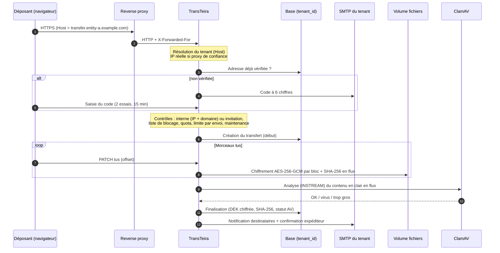
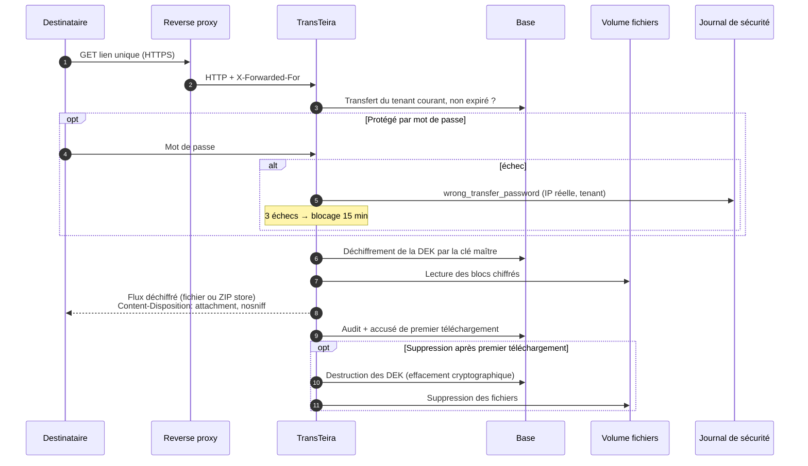
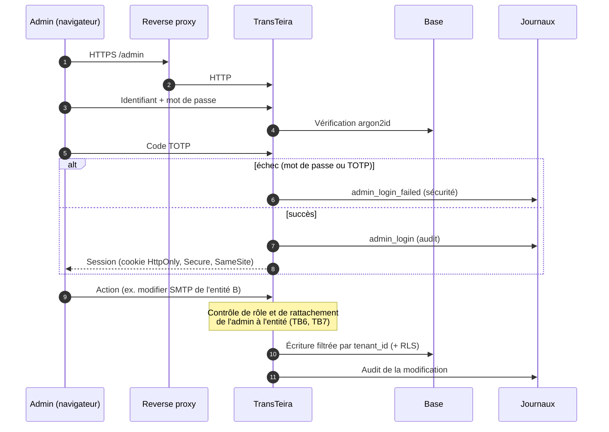

# TransTeira : modèle de menaces (STRIDE)

| Champ | Valeur |
|---|---|
| Version du document | **0.20 (brouillon pour la V1 ; décisions du 2026-10-19, couche de données, serveur HTTP, chiffrement, identification des déposants, dépôt tus, antivirus, notifications, téléchargement, tâche de nettoyage, copie de la base, comptes et authentification des admins, socle du journal d'audit, configuration des entités, opérations des entités (transferts, invitations, liste de blocage, journal d'audit, statistiques, alertes de quota, droits des personnes), jetons d'API et dépôt par jeton, documentation interactive de l'API, réglages de l'instance (mode maintenance, réglages système, alerte d'espace disque, SMTP système, rotation de la clé maître depuis l'administration), socle de l'interface web et interface publique (CSP de l'interface, chaîne d'approvisionnement npm, état côté navigateur, jetons dans les chemins), revue de l'étape 15 (cache privé des pages publiques, `X-Robots-Tag` de l'API publique, URL d'envoi filtrée, contrôles CSS du build), interface d'administration, partie 1 (secrets affichés à l'écran, aperçu des modèles de mails, page de retour après connexion, cycle de vie de la session dans l'interface, envoi d'images depuis l'interface, endpoint d'image côté admin), interface d'administration, partie 2 (secret d'un jeton d'API affiché une fois, données personnelles dans les écrans d'opérations et le tableau de bord), interface d'administration, partie 3 (rotation de la clé maître depuis l'interface, message de maintenance affiché par l'interface), étape 19, tests de bout en bout (limite de débit dédiée aux fichiers de construction de l'interface, T-171 ; compléments à T-91 et T-163 ; colonne E de la section 9) intégrés)** |
| Périmètre | TransTeira V1 (le cœur), avec anticipation V1.1 / V2 (section 10) |
| Méthode | STRIDE (Spoofing, Tampering, Repudiation, Information disclosure, Denial of service, Elevation of privilege) |
| Référence fonctionnelle | `CLAUDE.md` (cahier des charges). Les renvois de la forme « §16.1 » désignent ses sections. |
| Statut | À valider par relecture humaine avant toute écriture de code applicatif (§27.1, §27.4) |

---

## 1. Objet, périmètre et maintenance

### 1.1 Objet

Ce document identifie les actifs de TransTeira, les acteurs qui interagissent avec lui, les frontières de confiance et les flux de données, puis recense, composant par composant, les menaces selon la méthode STRIDE et les mesures qui y répondent dans le cahier des charges.

Il sert :

- de **référence à l'agent de sécurité**, qui s'en sert pour relire chaque étape avant commit (§27.3) ;
- de **guide à l'agent de tests**, grâce à la table de correspondance menace → type de test (section 9) ;
- de **base au kit de conformité** V2 (registre RGPD, correspondance ISO 27001 annexe A, §22).

### 1.2 Périmètre

Inclus (V1) :

- le binaire Go (API REST `/api/v1`, interface publique, administration, aide intégrée, documentation OpenAPI) ;
- le stockage des fichiers chiffrés (volume Docker, un dossier par tenant) ;
- la base de métadonnées (SQLite par défaut, PostgreSQL en option avec RLS) ;
- le conteneur ClamAV et le dialogue clamd ;
- l'envoi de mails via le SMTP de chaque tenant (y compris un relais interne sans authentification) ;
- la gestion de la clé maître (secret Docker), sa rotation et l'effacement cryptographique ;
- le journal de sécurité (fail2ban, CrowdSec), le journal d'audit, le mode maintenance, la tâche de nettoyage, la copie de sauvegarde de la base ;
- les configurations de reverse proxy fournies (Caddy de référence, Nginx, Traefik, Apache) ;
- la chaîne de construction locale (image Docker, dépendances, `make check`, hook pre-push).

Exclus : voir section 7 (hypothèses et hors périmètre).

### 1.3 Maintenance du document

- Mis à jour **à chaque version** (V1, V1.1, V2) et à chaque changement d'architecture touchant une frontière de confiance.
- Toute nouvelle fonctionnalité ajoute ses menaces (identifiant `T-xx` non réutilisé) et ses tests (section 9).
- Les menaces retirées sont marquées « obsolète » plutôt que supprimées, pour conserver l'historique.
- Les points ouverts (section 8.2) sont fermés par une décision tracée dans ce document.

---

## 2. Actifs

Sensibilité : **C** = confidentialité, **I** = intégrité, **D** = disponibilité. Échelle : H (haute), M (moyenne), B (basse).

| ID | Actif | Description | C | I | D |
|---|---|---|---|---|---|
| A1 | Contenu des fichiers déposés | Données métier potentiellement sensibles, jusqu'à 20 Go par envoi, stockées chiffrées (§16.1). | H | H | M |
| A2 | Clés par fichier (DEK) | Clé AES-256 propre à chaque fichier, chiffrée par la clé maître et stockée en base (envelope encryption). | H | H | H |
| A3 | Clé maître (KEK) | Fournie par secret Docker ou fichier monté hors volume de données ; copie dans un coffre hors VM. Sa perte rend toutes les données illisibles. | H | H | H |
| A4 | Métadonnées des transferts | Adresses mail (expéditeurs, destinataires, invités), noms de fichiers, tailles, empreintes SHA-256, messages, dates, IP. Données personnelles (RGPD). | H | H | M |
| A5 | Codes de vérification (OTP) | Codes à 6 chiffres, 15 min, 2 essais (§7). | H | H | B |
| A6 | Mots de passe de transfert | Stockés sous forme de hachés ; protègent l'accès à un transfert (§10). | H | H | B |
| A7 | Identifiants admins | Hachés argon2id, secrets TOTP, codes de secours éventuels (§6.5). | H | H | M |
| A8 | Jetons d'API | Stockés hachés, par tenant, révocables (§16.4). | H | H | M |
| A9 | Mots de passe SMTP | Chiffrés en base (§12.1). | H | H | M |
| A18 | Identifiants PostgreSQL du rôle propriétaire | `TT_DB_MIGRATE_DSN` : permet de modifier le schéma et de désactiver la RLS. Utilisé seulement pour les migrations ; à fournir de préférence par fichier (secret Docker) ou par un conteneur de migration ponctuel. | H | H | B |
| A10 | Sessions admin et jetons d'accès publics | Cookies de session, liens de téléchargement, liens d'invitation, états de vérification. | H | H | M |
| A11 | Journal d'audit | Traçabilité des actions (§21.1), 12 mois. Contient des données personnelles. | M | H | M |
| A12 | Journal de sécurité | Alimente fail2ban / CrowdSec (§16.3) ; son intégrité conditionne les bannissements. | M | H | M |
| A13 | Configuration des tenants | FQDN, plages IP, domaines internes, quotas, modèles de mails, liste de blocage, habillage (§5). | B | H | M |
| A14 | Sauvegardes | Copie `VACUUM INTO` / `pg_dump` et sauvegarde VM des volumes (§23). Contiennent A2, A4, A7, A8, A9 et les fichiers chiffrés. | H | H | M |
| A15 | Disponibilité du service et espace disque | Capacité à recevoir et servir des transferts ; volume de données partagé entre tenants. | B | M | H |
| A16 | Réputation des domaines d'envoi | Les mails partent avec le domaine de chaque entité (SPF, DKIM, DMARC). Un abus nuit à la délivrabilité de toute l'entité. | B | H | M |
| A17 | Code source et chaîne de construction | Dépôt public, image Docker, dépendances Go. | B | H | M |

---

## 3. Acteurs

| ID | Acteur | Confiance | Capacités et intentions supposées |
|---|---|---|---|
| AC1 | Utilisateur anonyme d'Internet | Aucune | Accède aux pages publiques, tente l'énumération, le bruteforce, le déni de service, l'injection. |
| AC2 | Déposant interne | Partielle | IP dans une plage du tenant et domaine autorisé, adresse vérifiée. Peut déposer et inviter. Peut être malveillant (fuite de données, spam). |
| AC3 | Externe invité | Faible | Détient un lien d'invitation et une adresse vérifiée. Peut déposer vers l'interne qui l'a invité uniquement. |
| AC4 | Destinataire | Faible | Détient un lien de téléchargement (et éventuellement un mot de passe). Peut retransmettre le lien. |
| AC5 | Admin délégué | Élevée sur ses entités | Gère la configuration de ses entités, consulte leurs transferts. Ne doit jamais atteindre une autre entité. |
| AC6 | Super admin | Très élevée | Toutes les entités, quotas, mode maintenance, rotation de clé. |
| AC7 | Client d'API | Partielle | Script ou logiciel tiers muni d'un jeton d'API d'une entité. |
| AC8 | Exploitant de la VM | Totale (hors modèle) | Accès root à l'hôte, à Docker, aux volumes et au secret de la clé maître. Considéré de confiance (section 7). |
| AC9 | Admin d'entité malveillant | Élevée mais hostile | Admin délégué cherchant à lire les données d'une autre entité ou à élever ses privilèges. |
| AC10 | Reverse proxy compromis ou mal configuré | Intermédiaire | Peut forger `X-Forwarded-For`, `Host`, lire le trafic en clair après terminaison TLS. |
| AC11 | Attaquant ayant accès aux sauvegardes | Aucune | Lit les copies de volumes ou de base (vol de sauvegarde, prestataire). N'a pas la clé maître. |
| AC12 | Autre service sur le réseau Docker partagé `proxy` | Faible | Conteneur tiers relié au même réseau que le reverse proxy, pouvant joindre l'application directement. |

---

## 4. Frontières de confiance

| ID | Frontière | Description | Contrôles principaux |
|---|---|---|---|
| TB1 | Internet ↔ reverse proxy | Terminaison TLS, HSTS, transmission de l'IP réelle. | TLS par FQDN, HSTS au proxy (§16.2, §18.2), fail2ban / CrowdSec en amont. |
| TB2 | Reverse proxy ↔ application (réseau `proxy` partagé) | Trafic HTTP en clair sur un réseau Docker partagé avec d'autres services. | Aucun port exposé sur l'hôte (§18.1), liste des proxys de confiance (§8.1), résolution stricte du tenant (§4). |
| TB3 | Application ↔ réseau interne | ClamAV (clamd), PostgreSQL, relais SMTP sans authentification. | Réseau Docker interne non visible du proxy (§18.1), chaînes de connexion par variables d'environnement. |
| TB4 | Application ↔ volumes de fichiers | Écriture et lecture des fichiers chiffrés, base SQLite, journaux. | Chiffrement AES-256-GCM par blocs, noms aléatoires, dossier par tenant (§5, §16.1). |
| TB5 | Application ↔ secret de clé maître | Lecture du secret Docker ou du fichier monté hors volume. | Montage en lecture seule, hors volumes sauvegardés (§16.1, §18.1). |
| TB6 | Tenant ↔ tenant (logique) | Cloisonnement des données dans une instance et une base uniques. | `tenant_id` obligatoire dans la couche d'accès, RLS PostgreSQL, tests à 100 % (§5, §17, §24.3). |
| TB7 | Espace public ↔ espace d'administration | Utilisateurs sans compte d'un côté, admins authentifiés de l'autre. | argon2id + TOTP, sessions, rôles, rate limiting (§6.5, §16.2). |
| TB8 | Hôte / VM ↔ sauvegardes | Les volumes et copies de base sortent de la VM vers le système de sauvegarde. | Fichiers chiffrés, DEK chiffrées par la clé maître non sauvegardée avec les données, effacement cryptographique (§16.1, §23). |

---

## 5. Diagrammes de flux de données

Les diagrammes utilisent Mermaid. Les sous-graphes matérialisent les frontières de confiance.

### 5.1 Diagramme de contexte global

```mermaid
flowchart LR
    subgraph INTERNET["Internet (non fiable)"]
        U1[Déposant interne / externe]
        U2[Destinataire]
        U3[Admin]
        U4[Client d'API]
    end

    subgraph HOST["VM Docker"]
        subgraph PROXYNET["Réseau partagé 'proxy' (TB2)"]
            RP[Reverse proxy<br/>Caddy / Nginx / Traefik / Apache]
            APP[TransTeira<br/>binaire Go]
        end
        subgraph INTNET["Réseau interne (TB3)"]
            AV[ClamAV clamd]
            PG[(PostgreSQL optionnel)]
            SMTPR[Relais SMTP interne optionnel]
        end
        subgraph VOL["Volumes (TB4)"]
            FS[(Fichiers chiffrés<br/>un dossier par tenant)]
            DB[(SQLite WAL)]
            BK[(Copies de base)]
            LOG[(Journaux audit / sécurité)]
        end
        KEY[/Secret clé maître (TB5)/]
        F2B[fail2ban / CrowdSec]
    end

    EXTSMTP[Serveur SMTP externe]
    BACKUP[(Sauvegarde VM hors hôte (TB8))]
    VAULT[(Coffre de mots de passe hors VM)]

    U1 & U2 & U3 & U4 -- "HTTPS (TB1)" --> RP
    RP -- "HTTP + X-Forwarded-For + Host" --> APP
    APP --> AV
    APP --> PG
    APP --> SMTPR
    APP --> EXTSMTP
    APP --> FS & DB & BK & LOG
    KEY -. lecture seule .-> APP
    LOG --> F2B
    F2B -. bannissement DOCKER-USER .-> RP
    VOL --> BACKUP
    VAULT -. restauration .-> KEY
```

### 5.2 Flux de dépôt



### 5.3 Flux de téléchargement



### 5.4 Flux d'administration



---

## 6. Menaces par composant

Légende :

- **Cat.** : S, T, R, I, D, E (STRIDE).
- **Prob.** : probabilité (faible, moyenne, élevée) avant mesures.
- **Impact** : faible, moyen, élevé, critique.
- **Résiduel** : risque après mesures (faible, moyen, élevé).

### 6.1 Résolution du tenant (en-tête `Host`)

| ID | Cat. | Menace | Impact | Prob. | Mesures | Résiduel |
|---|---|---|---|---|---|---|
| T-01 | S | Un client envoie un `Host` d'une autre entité pour obtenir son habillage, ses règles internes ou ses données ; ou le cache de résolution garde un FQDN rattaché à une ancienne entité après réaffectation. | Élevé | Moyenne | Le tenant est toujours déduit du `Host` normalisé et injecté dans le contexte ; toutes les données sont filtrées par ce tenant (§4, §5). Un lien d'une entité ouvert sous le FQDN d'une autre ne trouve rien. Le cache du résolveur est invalidé à chaque modification d'entité, avec un compteur de génération qui empêche une recherche en cours de réinsérer une valeur périmée, et une durée de vie bornée en filet de sécurité. | Faible |
| T-02 | S/I/D | FQDN inconnu ou absent : traitement par un tenant par défaut ; ou inondation de `Host` aléatoires pour saturer la base et le cache. | Élevé | Moyenne | Rejet (`421 unknown-tenant`) et journalisation (`unknown_fqdn`) de tout FQDN inconnu ou invalide **sur tous les chemins**, y compris les 404, 405 et redirections du routeur ; seuls `/healthz` et `/api/openapi.yaml` répondent sans tenant, par choix (§4, §16.3). Aucun tenant par défaut. Cache négatif borné (taille fixe, éviction en O(1)) ; limiteur dédié aux hôtes inconnus par IP (1 requête toutes les 12 s, rafale de 10, puis `429`) ; bannissement via le journal de sécurité. | Faible |
| T-03 | T | Host header poisoning : un lien généré dans un mail (notification, invitation) utilise un `Host` contrôlé par l'attaquant. | Élevé | Moyenne | Les URL absolues des mails sont construites depuis le FQDN **enregistré** du tenant, jamais depuis l'en-tête reçu. Normalisation (casse, port, point final) avant comparaison. | Faible |
| T-04 | S | Ambiguïté `Host` / `X-Forwarded-Host` / `:authority` entre proxy et application. | Moyen | Faible | L'application n'utilise **que** l'en-tête `Host` ; `X-Forwarded-Host` est ignoré, même depuis un proxy de confiance (décision P20). Les configurations de proxy fournies préservent `Host` (§18.2). | Faible |

### 6.2 Adresse IP réelle et proxys de confiance

| ID | Cat. | Menace | Impact | Prob. | Mesures | Résiduel |
|---|---|---|---|---|---|---|
| T-05 | S/E | Falsification de `X-Forwarded-For` / `X-Real-IP` pour paraître dans une plage interne et déposer librement. | Élevé | Élevée | En-têtes lus **uniquement** si la connexion TCP provient d'un proxy de confiance déclaré (§8.1, §16.2). `X-Forwarded-For` lu de droite à gauche en s'arrêtant à la première IP non fiable ; `X-Real-IP` pris en compte seulement s'il est unique et sans `X-Forwarded-For`. Adresses IPv4 encapsulées dans IPv6 ramenées en IPv4, zones IPv6 retirées, longueur des entrées bornée. **Refus par défaut** : un proxy de confiance qui n'envoie aucune adresse cliente utilisable (en-têtes absents, entrée malformée atteinte par le parcours, ou chaîne entièrement composée de proxys de confiance) donne une adresse nulle, qui n'appartient à aucune plage, est journalisée `ip=-` (jamais bannissable) et partage un seul compteur de débit. | Faible |
| T-06 | S | Un autre conteneur du réseau partagé `proxy` (AC12) joint l'application directement et forge les en-têtes ; ou les plages internes d'un tenant recouvrent le réseau Docker ou l'IP du proxy, si bien que des requêtes sont vues comme internes. | Élevé | Moyenne | Liste des proxys de confiance par IP précise (pas de plage du réseau entier) ; avertissement au démarrage pour toute plage plus large que /24 (IPv4) ou /64 (IPv6) ; documentation recommandant une IP fixe pour le proxy et interdisant de déclarer un proxy dans une plage interne (`.env.example`). Refus par défaut de T-05 si le proxy n'envoie pas l'IP cliente. Avertissement dans l'administration lorsqu'une plage interne recouvre `TT_TRUSTED_PROXIES` : prévu avec la gestion des plages. | Moyen |
| T-07 | D | IP forgée pour faire bannir un tiers (ou une plage interne) par fail2ban / CrowdSec. | Élevé | Moyenne | Le journal de sécurité ne contient que l'IP réelle calculée selon T-05 (§16.3), jamais l'IP du proxy. Les plages internes des tenants et les IP de sortie (NAT) de l'entreprise sont à exclure des bannissements : section « Never ban your own users » des README `integrations/fail2ban` et `integrations/crowdsec` (`ignoreip`, allowlist). | Faible |
| T-08 | E | Mauvaise configuration : proxy de confiance trop large (`0.0.0.0/0`, ou plages découpées comme `0.0.0.0/1,128.0.0.0/1`) ou en-tête non écrasé par le proxy. | Élevé | Moyenne | Refus au démarrage de tout préfixe plus court que /8 (IPv4) ou /32 (IPv6), et de tout ensemble de plages couvrant tout l'espace IPv4 ou IPv6 ; plages avec bits d'hôte refusées ; avertissement au-delà de /24 ou /64 (T-06) ; configurations de proxy à fournir (étape reverse proxy) devant ajouter à ou écraser `X-Forwarded-For` (avec un test chacune), puisque cet en-tête l'emporte sur `X-Real-IP`. Un avertissement (limité en débit) lorsqu'un `X-Forwarded-For` arrive d'une source non déclarée est reporté à une étape ultérieure. | Moyen |

### 6.3 Vérification d'adresse mail (OTP)

| ID | Cat. | Menace | Impact | Prob. | Mesures | Résiduel |
|---|---|---|---|---|---|---|
| T-09 | S | Bruteforce du code à 6 chiffres. | Élevé | Moyenne | Code tiré uniformément (`crypto/rand`, sans biais de modulo) ; 2 essais puis invalidation, 15 min de validité, 5 codes/h par adresse, 20 codes/h par IP (§7), comptés en base sur l'heure glissante (résistent au redémarrage) ; code vérifié par HMAC (clé dérivée de la clé maître) en temps constant ; essai décompté par mise à jour atomique. Probabilité de succès par code : 2/10⁶. | Faible |
| T-10 | S | Bruteforce distribué (nombreuses IP) sur une même adresse. | Moyen | Faible | La limite par adresse (5/h) borne à 10 essais/h, soit ~10⁻⁴ par jour. Journalisation et alerte (V1.1). | Faible |
| T-11 | I | Oracle d'existence : la réponse révèle si une adresse est déjà vérifiée, ou interne. | Moyen | Élevée | Refus générique (`403 deposit-not-allowed`, corps identique quel que soit le motif : plage IP, domaine, liste de blocage, invitation) ; envoi du mail asynchrone, donc temps de réponse indépendant de l'envoi. Le raccourci « adresse déjà vérifiée » (`201`) n'est visible que d'un client déjà éligible (IP interne + domaine, ou invitation valide pour cette adresse). | Faible |
| T-12 | D | Email bombing : envoi massif de codes vers une victime tierce (tiers ou interne). | Moyen | Moyenne | 5 codes/h par adresse, 20/h par IP et par entité (§7), comptés dans la transaction d'écriture sous verrou d'entité (aucun dépassement par requêtes concurrentes) ; demande de code acceptée seulement si le contexte de dépôt est éligible (plage interne ou invitation valide) ; invitations limitées par émetteur. | Faible |
| T-13 | S | Réutilisation d'un code après usage ou sur un autre tenant. | Élevé | Faible | HMAC du code lié à l'identifiant du défi, défi lié au tenant (RLS) ; consommation conditionnelle dans la transaction qui crée la session (deux confirmations concurrentes : une seule réussit) ; le code n'est jamais stocké ni journalisé, seul son HMAC l'est. | Faible |
| T-14 | S | Vol du cookie de session de dépôt, ou usurpation d'une adresse déjà vérifiée. | Moyen | Faible | Cookie `__Host-tt_deposit` (`HttpOnly`, `Secure`, `SameSite=Strict`), jeton de 256 bits dont seul le SHA-256 est stocké, lié au tenant, expiration absolue (4 h par défaut), révocable (`DELETE`). Session sans code pour une adresse déjà vérifiée seulement si le navigateur présente le cookie technique de reconnaissance (décision P26) ; un dépôt par invitation exige toujours un code. Pour un interne, la règle IP est revérifiée à chaque action qui la suppose (invitation, puis transfert). Une invitation révoquée ou expirée invalide les sessions qu'elle a ouvertes. | Faible |
| T-15 | S | Un interne qui a quitté l'organisation conserve une adresse vérifiée. | Moyen | Moyenne | Le dépôt libre exige aussi l'IP interne (§6.2) ; purge à 12 mois (§7) ; effacement par adresse (§20). | Moyen |
| T-139 | S | Sur le réseau interne, un employé ou un poste compromis ouvre une session au nom d'un collègue déjà vérifié en tapant son adresse, puis dépose ou invite en son nom (mails signés DKIM de l'entité). | Élevé | Moyenne | Session sans code seulement si le navigateur présente le cookie technique de reconnaissance `__Host-tt_known` (HMAC de l'entité, de l'adresse, d'un sel propre à l'adresse et de la date d'émission, sans l'adresse en clair, 5 adresses au plus ; refusé côté serveur au-delà de 12 mois ; révocable par changement du sel, réinitialisé à la revérification ; invalidé par une rotation de la clé maître) posé après un code confirmé ; sinon un code est envoyé à l'adresse (décision P26). Résiduel : vol du cookie sur le poste de la victime, utilisable au plus 12 mois depuis une IP interne. | Faible |

### 6.4 Invitations externes

| ID | Cat. | Menace | Impact | Prob. | Mesures | Résiduel |
|---|---|---|---|---|---|---|
| T-16 | S | Devinette ou énumération de liens d'invitation. | Élevé | Faible | Jeton `inv_` de 256 bits (`crypto/rand`), seul son SHA-256 est stocké, lié au tenant ; inconnu → `404`. | Faible |
| T-17 | E | Un externe invité dépose vers d'autres destinataires que l'interne invitant. | Élevé | Moyenne | Destinataire imposé côté serveur : l'interne émetteur de l'invitation, relu en base à la création (§9) ; les destinataires fournis par un externe sont ignorés. | Faible |
| T-18 | T | L'invitation sert de vecteur de spam / phishing (message libre envoyé par le SMTP de l'entité à une adresse arbitraire). | Élevé | Moyenne | Seuls les internes vérifiés, depuis une IP interne, invitent (§9) ; liste de blocage appliquée à l'émetteur et à l'invité ; texte libre limité à 2 000 caractères, échappé dans le HTML, URL non transformées en liens ; en-têtes MIME validés (aucune injection CRLF) ; traçage de l'émetteur (§9, §21.1) ; limites par interne en V1.1 (§15.2). | Moyen |
| T-19 | R | Un interne nie avoir émis une invitation. | Faible | Faible | Émetteur tracé en base et dans l'audit avec IP (§9, §21.1). | Faible |
| T-20 | S | Lien d'invitation transféré à un tiers. | Moyen | Moyenne | L'invitation est liée à l'adresse invitée (autre adresse refusée) et **chaque** dépôt par invitation exige un code, même pour une adresse déjà vérifiée (décision P26) : le lien seul ne suffit jamais. | Faible |

### 6.5 Dépôt et protocole tus

| ID | Cat. | Menace | Impact | Prob. | Mesures | Résiduel |
|---|---|---|---|---|---|---|
| T-21 | E | Accès à un upload tus d'un autre utilisateur ou d'un autre tenant (PATCH / HEAD sur un identifiant deviné). | Élevé | Moyenne | Identifiant `upl_` de 256 bits ; accès réservé à une session de dépôt de la même entité, de la même adresse, du même type et de la même invitation que l'expéditeur (sinon `404`, sans fuite) ; vérification à chaque requête ; tests de cloisonnement par opération. | Faible |
| T-22 | T | Déclaration de taille (`Upload-Length`) mensongère pour contourner la limite par envoi ou le quota. | Moyen | Élevée | Tailles déclarées à la création du transfert (l'extension tus `creation` n'est pas exposée), contrôlées contre la limite par envoi (`413`) et le quota (`507`) ; à chaque PATCH, lecture bornée à la taille restante, un octet de plus donne `413` sans être écrit. | Faible |
| T-23 | D | Remplissage du disque par des uploads tus jamais terminés. | Élevé | Élevée | Réservation sur le quota dès la création (somme des tailles déclarées, sous verrou d'entité) ; expiration `TT_UPLOAD_TTL` (24 h après la dernière activité du transfert, P5) et au plus tard `TT_UPLOAD_MAX_AGE` (7 jours) après la création, avec `410` (un PATCH vide ne prolonge pas l'activité) ; au plus `TT_MAX_OPEN_TRANSFERS` transferts ouverts non expirés par expéditeur interne (10) et 3 par externe, comptés sous verrou d'entité ; purge par la tâche de nettoyage (mis en œuvre : toutes les 15 min, clés puis fichiers et points de reprise effacés, transfert `expired`, réservation libérée ; listes parcourues par curseur, de sorte que des envois encore actifs ou des échecs répétés ne bloquent jamais les suivants, toutes entités confondues). Résiduel : le plafond compte par adresse, et un interne peut le multiplier en invitant des adresses qu'il contrôle jusqu'au plafond d'invitations de la V1.1 ; l'effet reste limité au quota de sa propre entité ; alerte disque 85 % (§19). | Moyen |
| T-24 | T | Chevauchement d'offsets ou PATCH concurrents corrompant le fichier. | Moyen | Faible | Verrou exclusif par fichier (un second PATCH reçoit `409`, jamais d'attente) ; contrôle strict de `Upload-Offset` contre l'offset durable ; la finalisation et l'annulation prennent les mêmes verrous ; empreinte SHA-256 calculée en flux (§8.6). | Faible |
| T-25 | E | Contournement du contrôle d'éligibilité : création tus autorisée, puis PATCH depuis une IP externe. | Moyen | Moyenne | L'éligibilité (liste de blocage, règle IP pour un interne, invitation active pour un externe, maintenance) est revérifiée à la création **et** à la finalisation du transfert ; l'upload est lié à l'expéditeur. Un PATCH depuis l'extérieur n'aboutit à aucune mise à disposition sans finalisation éligible. | Faible |
| T-26 | D | Dépôt bloqué par la liste de blocage contourné par variation de casse ou de sous-domaine. | Moyen | Moyenne | Normalisation des adresses (casse du domaine, IDN en punycode) avant comparaison ; politique sur sous-domaines à préciser. | Faible |
| T-27 | I | Fichier dont l'empreinte figure sur la liste de blocage déposé quand même. | Moyen | Moyenne | Empreinte SHA-256 calculée en flux sur le clair, comparée à la liste de blocage à la finalisation (`403 blocked-file`, le transfert reste en `uploading` et n'est jamais mis à disposition) (§15.2). | Faible |

### 6.6 Stockage et chiffrement au repos

| ID | Cat. | Menace | Impact | Prob. | Mesures | Résiduel |
|---|---|---|---|---|---|---|
| T-28 | I | Lecture des fichiers depuis le volume (accès disque, sauvegarde volée). | Critique | Moyenne | AES-256-GCM par blocs, DEK par fichier chiffrée par la clé maître hors volume (§16.1). | Faible |
| T-29 | T | Altération, réordonnancement ou troncature de blocs chiffrés sur disque. | Élevé | Faible | Format P7 (décidé) : en-tête versionné de 16 octets (`TTEF`, version, taille de bloc, préfixe de nonce aléatoire de 7 octets) ; nonce par bloc = préfixe + compteur 32 bits + octet « dernier bloc » ; AAD = en-tête complet + tenant + identifiant de fichier ; dernier bloc toujours présent (vide si besoin). Les lecteurs (séquentiel, et à accès direct pour les téléchargements partiels, qui authentifie le dernier bloc avant de rendre le moindre octet) ne rendent que des octets authentifiés et refusent altération, troncature, permutation et données en trop. Vecteurs de référence figés, revérifiés par un test indépendant qui n'utilise que la bibliothèque standard. | Faible |
| T-30 | I | Réutilisation de nonce GCM (catastrophique : fuite du XOR des clairs et forge). | Critique | Faible | DEK unique par fichier, compteur strictement croissant, refus au-delà de 2³² blocs. Reprise tus : un bloc incomplet n'est jamais chiffré sous son nonce de compteur avant d'être complet ; il est scellé à part (avec l'état SHA-256 de l'appelant) sous une sous-clé dérivée de la DEK et un nonce aléatoire de 96 bits (`Checkpoint`). La reprise exige que le fichier sur disque ait exactement la taille du point de reprise (`ErrStaleCheckpoint` sinon) : l'envoi repart alors avec un nouvel identifiant et une nouvelle DEK, jamais par troncature. Le moteur tus (`internal/upload`) tient ces obligations : synchronisation du fichier avant l'enregistrement atomique du point de reprise, enregistrement avant l'accusé de chaque PATCH, verrou exclusif par fichier ; après un crash (`ErrStaleCheckpoint`), l'envoi est réinitialisé avec une nouvelle DEK et un nouveau fichier, l'ancienne clé détruite. Résiduel théorique : après un crash, un bloc déjà chiffré mais jamais rendu durable peut subsister dans des blocs libres d'une image disque brute alors que le même bloc est rechiffré à la reprise. Tests d'unicité des nonces, couverture 100 % (§16.1). | Faible |
| T-31 | I | Données en clair écrites temporairement sur disque (fichier temporaire, swap, morceaux tus avant finalisation). | Élevé | Moyenne | Chiffrement en flux dès la réception de chaque morceau (§8.6) ; seuls des blocs chiffrés sont écrits ; le reste d'un bloc incomplet et l'état SHA-256 sont chiffrés dans le point de reprise ; aucun fichier temporaire en clair ; tampon de lecture fixe, rien n'est mis en mémoire au-delà ; documentation sur le swap chiffré de la VM. | Moyen |
| T-32 | I | Nom d'origine visible sur disque, ou chemin devinable. | Moyen | Faible | `TT_DATA_DIR/<tenant>/<128 bits aléatoires en hexadécimal>.ttef` ; nom d'origine uniquement en base, assaini selon P8 (NFC ; caractères de contrôle, bidirectionnels, de format et invisibles refusés ; séparateurs et leurs sosies Unicode refusés ; plus de deux espaces consécutives refusées ; noms réservés Windows refusés ; 255 octets). | Faible |
| T-33 | T | Path traversal via l'identifiant de tenant ou de fichier dans la construction du chemin. | Élevé | Faible | Chemins construits uniquement depuis des identifiants validés (format strict), jamais depuis une saisie ; toutes les opérations passent par `os.Root` ouvert sur le dossier de données (aucun lien symbolique ne permet d'en sortir) ; fichiers réguliers uniquement. | Faible |
| T-34 | E | Une DEK d'un fichier est utilisée pour déchiffrer un fichier d'un autre tenant (confusion d'identifiants), ou une DEK chiffrée est recopiée sur une autre ligne en base. | Élevé | Faible | AAD des blocs incluant tenant et fichier ; AAD de l'enveloppe incluant usage, tenant et identifiant de ligne (une DEK recopiée ailleurs ne se déchiffre pas) ; clés d'enveloppe dérivées par usage (HKDF) ; lecture de la DEK par la couche d'accès filtrée par tenant et la RLS de `wrapped_keys` (§5). | Faible |

### 6.7 Gestion des clés et rotation

| ID | Cat. | Menace | Impact | Prob. | Mesures | Résiduel |
|---|---|---|---|---|---|---|
| T-35 | I | Fuite de la clé maître (journaux, variable d'environnement visible via `docker inspect`, image). | Critique | Moyenne | Clé fournie par secret Docker ou fichier monté (§16.1), jamais par variable d'environnement en clair, jamais journalisée ; fichier lu en lecture seule. | Moyen |
| T-36 | D | Perte de la clé maître : toutes les données deviennent illisibles. | Critique | Faible | Copie dans un coffre hors VM (§16.1, §23), avec l'identifiant de clé (`mk_…`, dérivé de la clé, non secret) pour retrouver la bonne entrée ; procédure dans `docs/operations/master-key.md`. Contrôle au démarrage : la clé courante est enregistrée dans `master_keys`, et le démarrage est refusé si une DEK référence une clé absente du trousseau. Aucune porte dérobée : une clé perdue rend les fichiers et secrets irrécupérables. | Faible |
| T-37 | T | Rotation interrompue laissant des DEK chiffrées par deux clés différentes, démarrage avec la mauvaise clé, ou retour silencieux à une clé retirée (peut-être compromise). | Élevé | Moyenne | Rotation reprenable par lots en transactions courtes (mise à jour conditionnelle sur l'ancien identifiant de clé) ; chaque DEK porte l'identifiant de la clé maître qui la chiffre ; les deux clés sont chargées pendant l'opération et les nouvelles DEK sont chiffrées sous la nouvelle clé ; la rotation n'est terminée que s'il ne reste aucune DEK sous l'ancienne clé (verrou de table sous PostgreSQL). Une clé retirée ne peut plus chiffrer ni redevenir cible (déclencheur en base, refus au démarrage) ; les DEK restées sous l'ancienne clé se rechiffrent par `rotate-master-key -recover-from` sans recharger celle-ci dans le serveur ; une clé courante retirée est refusée au démarrage ; une rotation ne part que de la clé active vers une clé nouvelle, ou d'une clé retirée vers la clé active (nettoyage) ; une rotation incohérente avec la clé configurée bloque le démarrage et peut être abandonnée (`-abandon`, vérification et abandon atomiques) si c'est un nettoyage ou si aucune DEK n'utilise sa clé cible ; démarrage refusé avec l'ancienne clé après une rotation terminée (§16.1). Rotation depuis l'administration (étape 14, `internal/keyrotation`) : même moteur reprenable (`masterkey.Rotate`), un seul worker par instance ; une rotation interrompue par l'arrêt n'est jamais marquée en échec (contexte annulé ≠ échec) et l'application attend l'arrêt du worker avant de détruire les clés en mémoire ; reprise par une nouvelle demande entre les mêmes clés (même identifiant), jamais automatique au démarrage (avertissement journalisé) ; rotation terminée → `409` tant que l'instance n'a pas redémarré avec la nouvelle clé (`restartRequired`) ; exécution simultanée commande + administration sûre (lignes rechiffrées seulement si encore sous l'ancienne clé, le perdant constate la fin sans second événement). Voir T-156. | Faible |
| T-38 | R | Rotation effectuée sans trace. | Moyen | Faible | Table `key_rotations` (clés de départ et d'arrivée, progression, dates, erreur) et journal applicatif ; **journal d'audit (étape 14)** : `master_key.rotation_started` (admin et IP, ou acteur système `cli` pour la commande, reprise signalée par `resumed`), `master_key.rotation_completed`, `master_key.rotation_failed` (motif `rewrap`, `keys_still_created`, `error` ou `abandoned` pour `-abandon`), y compris pour les rotations lancées en ligne de commande et les nettoyages `-recover-from` ; un démarrage depuis l'administration dont l'événement ne peut pas être écrit ne lance pas le worker (aucune rotation non auditée). Détails limités aux identifiants de clés (non secrets) et aux compteurs. | Faible |
| T-39 | E | Rotation déclenchée par un admin délégué. | Élevé | Faible | Action réservée au super admin (§6.5, §16.1) (`403` sinon, opérations couvertes par les tests de cloisonnement « super admin seulement ») ; **reconfirmation TOTP obligatoire** (étape 14, T-156). | Faible |
| T-40 | I | Clé maître ou DEK en clair conservées en mémoire et exposées par un dump ou un endpoint de debug (`pprof`). | Élevé | Faible | Aucun endpoint de debug exposé en production ; DEK déchiffrées uniquement le temps de l'opération. | Faible |

### 6.8 Antivirus (ClamAV)

| ID | Cat. | Menace | Impact | Prob. | Mesures | Résiduel |
|---|---|---|---|---|---|---|
| T-41 | T | Fichier malveillant au-delà des limites de ClamAV, mis à disposition sans analyse. | Élevé | Élevée | Accepté mais signalé (§11) : statut `not_scanned_too_large`, mention dans le mail des destinataires et sur la page de téléchargement, mail `file_not_scanned` à l'expéditeur ; limite `TT_CLAMAV_MAX_SCAN_BYTES` (2 Gio par défaut) alignée sur `StreamMaxLength` de clamd (`docs/operations/antivirus.md`). Risque assumé par le cahier des charges. | Élevé |
| T-42 | D | Indisponibilité de ClamAV : dépôts bloqués ou, pire, fichiers mis à disposition sans analyse. | Élevé | Moyenne | Fail-closed (P10) : le transfert reste en `scanning`, rien n'est mis à disposition ; nouvelle tentative avec délai croissant (30 s à 10 min), un seul avertissement par incident, reprise automatique au retour de clamd et au redémarrage (balayage des transferts en analyse) ; un « OK » reçu après une écriture interrompue n'est jamais pris pour un fichier sain ; une erreur propre au fichier (réponse incohérente, fichier illisible, délai dépassé, ou connexion coupée alors que clamd répond encore au PING) répétée 3 fois retient le fichier (`scan_error`, jamais téléchargeable, expéditeur prévenu), et toute connexion perdue pendant l'analyse compte contre le fichier en cours (y compris quand il fait tomber clamd, journalisé avec ses identifiants), si bien qu'un fichier hostile ne peut pas bloquer l'analyse indéfiniment ; les erreurs passagères de la base ou du coffre ne comptent pas ; la durée de validité ne court qu'à partir de la mise à disposition. Alerte au super admin à l'étape admin. | Faible |
| T-43 | D | Archive malveillante (zip bomb) épuisant ClamAV pendant la décompression. | Moyen | Moyenne | Limites `MaxScanSize`, `MaxRecursion`, `MaxFiles` de ClamAV ; ClamAV isolé dans son conteneur avec limites de ressources ; délai d'attente côté Go. | Faible |
| T-44 | T | Analyse d'un contenu différent de celui stocké (TOCTOU). | Élevé | Faible | Analyse de la relecture déchiffrée du fichier stocké (exactement ce qui sera servi), sans écrire le clair sur disque ; le client exige exactement la taille déclarée (lecture partielle = erreur) ; fichier non disponible tant que le transfert n'est pas `available`. | Faible |
| T-45 | I | Exposition de clamd au réseau du proxy. | Moyen | Faible | ClamAV sur le réseau interne uniquement (§11, §18.1). | Faible |
| T-46 | I | Signatures obsolètes. | Moyen | Moyenne | `freshclam` dans le conteneur ; état des signatures dans le health check (à confirmer). | Moyen |
| T-140 | T | Archive conçue pour dépasser les limites internes de ClamAV (`MaxFiles`, `MaxRecursion`, `MaxFileSize` d'une entrée) ou archive chiffrée : ClamAV n'analyse pas tout et répond « OK », le fichier serait déclaré sain. | Élevé | Moyenne | `AlertExceedsMax yes`, `AlertEncryptedArchive yes` et `AlertEncryptedDoc yes` obligatoires dans la configuration de clamd, `HeuristicScanPrecedence no`, `MaxScanTime` inférieur à `TT_CLAMAV_TIMEOUT` ; les signatures `Heuristics.Limits.Exceeded.*` et `Heuristics.Encrypted.*` donnent `not_scanned_too_large` ou `not_scanned_encrypted`, signalés à l'expéditeur et aux destinataires (§11) au lieu de `clean`. Résiduels : une configuration de clamd sans ces options (auto-test au démarrage envisagé) ; un déposant peut obtenir délibérément un fichier livré non analysé (limites, chiffrement), ce qui est conforme à §11 et accepté puisque les destinataires sont prévenus. | Moyen |
| T-141 | E | Compromission du conteneur ClamAV par un fichier exploitant une faille de ses analyseurs, donnant un accès au réseau interne partagé avec l'application. | Élevé | Faible | Conteneur ClamAV sur un réseau partagé uniquement avec l'application (pas avec PostgreSQL), utilisateur non root, système de fichiers en lecture seule hormis les signatures, limites de ressources (`docs/operations/antivirus.md`, à intégrer au docker-compose) ; aucune donnée sensible transmise hormis le contenu analysé. | Moyen |

### 6.9 Téléchargement, ZIP et mot de passe de transfert

| ID | Cat. | Menace | Impact | Prob. | Mesures | Résiduel |
|---|---|---|---|---|---|---|
| T-47 | I | Énumération ou devinette des liens de téléchargement. | Critique | Faible | Jeton `dl_` de 256 bits créé à la mise à disposition ; seul son SHA-256 est en base pour la recherche, une copie scellée par le coffre de clés (rechiffrée lors des rotations) sert à réafficher le lien à l'expéditeur ; lien construit depuis le FQDN enregistré ; jamais journalisé ; jeton inconnu `404`, transfert expiré, supprimé ou rejeté `410` (le jeton de 256 bits fait office d'identifiant valide, décision P9) ; limite de débit globale par IP. | Faible |
| T-48 | S | Bruteforce du mot de passe de transfert. | Élevé | Moyenne | 3 essais puis blocage 15 min (§10), compteurs conservés en base et comptés avant la vérification argon2id (des requêtes simultanées ne font jamais vérifier plus de 3 mots de passe ; un client bloqué ne coûte aucun calcul) ; double blocage par transfert et par IP (/64 en IPv6, décision P4), 3 échecs sur une fenêtre glissante de 15 min ; un mot de passe juste efface le compteur du transfert mais ne retire du compteur de l'IP que sa propre tentative (les échecs sur d'autres transferts restent comptés) ; au plus 4 flux simultanés par transfert et 8 par IP (T-55) ; journal de sécurité (`transfer_password_invalid`, `rate_limited` portée `transfer_password`) ; déverrouillage protégé contre les requêtes intersites (corps JSON exigé, contrôles `Origin` et `Sec-Fetch-Site`) pour qu'une page tierce ne puisse pas bloquer l'IP d'une victime. | Moyen : un tiers détenant le lien peut bloquer le destinataire légitime 15 min (déni de service limité, accepté). |
| T-49 | I | Mot de passe de transfert stocké de façon réversible ou haché faiblement. | Élevé | Faible | Hachage argon2id (m = 64 Mio, t = 3, p = 1, format PHC, concurrence bornée) ; jamais transmis dans le mail de notification (§12.2) ; cookie de déverrouillage `__Host-tt_dl` (1 h, entrées HMAC de l'entité, du transfert et de l'échéance, sans donnée en clair). | Faible |
| T-50 | T | Injection dans `Content-Disposition` via le nom de fichier (CRLF, guillemets, `;`). | Élevé | Moyenne | En-tête construit avec `filename*=UTF-8''` encodé RFC 5987 et un `filename` ASCII de repli dont les caractères non ASCII, guillemets, barres obliques inverses et caractères de contrôle sont remplacés ; caractères de contrôle et invisibles refusés dès le dépôt (P8). | Faible |
| T-51 | T | ZIP slip côté destinataire : noms contenant `../`, chemins absolus, `C:\`, entrées dupliquées. | Élevé | Moyenne | Noms assainis au dépôt (P8) puis par `filename.ArchiveName` (caractères interdits sous Windows remplacés, dédoublonnage insensible à la casse) ; l'écrivain ZIP refuse `..`, `/` initial, barre oblique inverse, `:` et caractères de contrôle, et les doublons. | Faible |
| T-52 | S | Tromperie par nom de fichier Unicode (RTL override `U+202E`, homoglyphes, `facture.pdf.exe`). | Moyen | Moyenne | Suppression des caractères bidirectionnels et invisibles, normalisation NFC, affichage de l'extension réelle ; téléchargement forcé (§10). | Moyen |
| T-53 | E | Exécution ou rendu d'un fichier dans le navigateur (XSS via HTML/SVG servi depuis le domaine). | Élevé | Moyenne | `Content-Disposition: attachment`, `X-Content-Type-Options: nosniff`, type `application/octet-stream` (ou `application/zip`), `Content-Security-Policy: default-src 'none'; sandbox; frame-ancestors 'none'` et `Cache-Control: no-store` sur les réponses de fichiers et d'archive (§10, §16.2). | Faible |
| T-54 | I | Accès à un transfert expiré, supprimé ou dont le premier téléchargement a déjà eu lieu (course entre deux téléchargements simultanés). | Moyen | Moyenne | Statut, expiration et `delete_after` revérifiés à chaque requête (jeton inconnu `404`, transfert expiré, supprimé ou rejeté `410`) ; premier téléchargement marqué par une mise à jour conditionnelle (un seul accusé) ; reprise `Range` autorisée pendant le délai de grâce (P23), puis suppression par effacement cryptographique ; seuls les fichiers livrables sont listés et servis. Résiduel : une réponse déjà ouverte peut se terminer après la suppression, dans la limite du délai d'inactivité en écriture (délai de grâce voulu). « Servi » signifie remis aux tampons du serveur : un détenteur du lien peut faire compter des octets sans les recevoir, ce qui ne peut qu'avancer l'accusé et la suppression de son propre transfert. | Faible |
| T-55 | D | Téléchargements massifs répétés saturant la bande passante ou le CPU (déchiffrement). | Moyen | Faible | Au plus 2 flux simultanés par client et par transfert, 4 par transfert et 8 par client (IP, /64 en IPv6), au-delà `429` journalisé (`rate_limited` portée `download_streams`) ; un seul client ne peut donc pas occuper tous les flux d'un transfert ; limite de débit globale par IP ; délai d'inactivité en écriture (`TT_DOWNLOAD_IDLE_TIMEOUT`) qui coupe un client qui ne lit plus ; usage à faible concurrence (§1). | Moyen : deux clients distincts détenant le lien, lisant très lentement, peuvent occuper les 4 flux d'un transfert (déni de service limité à ce transfert, accepté comme T-48) ; des destinataires derrière un même NAT partagent les plafonds par client. |
| T-56 | R | Le destinataire nie avoir téléchargé. | Faible | Faible | Audit des téléchargements (§21.1) ; preuve de remise PDF en V2 (§22). | Faible |
| T-57 | I | Le lien de téléchargement fuit via `Referer`, historique, journaux du proxy. | Moyen | Moyenne | `Referrer-Policy: no-referrer` (§16.2) ; aucune ressource tierce ; documentation sur la rétention des journaux du proxy. | Moyen |
| T-151 | D | Inondation de débuts de téléchargement : un client (ou un détenteur du lien) répète des `GET` depuis l'octet 0 (ou abandonne après le premier octet) ; chacun comptait comme un début de téléchargement et écrivait un événement d'audit `transfer.downloaded` (conservé 12 mois, en ajout seul, dans la base partagée), incrémentait `download_count` du transfert et gonflait les statistiques de l'entité. | Moyen | Moyenne | **Mis en œuvre (étape 12, `internal/download/dedup.go`)** : déduplication des débuts par (entité, transfert, objet = fichier ou archive, client = adresse IPv4 ou préfixe IPv6 /64, comme les limites de débit) sur une fenêtre d'une heure : seul le premier début de la fenêtre écrit l'événement d'audit et incrémente `download_count` et le compteur de débuts des statistiques ; une répétition dans la fenêtre ne la prolonge pas ; les octets servis restent comptés exactement. Table en mémoire bornée à 100 000 entrées (environ 30 Mo), entrées expirées purgées à chaque appel, la plus ancienne évincée quand la table est pleine. Plafond par transfert (`Options.MaxStartsPerTransfer`, 1 000 par défaut) : quels que soient les clients, au plus 1 000 débuts d'un même transfert sont enregistrés par fenêtre d'une heure ouverte au premier ; au-delà, plus rien n'est enregistré (audit, `download_count`, statistiques) jusqu'à la fin de la fenêtre, les octets restant comptés. Ce compteur est tenu dans une seconde table bornée (100 000 transferts, la plus ancienne fenêtre évincée en premier), indexée par (entité, transfert) : un client qui fait défiler les 65 536 préfixes /64 d'un /48 évince les entrées de la première table mais ne remet pas ce compteur à zéro, ce qui demanderait autant d'autres transferts dont il ne peut pas forger les liens. Les flux simultanés restent bornés par T-55. Tests `TestDownloadStartFlood`, `TestDownloadStartKeyCycling`, `TestStartDedup`, `TestStartDedupPerTransfer`, `TestStartDedupOptions`. | Faible : la table est oubliée au redémarrage (un début peut être compté une fois de plus) ; un attaquant disposant de nombreuses adresses IP (ou préfixes /64) est compté une fois par adresse et par heure, dans la limite de 1 000 événements d'audit par transfert et par heure ; ce plafond atteint, des téléchargements légitimes de l'heure ne sont plus comptés. |

### 6.10 Authentification admin, sessions, TOTP et premier lancement

| ID | Cat. | Menace | Impact | Prob. | Mesures | Résiduel |
|---|---|---|---|---|---|---|
| T-58 | S | Bruteforce ou credential stuffing sur la connexion admin. | Critique | Élevée | argon2id, TOTP obligatoire pour le super admin et recommandé (§6.5), rate limiting et journal de sécurité pour fail2ban / CrowdSec (§16.2, §16.3). **Mis en œuvre (étape 10)** : administration servie seulement sur l'hôte dédié `TT_ADMIN_HOSTS` ; échecs comptés en base avant la vérification argon2id, 5 par (identifiant, IP) et 20 par IP sur 15 min, blocage 15 min, sans blocage par identifiant seul (pas de déni de service sur le super admin) ; seconds facteurs faux comptés aussi par compte ; limite en mémoire par IP (`admin_auth`) ; `admin_login_failed` et `rate_limited` journalisés. | Faible |
| T-59 | S | Vol de session (XSS, cookie intercepté). | Critique | Faible | Cookie `HttpOnly`, `Secure`, `SameSite=Strict`, préfixe `__Host-` ; CSP stricte ; expiration courte et à l'inactivité ; rotation à chaque étape franchie. **Mis en œuvre (étape 10, décision P1)** : jeton opaque de 256 bits dont seul le SHA-256 est stocké, inactivité `TT_ADMIN_SESSION_IDLE_TIMEOUT` (30 min), absolue `TT_ADMIN_SESSION_MAX_AGE` (12 h), états intermédiaires de 5 min, révocation à la déconnexion, au changement de mot de passe, de rôle ou de rattachements, à la désactivation, aux réinitialisations, au remplacement ou à la désactivation du TOTP ; enrôler ou remplacer un TOTP depuis une session authentifiée exige le mot de passe actuel (compté dans les limites de connexion), la confirmation est limitée comme la connexion (5 échecs par compte en 15 min) et un enrôlement en attente expire au bout de 15 min, si bien qu'une session volée ne suffit pas à capturer ou bloquer le second facteur ; `Cache-Control: no-store`. | Faible |
| T-60 | S | Rejeu du code TOTP. | Élevé | Faible | Code accepté une seule fois par fenêtre (dernier compteur utilisé mémorisé), fenêtre de tolérance ±1 pas. **Mis en œuvre (étape 10)** : avancement atomique du compteur en base, comparaison en temps constant, 5 échecs révoquent la session intermédiaire. | Faible |
| T-61 | I | Secrets TOTP lisibles en base ou dans les sauvegardes. | Élevé | Moyenne | Secrets TOTP chiffrés par la clé maître (P13). **Mis en œuvre (étape 10)** : table `system_secrets`, usage d'enveloppe `admin-totp` lié au rattachement réservé `system` et à l'identifiant du secret, rechiffrés par la rotation de la clé maître (qui ne se termine qu'une fois les deux tables vidées de l'ancienne clé). | Faible |
| T-62 | E | Prise de contrôle de l'instance via la procédure de premier lancement (premier arrivé devient super admin). | Critique | Moyenne | Initialisation conditionnée à un jeton d'installation (`TT_SETUP_TOKEN`, ou généré à chaque démarrage tant qu'aucun admin n'existe et affiché une fois dans les journaux du conteneur, décision P11), comparé en temps constant, création unique sous verrou ; TOTP imposé avant tout usage (§6.6) ; procédure désactivée dès qu'un super admin existe. | Faible |
| T-63 | E | Admin délégué agissant sur une entité à laquelle il n'est pas rattaché (IDOR sur l'identifiant d'entité). | Critique | Moyenne | Contrôle d'autorisation centralisé (rôle + rattachement) sur chaque endpoint ; tests de cloisonnement à 100 % (§24.3). **Socle en place (étape 10)** : `RequireSuperAdmin`, `RequireTenantAccess`, `RequireTenantWrite` (prêt pour l'auditeur en lecture seule ; une entité non rattachée répond 404, comme une entité inexistante) ; les endpoints d'entité de l'étape suivante s'appuient dessus. | Faible |
| T-64 | E | Admin délégué relevant la limite par envoi au-dessus de celle fixée, ou modifiant son propre quota. | Moyen | Moyenne | Limite par envoi uniquement à la baisse, quota réservé au super admin (§6.5). **Mis en œuvre (étape 11)** : plafond `max_transfer_ceiling` fixé par le super admin ; l'admin délégué ne peut modifier que la langue et la limite par envoi sous ce plafond, tout autre champ (nom, FQDN, quota, plafond) est refusé (403) ; règle doublée par une contrainte en base. | Faible |
| T-65 | S | Énumération des identifiants admins par message d'erreur ou délai. | Faible | Moyenne | Message unique, hachage argon2id factice si l'utilisateur n'existe pas (temps constant). **Mis en œuvre (étape 10)**, y compris pour un compte désactivé ou non activé. | Faible |
| T-66 | R | Action admin non traçable. | Moyen | Faible | Audit des connexions, modifications, suppressions, effacements, mode maintenance (§21.1). **Socle en place (étape 10)** : table `audit_events`, connexions réussies et refusées, initialisation, TOTP, codes de secours, mots de passe, comptes admins, réinitialisation locale ; détails sans secret (refus des clés sensibles). **Étendu (étape 12)** : suppression et renvoi de transferts, révocation d'invitations, liste de blocage, recherche et effacement RGPD, ainsi que les événements des déposants, des destinataires et du système (création, finalisation et téléchargement de transferts, invitations, vérifications d'adresse, antivirus, quotas) ; détails sans adresse mail (T-150). | Faible |
| T-67 | S | Perte du second facteur du super admin : verrouillage définitif. | Élevé | Faible | **Mis en œuvre (étape 10, décision P12)** : 8 codes de secours à usage unique (60 bits, HMAC dont la clé est dérivée du secret TOTP, lui-même scellé par la clé maître : une base volée seule ne permet pas de les tester, et ils survivent à une rotation), régénérés à chaque enrôlement ; réinitialisation par un autre super admin (lien d'activation affiché) ; commandes locales `transteira admin reset-totp` et `reset-password` (lien d'activation affiché), exécutables seulement dans le conteneur, auditées ; la règle du dernier super admin ne compte que les comptes utilisables (mot de passe et TOTP en place). | Faible |

### 6.11 Jetons d'API

| ID | Cat. | Menace | Impact | Prob. | Mesures | Résiduel |
|---|---|---|---|---|---|---|
| T-68 | S | Vol d'un jeton d'API (script, dépôt Git, journal). | Élevé | Moyenne | Jetons stockés hachés, révocables, expiration optionnelle, date de dernière utilisation (§16.4) ; préfixe reconnaissable pour la détection de secrets (gitleaks). **Mis en œuvre (étape 13, `internal/apitoken`)** : secret `tt_` suivi de 43 caractères base62 (256 bits de `crypto/rand`), affiché une seule fois à la création ; seule son empreinte SHA-256 est stockée, avec un préfixe visible de 7 caractères ; ni le secret ni son empreinte n'apparaissent dans les listes, l'audit, le journal de sécurité ou le journal applicatif ; révocation et expiration effectives dès la requête suivante (`401 invalid-credentials` pour toute requête commencée après), expiration facultative ; un envoi `PATCH` déjà en cours n'est pas coupé : il se poursuit jusqu'à la fin de son corps ou jusqu'au délai d'inactivité (`TT_UPLOAD_IDLE_TIMEOUT`), puis le transfert ne peut plus être repris ni finalisé avec ce jeton ; règle gitleaks `transteira-api-token`. Un vol reste exploitable dans les plages du jeton (T-73) : le guide d'intégration (`docs/api/integration.md`) prescrit un coffre ou un fichier lisible du seul compte d'exécution, le passage par fichier plutôt qu'en argument, un jeton par application et une expiration pour tout jeton utilisable de partout. Tests : `TestGenerate`, `TestAuthenticate` (couverture 100 % de `internal/apitoken`), `TestAPITokenInvalid` (révoqué, expiré, inconnu). | Moyen |
| T-69 | E | Jeton d'une entité utilisé sur le FQDN d'une autre. | Critique | Faible | Le jeton est lié à un tenant et refusé si le tenant résolu par `Host` diffère (§5). **Mis en œuvre (étape 13)** : l'empreinte est recherchée dans la portée de l'entité résolue par `Host` (table `api_tokens` sous RLS forcée avec PostgreSQL), puis comparée en temps constant : un jeton de A présenté sous le FQDN de B est inconnu (`401 invalid-credentials`, `api_token_invalid`), sans indice de son existence ailleurs. Tests : `TestAPITokensIsolation`, `TestRLSAPITokensCrossTenantRawSQL`, opérations d'administration des jetons ajoutées aux cas de cloisonnement HTTP. | Faible |
| T-70 | E | Jeton d'API accédant aux endpoints d'administration. | Élevé | Faible | Périmètre limité au dépôt automatisé (§16.4) ; portées explicites dans le modèle pour l'avenir. **Mis en œuvre (étape 13)** : la voie jeton n'existe que sur les opérations dont la politique de route l'accepte (`createTransfer`, `getTransfer`, `cancelTransfer`, `finalizeTransfer`, `HEAD`, `PATCH` et `DELETE` tus) ; sur l'hôte d'administration, où aucun tenant n'est résolu, un jeton n'ouvre rien (`404` sur les chemins de dépôt, `401` sur `/admin/*`). **Préséance** : dès qu'un en-tête `Authorization: Bearer` est présent, seule la voie jeton s'applique ; l'en-tête `Cookie` est retiré de la requête, si bien qu'aucune session de dépôt ne peut s'y mêler, et le contrôle CSRF n'a pas lieu d'être (un navigateur n'ajoute jamais cet en-tête de lui-même) ; plusieurs en-têtes `Authorization` sont refusés comme un jeton invalide. Tests : `TestAPITokenRoutes`, `TestAPITokenIgnoredElsewhere`, `TestAPITokenSeveralAuthorizationHeaders`, `TestTokenAuthMiddleware`. | Faible |
| T-71 | S | Bruteforce de jetons. | Moyen | Faible | Entropie ≥ 256 bits, comparaison du haché, rate limiting et journalisation des jetons invalides (§16.3). **Mis en œuvre (étape 13)** : analyse stricte de l'en-tête (fuzzée) ; réponse unique `401 invalid-credentials` pour un jeton vide, mal formé, inconnu, révoqué ou expiré, donnée avant tout contrôle d'adresse (aucun oracle) ; chaque échec écrit `api_token_invalid` ; verrouillage en mémoire par IP (IPv6 par /64) : 10 jetons invalides en 10 min verrouillent l'adresse 15 min, pendant lesquelles toute requête porteuse d'un jeton invalide reçoit `429` avec `Retry-After`, avec un événement `rate_limited scope="api_token"` limité à un par client toutes les 10 s, lu par fail2ban et CrowdSec. **Compromis assumé** : un jeton valide passe toujours depuis une adresse verrouillée, pour qu'un tiers partageant la même adresse (NAT, proxy sortant) ou un attaquant usurpant une plage ne puisse pas bloquer un dépôt légitime en martelant de faux jetons ; le verrouillage ne sert donc qu'à limiter l'inondation et le bruit dans les journaux, la résistance à la devinette reposant sur les 256 bits du secret (une recherche exhaustive reste hors de portée, verrouillage ou non). Tests : `FuzzParseAuthorization`, `TestParseAuthorization`, `TestAPITokenLockout`, `TestAPITokenInvalid`. | Faible |
| T-72 | R | Usage d'un jeton non attribuable, ou jeton atteignant les transferts d'un autre déposant. | Moyen | Faible | Audit des utilisations de jetons (§21.1). **Mis en œuvre (étape 13)** : `api_token.created`, `api_token.updated` et `api_token.revoked` (acteur : l'admin), `api_token.used` une fois par transfert créé (ni à chaque requête, ni lors d'un rejeu idempotent) ; les événements de transfert portent l'acteur `api_token` et l'identifiant `tok_…`, jamais d'adresse dans les détails ; les vues admin des transferts indiquent l'origine `api` et `apiTokenId`. **Propriété par jeton** : un transfert créé par jeton porte `api_token_id` ; seul ce jeton le lit, l'envoie, le finalise ou l'annule (`404` pour un autre jeton de la même entité) ; une session de dépôt ne l'atteint jamais, même avec la même adresse, et un jeton n'atteint jamais un transfert créé par session ; plafond de transferts ouverts (`TT_MAX_OPEN_TRANSFERS`) et clé d'idempotence comptés par jeton. **Dernière utilisation** mise à jour au plus une fois par minute et par jeton, pour ne pas écrire en base à chaque morceau d'envoi (§17). Tests : `TestAPITokenOwnership`, `TestAPITokenOpenCapAndIdempotency`, `TestAuthenticateLastUse`, `TestDueBounded`, `TestTransfersAPIToken`. | Faible |
| T-73 | E | Un jeton d'API contourne le filtrage IP interne de l'entité. | Moyen | Moyenne | Liste de plages autorisées obligatoire par jeton, « toute adresse » uniquement sur déclaration explicite ; expéditeur limité aux domaines internes ; refus journalisé (décision P14). **Mis en œuvre (étape 13)** : 1 à 100 plages CIDR obligatoires, normalisées à la création et à la modification ; « toute adresse » uniquement par `0.0.0.0/0` et `::/0` déclarés ; une adresse cliente (lue derrière les seuls proxys de confiance, T-05) hors plages reçoit `403 ip-not-allowed`, contrôlé après l'authentification du jeton, et écrit `deposit_refused reason="ip"` ; `senderEmail` obligatoire, dans un domaine interne de l'entité et soumis à la liste de blocage (`403 deposit-not-allowed`, `deposit_refused reason="domain"` ou `"blocklist"`) ; destinataires obligatoires ; limite par envoi, quota et antivirus appliqués comme pour un dépôt interne. Tests : `TestAPITokenIPNotAllowed`, `TestAPITokenSenderEmail`, `TestAdminValidation`, `TestTokenSender`. | Faible |
| T-153 | S/R | Un jeton d'API usurpe un expéditeur interne : le détenteur d'un jeton (script compromis, secret volé, intégrateur indélicat) dépose sous l'adresse de n'importe quel interne de l'entité, puisque aucun code de vérification n'est envoyé avec un jeton ; les destinataires reçoivent un transfert qui semble venir d'un collègue. | Élevé | Moyenne | **Mis en œuvre (étape 13)** : liste facultative **`allowedSenders`** par jeton (adresses ou domaines) ; lorsqu'elle est renseignée, `senderEmail` doit correspondre exactement à une entrée (adresse identique, ou domaine identique, sans sous-domaine), en plus des contrôles existants (domaine interne de l'entité, liste de blocage, T-73) ; sinon `403 deposit-not-allowed` et `deposit_refused reason="domain"` au journal de sécurité ; la règle est vérifiée à la création et de nouveau à la finalisation, avec la liste courante du jeton (au plus 100 entrées normalisées, modifiables sans changer le secret). Le guide d'intégration et le guide d'administration recommandent de la renseigner avec l'adresse fonctionnelle du traitement. **Traçabilité** : l'événement d'audit `api_token.used` enregistre l'adresse d'expéditeur déclarée comme acteur (type `depositor`) et le jeton comme objet, si bien qu'un usage abusif se rattache à la fois au jeton et à l'adresse revendiquée ; comme acteur déposant, cette adresse est couverte par la pseudonymisation de l'effacement RGPD (T-150). L'expéditeur reçoit toujours la confirmation d'envoi, ce qui révèle à un interne usurpé un dépôt qu'il n'a pas fait. | Moyen lorsque `allowedSenders` est vide (choix de l'admin, pour un jeton déposant pour le compte de nombreuses personnes) : le jeton peut alors déposer sous toute adresse interne non bloquée, dans ses plages ; faible lorsqu'elle est renseignée. |

### 6.12 Couche d'accès aux données multi-tenant

| ID | Cat. | Menace | Impact | Prob. | Mesures | Résiduel |
|---|---|---|---|---|---|---|
| T-74 | I | Requête oubliant le filtre `tenant_id`, ou requête construite de façon à lire ou modifier les lignes d'une autre entité (fuite inter-entités). | Critique | Moyenne | Couche d'accès recevant obligatoirement le tenant (§5). Chaque requête SQL est déclarée dans un registre : une requête d'entité doit porter exactement un prédicat `tenant_id = ?` (relié par `AND` au premier niveau du `WHERE`, ou colonne d'un `INSERT`) et rester mono-table ; identifiants entre guillemets, paramètres numérotés ou nommés, sous-requêtes, jointures, `IN` appliqué à une table, `TABLE`/`VALUES` hors liste d'insertion, `set_config` et littéraux `'app.` sont refusés. Validation au chargement, exécuteur typé qui injecte lui-même le tenant, liste figée des requêtes d'entité et des requêtes système vérifiée par test, fuzzing différentiel du validateur contre une base à deux entités, tests de cloisonnement à 100 % (§24.2, §24.3). **Sous SQLite, c'est la seule couche** : la RLS n'existe que sous PostgreSQL. | Faible |
| T-75 | I | Avec PostgreSQL, contournement de la RLS : rôle propriétaire des tables, rôle `BYPASSRLS` ou superutilisateur, appartenance à un tel rôle, droit `CREATE` sur le schéma, table temporaire masquant une table applicative, variable de transaction non positionnée ou héritée d'une connexion du pool. | Critique | Moyenne | Deux rôles (décision du 2026-10-19) : un rôle propriétaire utilisé seulement pour les migrations (`TT_DB_MIGRATE_DSN`), et un rôle d'exécution qui ne possède rien et ne reçoit que les droits de lecture et d'écriture des lignes. Au démarrage, `Verify` refuse un rôle d'exécution superutilisateur, `BYPASSRLS`, membre du propriétaire ou d'un rôle privilégié, ou disposant de `CREATE` sur le schéma, ainsi que toute table d'entité sans `ENABLE` + `FORCE ROW LEVEL SECURITY` et politique ; il signale le droit `TEMP`. Le tenant est fixé par `set_config(…, true)`, limité à la transaction ; la politique ne voit rien si la variable est vide. **Risque résiduel accepté** : du SQL arbitraire exécuté par le rôle d'exécution (injection) peut lui-même fixer `app.tenant_id` ou `app.system_scope` ; la RLS protège donc contre les erreurs de l'application, pas contre une injection SQL (voir T-76). | Moyen |
| T-76 | T | Injection SQL. | Critique | Faible | Requêtes paramétrées exclusivement, déclarées dans un registre validé (T-74) ; aucune concaténation de valeurs dans le SQL ; fuzzing des entrées (§24.2). La RLS n'est **pas** une défense contre l'injection dans ce modèle (T-75) : la prévention repose entièrement sur le paramétrage. | Faible |
| T-77 | I | Fuite inter-entités via les agrégats (statistiques, recherche RGPD par adresse, tâches de fond). | Élevé | Moyenne | Les tâches de fond et vues globales passent par l'exécuteur système explicite (`System(raison)`), dont les requêtes sont figées dans une liste blanche vérifiée par test ; chaque usage est journalisé avec sa raison (niveau info), puis audité quand le journal d'audit sera en place. La recherche RGPD reste limitée au périmètre de l'admin (§20, T-112). Statistiques et journal global : voir T-148. | Faible |
| T-78 | I | Même adresse mail présente dans deux entités : la vérification de l'une vaut pour l'autre. | Moyen | Moyenne | Adresses vérifiées rattachées au tenant (§7). | Faible |
| T-79 | E | Fichiers d'un tenant lus via le chemin d'un autre tenant. | Critique | Faible | Chemin calculé depuis l'enregistrement filtré par tenant ; AAD liant le tenant (T-34). | Faible |

### 6.13 SMTP et mails

| ID | Cat. | Menace | Impact | Prob. | Mesures | Résiduel |
|---|---|---|---|---|---|---|
| T-80 | T | Injection d'en-têtes SMTP (CRLF dans l'adresse, le nom ou l'objet). | Élevé | Moyenne | Validation stricte des adresses (RFC 5322 restreint), rejet de CR/LF, encodage RFC 2047 des en-têtes, bibliothèque de construction MIME. | Faible |
| T-81 | T | Injection HTML ou de modèle dans le message libre de l'expéditeur (phishing sous le domaine de l'entité). | Élevé | Élevée | Message libre échappé (texte uniquement, aucun lien HTML généré), caractères de contrôle et invisibles retirés, longueur limitée ; modèles compilés avec échappement automatique (`html/template`). Résiduel : les clients de messagerie rendent souvent cliquables les URL écrites en clair ; un déposant vérifié (interne, ou externe invité) peut donc faire parvenir un lien d'hameçonnage dans un mail signé DKIM de l'entité. Atténué par l'identification vérifiée du déposant, l'audit des dépôts et, en V1.1, la détection des abus et le signalement ; neutralisation des URL à envisager. | Moyen |
| T-82 | E | Injection de modèle côté admin (modèles de mails personnalisés exécutant des fonctions arbitraires ou accédant à des données). | Élevé | Faible | Moteur de modèles restreint : variables autorisées listées, aucune fonction dangereuse, aucune inclusion de fichier ; validation à l'enregistrement. | Faible |
| T-83 | S | Usurpation du domaine d'envoi d'une entité par un tiers. | Moyen | Moyenne | SPF, DKIM, DMARC prérequis et contrôle indicatif dans l'administration (§12.1). | Moyen |
| T-84 | D | Utilisation de TransTeira comme relais de spam (notifications vers des destinataires arbitraires). | Élevé | Moyenne | Seuls internes et invités vérifiés envoient ; limites de destinataires par envoi (V1.1, §15.1) ; rate limiting ; à prévoir dès la V1 un plafond simple de destinataires par envoi (section 8.2). | Moyen |
| T-85 | I | Relais SMTP sans authentification ni chiffrement exposé hors du réseau interne. | Élevé | Faible | Relais uniquement sur le réseau Docker interne (§12.1) ; documentation l'interdisant sur un réseau partagé. | Faible |
| T-86 | I | Mot de passe SMTP en clair en base, journal ou réponse d'API. | Élevé | Faible | Chiffré en base (§12.1), jamais renvoyé par l'API (champ en écriture seule), jamais journalisé (§16.2). | Faible |
| T-87 | T | QR code ou contenu chargé à distance (traçage, image modifiée). | Faible | Faible | QR code PNG généré localement, joint en image inline (CID) ; aucune image distante (§12.2). | Faible |
| T-88 | I | Interception du mail de notification (le lien suffit pour télécharger). | Élevé | Moyenne | Mot de passe par un autre canal (§12.2) ; STARTTLS / TLS vers le serveur SMTP recommandé hors relais interne ; vérification du destinataire en V1.1 (§10). | Moyen |
| T-142 | D | Notifications perdues : arrêt du processus entre la mise à disposition et la mise en file des mails, file en mémoire perdue au redémarrage, ou mails abandonnés après une heure de refus (file pleine, coupe-circuit SMTP ouvert). Le transfert est disponible et sa durée court, mais les destinataires ne sont pas prévenus. | Moyen | Faible | Mails mis en file juste après la validation ; nouvelle tentative pendant une heure si la file refuse ; chaque perte journalisée en erreur (identifiants seulement) ; l'expéditeur voit le transfert disponible ; renvoi de la notification par l'administration (mis en œuvre à l'étape 12, T-146). | Moyen : pas de file persistante ni de renvoi automatique en V1 (accepté). |
| T-143 | E | Interception du lien d'activation d'un admin (création ou réinitialisation) par quiconque contrôle le canal d'envoi, par exemple l'admin délégué d'une entité qui modifie le SMTP de celle-ci, pour s'approprier un compte rattaché à d'autres entités, voire promu super admin. | Critique | Moyenne | Décision du 2026-10-22 : le lien n'est jamais envoyé par mail ; il est renvoyé une seule fois au super admin dans la réponse de création ou de réinitialisation, qui le transmet hors bande ; jeton de 256 bits haché en base, à usage unique, 72 h, porté dans le fragment ; activations en attente supprimées à tout changement de rôle, de rattachements ou d'adresse ; promotion en super admin refusée tant que le compte n'est pas activé avec TOTP. | Faible |
| T-144 | T | Injection dans les modèles de mails personnalisés par un admin délégué (injection de template côté serveur, script, image distante de pistage, lien `javascript:`, en-tête de mail via l'objet). | Élevé | Moyenne | Décision du 2026-10-22 : variables `{{nom}}` seulement, sans aucune logique ni appel de fonction ; HTML filtré par liste blanche puis resérialisé (pas de script, style externe, formulaire, cadre, gestionnaire `on*`, image autre que `cid:`, lien autre que `https:`/`mailto:`) ; styles en ligne limités à des propriétés et valeurs sûres ; valeurs échappées selon le contexte ; objet ramené à une ligne ; variables obligatoires contrôlées ; fuzzing du moteur et du filtre. | Faible |
| T-145 | E | Suppression d'une entité laissant des données lisibles, ou effaçant une autre entité. | Critique | Faible | Suppression réservée au super admin avec le nom en confirmation ; statut `deleting` (hôte en 421, plus aucune modification, création de transfert refusée sous verrou d'entité) ; début (admin, IP) et fin (acteur système) audités ; effacement poursuivi après déconnexion du client ; effacement par entité dans l'ordre clés puis fichiers, clés restantes détruites, dossier supprimé, ligne supprimée seulement quand plus aucune clé ne subsiste ; reprise automatique ; refus d'effacer une entité qui n'est pas en suppression. Dossier supprimé une seconde fois après la ligne. Résiduel : une écriture de morceau tus déjà en cours peut encore recréer un dossier sans données lisibles (clé détruite), signalé par le balayage sans être supprimé ; un arrêt brutal entre la suppression de la ligne et l'audit de fin perd l'événement `tenant.deleted` (le début reste audité). | Faible |
| T-89 | D | Serveur SMTP d'une entité injoignable, ou entité qui sature la file, bloquant l'envoi des autres entités. | Moyen | Moyenne | Envoi asynchrone avec délai d'attente ; plusieurs workers, livraisons concurrentes et mails en attente plafonnés par entité, coupe-circuit par entité après des échecs de connexion répétés, avec une seule tentative de sonde à sa réouverture ; les mails déjà acceptés puis abandonnés sont comptés dans un avertissement ; échec journalisé sans contenu. | Faible |
| T-90 | I | SSRF via la configuration SMTP (hôte interne arbitraire saisi par un admin délégué, test d'envoi utilisé comme scanner de ports). | Moyen | Moyenne | **Mis en œuvre (étape 11, P21)** : `TT_SMTP_DENY_NETWORKS` (par défaut bouclage, lien local, métadonnées cloud) contrôlé sur l'adresse résolue à chaque connexion SMTP, test compris, ce qui empêche le contournement par rebinding DNS ; IP littérale interdite refusée dès l'enregistrement ; test limité à 5 par 10 min par admin et entité, réponse du serveur assainie et tronquée, sans identifiants. Résiduel : les réseaux privés restent autorisés par défaut pour le relais Docker interne ; l'exploitant doit y ajouter les réseaux de la base et de ClamAV. | Faible |

### 6.14 Front web (XSS, CSRF, clickjacking, CSP)

| ID | Cat. | Menace | Impact | Prob. | Mesures | Résiduel |
|---|---|---|---|---|---|---|
| T-91 | E | XSS stockée via noms de fichiers, messages, noms d'entité, mentions légales, modèles. | Critique | Moyenne | Échappement contextuel systématique ; CSP stricte sans `unsafe-inline` ni `unsafe-eval`, sans CDN (§4.1, §16.2) ; contenu riche (mentions légales) en Markdown assaini. **Mis en œuvre pour l'interface web (étape 15, `internal/httpserver/webui.go`, `web/`)** : **CSP de l'interface**, posée sur chaque page et chaque fichier du build à la place de la CSP par défaut : application publique (FQDN d'entité) `default-src 'none'; script-src 'self'; style-src 'self'; img-src 'self'; connect-src 'self'; manifest-src 'self'; frame-ancestors 'none'; base-uri 'none'; form-action 'none'` ; application d'administration (hôte d'administration) identique, avec en plus `img-src 'self' data:` pour le QR code de l'enrôlement TOTP (et, depuis l'étape 16, l'aperçu local d'une image choisie avant envoi, T-166) ; ni `unsafe-inline`, ni `unsafe-eval`, ni origine tierce. **Échappement** : Svelte 5 échappe toute interpolation de texte ; les textes venant de l'API (noms de fichiers, messages, nom de l'entité, message de maintenance, nom de l'invitant) sont toujours rendus comme du texte, jamais comme du HTML. **`{@html}` interdit** par eslint (`svelte/no-at-html-tags` en erreur), avec **exactement deux exceptions** depuis l'étape 16, chacune portant l'un des deux seuls commentaires de désactivation du code : `src/shared/components/LegalContent.svelte` (mentions légales, page publique et aperçu côté admin), qui affiche le HTML déjà filtré par le serveur (`internal/markup`, liste blanche ; champ `LegalDocument.html`, renvoyé aussi par les GET et PUT admin), et `src/admin/components/TemplatePreview.svelte` (aperçu d'un modèle de mail), qui affiche le HTML rendu et filtré par le serveur (`internal/mail/sanitize`, liste blanche) puis rend ses liens inertes (T-163) ; toute troisième exception est exclue ; `innerHTML`, `outerHTML`, `eval` et `new Function` interdits (`no-restricted-syntax`). **Aucun style ni script en ligne** : `svelte/no-inline-styles` (sans exception pour les transitions, qui écrivent des styles en ligne), `no-restricted-syntax` contre `setAttribute('style', …)`, et `scripts/check-dist.mjs` sur le build (aucun `<script>` sans `src` de même origine, aucun élément `<style>`, aucun attribut `on…=`, aucun `style=` y compris dans les gabarits HTML compilés dans le JavaScript ; dans les feuilles CSS, aucune règle `@import` ni `url()` hors des fichiers du build ; aucun fichier dont l'extension est hors de la liste blanche des types servis par le serveur, `uiContentTypes`). **URL reçues de l'API** (liens de téléchargement, logo, image de fond) filtrées par `safeApiHref` (`src/shared/safe/href.ts`) : seuls les chemins relatifs de même origine sous `/api/v1/downloads/` ou `/api/v1/tenant/assets/` sont acceptés (schéma, URL absolue ou sans schéma, `//`, barre oblique inverse, segments `.`/`..`, échappements dangereux, caractères de contrôle et fragment refusés), Svelte ne filtrant pas les valeurs d'`href`. **URL d'envoi tus** (adresse renvoyée par le serveur à la création d'un envoi, à laquelle le moteur d'envoi transmet le contenu des fichiers) filtrée de la même façon par `safeUploadUrl` : seuls les chemins relatifs de même origine sous `/api/v1/uploads/` sont acceptés, toute autre valeur arrête l'envoi. **Couleurs de l'entité** validées (`^#[0-9a-fA-F]{6}$`) avant d'être écrites par le CSSOM (`style.setProperty`, non soumis à `style-src`), sans quoi elles sont ignorées. Tests : `TestWebUITenantHost`, `TestWebUIAdminHost` (CSP exacte), `href.test.ts`, `theme.test.ts`, `check-dist` dans `make web-build`, eslint dans `make web-check`. **Étendu (étape 16, interface d'administration)** : les deux exceptions `{@html}` ci-dessus n'affichent que du HTML filtré par le serveur, jamais une chaîne construite par le navigateur ; l'aperçu des modèles ne garde que le contenu du `<body>` du mail rendu, retire `href` et `target` de chaque lien (`a`, `area`), ainsi que les `role`, `id` et `tabindex` du mail, et rattache ses titres (`h1` à `h6`, les modèles par défaut commençant par un `h1`) sous le sous-titre de l'aperçu par `role="heading"` et `aria-level` (`neutralizePreview`, `templates.ts`), si bien que la page garde un seul titre de niveau 1 ; **aucun changement de CSP** : les attributs `style` de tous les modèles (ceux par défaut en contiennent aussi, comme les modèles personnalisés, et la mise en page du mail), conservés par le filtre du serveur pour les clients de messagerie, sont **retirés par le serveur du seul HTML de l'aperçu**, avec les éléments `style`, et chaque image (images `cid:`, que le navigateur ne peut pas charger, dont le QR code) y est remplacée par son texte alternatif entre crochets (`sanitize.ForPreview`, appliqué par `mail.Preview` ; les mails envoyés gardent leurs styles et images) : l'aperçu montre la structure et le contenu du mail sans ses styles, ce qu'une note visible indique, et **ne produit plus aucun rapport de violation de CSP** (`style-src`, `img-src`) ; l'URL de l'image enregistrée d'une entité est construite par `assetUrl` (`components/branding.ts`) à partir d'un identifiant d'entité et d'un nom d'image validés, sous `/api/v1/admin/tenants/{id}/branding/` seulement. Tests : `templates.test.ts` (`previewBody`, `neutralizePreview`), `branding.test.ts`, eslint (exactement deux commentaires de désactivation), `TestForPreview` (`internal/mail/sanitize`), `TestPreviewAndVariables` (`internal/mail`, aucun style ni image dans l'aperçu des modèles par défaut), bout en bout « the preview renders without CSP violation ». | Faible |
| T-92 | E | XSS via le logo ou l'image de fond (SVG contenant du script). | Élevé | Moyenne | **Mis en œuvre (étape 11, P17)** : PNG, JPEG ou WebP détectés par le contenu, SVG et autres formats refusés ; dimensions et mémoire de traitement contrôlées avant décodage (bombes de décompression) : budget de 320 Mio pour le décodage, le redimensionnement et le réencodage, estimé pour le pire cas du format, du modèle de couleur et de la structure (tRNS non visible dans l'en-tête PNG, entrelacement Adam7, arrondi aux MCU JPEG quel que soit le marquage progressif, arbres de Huffman WebP sans lien avec la taille de l'image, tampon temporaire du filtre Catmull-Rom des logos ; fond redimensionné en bilinéaire approché, sans tampon temporaire), toutes allocations comptées, et vérifié par des tests qui mesurent les allocations réelles sur des images de pire cas générées ; un seul décodage à la fois et au plus 4 corps de requête en mémoire ; image décodée puis réencodée (logo PNG, fond JPEG), ce qui supprime métadonnées, données en fin de fichier et contenu actif ; servie avec son type exact et `nosniff`. | Faible |
| T-93 | T | CSRF sur l'administration ou les actions publiques (vérification, dépôt, mot de passe). | Élevé | Moyenne | Cookies `SameSite=Strict` ; jeton anti-CSRF (`X-CSRF-Token`, HMAC du jeton de session, comparé en temps constant) exigé sur les méthodes non sûres des opérations authentifiées par cookie ; `Origin`, s'il est présent, doit valoir `https://<hôte de l'entité>` ; `Sec-Fetch-Site`, s'il est présent, doit valoir `same-origin`. Politique déclarée par opération et comparée par test aux exigences de sécurité de l'OpenAPI. L'exigence d'un corps `application/json` n'est qu'une défense en profondeur. | Faible |
| T-94 | T | Clickjacking (pages d'admin ou de téléchargement intégrées dans une iframe). | Moyen | Faible | `frame-ancestors 'none'`, `X-Frame-Options: DENY` (§16.2). **Appliqué aux pages de l'interface (étape 15)** : les CSP de l'application publique et de l'administration (T-91) gardent `frame-ancestors 'none'`, et le middleware d'en-têtes ajoute `X-Frame-Options: DENY` à toutes les réponses, pages de dépôt, de téléchargement, d'invitation et d'administration comprises. | Faible |
| T-95 | I | Fuite d'informations par ressources tierces (polices, scripts, analytics). | Moyen | Faible | Aucun CDN ni ressource tierce, uniquement des cookies techniques (§16.2). **Vérification du build (étape 15)** : polices système, images servies par l'application, aucune ressource intégrée en URI `data:` par Vite (`assetsInlineLimit: 0`), aucun polyfill en ligne (`modulePreload.polyfill: false`) ; `scripts/check-dist.mjs` refuse toute URL `http(s)://` dans le build hors espaces de noms XML (w3.org) et liens de documentation des messages d'erreur de Svelte (texte jamais chargé), toute URI `data:` dans l'application publique et toute référence à un fichier absent ; la CSP (`connect-src 'self'`, `img-src 'self'`) bloque en filet de sécurité toute requête vers un tiers. | Faible |
| T-96 | I | Documentation OpenAPI interactive exposant la surface d'attaque publiquement ; `/healthz` exposant des détails internes. | Faible | Moyenne | Accès réservé aux admins par défaut (§4.1). **Mis en œuvre (étape 13)** : `/api/docs` servi sur l'hôte d'administration avec une session admin authentifiée seulement (`401` sinon), absent des FQDN d'entité (`404`) sauf avec `TT_API_DOCS_PUBLIC=true` (voir T-152). Spécification publique de toute façon (code open source). `/healthz` n'expose que l'état global, l'état de chaque composant et la version exacte (visible par choix, §25) ; aucun message d'erreur ni donnée de tenant. | Faible |
| T-97 | T | Open redirect (paramètre de retour après connexion). | Moyen | Faible | Redirections uniquement vers des chemins relatifs internes validés. **Mis en œuvre (étape 16)** : voir T-164 (`safeNext`). | Faible |
| T-98 | I | Erreurs détaillées (traces, requêtes SQL) dans les réponses. | Moyen | Moyenne | Problem Details RFC 9457 avec codes documentés (§4.1), détails internes uniquement dans les journaux (y compris pour `/healthz`). Une erreur survenue après le début d'une réponse interrompt la connexion au lieu d'ajouter un corps d'erreur au flux. | Faible |
| T-152 | E/I | Page de documentation interactive (`/api/docs`) : le code tiers embarqué (Scalar) injecte ses propres styles, ce qui impose d'assouplir la CSP ; il contient des URL de services externes (polices, proxy de requêtes, agent, registre) qui pourraient faire sortir des requêtes ou la spécification vers un tiers ; une version altérée, ou mise à jour sans contrôle, exécuterait du code hostile dans le navigateur d'un admin connecté. | Moyen | Faible | **Mis en œuvre (étape 13, `internal/httpserver/docs.go`, `web/apidocs/`)** : **accès** réservé par défaut aux admins authentifiés sur l'hôte d'administration (`401` sans session), page absente des FQDN d'entité sauf `TT_API_DOCS_PUBLIC=true` (servie alors sans authentification, mais seulement sur les FQDN d'entité connus : un FQDN inconnu garde la réponse `421` et l'événement `unknown_fqdn`) ; **code figé** : `@scalar/api-reference` en version épinglée (1.73.1), `standalone.js` copié sans modification depuis l'archive du registre npm, intégrité de l'archive et SHA-256 du fichier consignés dans `web/apidocs/README.md` et épinglés par un test (une modification du fichier embarqué fait échouer les tests) avec une procédure de mise à jour (version publiée depuis au moins deux semaines, intégrité vérifiée, recherche de nouvelles URL externes), le tout intégré au binaire (`embed`), sans CDN ; **URL externes neutralisées** par la configuration (`init.js` : polices par défaut, proxy, bouton client, agent, MCP et télémétrie désactivés) ; **CSP propre à cette page**, en filet de sécurité : `default-src 'none'; script-src 'self'; style-src 'self' 'unsafe-inline'; connect-src 'self'; img-src 'self' data:; font-src 'self'; frame-ancestors 'none'; base-uri 'none'; form-action 'none'` : `'unsafe-inline'` ne vaut que pour les styles et sur cette seule page, aucun script en ligne (`index.html` sans script ni gestionnaire d'événement, démarrage dans `init.js`), aucune requête possible hors de l'origine ; le reste de l'application garde la CSP stricte (T-91). Tests : `TestDocsAdminHost`, `TestDocsNotPublic`, `TestDocsPublic`, `TestDocsPageHasNoInlineCode`, `TestDocsHandlerUnknownAsset`, `TestAPIDocs` (CSP vérifiée, aucune ressource externe). | Faible |
| T-160 | I/S | État conservé côté navigateur : un script injecté, une extension, un autre utilisateur du même poste ou un outil de diagnostic lit dans `localStorage` / `sessionStorage` un jeton anti-CSRF, un identifiant de session, un lien de téléchargement ou des données personnelles, et les réutilise après la fin de la session. | Moyen | Faible | **Mis en œuvre (étape 15, `web/src/shared`)** : **jeton anti-CSRF en mémoire seulement** (`api/csrf.svelte.ts`) : jamais écrit dans un stockage ; après un rechargement, il est redemandé à `GET /deposit-sessions/current` (application publique) ou `GET /admin/me` (administration). Les cookies de session restent `HttpOnly` (P1, T-93). **`sessionStorage`** : uniquement l'identifiant du transfert en cours et l'empreinte descriptive des fichiers sélectionnés (nom, taille, date de modification) pour reprendre un envoi après rechargement (`upload/resume-store.ts`, clé `tt.upload`), effacés à la fin de l'envoi, à l'annulation et à la fermeture de l'onglet ; aucun jeton, mot de passe, code, adresse ni lien. Seul, l'identifiant ne donne aucun accès : la reprise exige le cookie de session de dépôt, et le serveur vérifie la propriété du transfert. **`localStorage`** : uniquement la langue choisie (`tt.lang`, `i18n/language.ts`). Tous les accès au stockage sont protégés (stockage indisponible ou refusé : fonctionnement normal sans reprise ni mémorisation). Aucun cookie posé par le code client. Tests : `csrf.test.ts`, `resume-store.test.ts`, `language.test.ts`. Résiduel : un script exécuté dans la page (rendu improbable par T-91) lirait le jeton en mémoire comme il pourrait de toute façon émettre des requêtes. | Faible |
| T-161 | I | Jetons d'accès dans les chemins d'URL (`/d/{jeton}` téléchargement, `/i/{jeton}` invitation) divulgués par l'en-tête `Referer` vers un site tiers, par l'indexation d'un moteur de recherche (lien collé dans une page publique), par l'historique du navigateur ou par les journaux d'accès du reverse proxy. | Élevé | Moyenne | **Mis en œuvre (étape 15)** : `Referrer-Policy: no-referrer` sur toutes les réponses (middleware d'en-têtes) doublé de `<meta name="referrer" content="no-referrer">` dans les deux pages d'entrée ; aucun lien ni ressource vers une autre origine (T-95) ; **non-indexation** : `X-Robots-Tag: noindex, nofollow` sur toutes les réponses de l'interface (`UIRobots`), `<meta name="robots" content="noindex, nofollow">` dans les pages d'entrée et `robots.txt` (`Disallow: /`) ; `X-Robots-Tag: noindex, nofollow` aussi sur toutes les réponses de l'API publique dont le chemin porte un jeton (`/api/v1/downloads/…`, `/api/v1/invitations/…`, quel que soit le statut, `tokenRobots` dans `internal/httpserver/webui.go`) ; **aucun stockage par un cache partagé** : la page d'entrée publique (servie pour `/d/{jeton}` et `/i/{jeton}`) et les fichiers racine sont envoyés avec `Cache-Control: private, no-cache` (revalidation par `ETag`, réponse `304`), pour qu'un proxy ou un cache intermédiaire ne conserve pas d'entrées indexées par des URL porteuses de jetons ; le lien d'activation d'un compte admin porte son jeton dans le **fragment** (`/admin/activate#act_…`), jamais envoyé au serveur ni au proxy ; l'application ne journalise pas les chemins des requêtes. Les jetons de téléchargement et d'invitation restent dans le chemin (liens transmis par mail, ouverts sans JavaScript côté serveur) ; leur entropie, leur expiration, le mot de passe optionnel et les réponses uniformes (P9) limitent l'usage d'un jeton divulgué. Résiduel : les **journaux d'accès du reverse proxy** enregistrent les chemins complets ; recommandation documentée pour l'exploitant : caviarder `/d/`, `/i/` et les chemins d'API qui portent les mêmes jetons (`/api/v1/downloads/{jeton}/…`, `/api/v1/invitations/{jeton}`) dans ces journaux (ou ne pas journaliser ces chemins), et ne pas transmettre ces journaux à des tiers sans filtrage. | Moyen |
| T-162 | I | Secrets affichés à l'écran par l'interface d'administration (secret et QR code de l'enrôlement TOTP, codes de secours, lien d'activation d'un compte) : conservés après usage dans un stockage du navigateur, dans l'URL ou l'historique, lus par un lecteur d'écran dans une annonce, retrouvés par un autre utilisateur du même poste après la déconnexion, ou vus par-dessus l'épaule. | Élevé | Faible | **Mis en œuvre (étape 16, `web/src/admin`)** : les secrets ne vivent **qu'en mémoire du composant** qui les affiche (`TotpEnroll`, `RecoveryCodes`, `ActivationLinkPanel`, écrans `Setup`, `Activate`, `Account`, `AdminCreate`, `AdminEdit`) ou dans l'état en mémoire de la session pendant les étapes de connexion (`auth/session.svelte.ts`) ; ils sont **effacés à la destruction de l'écran** (`onDestroy`) **et à la déconnexion ou à l'expiration de la session** (remise à zéro des données en mémoire, T-165) ; ils ne sont **jamais écrits dans `localStorage`, `sessionStorage`, un cookie ou l'URL**, ni journalisés, et **les annonces pour les lecteurs d'écran ne les lisent jamais** (elles signalent seulement que les codes ou le lien sont affichés). **QR code** : affiché en URI `data:` seulement si sa base64 est celle d'un PNG valide (`isPngBase64`, `forms/totp.ts`), sinon seule la clé est montrée ; le compte et l'émetteur lus dans `otpauthUri` sont affichés comme du texte, jamais comme un lien. **Codes de secours** : affichés une seule fois, copie, téléchargement en `.txt` par un objet `Blob` dont l'URL est révoquée aussitôt, case « je les ai enregistrés » obligatoire pour continuer. **Lien d'activation** : affiché une seule fois au super admin avec sa date d'expiration et la consigne de le transmettre par un autre canal (jamais par mail, T-143) ; quitter la page avant d'avoir confirmé la remise demande une confirmation (garde de navigation et `beforeunload`). **Jeton d'activation** : lu une fois dans le fragment (`#act_…`, motif vérifié par `readActivationToken`) par `main.ts`, qui **retire le fragment de l'URL dès le chargement de la page, avant le démarrage** du routeur et de l'application (`history.replaceState`, barre d'adresse et entrée d'historique), et confie le jeton à un module de conservation à lecture unique, vidé à la première lecture par l'écran d'activation ; le jeton n'est jamais placé dans le DOM. **Application d'administration servie en `Cache-Control: no-store`** (pages et réponses de l'API admin), si bien qu'aucune page affichant un secret ne reste dans le cache du navigateur. Tests : `activation.test.ts`, `totp.test.ts`, `activationLink.test.ts`, `views.test.ts`, `session.test.ts`. Résiduel : un secret copié reste dans **l'historique du presse-papiers** du système ou d'un gestionnaire de presse-papiers, et l'affichage à l'écran reste exposé à **un regard par-dessus l'épaule** ou à une capture d'écran ; recommandation documentée (`docs/operations/admin.md`) : ranger les codes de secours dans un coffre de mots de passe et transmettre le lien d'activation par un canal de confiance. | Faible |
| T-163 | E/T | XSS stockée via l'aperçu d'un modèle de mail : un admin délégué glisse dans le modèle personnalisé de son entité du HTML actif (script, gestionnaire d'événement, lien `javascript:`, formulaire, balise `base`), puis un super admin ouvre l'aperçu de ce modèle dans l'administration, où le code s'exécuterait avec ses droits sur toutes les entités. | Critique | Faible | **Mis en œuvre (étape 16)** : **filtre du serveur** (`internal/mail/sanitize`, liste blanche, à l'enregistrement et au rendu de l'aperçu) : balises de mise en forme seulement, `script`, `style`, `form`, `iframe`, `base`, `svg` et autres retirés avec leur contenu, tout attribut `on…` retiré, liens `https:` et `mailto:` seulement, images `cid:` seulement, propriétés de style limitées sans `url()` ni parenthèse ; **CSP de l'administration** : `script-src 'self'` bloque tout script en ligne et tout gestionnaire d'événement en ligne qui échapperait au filtre, `base-uri 'none'` et `form-action 'none'` neutralisent une balise `base` ou un formulaire ; **liens inertes** : une fois l'aperçu inséré, `neutralizePreview` retire `href` et `target` de chaque lien et les `role`, `id` et `tabindex` du mail (pas de faux repère de page ni de vol du focus), puis rattache ses titres sous le sous-titre de l'aperçu (`role="heading"`, `aria-level`) ; **styles en ligne et images** : les attributs et éléments `style` de tous les modèles, par défaut comme personnalisés, sont retirés par le serveur du seul HTML de l'aperçu et les images y sont remplacées par leur texte alternatif (`sanitize.ForPreview`) : `style-src 'self'` et `img-src` les bloqueraient de toute façon, et l'aperçu ne produit ainsi aucun rapport de violation de CSP ; **exception unique** : `TemplatePreview.svelte` est la seconde et dernière exception `{@html}` (T-91), et ne reçoit que la réponse de `previewEmailTemplate`. Tests : `internal/mail/sanitize` (vecteurs XSS, `TestForPreview`), `templates.test.ts`, eslint, bout en bout sans violation de CSP. Résiduel : un modèle peut contenir un **texte trompeur** (hameçonnage sans style, ex. faux message demandant de se reconnecter ailleurs) lisible dans l'aperçu ; il ne peut ni exécuter de code ni mener à un lien, et chaque modification de modèle est auditée (T-66). | Faible |
| T-164 | S/T | Redirection ouverte via le paramètre `next` de la page de connexion de l'administration (`/admin/login?next=…`) : un lien piégé ramène l'admin, une fois connecté, vers un site tiers imitant l'administration, ou vers une route d'authentification pour l'enfermer dans une boucle. | Moyen | Faible | **Mis en œuvre (étape 16, `auth/guard.ts`)** : `safeNext` n'accepte qu'un chemin interne de l'application : chaîne commençant par une seule `/`, sans `//`, barre oblique inverse, espace ni caractère de contrôle, contrôlés sur la valeur brute **et** décodée, longueur bornée (2 048), routes d'authentification (`/login`, `/setup`, `/activate`) refusées ; toute autre valeur donne `/`. La navigation se fait par le routeur de l'application sous la base `/admin`, jamais par une affectation de `location`. Tests : `guard.test.ts` (`//`, `\`, schémas, encodages, routes d'authentification). | Faible |
| T-165 | S/I | Cycle de vie de la session dans l'interface d'administration : après une déconnexion ou l'expiration de la session, l'interface continue d'afficher des données ou de garder un jeton anti-CSRF ; un nouvel essai automatique sur `csrf-invalid` boucle ou rejoue une requête pour une session non authentifiée ; une étape intermédiaire de connexion survit à un rechargement ; une garde « modifications non enregistrées » retient l'admin sur une page dont il a perdu l'accès. | Moyen | Faible | **Mis en œuvre (étape 16, `shared/api/client.ts`, `admin/auth/session.svelte.ts`, `admin/App.svelte`)** : **déconnexion** : `POST /admin/auth/logout`, puis effacement du jeton anti-CSRF et de toutes les données en mémoire (profil, écrans, secrets de T-162), retour à la connexion avec une annonce ; **401 `unauthenticated`** sur n'importe quelle requête : rappel `onUnauthenticated`, retour à l'état anonyme avec un message et redirection vers `/login?next=…` (T-164), données en mémoire effacées ; `invalid-credentials` reste une erreur de formulaire ; **403 `csrf-invalid`** : rappel `recoverCsrf`, qui relit `/admin/me` pour obtenir le jeton courant (changé par exemple après un basculement de clé maître) **seulement si l'admin est authentifié** et pour une méthode non sûre, puis **un seul** nouvel essai ; **étapes intermédiaires** (second facteur, enrôlement) **en mémoire seulement**, le serveur les faisant expirer 5 minutes après leur début (un secret TOTP en attente reste confirmable 15 minutes) ; un rechargement ramène à la connexion, et les écrans le disent ; les **codes de secours**, affichés après la confirmation avec une session complète, ne vivent eux aussi qu'en mémoire : un rechargement connecte directement l'admin et les codes sont perdus, d'où un avertissement avant de quitter l'écran ; **redirections forcées** (session expirée, déconnexion, accès perdu) faites par `navigate(…, { force: true })`, qui contourne les gardes de navigation, jamais pour une navigation de l'utilisateur ; l'application publique ne déclare aucun de ces rappels. **Lectures en arrière-plan (étape 18)** : chaque requête à l'API d'administration prolonge la session (délai d'inactivité glissant de 30 minutes, `internal/adminauth`) ; une lecture déclenchée par une minuterie garderait donc ouverte indéfiniment une session laissée sans surveillance et viderait de son sens le délai d'inactivité. D'où la règle : **aucune lecture déclenchée par une minuterie, sauf tant que l'admin est actif** (au plus 10 minutes sans activité : appui pointeur ou clavier, page de nouveau affichée ; `activity.ts`). L'état de maintenance (`maintenance.svelte.ts`) n'est lu qu'au démarrage, à chaque navigation, au retour sur l'onglet et après un changement, jamais sur minuterie ; la relecture de la progression de la rotation de la clé maître (T-169) se suspend après 10 minutes d'inactivité et ne reprend que sur une action de l'admin (« Reprendre les mises à jour »). Le prolongement de la session par l'interface est ainsi borné à 10 minutes après la dernière activité. Tests : `client.test.ts` (essai unique, absence d'essai sans session, 401), `session.test.ts`, `machine.test.ts`, `guard.test.ts`, `router.test.ts`, `maintenance.test.ts` (aucune minuterie, lecture à la navigation et au retour sur l'onglet), `activity.test.ts` (pause après 10 minutes d'inactivité, horloge simulée). | Faible |
| T-166 | T/E | Envoi d'images d'habillage depuis l'interface (logo, image de fond) : un fichier hostile (SVG avec script, polyglotte, bombe de décompression) contourne les contrôles du navigateur ; l'aperçu local exécute du contenu ; l'image enregistrée d'une entité est lue par l'admin d'une autre entité via le nouvel endpoint d'image côté admin. | Élevé | Faible | **Mis en œuvre (étape 16)** : les **contrôles côté client sont indicatifs** (type PNG, JPEG ou WebP, 5 Mio pour un logo, 10 Mio pour un fond, `validateImageFile`) ; le **serveur fait foi** : détection par le contenu, contrôle des dimensions avant décodage, décodage puis réencodage (T-92) ; le fichier est envoyé tel quel comme corps `Blob` avec son type. **Aperçu local** seulement pour un fichier que l'admin vient de choisir, en URI `data:` lue par `FileReader` et acceptée seulement si elle correspond à `data:image/(png|jpeg|webp);base64,…` (`isSafePreviewUrl`), dans une balise `img` (aucun script exécuté). **Image enregistrée** lue par `GET /admin/tenants/{tenantId}/branding/{asset}` (`getBrandingAsset`) : contrôle d'accès à l'entité (une entité hors périmètre répond 404, comme une entité inconnue, T-63), image réencodée seulement (jamais le fichier envoyé ni le fond par défaut), type exact, `nosniff`, `Cache-Control: no-store`, `ETag`, réponse produite par le même code que l'endpoint public (`internal/api/apiutil.WriteImage`). Tests : `branding.test.ts`, `TestWriteImage`, `TestBrandingHandlers`, cas d'isolation `adminBrandingAsset` (`test/isolation/http/tenantconfig_test.go` : le logo de B n'est jamais servi à l'admin de A, réponse identique à celle d'une entité inconnue). | Faible |
| T-167 | I | Secret d'un nouveau jeton d'API affiché par l'interface d'administration (écran de création d'un jeton) : conservé après usage dans un stockage du navigateur, dans l'URL ou l'historique, lu par un lecteur d'écran dans une annonce, retrouvé après la déconnexion par un autre utilisateur du même poste, ou perdu parce que la fenêtre a été fermée avant d'être copié (l'admin crée alors un second jeton sans révoquer le premier). | Élevé | Faible | **Mis en œuvre (étape 17, `web/src/admin`)** : le secret (champ `token` de la réponse de `createApiToken`, renvoyé une seule fois, seul son haché étant conservé, T-68) ne vit **qu'en mémoire de l'écran** `TokenCreate` et dans l'état du composant `SecretOnceModal`, qui en garde une copie ; il ne passe par aucun module de logique (`tokens.ts`) ; il est **effacé à la fermeture de la fenêtre, à la destruction de l'écran** (`onDestroy`) **et donc à la déconnexion ou à l'expiration de la session**, qui quittent l'écran (T-165) ; il n'est **jamais écrit dans `localStorage`, `sessionStorage`, un cookie ou l'URL**, ni journalisé, et **aucune annonce ni message de confirmation ne le contient** (`secretLeaveMessage`). **Garde « secret affiché une fois »** (`secretOnce.ts`, sur le modèle du lien d'activation, T-162) : la fenêtre ne se ferme qu'une fois le secret **copié avec succès** (rappel `oncopy` du bouton de copie, appelé avec le résultat de la copie : un échec de copie ne compte pas) ou l'enregistrement du secret confirmé par l'admin (case « j'ai enregistré ce secret » cochée) ; jusque-là, pas de bouton de fermeture d'en-tête, `Échap` refusé (`secretCancelGuard`), fenêtre rouverte si le navigateur la ferme quand même, confirmation avant de quitter la page (garde de navigation du routeur) et avertissement `beforeunload`. La liste n'affiche que le préfixe (`tt_` et 4 caractères). Consigne affichée : transmettre le jeton par un canal de confiance, jamais par mail en clair. Application d'administration en `Cache-Control: no-store` (T-162). Tests : `secretOnce.test.ts` (garde, échec de copie sans effet, message sans le secret), `tokens.test.ts`. Résiduel : comme pour T-162, **historique du presse-papiers** et regard par-dessus l'épaule ; un secret perdu se traite par la révocation du jeton et la création d'un nouveau. | Faible |
| T-168 | I | Données personnelles dans les écrans d'opérations des entités : l'adresse recherchée pour l'exercice des droits (effacement RGPD) conservée dans l'URL, l'historique, un stockage du navigateur ou une annonce ; adresses des filtres (transferts, journal d'audit) divulguées par l'URL ; détails d'un événement d'audit interprétés comme du HTML (XSS stockée par un texte libre). | Moyen | Faible | **Mis en œuvre (étape 17, `web/src/admin/screens/ops`)** : **droits des personnes** (`Privacy.svelte`, `privacy.ts`) : l'adresse n'est envoyée que dans le **corps des requêtes POST** (`data-subjects/search`, `data-subjects/erase`), ne vit que dans l'état du composant, n'est **jamais placée dans l'URL, un stockage du navigateur ni une annonce**, et l'adresse comme les résultats sont **effacés quand l'admin quitte l'écran** (`onDestroy`) ; le lien vers le journal d'audit après un effacement ne filtre que sur l'action `data_subject.erased`, dont l'objet est le pseudonyme. **Filtres dans l'URL** (`filters.ts`) : les filtres des listes (dont l'adresse exacte d'un expéditeur ou destinataire pour les transferts, et l'acteur du journal d'audit) sont **acceptés dans la chaîne de requête**, pour qu'une vue filtrée puisse être mise en favori : ces pages sont réservées aux admins authentifiés de l'entité, servies en `Cache-Control: no-store`, avec `Referrer-Policy: no-referrer` (middleware d'en-têtes, `internal/httpserver/middleware/headers.go`, doublé de la balise `meta` des pages d'entrée, T-161) et sans aucune ressource d'une autre origine ; les filtres ne sont **jamais écrits dans un stockage du navigateur**, et l'application ne journalise pas les chemins des requêtes. **Détails de l'audit** rendus **comme du texte seulement** (paires clé / valeur, valeurs non textuelles en JSON, `detailEntries`, `auditLabels.ts`), **aucune nouvelle exception `{@html}`** (toujours exactement deux, T-91). Tests : `privacy.test.ts` (corps de la requête, lien vers l'audit), `filters.test.ts`, `auditLabels.test.ts` (`detailValue` rend `<b>x</b>` tel quel), eslint. Résiduel : une adresse saisie dans un filtre reste dans **l'historique du navigateur** du poste de l'admin et, comme paramètre de l'appel d'API (`email`, `actor`), dans les **journaux d'accès du reverse proxy** de l'hôte d'administration ; recommandation : limiter la conservation de ces journaux et ne pas les transmettre à des tiers sans filtrage (comme pour T-161). | Faible |
| T-169 | E/S/I | Rotation de la clé maître depuis l'interface d'administration (écran Système → Clé maître) : démarrage par erreur ou par un tiers devant un poste laissé ouvert, code TOTP ou code de secours conservé après usage (stockage du navigateur, URL, annonce, journal), matériel de clé affiché, relecture de la progression qui continue après avoir quitté l'écran, reprise d'une rotation jugée à tort interrompue alors que le worker tourne encore, ou interface bloquée après le redémarrage de l'étape 4 (jeton anti-CSRF dérivé de l'ancienne clé). | Élevé | Faible | **Mis en œuvre (étape 18, `web/src/admin/screens/system`)** : **double confirmation** : récapitulatif de deux cases à cocher (« la nouvelle clé est dans le coffre », « j'ai vérifié les identifiants », `checklistDone`), décochées après chaque démarrage, puis boîte de dialogue qui exige un **code TOTP courant ou un code de secours**, vérifié **par le serveur** (T-156 : sans rejeu, verrouillage partagé avec la connexion, session fermée au 5e code faux, qui reçoit encore `401 invalid-credentials`, la page de connexion revenant à la requête suivante) ; l'interface rappelle d'attendre le code suivant après une connexion et prévient que des codes faux répétés ferment la session. Sans `TT_MASTER_KEY_NEW_FILE`, aucun bouton de démarrage n'est proposé. **Code saisi** : il ne vit **qu'en mémoire du composant** `MasterKey.svelte`, n'est jamais conservé par un module (`startBody` le normalise seulement), est **effacé dès que la requête est construite** (quelle que soit la réponse), à la fermeture de la boîte de dialogue, au changement de mode (TOTP ou secours) et à la destruction de l'écran ; il n'est **jamais placé dans l'URL, un stockage du navigateur, une annonce ou un journal**. **Aucune matière de clé** : l'API ne renvoie que des identifiants (`mk_` et 16 caractères hexadécimaux, non secrets), des compteurs et des dates ; l'interface ne peut ni créer, ni envoyer, ni télécharger de clé. **Progression en lecture seule** (`GET …/rotations/{id}`, `poller.ts`) : une seule lecture à la fois, toutes les 2 s écran visible, 10 s onglet caché ou rotation jugée interrompue, attente croissante après un échec (30 s au plus) ; **arrêt sur un statut final, sur une erreur autre que réseau ou serveur, et dès que l'écran est quitté** (`stop()` ignore aussi une réponse en vol) ; une réponse d'une relecture antérieure (autre rotation, ou relecture redémarrée) est ignorée ; **pause après 10 minutes sans activité de l'admin** (`activity.ts`, T-165), avec un avis non bloquant et « Reprendre les mises à jour » ; après une erreur persistante, arrêt avec « Réessayer » ; **ces arrêts survivent à la relecture de l'état** (`pollHalted`) et ne cessent que sur une action de l'admin ou pour une autre rotation, si bien qu'une erreur `4xx` persistante ne relance pas une lecture toutes les 2 s ; annonces aux lecteurs d'écran par paliers (25, 50, 75, 100 %), jamais à chaque lecture. **Refus `409`** (`new-master-key-missing`, rotation déjà en cours, rotation inachevée entre d'autres clés, redémarrage requis) : message sur la page selon `code` et `detail` (`conflictKind`, avec repli sur l'état relu), état relu, aucune nouvelle tentative automatique. **Détection d'interruption indicative** : l'API ne dit pas si le worker tourne ; une rotation `running` dont le compteur ne bouge plus pendant 30 s et trois lectures (`isStalled`) est présentée comme interrompue, avec « Reprendre la rotation » (cases et nouveau code, même identifiant) ; un **faux positif est sans effet** : si le worker de **cette instance** tourne, le serveur refuse la reprise (`409`, déjà en cours) et rien n'est modifié ; si un **autre processus** la mène (commande `rotate-master-key`), la reprise est acceptée et tourne en parallèle sans risque (rechiffrement de chaque clé par une mise à jour conditionnelle, arrêt du worker qui trouve la rotation terminée ailleurs, `finishedElsewhere`) : une partie du travail est seulement faite deux fois. **Après le redémarrage de l'étape 4**, l'interface relit `GET /admin/me` sur un `403 csrf-invalid` et rejoue la requête une seule fois (`recoverCsrf`, T-165) ; l'écran rappelle que les pages ouvertes doivent être rechargées. Écrans système réservés au super admin (garde `super` côté client, `403` côté serveur, T-148). Tests : `masterKey.test.ts` (états, bouton par état, cases requises, progression bornée, paliers d'annonce, détection d'interruption, cadence de relecture, arrêts `pollHalted` et `idleHalt` avec horloge simulée, correspondance des erreurs `401`/`429`/`409`, corps du code), `poller.test.ts` (une étape à la fois, arrêt, réponse en vol ignorée, reprise à la visibilité), `activity.test.ts`, `TestRotationConflictDetails` (textes exacts des `detail` des `409`, reconnus par `conflictKind`). | Faible : comme pour T-156, une session ouverte et l'authentificateur suffisent ; l'effet reste borné (rechiffrement vers une clé déjà déployée par l'exploitant). |
| T-170 | T/I | Message de maintenance affiché par l'interface (aperçu de l'écran Maintenance de l'administration, page de maintenance des pages publiques) : HTML ou script interprété (XSS stockée par un super admin ou un compte de super admin compromis), caractères invisibles ou bidirectionnels masquant le sens du texte, contrôle côté client contourné, ou information confidentielle affichée sur toutes les entités. | Moyen | Faible | **Mis en œuvre (`web/src/public` depuis l'étape 15, `web/src/admin` à l'étape 18)** : le message est **rendu comme du texte seulement** (interpolation Svelte, `white-space: pre-line` pour les sauts de ligne) ; c'est le cas sur les pages publiques depuis l'étape 15 (vérifié), et l'étape 18 ajoute l'aperçu de l'administration, rendu de la même façon, **aucune nouvelle exception `{@html}`** (toujours exactement deux, T-91) ; le bandeau de maintenance de l'administration ne reprend pas le message. Le **contrôle côté client** (`maintenance.ts` : 500 caractères Unicode au plus, refus des caractères de contrôle autres que le saut de ligne, de U+2028, U+2029 et des contrôles bidirectionnels) n'est **qu'indicatif** : **le serveur fait foi** (T-155, `400 validation-failed` avec le champ en cause, reporté sur le champ du formulaire). **Affiché sur toutes les entités**, à tout visiteur : l'écran avertit de ne rien écrire de confidentiel (noms internes, adresses, détails de l'infrastructure). Changer le mode demande une confirmation, car il bloque les dépôts sur toutes les entités ; quand `TT_MAINTENANCE=true` impose le mode, enregistrer les messages enregistre aussi le choix « actif », ce qu'une confirmation explique. Tests : `maintenance.test.ts` (longueur en points de code, caractères refusés, message vide qui efface, corps du `PUT`, confirmations, erreurs `409` et `400`), `maintenanceBanner.test.ts`, `bootstrap.test.ts` (message de la page publique), eslint (ni `{@html}` ni `innerHTML`). | Faible : un super admin peut toujours écrire un message trompeur (texte seul, audité sans son contenu, T-155). |

### 6.15 Journaux (sécurité et audit)

| ID | Cat. | Menace | Impact | Prob. | Mesures | Résiduel |
|---|---|---|---|---|---|---|
| T-99 | T | **Injection de ligne dans le journal de sécurité** : un champ contrôlé par l'attaquant (adresse mail, FQDN inconnu, User-Agent, nom de fichier) contient CR/LF ou imite le format, et forge une ligne lue par fail2ban / CrowdSec, provoquant le bannissement d'une IP choisie. | Élevé | Élevée | `ip=` toujours en deuxième position, issu de `netip.Addr` côté serveur ; valeurs entre guillemets avec échappement de `\`, `"`, CR, LF, caractères de contrôle et séparateurs Unicode ; tenant restreint à `[a-z0-9.-]` ; noms de clés et d'événements validés. Regex fail2ban et parser CrowdSec ancrés sur le début de ligne et le champ IP. Tests « golden », corpus de lignes forgées passé dans `fail2ban-regex`, fuzzing (`FuzzLogLine`). Résiduel : un outil tiers qui lirait le journal avec une regex non ancrée. | Faible |
| T-100 | D | Bannissement d'IP légitimes (plage interne, proxy, NAT d'entreprise) suite à des échecs provoqués, y compris par un initié qui dépasse volontairement la limite de débit globale derrière l'IP de sortie partagée. | Élevé | Moyenne | Section « Never ban your own users » des README d'intégration (`ignoreip`, allowlist CrowdSec) ; jamais l'IP du proxy (T-05) ; IP réelle fiable. Émission limitée : au plus une ligne `rate_limited` par clé et par portée toutes les 10 s, ce qui exige une rafale soutenue avant d'atteindre les seuils fail2ban / CrowdSec. | Moyen |
| T-101 | I | Secrets ou données excessives dans les journaux (codes OTP, mots de passe, jetons, liens de téléchargement complets). | Élevé | Moyenne | Interdiction de journaliser secrets et jetons (§16.2) : les journaux de sécurité ne portent que le motif ; la file de mails ne journalise que l'entité, le modèle et un haché des destinataires, jamais le corps ni le code ; les erreurs SMTP sont expurgées du mot de passe ; tests vérifiant l'absence de code dans les journaux ; identifiants de transfert tronqués ou hachés ; revue par l'agent de sécurité. | Faible |
| T-102 | R | Effacement ou modification du journal d'audit par un admin. | Moyen | Faible | Aucune API de modification ou suppression du journal ; purge uniquement par la tâche de nettoyage à 12 mois (§20). **Mis en œuvre (étape 12)** : une seule exception, la pseudonymisation RGPD (P19, T-111) : une requête système déclarée (raison « GDPR erasure: replace one data subject's address in the actor column of one tenant's events ») qui ne remplace que la colonne `actor`, pour une seule adresse d'une seule entité et pour les seuls acteurs déposant ou destinataire ; elle n'est déclenchée que par l'effacement d'une personne, lui-même audité (`data_subject.erased`). En portée d'entité, le journal reste en ajout seul : sous PostgreSQL, la RLS refuse toute mise à jour ou suppression, y compris des événements de l'entité (`TestRLSAuditAppendOnly`, inchangé). Chaînage par hachage envisageable (V2). | Moyen |
| T-103 | D | Remplissage du disque par les journaux (échecs massifs, inondation de requêtes refusées). | Moyen | Moyenne | Au plus une ligne `rate_limited` par clé et par portée toutes les 10 s, une IP qui balaie des hôtes inconnus n'écrit plus qu'une ligne `unknown_fqdn` toutes les 12 s une fois sa rafale épuisée ; rotation des journaux (logrotate puis `SIGHUP`, documentée avec le cas d'échec de réouverture, qui coupe le bannissement et apparaît sur stdout) ; volume dédié (§18.1), alerte disque (§19). | Faible |
| T-104 | I | Admin délégué consultant les journaux d'une autre entité. | Élevé | Faible | Journaux cloisonnés par tenant (§21.1), tests de cloisonnement. **Mis en œuvre (étape 12)** : journal d'une entité lu en portée de celle-ci, sans jamais les événements sans entité ; journal global réservé au super admin (T-148). | Faible |

### 6.16 Mode maintenance

| ID | Cat. | Menace | Impact | Prob. | Mesures | Résiduel |
|---|---|---|---|---|---|---|
| T-105 | E | Activation du mode maintenance par un admin délégué (déni de service pour toutes les entités). | Élevé | Faible | **Mis en œuvre (étape 14)** : `PUT /admin/system/maintenance` réservé au super admin (`403` sinon), jeton CSRF, audité dans la même transaction que le changement (`maintenance.enabled` / `maintenance.disabled`) ; lecture (`GET`) ouverte à tout admin authentifié (aucune donnée d'entité). Voir T-155. | Faible |
| T-106 | T | Dépôts tus en cours finalisés pendant la maintenance (migration concurrente). | Moyen | Moyenne | **Décidé et mis en œuvre (étape 14)** : refus (`503` + `Retry-After`) de l'ouverture de session de dépôt, de la création de transfert, des `PATCH` tus (sans corps), de la finalisation et de la création d'invitation, par un middleware par opération exécuté avant la lecture du corps ; les `HEAD` tus restent possibles, les envois reprennent après la maintenance. | Faible |
| T-107 | D | Health check renvoyant « sain » pendant une maintenance ou masquant une panne. | Faible | Faible | Health check répondant avec un état distinct (§4, §19) : `/healthz` garde son statut issu des vérifications et ajoute `"maintenance": true`. | Faible |

### 6.17 Nettoyage et effacement cryptographique

| ID | Cat. | Menace | Impact | Prob. | Mesures | Résiduel |
|---|---|---|---|---|---|---|
| T-108 | I | Fichiers expirés encore lisibles (tâche de nettoyage en panne). | Élevé | Moyenne | Contrôle d'expiration à chaque accès indépendamment de la purge ; expiration effective chaque minute (clés détruites, fichiers effacés, statut `expired`) ; un transfert bloqué en analyse n'expire pas sur sa date provisoire mais est abandonné 30 jours après sa finalisation, avec un avertissement journalisé ; `LastRun` n'avance pas lorsqu'un effacement échoue ; heure du dernier passage réussi conservée par tâche (`LastRun`), exposée par `/status` en V1.1. | Faible |
| T-109 | I | Copies des fichiers dans les sauvegardes encore exploitables après suppression. | Élevé | Élevée | Destruction de la ligne `wrapped_keys` de la DEK (§16.1), aussi par cascade à la suppression d'une entité ; sous SQLite, `secure_delete` et point de contrôle `wal_checkpoint(TRUNCATE)` après suppression, pour que la DEK ne subsiste ni dans la base ni dans le WAL. Résiduels : un point de contrôle libère des blocs sans les écraser (systèmes de fichiers copy-on-write, usure des SSD, instantanés de VM) ; sous PostgreSQL, lignes mortes jusqu'au `VACUUM`, segments et archives WAL, fichiers `pg_dump` ; copies nocturnes SQLite (`VACUUM INTO`, pages vivantes seulement) conservant les DEK chiffrées des fichiers présents ce jour-là pendant `TT_BACKUP_KEEP` jours (7 par défaut). Surtout, toute sauvegarde prise pendant la vie d'un transfert contient le fichier et sa DEK chiffrée, que la clé maître **courante** déchiffre : l'effacement ne protège ces sauvegardes qu'après une rotation **et** la destruction de l'ancienne clé une fois la durée de conservation des sauvegardes écoulée. Rotation recommandée au rythme de cette conservation (`docs/operations/master-key.md`). Écart avec la formulation de §16.1 accepté (décision P25). | Élevé |
| T-110 | T | Suppression partielle (DEK supprimée, fichier conservé, ou l'inverse) laissant des orphelins. | Faible | Moyenne | Ordre imposé : DEK détruite en premier (le fichier devient illisible), puis fichier sur disque, puis ligne ; la base refuse de supprimer une ligne de fichier dont la clé existe encore ; réconciliation quotidienne des orphelins par la tâche de nettoyage (fichier chiffré sans clé ou sans ligne, point de reprise ou état sans transfert correspondant, fichier temporaire ; délai de grâce de 24 h ; entrées inconnues signalées, jamais supprimées). | Faible |
| T-111 | I | Effacement RGPD incomplet (adresse restant dans l'audit, les invitations, les destinataires, les sessions ou les codes). | Moyen | Moyenne | **Mis en œuvre (étape 12, `internal/datasubject`)** : inventaire des tables contenant des adresses, toutes traitées dans l'entité de l'admin, par étapes rejouables : codes de vérification, sessions de dépôt (une session ouverte se termine) et adresse vérifiée supprimés en premier, pour que l'adresse ne puisse pas ouvrir un dépôt pendant l'effacement ; `transfers` (`sender_email`, `sender_ip`) : transferts envoyés par l'adresse, ou déposés avec une invitation dont elle est l'invitée, effacés cryptographiquement et lignes supprimées ; `transfer_recipients` : adresse retirée sous blocage de l'antivirus (T-147), ou transfert effacé si elle en était le seul destinataire, quel que soit son statut ; `invitations` : celles dont elle est l'invitée (`email`) supprimées, celles qu'elle a émises (`invited_by`) révoquées et leur émetteur remplacé par le pseudonyme ; journal d'audit : adresse remplacée par le pseudonyme dans `actor` (T-102, P19) ; `ScrubDeleted` une fois à la fin. La file de mails ne journalise qu'un haché des destinataires (T-101), un HMAC-SHA256 dont la clé aléatoire est tirée à chaque démarrage du processus et jamais stockée : il ne permet de corréler les entrées qu'au sein d'une même exécution, et ne peut plus être recalculé depuis une adresse une fois le processus arrêté ; le journal de sécurité ne contient aucune adresse. Garde-fou : le package audit refuse tout détail contenant `@` (`ErrPersonalDetail`), si bien qu'une adresse ne peut figurer qu'en `actor`, seule colonne pseudonymisée (T-150). Conservés volontairement : liste de blocage, adresses inscrites dans la liste `allowedSenders` d'un jeton d'API (configuration d'administration, intérêt légitime, comme la liste de blocage ; un admin les retire en modifiant le jeton), IP clientes de l'audit (12 mois, intérêt légitime de sécurité). Tests par table et par étape. Résiduels : sauvegardes (métadonnées en clair jusqu'à leur expiration ; fichiers illisibles une fois les clés détruites, sous la réserve de T-109), lignes mortes PostgreSQL jusqu'au `VACUUM`, mails déjà remis à la file d'envoi ou en attente de nouvelle tentative (notification, confirmation, renvoi) : ils ne sont pas retirés et leurs nouvelles tentatives ne revérifient pas les blocages ni l'effacement, si bien que la personne peut encore recevoir un mail émis juste avant (lien mort, 410, une fois le transfert effacé ; fichiers illisibles, clés détruites) ; le message et les noms de fichiers des transferts d'autres expéditeurs (dont la personne n'est que destinataire, ou qu'un autre expéditeur cite) peuvent la mentionner et sont conservés : textes libres non analysés, effacés avec leur transfert à l'expiration. | Faible |
| T-112 | E | Recherche ou effacement RGPD par adresse utilisé par un admin délégué pour atteindre les données d'une autre entité. | Élevé | Faible | Périmètre de l'admin (§20). **Mis en œuvre (étape 12)** : recherche et effacement exigent le droit de modification de l'entité (`RequireTenantWrite`) ; entité non rattachée ou en suppression → `404`, comme une entité inconnue ; toutes les lectures et écritures en portée de l'entité, la seule requête système (pseudonymisation de l'audit) recevant l'entité en paramètre explicite ; la même adresse dans une autre entité n'est ni comptée ni modifiée ; adresse transmise dans le corps d'un POST (jamais dans l'URL ni les journaux du proxy) ; recherche (`data_subject.searched`) et effacement (`data_subject.erased`) audités sans l'adresse ; effacements sérialisés. Tests de cloisonnement par endpoint et par dépôt. | Faible |

### 6.18 Sauvegardes

| ID | Cat. | Menace | Impact | Prob. | Mesures | Résiduel |
|---|---|---|---|---|---|---|
| T-113 | I | Vol d'une sauvegarde de VM (AC11) : base avec adresses, hachés, DEK chiffrées. | Élevé | Moyenne | Fichiers et DEK chiffrés, clé maître hors volumes (§16.1, §18.1). Les **métadonnées en base (adresses, noms de fichiers) restent en clair** dans la base : chiffrement de la sauvegarde recommandé côté outil de sauvegarde. | Moyen |
| T-114 | D | Sauvegarde incohérente de SQLite. | Moyen | Moyenne | `VACUUM INTO` nocturne (`TT_BACKUP_TIME`) vers un fichier temporaire, `quick_check`, fsync, mode `0600`, renommage atomique, `TT_BACKUP_KEEP` copies ; avec PostgreSQL, `pg_dump` par un conteneur dédié (`docs/operations/backup.md`). | Faible |
| T-115 | T | Restauration d'une ancienne base réactivant des transferts supprimés ou des jetons révoqués. | Moyen | Faible | Procédure de restauration documentée : purge immédiate des expirés, revue des jetons ; avertissement explicite. **Documenté (étape 13, `docs/operations/backup.md`)** : après toute restauration, revue de la liste des jetons de chaque entité et nouvelle révocation de ceux qui avaient été révoqués ou remplacés après la date de la copie (un jeton révoqué après la sauvegarde redevient valide dans la base restaurée) ; en cas de doute, rotation des jetons concernés. Les transferts expirés restaurés ne sont jamais servis (statut et expiration revérifiés à chaque requête) et sont purgés par la tâche de nettoyage. | Moyen |
| T-116 | I | Clé maître sauvegardée par erreur avec les volumes. | Critique | Faible | Clé hors volumes (§18.1) ; documentation et contrôle au démarrage refusant une clé située sous le chemin des données. | Faible |

### 6.19 Docker et chaîne d'approvisionnement

| ID | Cat. | Menace | Impact | Prob. | Mesures | Résiduel |
|---|---|---|---|---|---|---|
| T-117 | T | Dépendance Go vulnérable ou compromise. | Élevé | Moyenne | `govulncheck` dans `make check` (§24.4), `go.sum`, dépendances minimales, revue lors des mises à jour. | Moyen |
| T-118 | T | Image de base compromise ou obsolète (ClamAV, Alpine). | Élevé | Moyenne | Image minimale `scratch` / `alpine` épinglée par digest ; mises à jour régulières ; image signée et SBOM en V2 (§22). | Moyen |
| T-119 | E | Conteneur applicatif exécuté en root, système de fichiers en écriture. | Élevé | Moyenne | Utilisateur non root, `read_only: true` hors volumes, `cap_drop: ALL`, `no-new-privileges` (à intégrer au docker-compose). | Faible |
| T-120 | I | Secrets poussés sur le dépôt public. | Élevé | Moyenne | gitleaks en hook pre-push (§24.4), `.gitignore` (§25), `.env.example` sans valeur réelle. | Faible |
| T-121 | T | Absence de CI : contrôles contournés localement avant publication. | Moyen | Moyenne | `make check` obligatoire avant chaque commit d'étape (§27.2) ; relecture par les agents (§27.3). | Moyen |
| T-122 | I | Exposition accidentelle d'un port de l'application ou de ClamAV sur l'hôte. | Élevé | Faible | Aucun port publié (§18.1) ; vérification dans les tests de configuration du docker-compose. | Faible |
| T-159 | T/E | Chaîne d'approvisionnement npm de l'interface web : paquet compromis ou typosquatté, version malveillante publiée récemment, script d'installation exécuté sur le poste de développement, dépendance d'exécution embarquée dans le binaire servant du code hostile aux déposants et aux admins, types générés désynchronisés de la spécification. | Élevé | Moyenne | **Mis en œuvre (étape 15, `web/`, procédure dans `web/README.md`)** : **une seule dépendance d'exécution** (`svelte`), tout le reste en dépendances de développement absentes du build embarqué ; **versions exactes** (`save-exact=true`) et `package-lock.json` versionné, installation toujours par `npm ci --ignore-scripts` (`make web-install`) ; **aucun script d'installation** (`ignore-scripts=true` dans `.npmrc`, outils natifs livrés en paquets précompilés) ; `engine-strict` (Node 24, npm 11) ; **uniquement des versions publiées depuis au moins 14 jours** (`npm install --before=<date>`, qui s'applique aussi aux dépendances transitives), pour laisser le temps de détecter et retirer une version compromise ; **`npm audit --audit-level=high`** dans `make check` ; **procédure de mise à jour** documentée (date limite, lecture des journaux de modifications, `make web-check web-build` puis `make check`, `package.json` et `package-lock.json` commités ensemble ; aucune nouvelle dépendance d'exécution sans revue) ; **types générés** depuis `api/openapi.yaml` (`src/shared/api/schema.ts`, commité) contrôlés par `gen:check` dans `make web-check` (échec s'ils ne correspondent plus à la spécification) ; **`check-dist`** sur le build (T-91, T-95) ; `node_modules` exclus du module Go (bloc `ignore` de `go.mod`), de l'image Docker (`.dockerignore`) et de l'analyse gitleaks. Résiduel : un paquet compromis publié depuis plus de 14 jours sans être détecté, ou une faille d'un outil de build exécuté sur le poste de développement. | Moyen |

### 6.20 Déni de service

| ID | Cat. | Menace | Impact | Prob. | Mesures | Résiduel |
|---|---|---|---|---|---|---|
| T-123 | D | Slowloris / connexions lentes maintenues ouvertes (délais allongés pour les gros fichiers). | Moyen | Moyenne | `ReadHeaderTimeout` de 10 s ; délais de lecture et d'écriture posés par opération, 30 s par défaut et 2 min pour les images d'habillage ; seules les routes de flux déclarées dans une table unique en sont exemptées (`PATCH` tus, téléchargement d'un fichier et de l'archive ZIP) ; délai d'inactivité entre deux lectures d'un PATCH tus (`TT_UPLOAD_IDLE_TIMEOUT`, 60 s, posé dès l'arrivée de la requête et prolongé à chaque lecture, y compris pour les refus précoces suivis de `Connection: close` ; les autres routes reçoivent leur délai de lecture avant la lecture des paramètres ; progression conservée) ; délai d'inactivité en écriture sur les téléchargements (`TT_DOWNLOAD_IDLE_TIMEOUT`) ; limites de connexions au proxy. Résiduel : les requêtes refusées avant le choix de l'opération (421, 429, 404, 405) n'ont pas encore de délai, et net/http peut y lire lentement jusqu'à 256 Kio de corps ; un délai par défaut posé avant l'aiguillage est prévu. | Moyen |
| T-124 | D | Saturation du disque partagé par une entité au détriment des autres. | Élevé | Moyenne | Quota par entité, réservation à la création du transfert sous verrou d'entité (pas de dépassement par requêtes concurrentes), libérée à l'annulation ou à la terminaison d'un upload ; limite par envoi (§8.5) ; alertes 80 % et quota atteint aux admins délégués (mises en œuvre à l'étape 12, T-149), alerte disque 85 % (§19). La somme des quotas peut dépasser le disque : le documenter. | Moyen |
| T-125 | D | Requêtes coûteuses non authentifiées (argon2id sur la connexion admin, mots de passe de transfert). | Moyen | Moyenne | Rate limiting avant le calcul ; paramètres argon2id dimensionnés ; parallélisme borné. | Faible |
| T-126 | D | Bombardement de demandes de codes (coût SMTP, réputation). | Moyen | Moyenne | Limites §7, journal de sécurité (§16.3). | Faible |
| T-127 | D | Corps JSON ou en-têtes énormes sur l'API. | Faible | Moyenne | Taille maximale des corps hors tus, `MaxHeaderBytes`. | Faible |
| T-128 | D | Base SQLite verrouillée par écritures fréquentes. | Moyen | Faible | Pas d'écriture par morceau (§17), WAL, une seule instance. | Faible |
| T-137 | D | Effacement d'un verrouillage en mémoire (3 mots de passe faux puis 15 min, limites de codes) en saturant la table bornée avec de nombreuses clés (préfixes IPv6 /64, adresses mail) ; ou double rafale à la frontière d'une fenêtre fixe. | Moyen | Moyenne | La table n'évince jamais une entrée verrouillée ou au-delà de sa limite (refus des nouvelles clés si elle est pleine d'entrées verrouillées) ; fenêtre glissante. État perdu au redémarrage : les compteurs des codes de vérification (tentatives, codes par adresse et par IP, invitations par émetteur) sont conservés en base et comptés sous verrou d'entité ; ceux du mot de passe de transfert (table `password_failures`, fenêtre glissante de 15 min, comptés avant argon2id sous verrou d'entité) aussi. | Faible |
| T-138 | D | Appels répétés à `/healthz` (public, sans tenant) : ping de la base, connexion à clamd et écriture sur le volume à chaque requête, goroutines bloquées sur un disque figé. | Faible | Moyenne | Résultat partagé entre requêtes simultanées et mis en cache 3 s ; une seule sonde de stockage à la fois ; limite de débit globale par IP. | Faible |
| T-171 | D | Inondation de requêtes depuis une même adresse (une IPv4, un préfixe IPv6 /64) ; à l'inverse, limite de débit trop stricte qui refuse des utilisateurs légitimes partageant une adresse de sortie (NAT, proxy d'entreprise) au chargement de l'interface ; requêtes de fichiers statiques avec des `Host` aléatoires servant à forcer des recherches de tenant en base (cache manquant) et à vider le cache négatif sans limite. | Moyen | Moyenne | **Mis en œuvre** : deux limites de débit en mémoire par client (`internal/httpserver/server.go`), chaque requête étant imputée à **exactement une** des deux (`RateLimitIf` avec des prédicats complémentaires, `isAssetRequest`) ; au-delà, `429` avec `Retry-After` et `rate_limited` au journal de sécurité (au plus une ligne par client et par portée toutes les 10 s, T-103). **Limite des fichiers de construction** (portée `assets`, `AssetRate` 500 requêtes/s, rafale `AssetBurst` de 1 000) : les `GET` et `HEAD` sous `/assets/` (chemin déjà propre), **quel que soit le `Host`**, car un premier chargement d'une page d'administration demande plusieurs dizaines de morceaux de script : quelques utilisateurs derrière un même NAT recevaient des `429` sur les scripts et sur l'API avec la seule limite globale. Ces fichiers sont servis depuis la mémoire (un nom inconnu reçoit un `404` sans accès disque), mais la résolution du tenant (une recherche en base si le cache ne la connaît pas) précède le limiteur des hôtes inconnus (T-02) : la limite `assets`, appliquée avant toute résolution, borne aussi ces recherches (revue de sécurité de l'étape 19 : une exemption totale permettait de les forcer sans limite). **Limite globale** (portée `global`, `GlobalRate` 50 requêtes/s, rafale `GlobalBurst` de 100) : toutes les autres requêtes, dont un chemin non propre (`/assets/../x`), une autre méthode, les pages d'entrée, l'API, la documentation et l'aide. La protection volumétrique au-delà relève du reverse proxy (§18) et de fail2ban ou CrowdSec. Tests `TestAssetLimiter` (fichiers servis au-delà de la rafale globale, refusés au-delà de la rafale `assets`, y compris sur un hôte inconnu sans résolution du tenant), `TestDefaultAssetLimiter`, `TestGlobalRateLimit`, `TestDefaultGlobalLimiter`. | Faible : un client peut demander jusqu'à 500 fichiers statiques par seconde (et autant de recherches de tenant pour des hôtes inconnus), coût borné que le reverse proxy peut limiter davantage. |

### 6.21 Énumération et attaques temporelles

| ID | Cat. | Menace | Impact | Prob. | Mesures | Résiduel |
|---|---|---|---|---|---|---|
| T-129 | I | Énumération des transferts par identifiants séquentiels dans l'API admin ou publique. | Élevé | Faible | Identifiants publics aléatoires (UUIDv4 ou 128 bits), jamais d'auto-incrément exposé. | Faible |
| T-130 | I | Oracle « adresse interne / domaine autorisé » permettant de cartographier les domaines d'une entité. | Faible | Moyenne | Les domaines d'une entité ne sont pas secrets (FQDN public) ; messages d'erreur génériques malgré tout. | Faible |
| T-131 | I | Attaques temporelles sur la comparaison de codes, jetons, mots de passe. | Moyen | Faible | Comparaisons en temps constant (`crypto/subtle`), recherche par haché ou par identifiant puis comparaison constante. | Faible |
| T-132 | I | Oracle sur l'état d'un transfert (existe, expiré, protégé) pour un tiers sans lien. | Faible | Moyenne | Réponse uniforme pour un identifiant inconnu ; détails seulement avec un lien valide. | Faible |

### 6.22 SSRF et menace interne

| ID | Cat. | Menace | Impact | Prob. | Mesures | Résiduel |
|---|---|---|---|---|---|---|
| T-133 | I | SSRF via des URL saisies (V1 : contrôle DNS SPF/DKIM/DMARC dans l'administration, test SMTP ; V1.1 : webhooks). | Moyen | Moyenne | Contrôle DNS par requêtes DNS uniquement (pas de HTTP) ; voir T-90 ; webhooks traités en section 10. | Faible |
| T-134 | I | **Menace interne** : l'exploitant de la VM ou le super admin peut lire les fichiers (accès à la clé maître et aux DEK). | Critique | Faible | Hors modèle : le chiffrement côté serveur protège le support et les sauvegardes, **pas contre l'exploitant**. Audit des actions admin (§21.1) ; chiffrement de bout en bout en V2 (§22). | Élevé (accepté) |
| T-135 | I | Admin délégué consultant les métadonnées (adresses, noms de fichiers) de son entité à des fins non légitimes. | Moyen | Faible | Rôle limité à l'entité ; audit ; aucune interface ne permet de télécharger le contenu d'un transfert depuis l'administration (P18 : le détail d'un transfert ne donne que ses métadonnées, et le lien de téléchargement n'est jamais montré à l'admin, même au renvoi, T-146). | Moyen |
| T-136 | I | Déposant interne exfiltrant des données vers l'extérieur. | Élevé | Moyenne | Audit des dépôts (§21.1) ; détection des abus et restriction des destinataires en V1.1 (§8.4, §15.1). | Élevé (V1) |

### 6.23 Opérations des entités (administration)

| ID | Cat. | Menace | Impact | Prob. | Mesures | Résiduel |
|---|---|---|---|---|---|---|
| T-146 | S/D | Renvoi de la notification détourné : un admin (ou une session admin volée) fait parvenir le lien de téléchargement à une adresse de son choix, récupère le lien, ou inonde les destinataires (réputation du domaine, A16). | Moyen | Faible | Transfert `available` seulement (`409` sinon) ; destinataires limités aux destinataires d'origine du transfert, comparés après normalisation (`400` sinon) ; au plus 5 renvois par heure et par transfert, tous admins confondus (`429`) ; le jeton scellé à la mise à disposition est ouvert le temps de construire les mails puis effacé, jamais renvoyé à l'admin, journalisé ni renouvelé (les liens déjà reçus restent valides) ; droit de modification de l'entité et jeton CSRF ; SMTP de l'entité absent → `503`, rien n'est mis en file ; audité (`transfer.notification_resent`, nombre de destinataires seulement). Tests : destinataire étranger refusé, états, limite de débit, lien absent de la réponse et des journaux. | Faible : compteur de renvois en mémoire, remis à zéro au redémarrage. |
| T-147 | T/I | Course entre la suppression d'un transfert par un admin (ou un effacement RGPD) et l'antivirus : une analyse qui conclut après la destruction des clés rend le transfert disponible ou notifie ses destinataires. | Moyen | Faible | `lifecycle.Sweeper.EraseTransfer` bloque d'abord le transfert auprès du worker d'analyse (`scan.Worker.Hold`), avant toute destruction de clé : une analyse en cours est annulée sans compter de tentative, sans conclure ni envoyer de mail, et `Hold` attend son arrêt ; un transfert en file ou en attente de nouvelle tentative est retiré ; `Enqueue` et les balayages l'ignorent ; une conclusion déjà en cours de validation peut encore changer le statut ; la présence d'un blocage est revérifiée sous le verrou du worker juste avant la mise en file de ses mails. Le blocage porte une intention (`lifecycle.HoldIntent`) : sous `HoldForErase` (suppression, effacement d'un transfert), les mails de cette conclusion sont abandonnés et l'effacement suit ; sous `HoldForEdit` seul (retrait d'un destinataire par un effacement RGPD ; quand l'adresse est le seul destinataire, l'effacement du transfert, et donc son blocage `HoldForErase`, a lieu avant la libération du blocage `HoldForEdit`, pour que des mails différés ne partent jamais vers elle), ils sont différés, et la dernière libération les reconstruit depuis l'état courant en base (destinataires restants, lien descellé depuis la base) et ne les envoie que si le transfert est encore disponible (ou rejeté) ; un blocage `HoldForErase` pris entre-temps annule les mails différés ; un worker fermé avant la libération les abandonne (journalisé). Les blocages sont comptés par transfert. Un upload tus en cours (`PATCH`) fait refuser la suppression après 5 essais espacés de 200 ms (`409` + `Retry-After`). Tests `TestEraseTransferHoldsFirst`, `TestEraseWhileScanning`, `TestHoldDuringCommit`, `TestHoldForEditDefersMails`, `TestHoldForEditThenErase`, `TestEraseSoleRecipientUnderEditHold`. | Faible : les mails déjà remis à la file d'envoi ou au retrier avant le blocage ne sont pas retirés, et leurs nouvelles tentatives ne revérifient pas les blocages : un destinataire peut encore recevoir une notification, dont le lien est mort une fois le transfert effacé (T-111). |
| T-148 | I | Fuite inter-entités par les statistiques ou le journal d'audit global : un admin délégué lit les compteurs, l'espace disque ou les événements d'autres entités, ou les événements sans entité (comptes admins, maintenance, rotation). | Élevé | Faible | Statistiques globales et journal global réservés au super admin (`RequireSuperAdmin`, `403` sinon) ; statistiques et journal d'une entité lus en portée de celle-ci (entité non rattachée → `404`), sans jamais d'événement sans entité ; compteurs quotidiens `tenant_daily_stats` sans donnée personnelle, sous RLS (`ENABLE` + `FORCE`) avec PostgreSQL, agrégats globaux par requêtes système déclarées. Tests de cloisonnement par endpoint (`checkTenantStats`, opérations réservées au super admin), par dépôt (`TestOperationsIsolation`) et en SQL brut (`TestRLSOperationsCrossTenantRawSQL`). | Faible |
| T-149 | D | Avalanche d'alertes de quota : un niveau qui oscille autour d'un seuil (dépôts et expirations successifs) ou des évaluations concurrentes envoient une alerte à chaque changement (boîtes des admins saturées, réputation du domaine). | Faible | Moyenne | Niveau d'alerte par entité en base (0, 80, 100) ; mail seulement quand le niveau monte, envoyé par le seul processus qui l'a fait changer (mise à jour conditionnelle) : une alerte par franchissement ; hystérésis : 80 ne se réarme que sous 75 %, 100 ne redescend à 80 que sous 95 % ; vérifications non bloquantes et regroupées par entité, balayage toutes les 15 min ; chaque montée auditée (`quota.warning`, `quota.reached`), même sans SMTP. Tests d'hystérésis et de concurrence. | Faible. Repli volontaire et documenté (`internal/quota`, `docs/operations/tenants.md`) : sans admin délégué actif et activé, l'alerte part aux super admins par le SMTP de l'entité, que peut avoir configuré un admin délégué depuis désactivé ou détaché (relais qu'il contrôle, qui reçoit alors les adresses des super admins et les chiffres de stockage de l'entité) ; le mail ne contient ni secret ni jeton de lien (seulement l'URL de l'administration), la garde de sortie SMTP (`TT_SMTP_DENY_NETWORKS`) s'applique ; un super admin qui reprend une entité sans admin délégué doit revoir son SMTP. |
| T-150 | I | Données personnelles dans un texte libre de l'audit (motif de suppression saisi par l'admin, valeur d'une entrée de liste de blocage, détail d'événement), qui échapperaient à l'effacement RGPD puisque seule la colonne `actor` est pseudonymisée. | Moyen | Moyenne | `audit.RedactAddresses` remplace toute adresse du motif par `[address]` (arobases pleine chasse et petites comprises), puis le motif est coupé à 500 caractères ; le package audit refuse tout détail dont une clé ou une valeur texte, à toute profondeur, contient `@` (`ErrPersonalDetail`) ; détails limités à des compteurs et identifiants ; valeur d'une entrée de liste de blocage enregistrée pour un domaine ou une empreinte seulement, jamais pour une adresse ; le renvoi n'enregistre que le nombre de destinataires. Chemin d'écriture unique : toute écriture d'audit d'une opération d'entité passe par `audit.Writer.RecordScopedTx` (dans la transaction de l'entité, sous son cloisonnement, entité de l'événement vide ou égale à celle de la transaction), qui applique les mêmes contrôles que `Record` (clés sensibles, `ErrPersonalDetail`) ; aucun package hors `internal/audit` n'appelle directement l'ajout d'événements de `store.AuditEvents`. Tests du caviardage et du garde-fou. | Faible : un nom ou un numéro de téléphone écrit dans le motif n'est pas détecté. |

### 6.24 Système (réglages de l'instance)

Réglages réservés au super admin et valables pour toute l'instance (étape 14) : SMTP système (alerte d'espace disque), mode maintenance, rotation de la clé maître depuis l'administration, alerte d'espace disque et adresse d'alerte (`internal/maintenance`, `internal/systemsettings`, `internal/diskalert`, `internal/keyrotation`, `internal/app/systemmail.go`, table `system_settings` sous RLS avec PostgreSQL).

| ID | Cat. | Menace | Impact | Prob. | Mesures | Résiduel |
|---|---|---|---|---|---|---|
| T-154 | I/S | Fuite ou détournement du secret du SMTP système (mot de passe visible par `docker inspect`, stocké dans un volume sauvegardé, journalisé ; relais sans authentification abusé ; identifiants envoyés en clair). | Élevé | Faible | Mot de passe lu **uniquement depuis un fichier** (`TT_SYSTEM_SMTP_PASSWORD_FILE`, secret Docker), chemin absolu hors des volumes de données, de sauvegarde, de journaux et du dossier SQLite (même règle que la clé maître, T-116) ; `TT_SYSTEM_SMTP_PASSWORD` **refusé au démarrage** ; valeur en `config.Secret`, jamais journalisée ni affichée (test `TestSystemSMTPPasswordNeverPrinted`) ; identifiant et mot de passe vont ensemble et sont refusés avec la sécurité `none` (pas d'identifiants sur un canal non chiffré) ; `starttls` (par défaut) ou `tls` imposent TLS quand ils sont choisis ; configuration invalide → refus du démarrage. **Pas de liste d'exclusion (`TT_SMTP_DENY_NETWORKS`) par conception** : la configuration relève de l'installation, de même confiance que la base (un relais en bouclage ou sur le réseau Docker interne est légitime), contrairement au SMTP saisi par un admin délégué (T-90). File d'envoi distincte de celle des entités. Les contrôles « hors des volumes » comparent les chemins **comme du texte** (après nettoyage) et **ne suivent pas les liens symboliques** : l'exploitant, qui fixe ces chemins, est de confiance, comme pour T-116. | Faible : l'exploitant qui contrôle l'environnement contrôle aussi le relais. |
| T-155 | E/T | Abus du mode maintenance (déni de service pour toutes les entités) ou injection par le message de maintenance (HTML ou script affiché aux déposants, faux message de phishing, caractères de contrôle, de ligne ou bidirectionnels masquant le texte, données d'une entité affichées aux autres). | Moyen | Faible | Écriture réservée au super admin avec jeton CSRF, auditée dans la même transaction (langues des messages seulement, jamais le texte) ; `TT_MAINTENANCE` l'emporte toujours (`409` sur une désactivation depuis l'administration) ; messages en **texte brut** de 1 à 500 caractères par langue prise en charge, refus (`400`) des caractères de contrôle autres que le saut de ligne, des séparateurs de ligne et de paragraphe Unicode (U+2028, U+2029) et des contrôles bidirectionnels ; message rendu comme texte (`detail` d'un Problem JSON, `maintenanceMessage` de `GET /tenant`), jamais comme HTML ; même message pour toutes les entités, aucune donnée d'entité ; état en mémoire derrière un pointeur atomique, refus avant lecture du corps. Tests `TestValidation`, `TestForcedByEnvironment`, `TestAuditRollback`, `TestMaintenanceMessage`, `TestMaintenanceAdmin`, `TestMaintenanceForcedByEnv`. | Faible : un super admin malveillant peut écrire un message trompeur (texte seul, audité). |
| T-156 | E/S | Rotation de la clé maître déclenchée depuis une session de super admin volée ou laissée ouverte, rejeu d'un code TOTP, rotation lancée vers une clé contrôlée par l'attaquant, ou matériel de clé exposé par l'API. | Élevé | Faible | Super admin seulement ; **reconfirmation du second facteur** à chaque démarrage (`adminauth.ConfirmTOTP`) : code TOTP courant **sans rejeu** (le pas utilisé à la connexion est consommé : il faut attendre le code suivant) ou code de secours **consommé** (`admin.recovery_code_used`) ; échec → `401`, journal de sécurité, audit `admin.login_failed`, **verrouillage partagé avec la connexion** (`429`) ; un code faux lors d'une reconfirmation compte aussi contre la session, fermée au 5e code faux comme à la connexion (une reconfirmation réussie ne renouvelle pas la session) ; rotation déjà en cours, entre d'autres clés ou terminée (redémarrage requis) refusée en `409` avant le code, sans consommer d'essai ni de code de secours (`TestConfirmTOTPEndsSession`, `TestStartRecheck`) ; absence de nouvelle clé vérifiée avant le code (`409 new-master-key-missing`, aucun essai consommé). **La nouvelle clé est fournie par l'exploitant** (`TT_MASTER_KEY_NEW_FILE` + redémarrage) : l'API ne peut ni créer, ni recevoir, ni renvoyer de clé, seulement des identifiants (non secrets), compteurs et dates. Un seul worker par instance (`409` si une rotation tourne, ou entre d'autres clés) ; une annulation par l'arrêt n'est jamais enregistrée comme échec ; refus `409` une fois la rotation terminée tant que l'instance n'a pas redémarré (`restartRequired`) ; audit de chaque démarrage, reprise et issue, y compris en ligne de commande (T-38). Tests `TestConfirmTOTP`, `TestConfirmTOTPLockout`, `TestStartChecks`, `TestShutdownThenResume`, `TestWorkerOutcomes`, `TestMasterKeyRotationAdmin`. | Faible : une session volée accompagnée de l'authentificateur reste suffisante ; l'effet est borné (rechiffrement vers une clé déjà déployée par l'exploitant, sans perte de données). |
| T-157 | D | Avalanche d'alertes d'espace disque : usage qui oscille autour du seuil, évaluations concurrentes, redémarrages successifs ou modifications répétées des réglages saturant les boîtes des super admins et la réputation du domaine d'envoi. | Faible | Moyenne | Niveau d'alerte persistant en base, changé par **compare-and-swap** : seul le processus qui fait monter le niveau envoie, une seule alerte par franchissement, rien de renvoyé après un redémarrage tant que le niveau reste levé ; **hystérésis de 5 points** (retour à la normale sous seuil − 5 %, sans mail) ; évaluation toutes les **5 minutes** et après un changement de réglage, demandes non bloquantes et regroupées ; destinataires dédoublonnés sans tenir compte de la casse ; échec de mesure journalisé une fois par changement. **Intervalle minimal d'une heure entre deux mails d'alerte**, quel que soit le nombre de franchissements (revue de sécurité L2) : la date du dernier mail est persistée en base (`disk_alert_mailed_at`) et prise par une mise à jour conditionnelle, donc conservée au redémarrage ; un super admin qui alterne le seuil (0,50 / 0,99) ne provoque qu'un mail par heure, chaque montée et chaque retour restant audités (`disk.alert_raised`, `disk.alert_cleared`) et journalisés (« disk alert not mailed »). Tests `TestNext`, `TestConcurrentCrossing`, `TestRaiseAndClear`, `TestRepoFailures`, `TestMeasureFailures`, `TestDiskAlert`. | Faible |
| T-158 | T/I | Redirection de l'alerte d'espace disque : une session de super admin volée remplace `alertEmail` par une adresse externe (fuite des chiffres d'espace disque et de l'URL de l'administration) ou la retire pour masquer l'alerte. | Faible | Faible | Réglage réservé au super admin avec jeton CSRF ; adresse nue validée strictement ; audité (`config.updated`) **avec les seuls noms de champs modifiés**, jamais l'adresse (T-150) ; l'alerte part toujours aussi à chaque super admin pouvant se connecter, indépendamment d'`alertEmail` ; elle reste visible dans les statistiques globales (`alertActive`), l'audit (`disk.alert_raised`) et le journal applicatif ; le mail ne contient ni secret ni jeton, seulement des chiffres et l'URL de l'administration construite depuis la configuration ; au plus un mail par heure (T-157). Tests `TestMergeAndAudit`, `TestEmail`. | Faible : `alertEmail` **n'est pas vérifiée** (aucun code envoyé) : une faute de frappe ou l'adresse d'un tiers reçoit l'alerte sans l'avoir demandée (chiffres d'espace disque et URL de l'administration, au plus un mail par heure). Risque résiduel accepté et documenté (`docs/operations/admin.md`) : l'adresse est saisie par un super admin, auditée par nom de champ. |

---

## 7. Hypothèses et hors périmètre

### 7.1 Hypothèses

| ID | Hypothèse |
|---|---|
| H1 | L'hôte (VM), le démon Docker et l'exploitant (AC8) sont de confiance. Un accès root à l'hôte donne accès à la clé maître et à la mémoire du processus. |
| H2 | Le TLS, le HSTS et les certificats sont gérés par le reverse proxy (§16.2, §18.2). L'application ne reçoit que du HTTP sur un réseau Docker. |
| H3 | Le reverse proxy écrase (et ne concatène pas aveuglément) les en-têtes d'IP cliente, conformément aux configurations fournies. |
| H4 | La clé maître est générée avec une source aléatoire cryptographique, sauvegardée dans un coffre hors VM, et jamais placée dans les volumes sauvegardés. |
| H5 | Les serveurs SMTP et relais configurés par les entités sont légitimes ; SPF, DKIM et DMARC sont configurés par l'exploitant. |
| H6 | Le réseau interne Docker (ClamAV, PostgreSQL, relais SMTP) n'est joignable que par les conteneurs de TransTeira. |
| H7 | Une seule instance applicative accède à la base (§4, §17). |
| H8 | L'horloge de la VM est synchronisée (NTP), condition du TOTP, des expirations et de la cohérence des journaux. |
| H9 | Les postes des utilisateurs et des admins ne sont pas compromis. |

### 7.2 Hors périmètre

- Compromission de l'hôte, du noyau, du démon Docker ou de l'hyperviseur.
- Sécurité du reverse proxy lui-même (au-delà des configurations fournies), de fail2ban et de CrowdSec.
- Sécurité des serveurs de messagerie des destinataires et interception du mail en transit au-delà du premier saut.
- Attaques par canaux auxiliaires matériels.
- Déni de service volumétrique réseau (à traiter en amont).
- Protection du contenu contre l'exploitant ou le super admin (V2 : chiffrement de bout en bout).
- Analyse du contenu des fichiers chiffrés de bout en bout (V2, impossible par construction).

---

## 8. Risques résiduels, recommandations et points à confirmer

### 8.1 Risques résiduels principaux

| Risque | Menaces | Commentaire |
|---|---|---|
| Lecture par l'exploitant / le super admin | T-134 | Inhérent au chiffrement côté serveur ; accepté en V1, traité en V2 (E2E). |
| Fichiers non analysés au-delà des limites ClamAV | T-41 | Accepté par le cahier des charges, compensé par l'information du destinataire. |
| Exfiltration par un interne | T-136 | Traçabilité seule en V1 ; détection des abus et restriction des destinataires en V1.1. |
| Anciennes sauvegardes + clé maître | T-109, T-113 | L'effacement cryptographique ne vaut que si l'ancienne clé maître n'est plus conservée avec une sauvegarde antérieure à la rotation. Recommandation : après rotation, supprimer l'ancienne clé du coffre une fois la durée de rétention des sauvegardes écoulée. |
| Métadonnées en clair dans la base et les sauvegardes | T-113 | Recommandation : chiffrement des sauvegardes côté outil (ex. chiffrement des jobs de sauvegarde). |
| Lien de téléchargement suffisant pour télécharger | T-57, T-88 | Mot de passe optionnel en V1 ; vérification du destinataire en V1.1. |
| Mauvaise configuration du proxy de confiance | T-06, T-08 | Dépend de l'exploitant ; garde-fous au démarrage et documentation. |
| Spam / phishing via les messages libres | T-18, T-81, T-84 | Échappement et limites ; plafonds par expéditeur en V1.1. |
| Jetons de téléchargement et d'invitation dans les journaux du reverse proxy | T-161 | Les chemins `/d/{jeton}` et `/i/{jeton}` apparaissent dans les journaux d'accès du proxy. Recommandation : caviarder ces chemins dans la configuration du proxy (documentée avec les configurations de reverse proxy). |
| Secrets affichés dans l'administration | T-162, T-163, T-167 | Un secret copié (lien d'activation, codes de secours, clé TOTP, secret d'un jeton d'API) reste dans l'historique du presse-papiers, et l'écran reste exposé aux regards ; un modèle de mail peut contenir un texte trompeur lisible dans l'aperçu. Recommandations : coffre de mots de passe pour les codes, canal de confiance pour le lien (`docs/operations/admin.md`). |
| Adresses dans les filtres de l'administration | T-168 | Une adresse saisie dans un filtre (transferts, journal d'audit) reste dans l'historique du navigateur de l'admin et dans les journaux d'accès du reverse proxy de l'hôte d'administration. Recommandation : conservation limitée de ces journaux, pas de transmission à des tiers sans filtrage ; l'adresse d'un effacement RGPD ne passe jamais par l'URL. |
| Rotation de la clé maître depuis l'interface | T-156, T-169 | Une session de super admin ouverte et l'authentificateur suffisent pour démarrer la rotation ; la détection d'interruption n'est qu'indicative (le serveur refuse une reprise en double dans la même instance ; avec un autre processus, la reprise tourne en parallèle sans risque). Recommandation : verrouiller le poste, suivre les événements `master_key.rotation_*` de l'audit, appliquer la procédure de `docs/operations/master-key.md`. |
| Message de maintenance | T-155, T-170 | Affiché sur toutes les entités : un message trompeur ou confidentiel reste possible (texte seul, audité sans son contenu). Recommandation : messages courts et génériques, sans nom interne. |
| Chaîne d'approvisionnement npm | T-159 | Délai de 14 jours, `npm audit` et dépendance d'exécution unique réduisent le risque sans l'annuler ; revue à chaque mise à jour. |
| Effacement RGPD et sauvegardes | T-109, T-111 | L'effacement ne touche ni les sauvegardes (métadonnées en clair jusqu'à leur expiration), ni les lignes mortes PostgreSQL avant `VACUUM`, ni les mails déjà en file ou en attente de nouvelle tentative, ni les messages et noms de fichiers des transferts d'autres expéditeurs qui la mentionnent ; limites documentées dans `docs/operations/admin.md`. |

### 8.2 Points à confirmer (relecture humaine)

Les décisions suivantes ne sont pas tranchées par le cahier des charges et conditionnent plusieurs mesures. Chaque point propose une option recommandée. Lors de la relecture humaine du 2026-10-19, les points marqués « Décidé » ont été tranchés explicitement ; toutes les autres recommandations de ce tableau ont été validées telles quelles et font foi.

| # | Sujet | Question | Recommandation ou décision |
|---|---|---|---|
| P1 | Session admin | Cookie de session côté serveur ou jeton porteur (JWT) pour l'interface d'administration ? | Cookie de session opaque côté serveur (`__Host-`, `HttpOnly`, `Secure`, `SameSite=Strict`), révocable, expiration à l'inactivité (ex. 30 min) et absolue (ex. 12 h). Jetons d'API réservés aux scripts. |
| P2 | CSRF | Stratégie anti-CSRF pour l'admin et les actions publiques. | `SameSite=Strict` + vérification de l'en-tête `Origin` + jeton anti-CSRF (double soumission ou synchronisé) sur toute requête à effet de bord. |
| P3 | Mot de passe de transfert | Algorithme de hachage. | argon2id (mêmes paramètres que les admins, éventuellement allégés), avec rate limiting préalable. |
| P4 | Blocage mot de passe | Le blocage de 15 min s'applique-t-il par transfert, par IP ou les deux ? | **Décidé (2026-10-19)** : les deux. Deux compteurs indépendants, chacun bloquant 15 min après 3 échecs : par transfert (toutes IP confondues, le transfert est bloqué pour tous) et par IP (tous transferts de l'entité confondus). Conséquence acceptée : une personne détenant le lien peut bloquer le destinataire légitime pendant 15 min (voir T-48). **Mis en œuvre (étape 8)** : table `password_failures`, comptage sous verrou d'entité avant argon2id. |
| P5 | Uploads tus inachevés | Durée de vie d'un upload incomplet et prise en compte dans le quota. | TTL de 24 h après la dernière activité, espace réservé dans le quota dès la création, purge par la tâche de nettoyage (mis en œuvre). |
| P6 | Clés pendant l'upload | Quand la DEK est-elle créée et où est-elle conservée avant la finalisation (la base n'est écrite qu'au début et à la fin, §17) ? | DEK générée à la création de l'upload, chiffrée par la clé maître et écrite en base **dès le début** (écriture « début d'envoi » autorisée), jamais sur disque en clair. |
| P7 | Nonce GCM par blocs | Schéma de nonce et protection contre troncature / réordonnancement. | **Décidé (2026-10-19)** : Format de type STREAM : nonce 96 bits = préfixe aléatoire 7 octets + compteur 32 bits + octet « dernier bloc » ; AAD = version de format + identifiant de fichier + tenant ; taille de bloc fixe (ex. 64 Kio) ; en-tête de fichier versionné. Reprise tus : un morceau incomplet est rechiffré depuis le dernier bloc complet, jamais deux contenus sous le même nonce. **Mise en œuvre (étape 4, 2026-10-20)** : l'AAD contient l'en-tête complet (dont la version et le préfixe de nonce), le tenant et l'identifiant de fichier ; le bloc incomplet n'est chiffré sous son nonce de compteur qu'une fois complet ; en attendant, il est scellé dans le point de reprise sous une sous-clé dérivée de la DEK, avec un nonce aléatoire ; la reprise exige la taille exacte du point de reprise, sinon l'envoi repart avec une nouvelle DEK (T-29, T-30). |
| P8 | Noms de fichiers | Politique d'assainissement. | Normalisation NFC, suppression des caractères de contrôle et bidirectionnels / invisibles, interdiction de `/`, `\`, `..`, `:`, lettres de lecteur, noms réservés Windows (`CON`, `NUL`…), longueur maximale (255 octets), dédoublonnage dans le ZIP, nom de repli si vide. Nom d'origine conservé en base pour l'affichage échappé. |
| P9 | Anti-énumération | Réponses des endpoints publics (vérification d'adresse, lien inconnu ou expiré, invitation). | Réponses et délais uniformes pour les tiers : « si l'adresse est éligible, un code a été envoyé » ; 404 identique pour inexistant et expiré sans lien valide ; message explicite « expiré » uniquement avec un identifiant valide (bonne UX pour le destinataire légitime). À arbitrer entre UX et confidentialité. |
| P10 | ClamAV indisponible | Comportement si clamd ne répond pas. | **Décidé (2026-10-19)** : Fail-closed : fichier en attente d'analyse, retentatives, mise à disposition seulement après analyse ; alerte au super admin. Distinct du cas « trop gros » (§11). **Mis en œuvre (étape 7)** : `internal/scan` ; l'alerte au super admin arrivera avec les comptes admin (étape admin). |
| P11 | Premier lancement | Protection de la procédure d'initialisation. | Jeton d'installation à usage unique généré au premier démarrage et affiché dans les journaux du conteneur (ou fourni par variable d'environnement), exigé par la page d'initialisation. |
| P12 | Récupération TOTP | Que faire en cas de perte du second facteur du super admin ? | Codes de secours à usage unique (hachés) remis à l'activation, plus commande locale de réinitialisation exécutable uniquement dans le conteneur (`docker exec`), auditée. |
| P13 | Secrets TOTP | Chiffrement en base. | Chiffrés par la clé maître (même mécanisme que le mot de passe SMTP), inclus dans la rotation. |
| P14 | Jetons d'API et filtrage IP | Un dépôt par jeton d'API est-il soumis aux plages IP ? Quelle identité d'expéditeur ? | **Décidé (2026-10-19)** : oui. Chaque jeton porte une liste obligatoire de plages autorisées (`allowedCidrs` : adresse, sous-réseau, ou `0.0.0.0/0` et `::/0` pour « toute adresse », déclaré explicitement). Un appel hors plage est refusé (`403 ip-not-allowed`) et journalisé. L'expéditeur est indiqué à chaque dépôt (`senderEmail`) et doit appartenir à un domaine interne de l'entité. |
| P15 | Plafond de destinataires | La V1 impose-t-elle un nombre maximal de destinataires par envoi (anti-spam) avant la détection d'abus V1.1 ? | Oui, plafond fixe configurable par variable d'environnement (ex. 50) en V1. |
| P16 | Message libre | Format autorisé dans le message de l'expéditeur. | Texte brut uniquement, échappé, longueur maximale (ex. 2 000 caractères), URL non transformées en liens dans le HTML. |
| P17 | Logo / image de fond | Formats acceptés. | PNG, JPEG, WebP uniquement, réencodés côté serveur ; SVG refusé en V1. **Mis en œuvre (étape 11).** |
| P18 | Accès admin aux contenus | Un admin peut-il télécharger le contenu d'un transfert depuis l'administration ? | Non : métadonnées seulement (relance, suppression). Limite la menace T-135. **Mis en œuvre (étape 12).** |
| P19 | RGPD et audit | Effacement par adresse : suppression ou pseudonymisation dans le journal d'audit ? | **Décidé (2026-10-19)** : Pseudonymisation (haché salé de l'adresse) pour conserver l'intégrité de l'audit, suppression ailleurs. **Mis en œuvre (étape 12)** : pseudonyme `erased-` suivi des 16 premiers caractères hexadécimaux d'un HMAC-SHA256 de l'adresse normalisée, dont la clé (32 octets aléatoires) est tirée pour chaque effacement puis effacée de la mémoire, jamais stockée, journalisée ni auditée : il regroupe les événements d'une personne au sein d'un effacement sans permettre de retrouver l'adresse (aucune attaque par dictionnaire sans le sel) et diffère d'un effacement à l'autre. Seule la colonne `actor` est modifiée (T-102). |
| P20 | `X-Forwarded-Host` | L'application doit-elle lire `X-Forwarded-Host` ? | Non : `Host` uniquement, préservé par les configurations de proxy fournies. |
| P21 | SMTP et SSRF | Restreindre les hôtes SMTP saisissables par un admin délégué ? | Liste d'exclusion optionnelle par variable d'environnement (ex. réseaux de la base, métadonnées cloud) ; test d'envoi rate-limité. **Mis en œuvre (étape 11)** : `TT_SMTP_DENY_NETWORKS`, contrôle à la connexion. |
| P22 | Format du journal de sécurité | Format exact. | Une ligne par événement, `horodatage RFC 3339` + `ip=<ip>` en position fixe + `tenant=` + `event=` puis champs libres en `clé="valeur"` échappés (ou JSON Lines avec IP en premier champ). Filtres fail2ban et parsers CrowdSec ancrés sur ce préfixe. |
| P23 | Requêtes `Range` | Autoriser la reprise de téléchargement (`Range`) avec l'option « suppression après le premier téléchargement » ? | **Décidé (2026-10-19)** : oui. `Range` est autorisé, y compris avec l'option. Le transfert est considéré comme téléchargé quand chaque octet de chaque fichier a été servi au moins une fois (ou l'archive entièrement transmise) ; il est alors supprimé après un délai de grâce (`TT_DELETE_AFTER_DOWNLOAD_GRACE`, 15 min par défaut) permettant de reprendre une dernière plage interrompue. **Mis en œuvre (étape 8)** : union des plages servies suivie sur disque, accusé unique, suppression par `internal/lifecycle` après le délai de grâce. |
| P24 | Durcissement conteneur | Paramètres du docker-compose. | Utilisateur non root, `read_only`, `cap_drop: ALL`, `no-new-privileges`, limites mémoire, images épinglées par digest. |
| P25 | Effacement cryptographique et sauvegardes | §16.1 dit que les copies des sauvegardes « deviennent illisibles » à la suppression. Or une sauvegarde prise pendant la vie d'un transfert contient le fichier et sa DEK chiffrée, que la clé maître courante déchiffre. Comment tenir la promesse ? | **Décidé (2026-10-20)** : la promesse est tenue après une rotation de la clé maître suivie de la destruction de l'ancienne clé à l'expiration de la conservation des sauvegardes ; une rotation à ce rythme est recommandée et documentée (T-109). Les résiduels de T-109 (PostgreSQL, système de fichiers) sont acceptés. |
| P26 | Adresse déjà vérifiée | §7 dit que la vérification n'est plus redemandée pour une adresse vérifiée, ce qui permet d'usurper un collègue depuis le réseau interne (T-139) ou de réutiliser un lien d'invitation transféré (T-20). | **Décidé (2026-10-20)** : un dépôt par invitation exige toujours un code ; pour un interne, la session sans code exige le cookie technique de reconnaissance prévu par §7, posé après un code confirmé sur ce navigateur. La base reste la référence (adresse vérifiée, non expirée). |

---

## 9. Correspondance menaces → types de tests

Types : **U** = unitaire, **I** = intégration, **F** = fuzzing natif Go, **C** = test de cloisonnement inter-entités (par endpoint), **E** = bout en bout Playwright, **K** = test de contrat OpenAPI, **G** = test gros fichier 20 Go derrière Caddy, **P** = test de configuration / déploiement (docker-compose, proxys).

| Menaces | Composant | U | I | F | C | E | K | G | P | Exemple de cas de test |
|---|---|---|---|---|---|---|---|---|---|---|
| T-01 à T-04 | Résolution du tenant | x | x | x | x | x | | | x | `Host` inconnu → rejet + événement sécurité ; lien de A ouvert sous le FQDN de B → 404 ; URL des mails = FQDN enregistré. |
| T-05 à T-08 | IP réelle / proxys | x | x | x | | | | | x | XFF forgé depuis une IP non fiable ignoré ; chaîne XFF multi-sauts ; refus de `0.0.0.0/0`. |
| T-09 à T-15, T-139 | OTP | x | x | x | x | x | | | | 3ᵉ essai refusé ; code expiré à 15 min ; 6ᵉ code/h refusé ; 21ᵉ par IP refusé ; code de A refusé sur B ; adresse vérifiée sans cookie de reconnaissance, avec un cookie d'une autre entité ou périmé → code exigé ; invitation sur adresse vérifiée → code exigé. |
| T-16 à T-20 | Invitations | x | x | x | x | x | | | | Destinataire imposé ; expiration 12 mois ; émetteur audité. |
| T-21 à T-27 | Upload / tus | x | x | x | x | x | x | x | | `Upload-Length` > limite ; PATCH sur upload d'un autre tenant ; purge des uploads inachevés ; coupure et reprise. |
| T-28 à T-34 | Chiffrement | x | x | x | x | | | x | | Bloc altéré / tronqué / réordonné → erreur ; unicité des nonces ; aucun clair sur disque ; couverture 100 %. |
| T-35 à T-40 | Clés et rotation | x | x | | x | | x | | x | Rotation interrompue puis reprise ; démarrage avec mauvaise clé refusé ; clé jamais dans les journaux ; rotations auditées (administration et commande, `-abandon`) ; rotation depuis l'administration réservée au super admin (`403` pour un admin délégué). |
| T-41 à T-46, T-140, T-141 | Antivirus | x | x | | | x | | | x | Fichier EICAR supprimé + mail ; fichier trop gros accepté + mention ; clamd arrêté → fail-closed. |
| T-47 à T-57, T-151 | Téléchargement / ZIP | x | x | x | x | x | x | x | | 3 mauvais mots de passe → blocage 15 min ; noms piégés (`../`, RTL, CRLF) assainis dans ZIP et en-tête ; en-têtes forcés ; débuts répétés par un même client dans l'heure comptés une seule fois, au plus 1 000 débuts enregistrés par transfert et par heure, octets comptés exactement. |
| T-58 à T-67 | Auth admin | x | x | x | x | x | x | | | TOTP rejoué refusé ; premier lancement sans jeton refusé ; admin délégué sur autre entité → 403/404. Couverture 100 %. |
| T-68 à T-73, T-153 | Jetons d'API | x | x | x | x | x | x | | | Jeton de A sur FQDN de B refusé ; jeton sur l'hôte d'administration refusé ; jeton révoqué, expiré ou inconnu → `401` et `api_token_invalid` ; martelage → `429` ; adresse hors plages → `403` et `deposit_refused` ; expéditeur hors domaine interne, absent ou bloqué refusé ; jeton de A sur un transfert de A créé par un autre jeton → `404` ; session et jeton ne voient pas les transferts l'un de l'autre ; plafond de transferts ouverts par jeton ; dépôt complet par jeton avec coupure et reprise après `HEAD` ; RLS de `api_tokens`. expéditeur hors `allowedSenders` d'un jeton refusé (T-153), adresse d'expéditeur en acteur de `api_token.used`. Couverture 100 % de `internal/apitoken`. |
| T-74 à T-79 | Accès données | x | x | x | x | x | | | | Pour **chaque endpoint** : ressource de A demandée par un acteur de B → refus ; validateur de requêtes : cas négatifs (guillemets, `?NNN`, jointures, sous-requêtes, `IN table`, `set_config`) et fuzzing différentiel contre une base à deux entités (lectures et écritures) ; RLS sans variable de transaction → aucune ligne ; `Verify` : refus de chaque configuration de rôle dangereuse ; tous les tests sur SQLite et PostgreSQL. Couverture 100 %. |
| T-80 à T-90, T-142 | SMTP / mails | x | x | x | x | x | | | | CRLF dans adresse / objet rejeté ; HTML du message échappé (Mailpit) ; QR inline CID ; mot de passe SMTP jamais renvoyé. |
| T-91 à T-98, T-152 | Front web | x | x | x | | x | x | | | Charges XSS dans noms et messages ; en-têtes CSP / frame-ancestors présents ; requête sans jeton CSRF refusée ; erreurs RFC 9457 ; `/api/docs` : `401` sans session sur l'hôte d'administration, absent des hôtes d'entité par défaut, CSP propre vérifiée, aucun script en ligne ni ressource externe. Interface (étape 15) : CSP exacte de chaque application, cache et `X-Robots-Tag` sur chaque route des deux hôtes (`TestWebUI*`) ; `safeApiHref` refuse `javascript:`, URL absolues, `//`, `..` et échappements (`href.test.ts`) ; couleur invalide jamais écrite (`theme.test.ts`) ; eslint (`svelte/no-at-html-tags`, `svelte/no-inline-styles`, `no-restricted-syntax`) et `check-dist` (aucun script ou style en ligne, aucune URL externe, aucune URI `data:` publique) ; console sans violation de CSP en bout en bout (étape 18), aperçu des modèles de mail compris (styles et images retirés du HTML de l'aperçu par le serveur). Administration (étape 16) : exactement deux exceptions `{@html}` (eslint), `previewBody` et `neutralizePreview` (`templates.test.ts`), `assetUrl` (`branding.test.ts`). |
| T-159 | Chaîne d'approvisionnement npm | | | | | | | | x | `npm ci --ignore-scripts` depuis le lockfile ; `npm audit --audit-level=high` ; `gen:check` échoue si les types générés diffèrent de la spécification ; `check-dist` sur le build ; le tout dans `make check`. |
| T-160, T-161 | État navigateur, jetons dans les chemins | x | x | | | x | | | | Jeton CSRF jamais écrit dans un stockage (`csrf.test.ts`) ; `sessionStorage` limité à l'identifiant du transfert et aux empreintes de fichiers (`resume-store.test.ts`) ; `localStorage` limité à la langue (`language.test.ts`) ; `X-Robots-Tag: noindex, nofollow` et `Cache-Control: private, no-cache` sur les pages `/d/` et `/i/` et `robots.txt` (`TestWebUITenantHost`), `X-Robots-Tag` sur les réponses de l'API sous `/api/v1/downloads/` et `/api/v1/invitations/` (`TestTokenAPIRobots`), `Referrer-Policy: no-referrer` posé par le middleware d'en-têtes (tests du middleware) ; aucun jeton dans le stockage après un parcours complet (bout en bout, étape 18). |
| T-162 à T-170 | Interface d'administration | x | x | | x | x | x | | | Fragment d'activation lu puis retiré de l'URL, motif du jeton (`activation.test.ts`) ; QR code affiché seulement pour une base64 PNG valide, compte et émetteur en texte (`totp.test.ts`) ; lien d'activation gardé jusqu'à confirmation (`activationLink.test.ts`) ; annonces sans codes ni lien (`views.test.ts`) ; données et jeton CSRF effacés à la déconnexion et sur 401 (`session.test.ts`) ; `safeNext` refuse `//`, `\`, schémas, encodages et routes d'authentification (`guard.test.ts`) ; nouvel essai CSRF unique, seulement avec une session authentifiée (`client.test.ts`) ; redirection forcée qui contourne les gardes (`router.test.ts`) ; corps `Blob` envoyé avec son type, aperçu local limité aux URI `data:` d'images acceptées (`client.test.ts`, `branding.test.ts`) ; `getBrandingAsset` : `no-store`, `nosniff`, `ETag`, 404 hors périmètre identique à une entité inconnue (`TestBrandingHandlers`, cas d'isolation `adminBrandingAsset`) ; secret d'un jeton d'API gardé jusqu'à copie ou confirmation, message de départ sans le secret (`secretOnce.test.ts`) ; adresse de l'effacement RGPD dans le corps POST seulement, lien d'audit sans adresse (`privacy.test.ts`) ; détails d'audit rendus comme du texte (`auditLabels.test.ts`) ; rotation de la clé maître : états, cases requises, progression bornée, paliers d'annonce, détection d'interruption, cadence de relecture, erreurs `401`/`429`/`409` (`masterKey.test.ts`), relecture arrêtée et réponse en vol ignorée (`poller.test.ts`) ; message de maintenance : longueur, caractères refusés, corps du `PUT`, confirmations (`maintenance.test.ts`), bandeau (`maintenanceBanner.test.ts`) ; routes système réservées au super admin (`routes.test.ts`) ; stockage local limité à `tt.lang`, aucun code TOTP dans l'URL ni le stockage, et console sans violation de CSP inattendue (essai réel, puis bout en bout à l'étape 19). |
| T-99 à T-104 | Journaux | x | x | x | x | | | | x | Champ contenant `\n` et une fausse ligne → une seule ligne, IP inchangée ; filtres fail2ban / parsers CrowdSec testés sur un corpus de lignes (positives et négatives). |
| T-105 à T-107 | Maintenance | x | x | | x | x | x | | | Dépôt, `PATCH` tus, finalisation et invitation refusés (`503`, message dans la langue négociée), health check OK avec `maintenance: true`, activation par admin délégué refusée, désactivation refusée quand `TT_MAINTENANCE` l'impose, choix conservé après redémarrage. |
| T-108 à T-112 | Nettoyage / effacement | x | x | | x | | | | | DEK détruite à l'expiration ; fichier expiré non servi même sans purge ; effacement RGPD limité au périmètre ; aucune ligne ne garde l'adresse après effacement, pseudonyme dans `actor` seulement ; journal en ajout seul en portée d'entité (`TestRLSAuditAppendOnly`). |
| T-113 à T-116 | Sauvegardes | x | x | | | | | | x | `VACUUM INTO` produit une base cohérente ; clé maître refusée sous le chemin des données. |
| T-117 à T-122 | Chaîne d'approvisionnement | | | | | | | | x | `govulncheck`, gitleaks, aucun port publié, utilisateur non root. |
| T-123 à T-128, T-137, T-138 | Déni de service | x | x | x | | | | x | x | Mémoire stable pendant 20 Go ; délais d'en-têtes ; corps JSON trop gros refusé. |
| T-129 à T-132 | Énumération / timing | x | x | | x | | x | | | Identifiants non séquentiels ; réponses uniformes ; usage de `subtle.ConstantTimeCompare`. |
| T-133 à T-136 | SSRF / interne | x | x | | x | | | | | Contrôle DNS sans requête HTTP ; aucune route admin de téléchargement de contenu (P18). |
| T-154 à T-158 | Système | x | x | x | x | x | x | | | Mot de passe du SMTP système refusé en variable, hors volumes, jamais affiché ; message de maintenance avec contrôle, séparateur de ligne ou contrôle bidirectionnel refusé (`400`) ; décodage des réglages fuzzé (`FuzzDecodeSystemSettingsUpdate`) ; rotation : code rejoué → `401`, verrouillage → `429`, sans nouvelle clé → `409` sans essai consommé, rotation en cours ou terminée → `409`, interruption puis reprise avec le même identifiant ; alerte disque unique par franchissement sous concurrence, hystérésis, aucun renvoi au redémarrage, mail reçu (Mailpit), au plus un mail par heure malgré l'alternance du seuil ; `alertEmail` audité par nom de champ ; opérations système réservées au super admin. |
| T-146 à T-150 | Opérations des entités | x | x | | x | x | x | | | Renvoi hors destinataires d'origine refusé, 6ᵉ renvoi dans l'heure → `429`, lien absent des réponses et des journaux ; suppression pendant une analyse : aucun mail, transfert jamais disponible ; retrait RGPD d'un destinataire pendant une analyse : mails différés puis envoyés depuis l'état courant aux seuls destinataires restants ; statistiques et journal global : `403` pour un admin délégué, aucun compteur d'une autre entité ; une seule alerte par franchissement, hystérésis ; adresse d'un motif caviardée, détail contenant `@` refusé. |

Garde-fous de bout en bout (étape 19, `test/e2e`, colonne **E**) : un vrai Chromium traverse Caddy jusqu'au binaire, sur SQLite et sur PostgreSQL, dans `make check`. Chaque contexte de navigateur de chaque scénario fait échouer le test en cas de violation de CSP (événement `securitypolicyviolation` et rapport de Chromium), d'erreur JavaScript de la page, de requête vers une autre origine que les trois hôtes du test (aucun CDN ni tiers, T-91 à T-98), de réponse HTTP 5xx ou d'erreur console non déclarée (les 401, 403, 404, 409 et 429 provoqués sont listés par test). axe-core (WCAG 2.1 A et AA, injecté depuis `node_modules`, sans exception de CSP) est exécuté sur chaque écran visité, sans violation tolérée. `expectCleanStorage` vérifie que `localStorage` ne contient que `tt.lang` et `sessionStorage` rien d'autre que la reprise d'envoi (T-160, T-161). Le scénario de cloisonnement (`specs/isolation.spec.ts`) ouvre chaque écran d'entité de B et chaque écran système avec la session de l'admin délégué de A : « page introuvable », aucun appel aux endpoints système, aucune donnée de B dans le DOM ni dans les réponses (`404`), rien de modifié ; un lien de téléchargement de A ouvert sous l'hôte de B est introuvable (T-01 à T-04, T-74 à T-79). Les autres scénarios couvrent le parcours complet de dépôt et de téléchargement avec empreintes SHA-256, le mot de passe de transfert (3 essais puis blocage), l'invitation externe, l'antivirus (EICAR généré à l'exécution, fichier trop gros), l'accès et la liste de blocage, l'authentification admin (TOTP, message générique, verrouillage, expiration de session), le secret d'un jeton d'API affiché une seule fois puis un dépôt tus par ce jeton, la maintenance et les écrans système. Une seule exécution à la fois sur la machine (verrou `test/e2e/.run.lock`), pour qu'une exécution n'arrête jamais le serveur ou le Caddy d'une autre.

Cibles de fuzzing prioritaires (§24.2) : parsing de `Host`, de `X-Forwarded-For`, adresses mail et domaines, noms de fichiers (assainissement, `Content-Disposition`, entrées ZIP), en-têtes tus, format des blocs chiffrés (déchiffrement de données arbitraires), champs écrits dans le journal de sécurité, modèles de mails, corps JSON de l'API.

---

## 10. Anticipation V1.1 et V2

| Fonctionnalité | Version | Menaces nouvelles | Orientation de conception dès la V1 |
|---|---|---|---|
| Webhooks (Teams, Slack, URL générique) | V1.1 | SSRF vers le réseau interne ou les métadonnées cloud, fuite de données dans la charge utile, rebinding DNS. | Client HTTP dédié : résolution puis blocage des plages privées, de bouclage et link-local, pas de redirection, délai court, charge minimale sans données personnelles inutiles, signature HMAC. Système d'événements interne réutilisable (§4). |
| Vérification du destinataire, suivi par destinataire | V1.1 | Liens par destinataire à énumérer, nouvelles surfaces OTP. | Modèle de données prévoyant des liens par destinataire ; réutilisation du module OTP. |
| « Mes envois » | V1.1 | Lien d'accès temporaire volé, oracle d'adresse. | Jetons à durée courte, usage unique pour l'ouverture, réponses uniformes. |
| Dépôt depuis l'extérieur pour internes vérifiés | V1.1 | Usurpation d'un interne depuis Internet. | Code exigé à chaque dépôt externe (§6.4), date et origine de la première vérification conservées dès la V1. |
| Réponse au transfert | V1.1 | Détournement en canal de dépôt ouvert. | Lien lié au transfert et au destinataire, quotas externes. |
| Métriques Prometheus, `/status`, syslog | V1.1 | Fuite d'informations, injection syslog. | Endpoints protégés, mêmes règles d'échappement que le journal de sécurité. |
| SSO OpenID Connect (Entra ID) | V2 | Validation des jetons (`iss`, `aud`, `nonce`, signature), confusion de tenant OIDC, liaison de comptes. | Couche d'authentification admin à fournisseurs multiples ; compte local super admin + TOTP conservé en secours (§6.5). |
| Rôle auditeur | V2 | Élévation de lecture vers écriture. | Modèle de rôles par permissions explicites dès la V1, refus par défaut. |
| Lien de dépôt permanent | V2 | Spam, dépôt de contenus malveillants, découverte du lien. | Jeton révocable, OTP du déposant, quotas externes, détection des abus. |
| Chiffrement de bout en bout | V2 | Pas d'antivirus, clé dans le fragment `#` exposée par l'historique ou les extensions, intégrité du code JavaScript servi. | Format de stockage versionné permettant un contenu opaque ; CSP stricte et absence de CDN (prérequis à l'intégrité du code client). |
| Image signée et SBOM | V2 | Réduit T-117, T-118. | Construction reproductible via `make release`. |
| Export / import de configuration | V2 | Exfiltration de secrets, import malveillant (XSS dans modèles). | Secrets jamais exportés (§22) ; validation identique à la saisie manuelle. |
