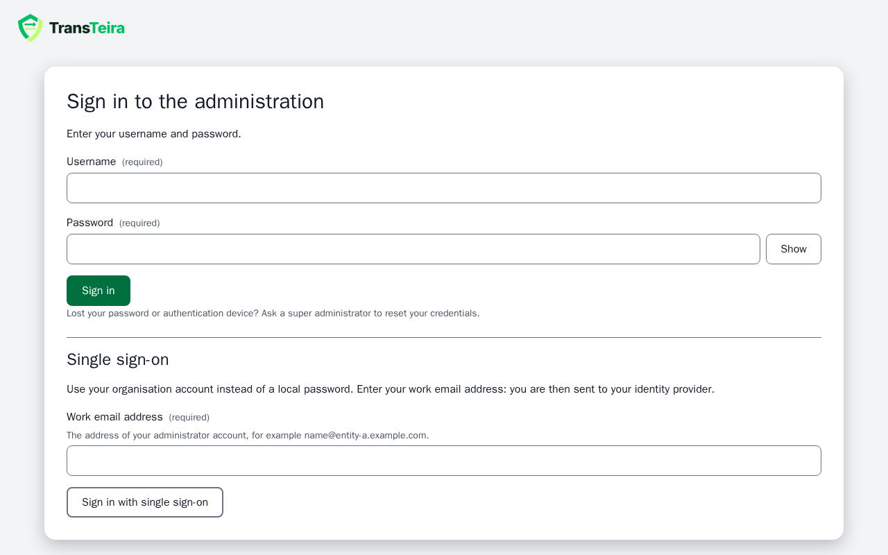
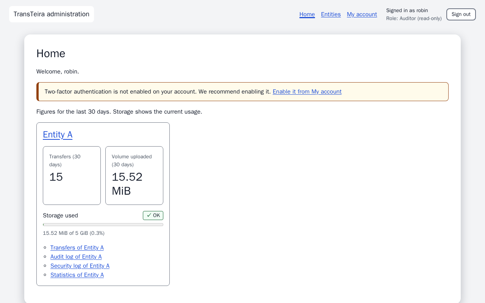
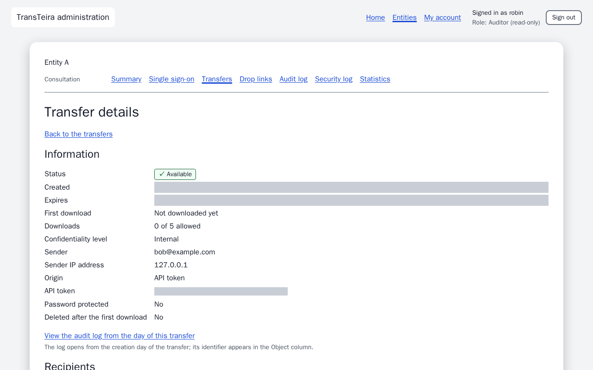
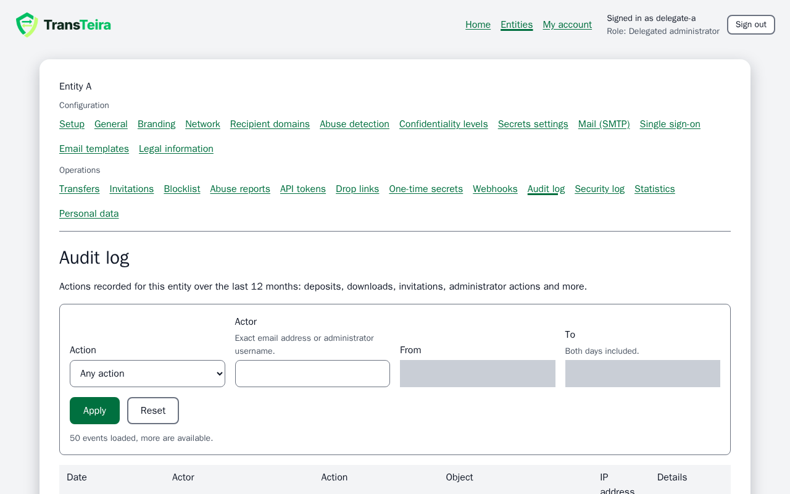
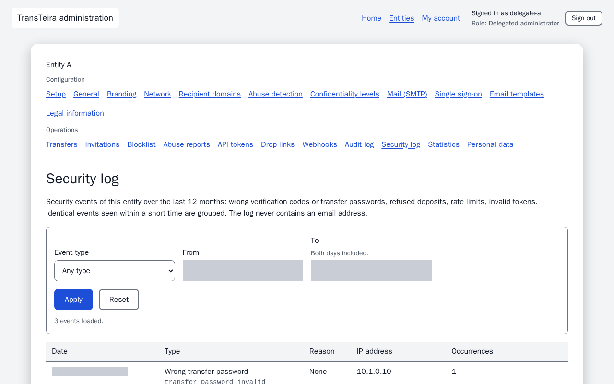
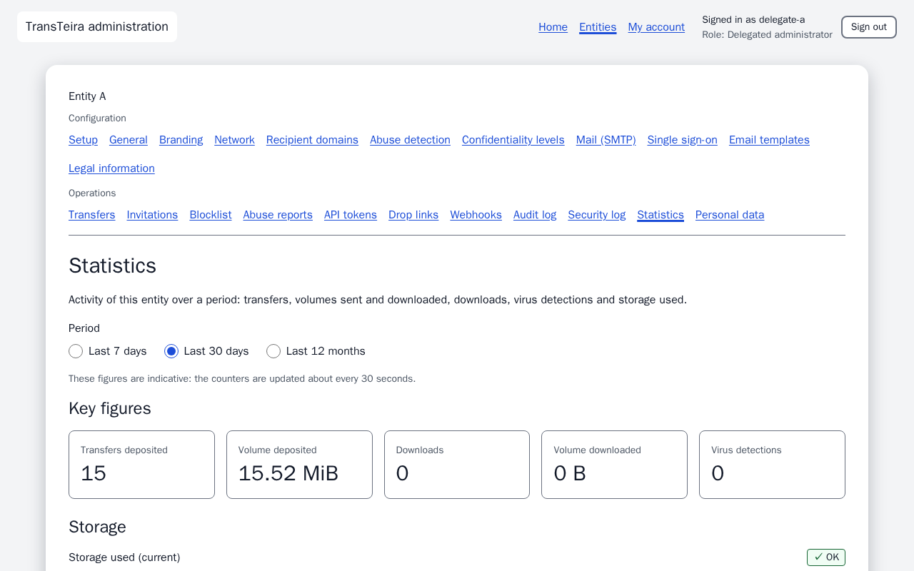
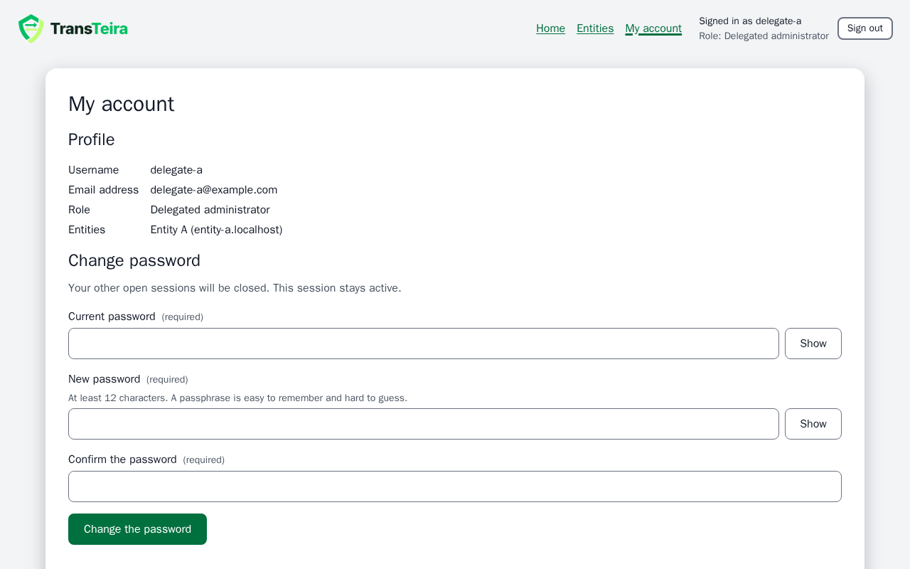

# Auditor guide

As an auditor, you consult the entities attached to your account, in read-only mode: their summary, audit log, security log, statistics, transfers and proofs, and their permanent drop links. This role is meant for a security officer or an audit (for example ISO 27001). You cannot change anything except your own password and second factor. Everything happens in the administration, at the address given by your organisation (for example `admin.transfer.example.com/admin/`). The **Help** link at the bottom of each screen opens the matching section of this guide.

<!-- topic: auditor-roles -->
## Your role: read-only

TransTeira has three administrator roles, and the role shown under your username tells you which one you have.

- **Super administrator**: manages every entity, creates the entities and the administrator accounts, and handles the system settings of the service.
- **Delegated administrator**: configures and operates the entities attached to the account.
- **Auditor** (shown as **Auditor (read-only)**): consults the entities attached to the account and changes nothing.

Your account is created by a super administrator, who attaches it to one or more entities. Another entity is invisible to you: if you open its address, the administration answers as if it did not exist.

You can read:

- the summary of the entity (its name, address, language, size limit and storage quota) and its single sign-on configuration, without any secret;
- the audit log, the security log and the statistics of the entity;
- the list of its transfers, the details of each transfer (metadata only) and their proofs of deposit and delivery, as PDF files;
- the list of its permanent drop links, never the secret of a link.

You manage only your own account: your password and your two-factor authentication. Any other action is refused with the error **read-only-role**, and the administration does not offer it to you.

<!-- topic: auditor-activation -->
## Activating your account

A super administrator creates your account, then gives you an activation link to choose your password, or invites you by mail. The link is valid for 72 hours and works only once; if you receive a second invitation, use only the latest, because each new invitation revokes the previous link.

1. Open the link. The page **Activate your account** appears.
2. Type your password in **New password**, then again in **Confirm the password**. The rule is shown under the field: at least 12 characters.
3. Click **Set the password**.
4. If two-factor authentication is required for your account (the default, and always with an invitation by mail), you configure it right away: see [Two-factor authentication](topic:auditor-totp).

If the page shows **Invalid activation link**, the link has expired, has already been used or was copied incompletely. Ask a super administrator for a new one.

If your organisation uses single sign-on for the entity, your account may have been created **without a password** ("single sign-on only"): there is no activation link, and you sign in as described below.

<!-- topic: auditor-login -->
## Signing in

You sign in either with your username, your password and a second factor, or with single sign-on when your account allows it.

### With a password

On **Sign in to the administration**, enter your **Username** and your **Password**, then click **Sign in**. If two-factor authentication is enabled, a second step **Two-factor authentication** follows:

- type the 6-digit **Authentication code** shown by your authenticator app (renewed every 30 seconds), then click **Verify**;
- if you no longer have your app, click **Use a recovery code** and type one of your recovery codes instead.

This second step must be completed within 5 minutes. To protect against password guessing, 5 failed attempts for the same username from the same network address within 15 minutes lock the sign-in for 15 minutes. Your session ends after 30 minutes of inactivity, and in any case after 12 hours (default values, set by the operator). To leave earlier, click **Sign out** in the main navigation.

> **Note** Lost your password or your authentication device? Ask a super administrator to reset your credentials: he or she hands you a new activation link.

### With single sign-on

If the entity uses single sign-on (OpenID Connect, for example Microsoft Entra ID), enter your work email address in the **Single sign-on** form of the sign-in page and click **Sign in with single sign-on**. You authenticate at your provider, and you arrive in the administration without a password or an authentication code of TransTeira: the second factor is the one of your provider. The first time, your account is linked to your identity at the provider.

An account created as "single sign-on only" has no password: it can only sign in this way. Your session then reaches only the entities that use the same provider. If the entity enforces single sign-on, the password sign-in is refused with a message telling you to use single sign-on. If the sign-in fails, the page shows a general message: ask a super administrator, who can read the reason in the security log.

<!-- topic: auditor-totp -->
## Two-factor authentication

Two-factor authentication protects your account even if your password leaks: signing in also requires a code generated by an app on your phone or computer. The super administrator decides whether it is mandatory for your account (it is by default). You configure it at the end of the activation, or later from [My account](topic:auditor-account).

On **Configure two-factor authentication**:

1. Install an authenticator app on your phone or computer (any TOTP-compatible app, or your password manager).
2. Scan the QR code. If you cannot, type the **Setup key** in the app by hand.
3. Type the 6-digit code shown by the app in **Confirmation code**, then click **Enable two-factor authentication**.

If the code is refused, check that the clock of your device is right: the codes depend on the time.

<!-- topic: auditor-recovery-codes -->
### Recovery codes

Recovery codes let you sign in if you lose access to your authenticator app. Right after the configuration, TransTeira shows 8 recovery codes, once and only once.

- Save them with **Copy all codes** or **Download (text file)**, and store them in a safe place, such as your password manager, but not next to your phone.
- Tick **I have saved these recovery codes in a safe place.**, then click **Continue**.

Each code works only once. Configuring a new device generates new codes and the previous ones stop working.

<!-- topic: auditor-admin -->
## Home page

The home page gives you an overview of the entities you consult. Each entity has a card with **Transfers (30 days)**, **Volume uploaded (30 days)**, **Storage used** (a meter of the space occupied compared with the quota) and quick links to its transfers, audit log, security log and statistics. You have no setup call to action: configuring an entity is the business of the delegated administrators.

If a card cannot load its figures, click **Try again**. If two-factor authentication is not enabled on your account, a banner recommends it. If no entity is attached to your account yet, the page says so: ask a super administrator to attach you to one.

The main navigation, at the top, contains **Home**, **Entities**, **My account** and **Sign out**. The footer holds the **Help** link and the **Language** selector, remembered in this browser.

<!-- topic: auditor-tenants -->
### Entities and summary

The **Entities** page lists the entities attached to your account, with their address, status, storage used and default language. If only one entity is attached to your account, this page takes you straight to it.

Once an entity is open, a navigation bar shows its name and a single group, **Consultation**, with **Summary**, **Single sign-on**, **Transfers**, **Drop links**, **Audit log**, **Security log** and **Statistics**. No configuration screen is offered.

<!-- topic: auditor-tenant-general -->
### Summary

The **Summary** shows the name and the address of the entity, its default language, its maximum size per transfer, its storage quota and its settings, with a note saying that you have read-only access. Nothing can be edited, exported or deleted from it.

<!-- topic: auditor-tenant-sso -->
### Single sign-on of the entity

The **Single sign-on** screen shows the single sign-on settings of the entity in read-only mode; only a super administrator can change them. The secret is never shown.

<!-- topic: auditor-tenant-transfers -->
## Transfers and proofs

The **Transfers** screen lists the transfers of the entity, most recent first. Filter by **Status** or by **Created from**, then click **Apply**; **Reset** clears the filters. You cannot search by email address: the filter is not offered to you, and the API refuses it with **read-only-role**. The columns show **Created**, **Sender**, **Recipients**, **Files and size**, **Status**, **Origin**, **Downloads** and **Expires**. Long lists show their first rows; click **Load more** for the next ones.

Open a transfer to see its **Transfer details**: status, dates, first download, sender, origin, options (including the **Confidentiality level**), recipients with the files each of them downloaded and when, and the files with their size, SHA-256 fingerprint and antivirus result. These are metadata only: file contents, download links and the message of the sender are never available, and you have no button to resend or delete a transfer.

<!-- topic: auditor-tenant-proofs -->
### Proofs of deposit and delivery

The details of a transfer have a **Proofs** section. It offers PDF files signed by the instance: the **proof of deposit** (written at the end of the antivirus analysis), the **proof of delivery** (written at the first complete download) and, when recipients have personal links, one **proof of delivery** per recipient. A proof not written yet is shown as unavailable.

Proofs are kept 12 months after they were issued, even if the transfer was deleted. The statement signed inside the PDF is authoritative, not its visible text: it lists the entity, the sender, the recipients, the files with their SHA-256 fingerprints and the dates, and no IP address. A proof is worth the trust placed in the operator of the instance, since there is no third-party timestamping. Each download of a proof is recorded in the audit log.

<!-- topic: auditor-tenant-audit -->
## Audit log

The **Audit log** screen shows the actions recorded for the entity over the last 12 months: deposits, downloads, invitations, administrator actions, antivirus detections and more.

Filter by **Action** (grouped by theme) and by period with **From** and **To**, then click **Apply**. The **Actor** filter is not offered to you, as for the transfers. The columns show the **Date**, **Actor**, **Action**, **Object**, **IP address** and **Details** (click **Show the details**). When the object is a transfer, a link opens its details. The filters are kept in the page address, so you can bookmark a view or share it with another person who has access to the entity.

An address erased at the request of the person concerned appears as a pseudonym starting with `erased-`. The log is kept 12 months and only holds the events of the entities attached to your account.

<!-- topic: auditor-tenant-security-log -->
## Security log

The **Security log** screen shows the security events of the entity over the last 12 months: wrong verification codes or transfer passwords, refused deposits, rate limits, invalid tokens and drop links. These are the events that the intrusion prevention tools (fail2ban, CrowdSec) work on, which is different from the audit log. The log never contains an email address.

Filter by **Event type** (choose a type in the list, or **Other type** and type its code) and by period with **From** and **To**. The columns show the **Date**, the **Type**, the **Reason**, the **IP address** and the **Occurrences**: identical events (same type, reason and address) seen within a short time are grouped in one row, with the number of occurrences and the date of the last one.

Events that belong to no entity (an unknown address, a failed administrator sign-in) are not shown here: they concern the instance and are reserved to the super administrator.

<!-- topic: auditor-tenant-stats -->
## Statistics

The **Statistics** screen shows the activity of the entity over a period. Choose the **Period**: **Last 7 days**, **Last 30 days** or **Last 12 months**. The **Key figures** give the **Transfers deposited**, **Volume deposited**, **Downloads**, **Volume downloaded** and **Virus detections**; the storage used is shown too, with charts per day or per month. Each chart has a **Show the data table** button for a readable version. The figures are indicative: the counters are updated about every 30 seconds.

<!-- topic: auditor-tenant-drop-links -->
## Drop links

The **Drop links** screen lists the permanent drop links of the entity, read-only: fixed addresses given to third parties to send files to a service of the entity. The list shows for each link its **Label**, **Recipients**, **Validity**, **Status** (**Active**, **Expired**, **Disabled** or **Revoked**), **Ends**, **Deposits per hour**, **Created** and **Last used**. A link neither used nor created for 12 months carries an **Unused for 12 months** badge.

You can neither create, change, rotate nor revoke a link. The secret of a link, which is part of its address, is never shown to you.

<!-- topic: auditor-account -->
## My account

My account gathers your profile, your password and your second factor: the only things you can change.

- **Profile** shows your **Username**, **Email address**, **Role** and **Entities**. Ask a super administrator to change your email address or your entities.
- **Change password**: type your **Current password**, then the **New password** twice, and click **Change the password**. Your other open sessions are closed; this one stays active. An account that signs in with single sign-on only has no password to change.
- **Two-factor authentication** shows its status. **Configure a new device** (or **Enable two-factor authentication** if it is not enabled yet) asks for your current password, then follows the steps of [Two-factor authentication](topic:auditor-totp). The previous app stops working, new [recovery codes](topic:auditor-recovery-codes) replace the old ones, and your other sessions are closed. The screen does not offer you to disable two-factor authentication.

<!-- topic: auditor-limits -->
## What you cannot do

The auditor role is read-only on purpose, so that an audit never alters what it examines. The administration does not offer these actions to you, and the server refuses them with the error **read-only-role** even if a request is sent by other means:

- changing the configuration of an entity (branding, network, mail, templates, legal texts, confidentiality levels, abuse thresholds, single sign-on);
- creating, changing or revoking an invitation, a blocklist entry, an API token, a webhook or a permanent drop link;
- resending, extending or deleting a transfer, closing an abuse report, erasing personal data;
- searching a list by email address (transfers and audit log);
- reading file contents, download links, the secret of a drop link, the instance security events without entity, or the system screens;
- creating or changing administrator accounts, including your own role and entities.

An entity that is not attached to your account does not exist for you. To get more access, or to see another entity, ask a super administrator.
