# Delegated administrator guide

As a delegated administrator, you configure and operate the entities attached to your account: their branding, network rules, mail server, email templates and legal texts, and you follow their transfers, invitations, blocklist, API tokens, webhooks, audit log, statistics and personal data requests. Everything happens in the administration, at the address given by your organisation (for example `admin.transfer.example.com/admin/`). The **Help** link at the bottom of each screen opens the matching section of this guide.

<!-- topic: admin-roles -->
## Roles

TransTeira has two administrator roles, and the role shown under your username tells you which one you have.

- **Super administrator**: manages every entity, creates the entities and the administrator accounts, and handles the system settings of the service.
- **Delegated administrator**: manages only the entities attached to the account. Another entity is invisible to you: if you open its address, the administration answers as if it did not exist.

Within your entities, you can change almost everything. A few settings are reserved to the super administrator: the name of the entity, its public address (FQDN), its storage quota, the ceiling of the size per transfer, and the deletion of the entity. Ask your super administrator when one of them needs to change.

<!-- topic: activation -->
## Activating your account

Your account is created by a super administrator, who then hands you an activation link to choose your password.

TransTeira never sends this link by email: the super administrator gives it to you in person, by instant messaging or by phone. The link is valid for 72 hours and works only once.

1. Open the link. The page **Activate your account** appears.
2. Type your password in **New password**, then again in **Confirm the password**. The rule is shown under the field: **At least 12 characters. A passphrase is easy to remember and hard to guess.**
3. Click **Set the password**.
4. If two-factor authentication is required for your account (the default), you configure it right away: see [Two-factor authentication](topic:admin-totp).

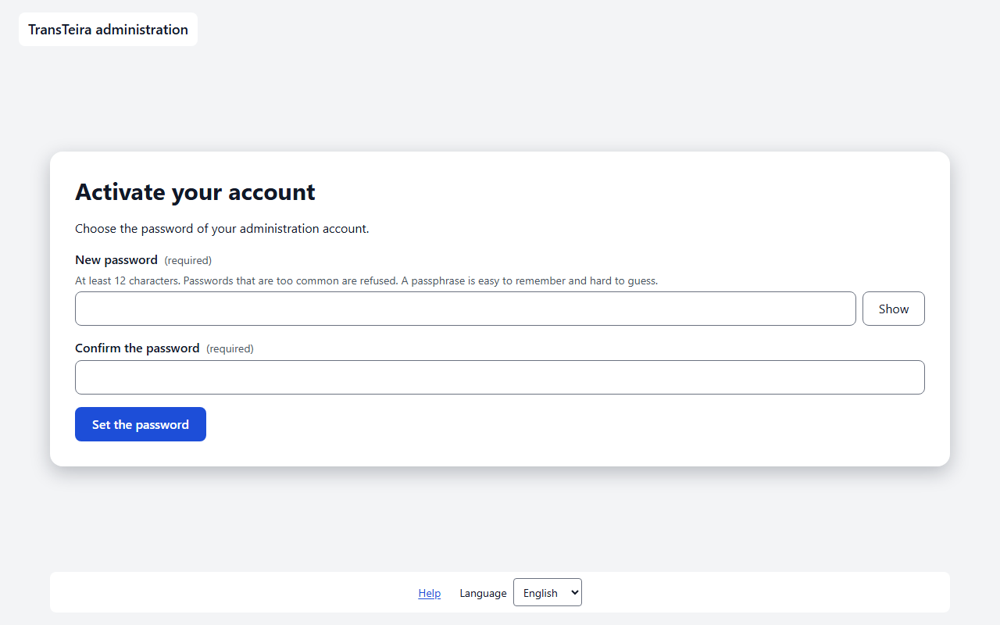

If the page shows **Invalid activation link**, the link has expired, has already been used or was copied incompletely. Ask a super administrator for a new one.

<!-- topic: login -->
## Signing in

The sign-in page protects the administration with your username, your password and, when it is enabled, a second factor.

On **Sign in to the administration**, enter your **Username** and your **Password**, then click **Sign in**.

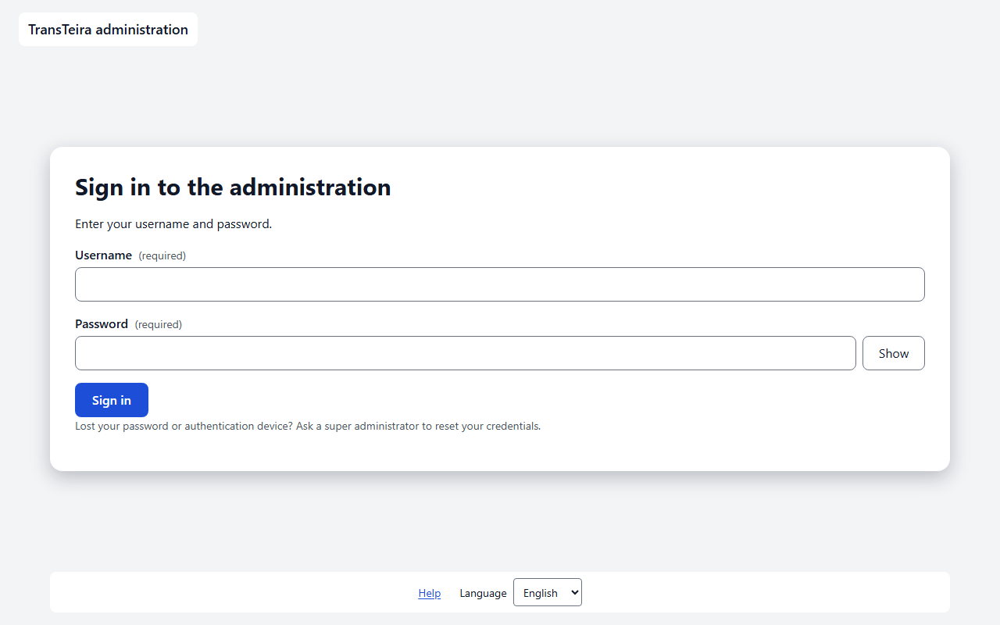

If two-factor authentication is enabled, a second step **Two-factor authentication** follows:

- type the 6-digit **Authentication code** shown by your authenticator app (renewed every 30 seconds), then click **Verify**;
- if you no longer have your app, click **Use a recovery code** and type one of your recovery codes instead.

This second step must be completed within 5 minutes. If you reload the page, you start again from the beginning.

To protect against password guessing, 5 failed attempts for the same username from the same network address within 15 minutes lock the sign-in for 15 minutes; the page shows the remaining time. Wrong second-factor codes are counted the same way.

Your session ends after 30 minutes of inactivity, and in any case after 12 hours (default values, set by the operator). To leave earlier, click **Sign out** in the main navigation.

> **Note** Lost your password or your authentication device? The sign-in page reminds you: **Lost your password or authentication device? Ask a super administrator to reset your credentials.** The super administrator then hands you a new activation link.

<!-- topic: admin-totp -->
## Two-factor authentication

Two-factor authentication protects your account even if your password leaks: signing in also requires a code generated by an app on your phone or computer.

It is mandatory for super administrators and recommended for everyone. The super administrator can make it mandatory for your account, which is the default for new accounts. You configure it at the end of the activation, or later from [My account](topic:account).

On **Configure two-factor authentication**:

1. Install an authenticator app on your phone or computer (any TOTP-compatible app, or your password manager).
2. Scan the QR code. If you cannot, type the **Setup key** in the app by hand; **Copy the key** copies it.
3. Type the 6-digit code shown by the app in **Confirmation code**, then click **Enable two-factor authentication**.

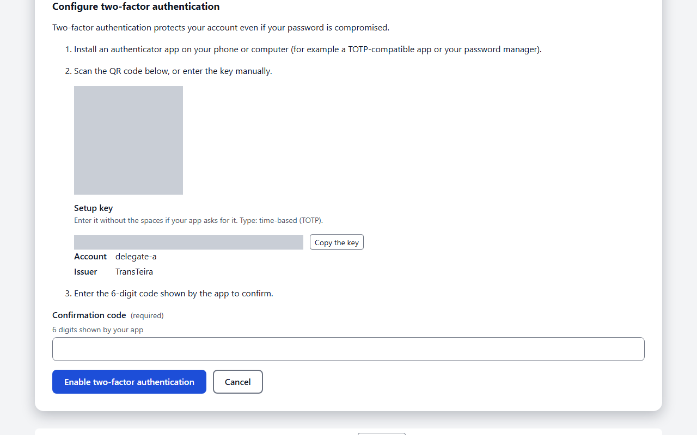

If the code is refused, check that the clock of your device is right: the codes depend on the time.

<!-- topic: admin-recovery-codes -->
### Recovery codes

Recovery codes let you sign in if you lose access to your authenticator app.

Right after the configuration, TransTeira shows 8 recovery codes, once and only once.

- Save them with **Copy all codes** or **Download (text file)**.
- Store them in a safe place, such as your password manager, but not next to your phone.
- Save them before leaving or reloading the page: once you leave it, they can never be shown again.
- Tick **I have saved these recovery codes in a safe place.**, then click **Continue**.

Each code works only once. Configuring a new device generates new codes and the previous ones stop working.

<!-- topic: admin -->
## Home page

The home page gives you an overview of the entities you administer.

Each entity has a card with:

- **Transfers (30 days)** and **Volume uploaded (30 days)**;
- **Storage used**, a meter of the space occupied compared with the quota, with its level: **OK**, **Nearly full** from 80 %, **Full** at 100 %;
- quick links to the transfers, the audit log and the statistics of the entity.

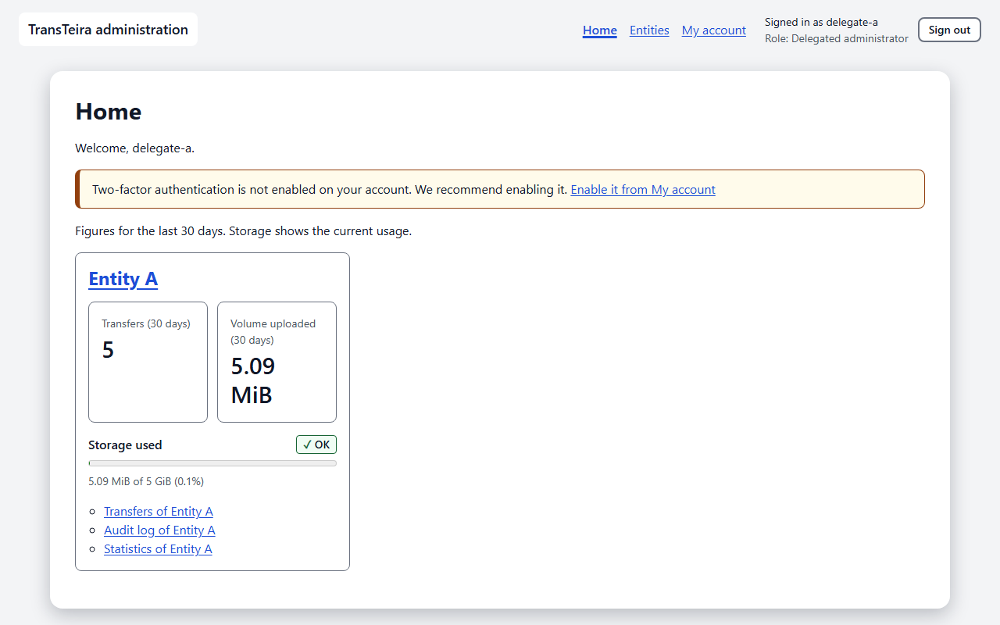

If a card cannot load its figures, click **Try again**.

If two-factor authentication is not enabled on your account, a banner recommends it, with the link **Enable it from My account**. If no entity is attached to your account yet, the page says so: ask a super administrator to attach you to one.

The main navigation, at the top, contains **Home**, **Entities**, **My account** and **Sign out**. The footer holds the **Help** link and the **Language** selector, remembered in this browser.

<!-- topic: account -->
## My account

My account gathers your profile, your password and your second factor.

- **Profile** shows your **Username**, **Email address**, **Role** and **Entities**. The email address receives your alerts; ask a super administrator to change it.
- **Change password**: type your **Current password**, then the **New password** twice, and click **Change the password**. Your other open sessions are closed; this one stays active.
- **Two-factor authentication** shows its status.
- **Change authentication device**: click **Configure a new device**, enter your current password, then follow the steps described in [Two-factor authentication](topic:admin-totp) (if it is not enabled yet, the button is **Enable two-factor authentication**). The previous app stops working, new [recovery codes](topic:admin-recovery-codes) replace the old ones, and your other sessions are closed.
- **Disable two-factor authentication**: possible only when it is not mandatory for your account. Otherwise the request is refused with **Two-factor authentication is required for your account: it cannot be disabled.**

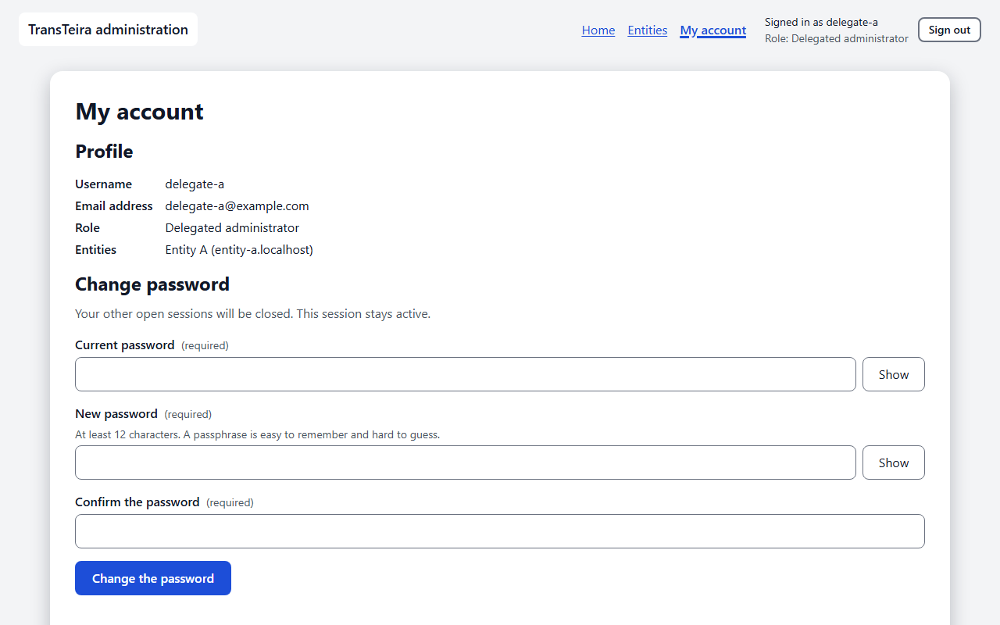

<!-- topic: tenants -->
## Entities

The **Entities** page lists the entities you administer, each with its own address, branding and configuration.

The columns show the **Name**, the **Address (FQDN)** of its public pages, the **Status**, the **Storage used** and the **Default language**. Click the name, or **Configure** followed by the name, to open an entity. If only one entity is attached to your account, this page takes you straight to it.

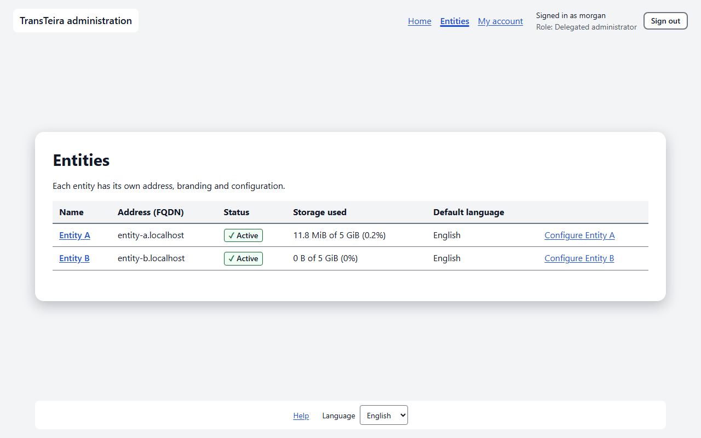

Creating and deleting entities is reserved to the super administrator: these actions are not offered to you.

<!-- topic: tenant-nav -->
### Entity navigation

Once an entity is open, a navigation bar shows its name and two groups of screens.

- **Configuration**: **General**, **Branding**, **Network**, **Recipient domains**, **Confidentiality levels**, **Mail (SMTP)**, **Email templates**, **Legal information**.
- **Operations**: **Transfers**, **Invitations**, **Blocklist**, **API tokens**, **Webhooks**, **Audit log**, **Statistics**, **Personal data**.

The filters of the lists are kept in the page address, so you can bookmark a filtered view or share it with another administrator of the entity. Long lists show their first rows; click **Load more** to see the next ones. If you leave a form with unsaved changes, the administration asks for confirmation first.

## Configuring an entity

The configuration screens set how the public pages of the entity look and behave. Changes apply immediately to the public pages, and each one is recorded in the [audit log](topic:tenant-audit).

<!-- topic: tenant-general -->
### General

The General screen shows the identity of the entity and lets you set its language and its size per transfer.

At the top, the status of the entity and the line **Storage used** give the occupied space compared with the quota. The name, the address (FQDN), the storage quota and the ceiling of the size per transfer are shown for information: as the screen reminds you, **A delegated administrator can only change the default language and the maximum size per transfer. The other settings are managed by the super administrator.**

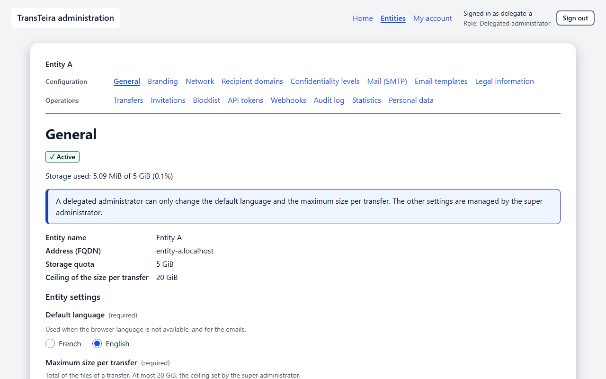

- **Default language**: used on the public pages when the language of the visitor's browser is not available, and for the emails.
- **Maximum size per transfer**: total of the files of one transfer. You can choose any value up to the ceiling set by the super administrator, itself at most 20 GB. Lower it if your users should not send very large transfers.

Click **Save** to apply.

The **Webhooks** section below sets the content of the alerts sent to the [webhooks](topic:tenant-webhooks) of the entity. **Include addresses in webhooks** adds the addresses of the sender and of the recipients concerned. Addresses are personal data that leave TransTeira with each alert: tick it only if the receivers need them and are trusted. It is off by default; click **Save the webhook setting** under the box to apply.

<!-- topic: tenant-branding -->
### Branding

The Branding screen sets the logo, the colors and the background image of the public pages.

**Colors**: choose the **Primary color** (buttons and active elements) and the **Accent color** (links and secondary elements) with the color picker, or type their code in the #RRGGBB format, for example #1A5FB4. Click **Save**.

The **Contrast** section checks each pair of colors used by the interface. The ratio must reach at least 4.5:1 (level AA) for texts to stay readable. A pair marked **Insufficient** is a warning: you can still save, but fix it to meet the accessibility requirements (RGAA). The **Preview of the public page** shows the result before you save.

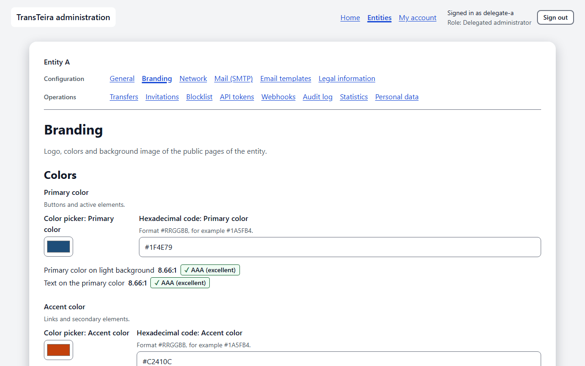

**Logo** (shown at the top of the public pages) and **Background image** (shown full screen behind the deposit area):

1. Click **Choose an image** and select a PNG, JPEG or WebP file: at most 5 MB for the logo and 10 MB for the background.
2. Check the preview, then click **Upload the image**.
3. To remove an image, click **Delete the image**.

Every image is re-encoded by TransTeira, which removes its metadata and any hidden content. SVG files are refused. A very large photo may be refused because of its dimensions: reduce it to 3840 pixels on its longest side (convert a WebP image to JPEG first). Without a background image, a default image is used.

<!-- topic: tenant-network -->
### Network

The Network screen defines who counts as an internal user of the entity.

A user is internal when **both** conditions are met: their IP address belongs to one of the internal ranges **and** their email address belongs to one of the internal domains. Only internal users can send files freely and invite external people; everyone else needs an invitation.

- **Internal IP address ranges**: one range per line in CIDR notation, for example `192.0.2.0/24` or `2001:db8::/32`.
- **Internal email domains**: one domain per line, for example `entity-a.example.com`.

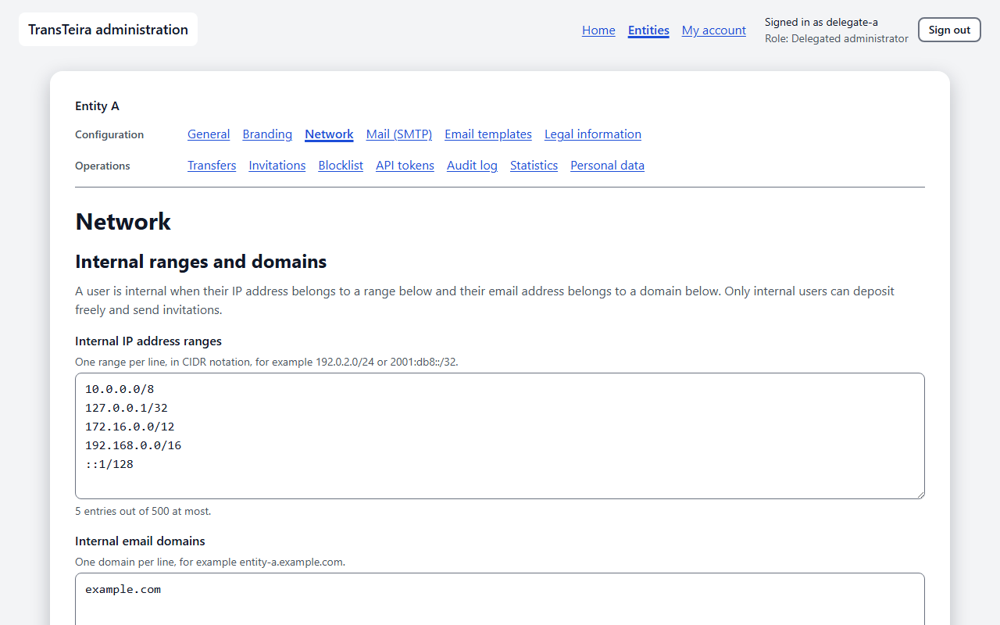

Errors are reported line by line, sometimes with a suggested correction you can apply. Repeated lines are ignored, and the server normalizes the values it saves (the lists shown after saving are the saved ones). Click **Save**.

**Allow deposits from outside for verified internal users**: off by default. When on, an address of an internal domain **already verified from the internal network** can deposit outside the ranges, without an invitation, with a code at every deposit (see the depositor guide, section "Depositing from outside"). Invitations remain reserved to the internal network, and these deposits are flagged in the [audit log](topic:tenant-audit) and counted by the [abuse detection](topic:tenant-abuse). A compromised mailbox would then allow deposits from the Internet: turn the option on only after assessment. The option itself is public in the entity configuration. When it is on, a code request from outside for an address that is not eligible (another domain, never verified from the internal network, inactive, unknown) gets the same answer as an eligible address, with no email sent: the attempt counts in the code limits and every code is refused at confirmation. If a user reports that no code arrives from outside, check their eligibility. With the option off, outsiders get the generic refusal. Blocklisted addresses are still refused.

**Allow recipients to reply to a transfer** (section **Reply to a transfer**): off by default. When on, a recipient who opens their personal link sees a **Reply** button and can send files back to the original sender without an invitation (see the recipient guide, section "Reply to a transfer"). It only concerns transfers sent by an internal user or an API token, never those of an external guest nor a reply, and never the old shared links from before version 1.1. The recipient of the reply is always the original sender. The replier must confirm their address with a code for every reply, even if the sender had not asked for verification. The reply is subject to everything that applies to external people: external quotas (see [Abuse detection](topic:tenant-abuse)), size limit per transfer, entity storage quota, antivirus, blocklist (replier and original sender) and confidentiality levels. It must finish before the original transfer expires, which is rechecked at creation and at finalization; turning the option off stops new replies at once, and maintenance mode refuses them. The main risk is phishing: a forwarded link or a compromised mailbox lets someone deposit files with an internal user. That is why the internal recipient sees, in the mail and on the download page, a warning that this is an external reply with a verified address. In the [audit log](topic:tenant-audit), a reply produces `transfer.created` with origin `reply` and then `transfer.reply_created`; a refusal linked to the original sender is recorded as `transfer.recipient_refused`. Refusal of a replier by the blocklist appears in the security log (`deposit_refused`, reason `blocklist`). In the transfer list, these transfers have the origin **Reply**.

Watch the warnings:

- an empty list of ranges or of domains means that nobody is internal: only invitations will allow deposits;
- a range covering every address, such as `0.0.0.0/0`, means that any user of an internal domain can deposit from anywhere.

TransTeira sees the address of the client as transmitted by the reverse proxy. If you are not sure which ranges to enter (offices, VPN, outgoing addresses), ask the operator of the service.

<!-- topic: tenant-recipient-rules -->
### Recipient domains

The Recipient domains screen limits the email domains senders may address, for example to prevent files from leaving for consumer webmail.

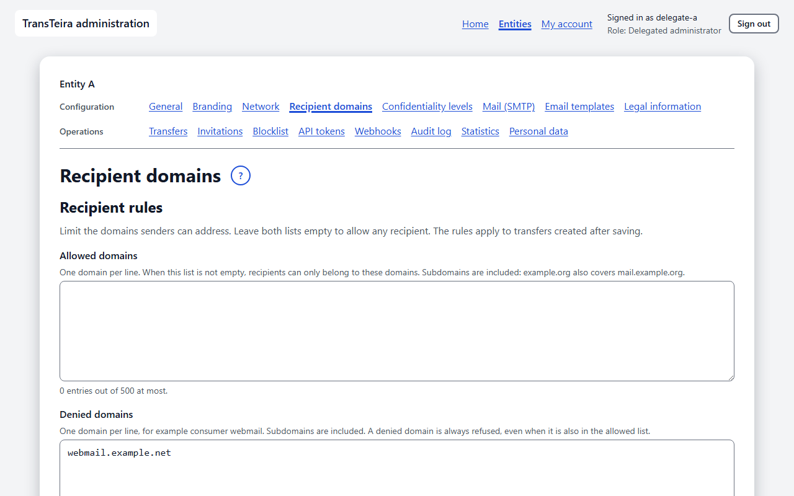

- **Allowed domains**: one domain per line. When this list is not empty, recipients can only belong to these domains.
- **Denied domains**: one domain per line. A denied domain is always refused.

A rule on a domain also covers its subdomains: `example.org` covers `mail.example.org`. If a domain is in both lists, it is denied, because the deny list wins. Leave both lists empty to allow any recipient. Each list holds at most 500 entries; the server saves the domains in lowercase, without duplicates, and shows the saved values. The screen warns you when a domain is in both lists and when a non-empty allowed list restricts the recipients. Click **Save**.

The rules apply to every new transfer, whether it is sent from the web page or with an API token. A transfer addressed to a refused domain is not created: the sender sees a message naming the refused addresses, and the refusal is recorded in the [audit log](topic:tenant-audit) with the refused domains. It is not written to the security log. Transfers that already exist are not affected.

<!-- topic: tenant-confidentiality -->
### Confidentiality levels

The Confidentiality levels screen defines the levels senders choose from when they create a transfer. Each level imposes its own rules. You can define from 1 to 10 levels, with exactly one **Default level**, which applies when the sender does not choose one. With a single level, the sender sees no selector, but its rules still apply.

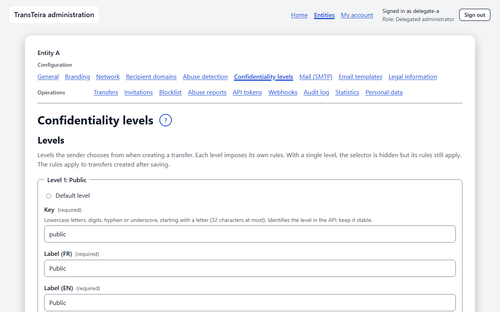

For each level, fill in:

- **Key**: lowercase letters, digits, hyphen or underscore, starting with a letter (32 characters at most). It identifies the level in the API: keep it stable.
- **Label** in French and in English (50 characters at most), and an optional **Description** in each language (500 characters at most), shown to the sender under the level.
- **Rules** (each one is a separate field):
- **Available durations**: the durations among 1, 7 and 30 days that the sender may choose (at least one).
- **Password required**.
- **Recipient verification required**. This rule is stored but not applied yet: it takes effect once per-recipient links are available.
- **Internal recipients only**: recipients must belong to the internal domains of the entity (see [Network](topic:tenant-network)).
- **Delete after the first download (forced)**.
- **Maximum number of downloads (cap)**: optional, from 1 to 1000. It caps the number of downloads the sender can set; if the sender sets none, the cap applies.

Use the arrows to reorder the levels, **Add a level** to create one, and **Save** to apply. The screen reports errors level by level.

A transfer that breaks a rule of its level is refused, whatever the way it is created (web page or API token), and the sender is told which rule is not met. The rules of the level are copied onto each transfer when it is created: editing or deleting a level never changes the transfers that already exist. The level of a transfer is shown to the recipients in the email and on the download page, in the transfer details (see [Transfers](topic:tenant-transfers)) and in the [audit log](topic:tenant-audit).

> **Note** Check the rules of the default level: they apply to every sender who does not choose a level.

<!-- topic: tenant-smtp -->
### Mail (SMTP)

The Mail (SMTP) screen sets the server through which the entity sends all its emails: verification codes, notifications, invitations and alerts.

Until it is configured, the screen shows **Mail is not configured yet: the entity cannot send any email.** and nobody can verify their address.

- **SMTP server**: host name or IP address, for example `smtp.example.com`.
- **Port** and **Connection security**: **None (relay on an internal network)**, **STARTTLS (usually port 587)** or **Implicit TLS (usually port 465)**. Choose None only for a relay reachable through the internal network of the service.
- **Username**: leave it empty for a relay without authentication. Authentication is refused without encryption, since the credentials would travel in clear.
- **Password**: **Keep the saved password**, **Replace the password** or **Remove the password**. It is encrypted and never shown again. If you change the server, the port or the username, enter it again.
- **Sender address**: the "From" address of the emails, for example `transfer@entity-a.example.com`.
- **Sender name**: optional, the name of the entity by default.

Click **Save**.

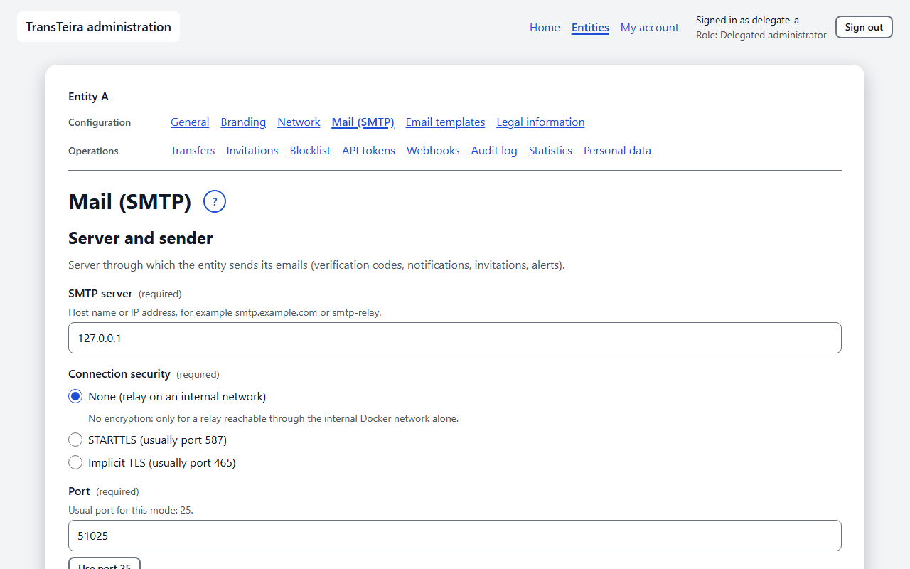

**Test email**: the test uses the saved settings, so save first. Type a **Recipient address** and click **Send a test email**. The result tells you whether the server accepted the message or, if not, the stage reached (connection, TLS, authentication…) and the server message. You can send 5 tests per 10 minutes.

**DNS check (SPF, DKIM, DMARC)**: without these DNS records on the domain of the sender address, emails may be classified as spam. DKIM selectors cannot be discovered automatically: type up to 5 in **DKIM selectors** (for example `selector1, selector2` for Microsoft 365), then click **Check the DNS**. Each record is reported as **Correct**, **To be checked**, **Missing** or **Check failed**. The check is indicative.

> **Note** With a relay to Microsoft 365, DKIM must be enabled in Microsoft 365 for the domain of the entity, and the sender address must be allowed in the application used by the relay. Ask the operator of the service to check it.

<!-- topic: tenant-templates -->
### Email templates

The Email templates screen lets you customise, for each language, the emails sent by the entity.

The list shows each template in each language, marked **Customized** or **Default**. A template that is not customised uses the default text. The templates are:

- **Verification code**, **Transfer notification**, **Transfer confirmation**, **First download receipt**;
- **Infected or withheld file**, **File not scanned**, **External invitation**;
- **Quota alert (80%)**, **Quota reached**, **Antivirus unavailable**.

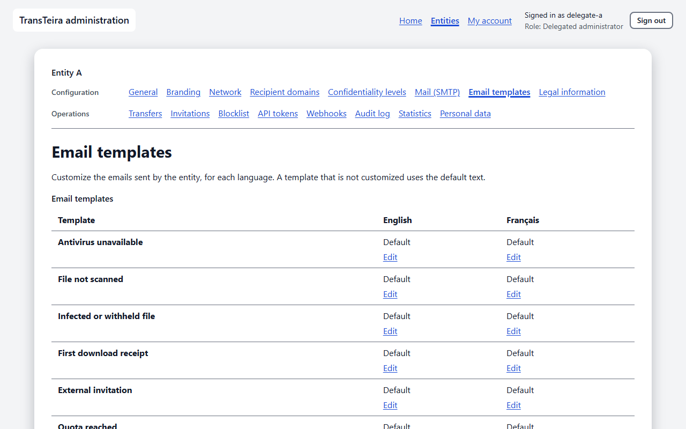

Click a template to open the editor. It has three fields: **Subject**, **HTML body** and **Text body** (plain text version, read by mail clients that do not display HTML).

- **Available variables**: click a variable to insert it at the cursor, in the last field used. Variables are written between double braces, for example `{{download_link}}`. Variables marked required must appear in both bodies; a missing or unknown variable is flagged.
- For security, the HTML is filtered: no scripts, no remote images, and only https and mailto links.
- **Preview** shows the email with sample data, without its styles and with images replaced by their description.
- **Save the template** saves it; **Restore the default template** deletes your customisation for this language.

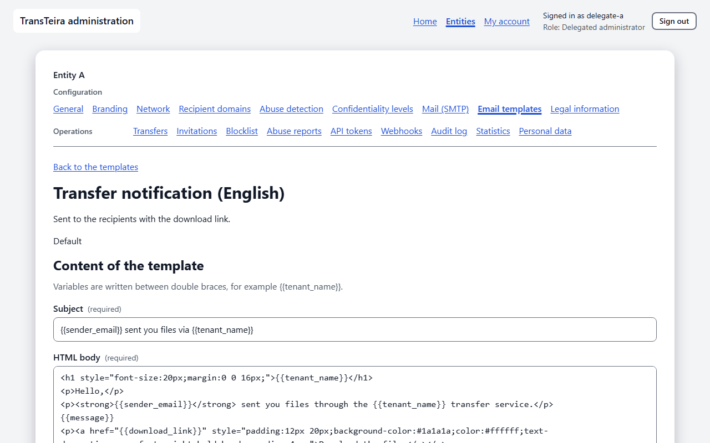

If the server finds an error, it gives the field, the line and the column, with a message in English. If a customised template ever fails when an email is sent, the default template is used instead, so the email still goes out.

<!-- topic: tenant-legal -->
### Legal information

The Legal information screen holds the texts shown on the legal information page of the entity.

There are two documents, **Legal notice** and **Privacy policy**, in each language, marked **Written** or **Not written**.

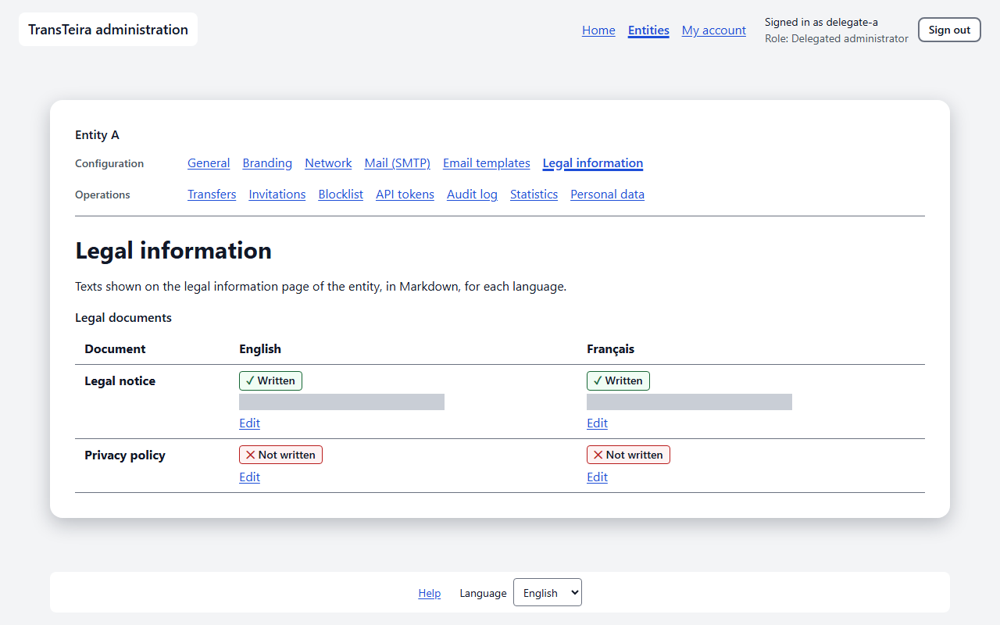

Click a document to edit it in **Text (Markdown)**: headings with `#`, lists with `-`, links with `[text](address)` (https and mailto addresses only). HTML is not interpreted. Click **Save**; the **Preview** shows the saved text. Saving an empty text deletes the document, after confirmation.

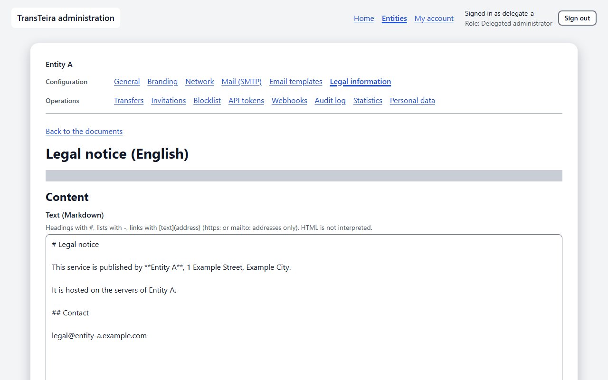

Visitors see the document in their language, or in the default language of the entity if it is not written in theirs. A missing document is announced as not published.

## Operating an entity

The operations screens let you follow the daily activity of the entity and act on it. The lists can be filtered and show the most recent items first.

<!-- topic: tenant-transfers -->
### Transfers

The Transfers screen lists the transfers of the entity, to follow them, resend their notification or delete them before they expire.

Filter by **Status**, by **Email address** (exact address of the sender or of a recipient) or by **Created from**, then click **Apply**; **Reset** clears the filters. The columns show **Created**, **Sender**, **Recipients**, **Files and size**, **Status**, **Origin**, **Downloads** and **Expires**.

- Statuses: **Uploading**, **Being scanned**, **Available**, **Rejected**, **Expired**, **Deleted**.
- Origins: **Internal user**, **External guest** (deposit through an invitation), **API token**, **Reply** (files sent back by a recipient, see [Network](topic:tenant-network)).

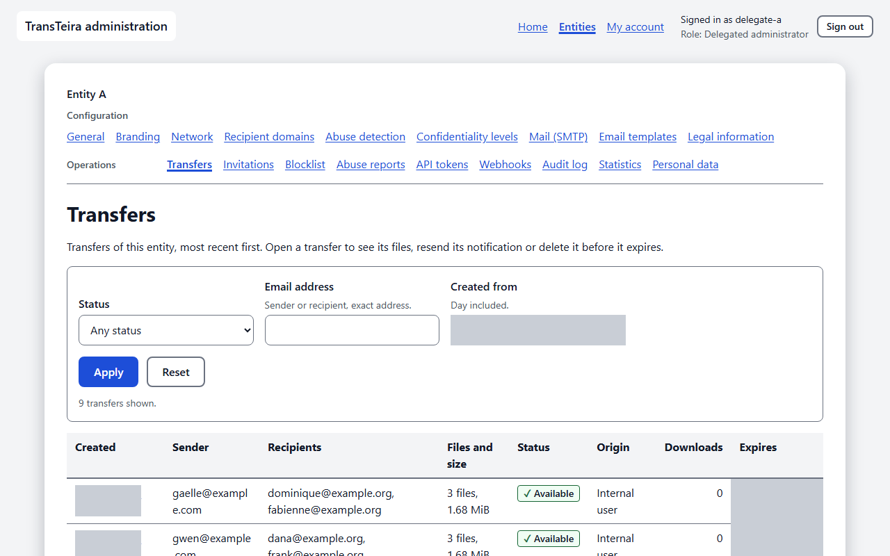

Open a transfer to see its **Transfer details**: status, dates, first download, sender and sender IP address, origin, options (including the **Confidentiality level** and the number of downloads, shown as the count out of the maximum allowed when the sender set one), recipients, and the files with their size, SHA-256 fingerprint and antivirus result. Every new transfer gives each recipient a personal link, so the details also show, for each recipient, which files were downloaded and when (first and last download), never the recipient's IP address or browser. Transfers created before version 1.1 keep a single shared link and show no per-recipient tracking. File contents and download links are never available to administrators.

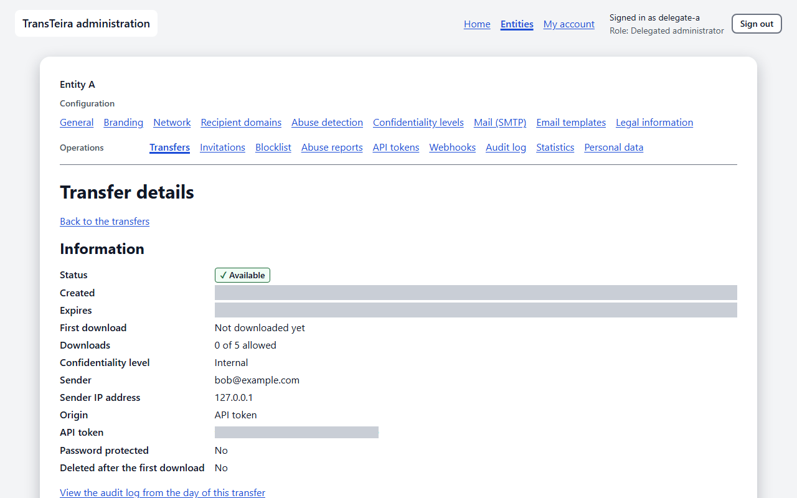

- **Resend the notification**: choose the recipients and click **Resend**. The email is sent again and each recipient receives their own personal link again, at most 5 times per hour. The day before a transfer expires, recipients who have not downloaded yet automatically receive a reminder email (not for transfers valid one day, nor for blocked addresses).
- **Delete the transfer**: optionally type a **Reason (optional)**, recorded in the audit log, then confirm. The files are erased for good, including from backups, since their encryption keys are destroyed. The download link stops working.
- Senders can also delete or extend their own transfers themselves from the "My transfers" page of the sending site (see the depositor guide), without an administrator. These actions are recorded in the [audit log](topic:tenant-audit) (`transfer.deleted`, `transfer.extended`, `my_transfers.link_requested`, `my_transfers.signed_in`).
- **View the audit log from the day of this transfer** opens the audit log at the creation day.

<!-- topic: tenant-invitations -->
### Invitations

The Invitations screen lists the invitations sent by internal users so that external people can deposit files for them.

The columns show the **Invited address**, **Invited by**, the **Status** (**Pending**, **Used**, **Expired**, **Revoked**), and the creation, expiry and last use dates. An invitation is valid 12 months after its creation or its last use, whichever is later.

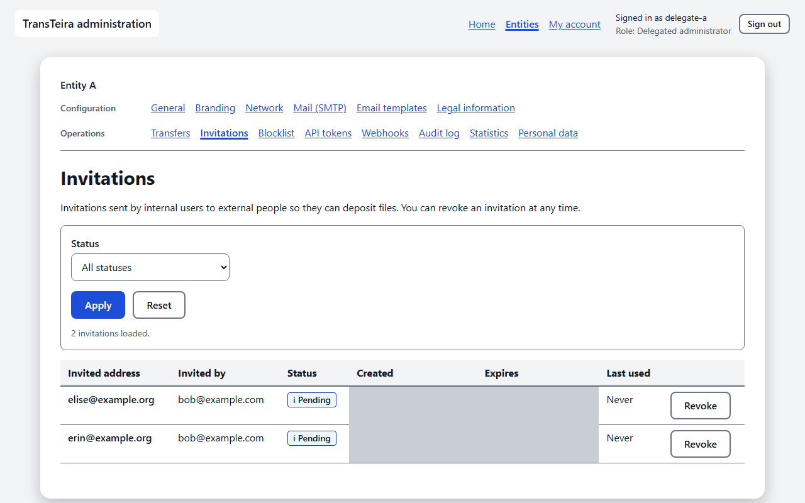

Click **Revoke** to stop an invitation immediately: its link no longer allows a deposit, and deposits already started with it end. This is final, but a new invitation can be sent later.

<!-- topic: tenant-blocklist -->
### Blocklist

The Blocklist screen stops addresses, domains or files from being deposited on the entity.

In **Add an entry**, choose the **Kind** (**Email address**, **Domain** or **SHA-256 digest**), type the **Value**, optionally a **Comment (optional)** for the other administrators (without unnecessary personal data), then click **Add**. A blocked address or domain can no longer deposit; a file whose fingerprint is blocked is refused. Click **Remove** to lift a block.

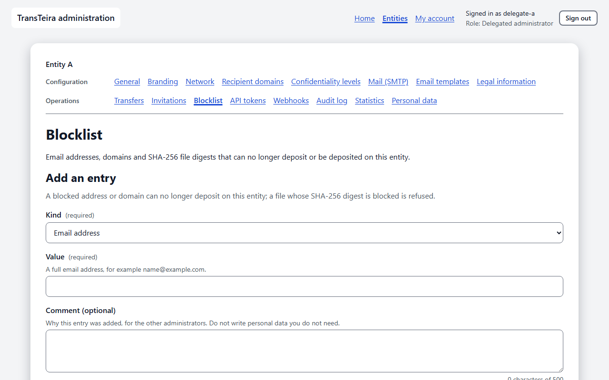

To block a file, copy its fingerprint from the transfer details (see [Transfers](topic:tenant-transfers)). Blocklist entries are kept on purpose after a personal data erasure, so that an abuser is not unblocked.

<!-- topic: tenant-tokens -->
### API tokens

API tokens let scripts and third-party software deposit files through the API of TransTeira, without a person verifying an address.

The list shows the **Name**, **Prefix**, **Allowed IP ranges**, **Allowed senders**, **Created**, **Last used**, **Expires** and **Status** of each token.

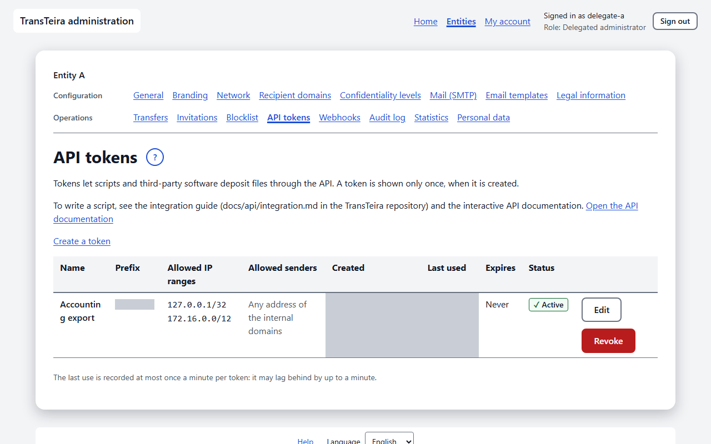

To create one, click **Create a token**:

1. **Name**: what the token is for, for example "Nightly ERP export".
2. **Allowed IP ranges**: the addresses the script connects from, as seen behind the reverse proxy, for example `192.0.2.10/32` (same notation as on the [Network](topic:tenant-network) screen). **Allow any address** is possible but discouraged.
3. **Allowed senders**: the addresses or domains the script may deposit as. With an empty list, the token can deposit as any address of the internal domains: restrict it.
4. **Expiry date (optional)**: none by default; the token then works until revoked.
5. Click **Create the token**.

The secret of the token is shown **only once**. Click **Copy the secret**, tick **I have stored this secret, it will not be shown again**, then **Close**. Give it to the person in charge of the script through a channel you trust, never in clear text by email.

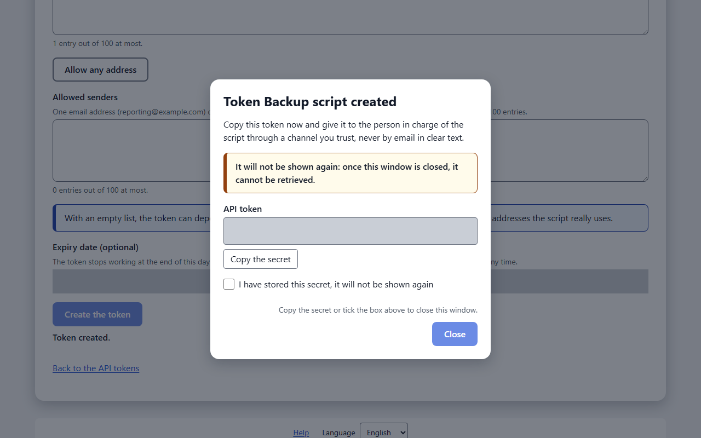

**Edit** changes the name, the ranges and the senders (not the expiry: create a new token instead). **Revoke** refuses every request made with the token from now on; this is final, and transfers already created stay available to their recipients. To write a script, see the integration guide `docs/api/integration.md` in the TransTeira repository and click **Open the API documentation**.

<!-- topic: tenant-webhooks -->
### Webhooks

Webhooks send the alerts of the entity to a Microsoft Teams or Slack channel, or to any receiver that accepts JSON (a SIEM, a script), in addition to the alert emails.

The list shows, for each webhook, its **Name and address** (only the scheme and the host of the address: the full address is stored encrypted and never shown again), its **Kind**, its **Events**, its **Status** and its **Last delivery** (delivered or failed, the HTTP status or the cause, the duration and the date). An entity can have at most 20 webhooks.

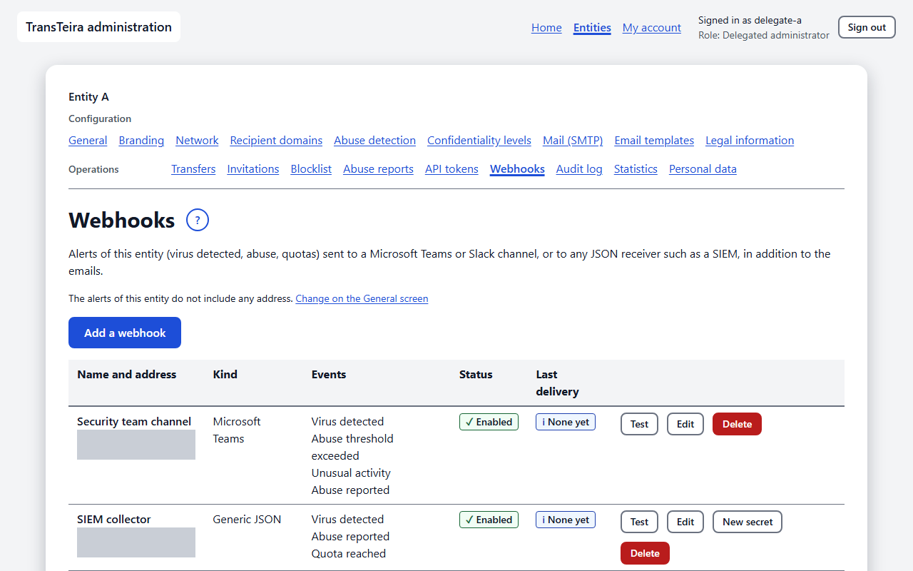

To add one, click **Add a webhook**:

1. **Name**: what the receiver is, for example "Security team channel".
2. **Kind**: **Microsoft Teams** or **Slack** for the incoming webhook of a channel (a formatted message), **Generic JSON** for any other receiver (a JSON document signed with a secret).
3. **Address (URL)**: the full `https://` address given by the receiver. An address whose host name cannot be resolved is refused (**This address is not allowed**), as are addresses of private or reserved networks unless the operator of the instance allowed them. You can create webhooks or enter new addresses 30 times per hour; beyond that, the form tells you how long to wait.
4. **Events**: **Virus detected**, **Abuse threshold exceeded**, **Unusual activity**, **Abuse reported**, **Quota at 80 %** and **Quota reached**. Select at least one.
5. Leave **Enabled** ticked, then click **Create the webhook**.

For a **Generic JSON** webhook, the signing secret is shown **only once**: copy it into the configuration of the receiver, which uses it to check the `X-TransTeira-Signature` header of each request (see `docs/api/integration.md` in the TransTeira repository). Then tick **I have stored this secret, it will not be shown again** and click **Close**.

The actions of each webhook:

- **Test** sends a test event right away and shows the result above the list: delivered with the HTTP status and the duration, or failed with a short cause (**Name not resolved**, **Address refused by the network rules**, **Connection failed**, **TLS error**, **No answer within 10 seconds**, **Error answer**). A test is not a delivery: it changes neither the **Last delivery** column nor a suspension. You can run 10 tests per hour.
- **Edit** changes the name, the events and **Enabled**, or replaces the address: leave **New address (URL)** empty to keep the current one. The kind cannot be changed.
- **New secret** (generic webhooks) replaces the signing secret: the old one stops working at once, and the new one is shown once.
- **Delete** removes the webhook and destroys its encrypted address and secret.

Deleting or disabling a webhook, or removing an event from it, stops at once the deliveries still waiting for it. After a change of address or of secret, the alerts in progress go to the new address with the new secret, never to the old address.

After 5 failed deliveries in a row, a webhook is **Suspended** for 15 minutes: the list shows until when. Fix the receiver and check it with **Test** (a test does not end the suspension); disabling and enabling the webhook again in **Edit** resumes the deliveries at once. Each delivery makes up to 5 attempts; alerts waiting to be sent are lost if the service restarts, but the emails and the [audit log](topic:tenant-audit) are not affected.

The alerts never contain a file name, a link to a transfer or a password. They contain no email address either, unless **Include addresses in webhooks** is ticked on the [General](topic:tenant-general) screen.

<!-- topic: tenant-audit -->
### Audit log

The Audit log screen shows the actions recorded for the entity over the last 12 months: deposits, downloads, invitations, administrator actions and more.

Filter by **Action** (grouped by theme), by **Actor** (exact email address or administrator username), and by period with **From** and **To**. The columns show the **Date**, **Actor**, **Action**, **Object**, **IP address** and **Details** (click **Show the details**). When the object is a transfer, a link opens its details.

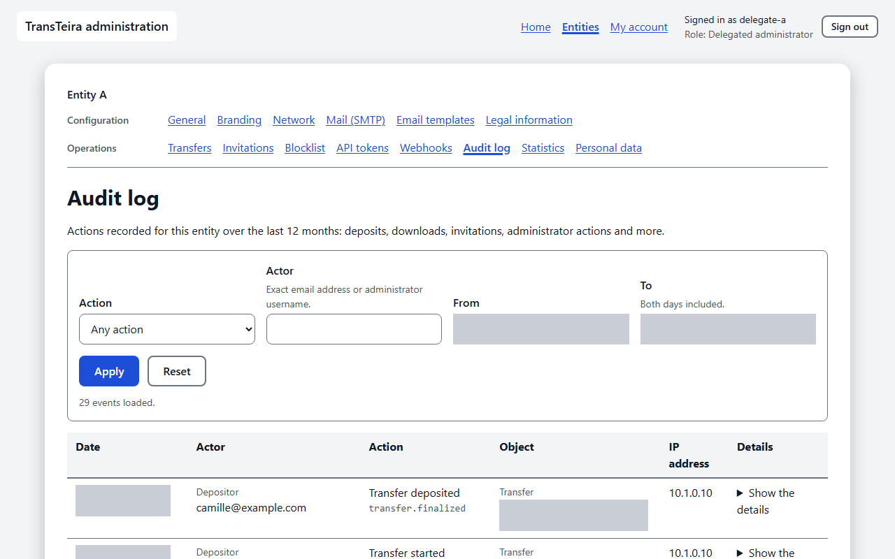

An address erased at the request of the person concerned appears as a pseudonym starting with `erased-`.

<!-- topic: tenant-stats -->
### Statistics

The Statistics screen shows the activity of the entity over a period.

Choose the **Period**: **Last 7 days**, **Last 30 days** or **Last 12 months**. The **Key figures** give the **Transfers deposited**, **Volume deposited**, **Downloads**, **Volume downloaded** and **Virus detections**; the storage used is shown too, with charts per day or per month. Each chart has a **Show the data table** button for a readable version. The figures are indicative: the counters are updated about every 30 seconds.

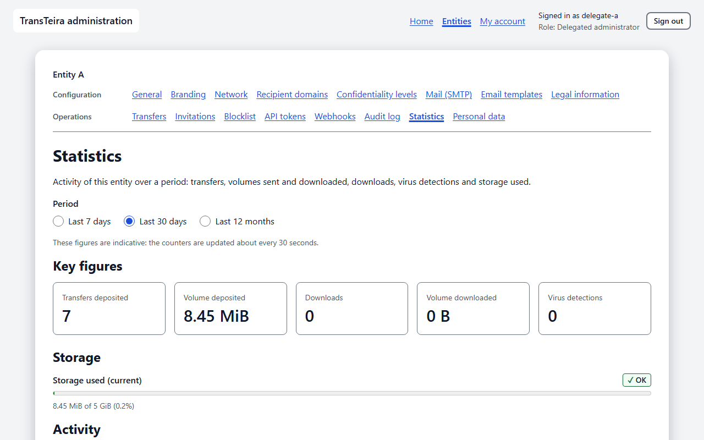

The storage quota is set by the super administrator. When the entity reaches 80 % of its quota, the delegated administrators receive an alert email; when it reaches 100 %, they receive another one and new deposits are refused until space is freed by expiry or deletion. Each alert is sent once per crossing of the threshold.

<!-- topic: tenant-abuse -->
### Abuse detection

The Abuse detection screen sets the thresholds that raise an alert on an internal data leak or on a misuse of the service by external people. All thresholds belong to the entity; an empty or zero value turns the threshold off.

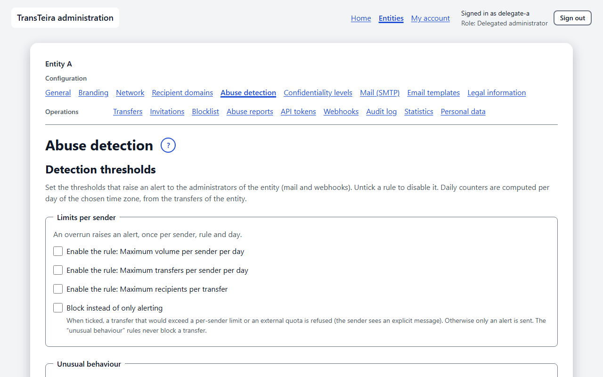

- **Per-sender limits**: maximum volume per day, maximum number of transfers per day, maximum number of recipients per transfer. They apply to **internal** senders only (inside the network, from outside and by API token); invited externals are governed only by the external quotas. The daily counters count every transfer created (or extended) that day whatever its later status, cancelled drafts included. A day is a calendar day of the **time zone** set on the screen. An extension from "My transfers" counts in the volume and the transfers of the day of the extension (alert only).
- **Block when exceeded**: off by default. When on, a transfer that would exceed a limit is refused and the sender is told; otherwise only an alert is raised.
- **Unusual behaviour** (alert only, for internal senders, including from outside): a volume above a **factor** times the daily average of the previous 30 days (a minimum number of active days is needed), a large transfer to a recipient outside the internal domains from a given size, a transfer outside **office hours** (time zone, start and end time, days of the week).
- **Invitations**: maximum number of invitations per internal user per rolling hour (20 by default). Beyond it, the invitation is refused and an alert is raised.
- **External quotas**: volume and number of deposits per day and per external address, blocking if blocking is on.

An alert is raised at most once per sender, per rule and per day. For a refusal (blocking), only the first refusal of the day for a sender and a rule is audited and alerted; later refusals the same day are only counted, with no new audit line, email or webhook. An alert-only alert raised earlier the same day does not hide a later refusal: email to the administrators of the entity and [webhooks](topic:tenant-webhooks) (`abuse.threshold_exceeded`, `abuse.unusual_activity`). Every alerted excess is written to the [audit log](topic:tenant-audit), with the sender as actor. Changes to the thresholds are audited too.

> **Note** Information of the people (GDPR): these checks have security as their only purpose. They are computed on demand from the existing transfers, with no stored user profile; alerts are kept for 12 months in the audit log, and the de-duplication data is purged after 2 days. Tell your users that these checks exist.

<!-- topic: tenant-abuse-reports -->
### Reports

The Reports screen lists the reports made by recipients with the **Report abuse** button of the download page.

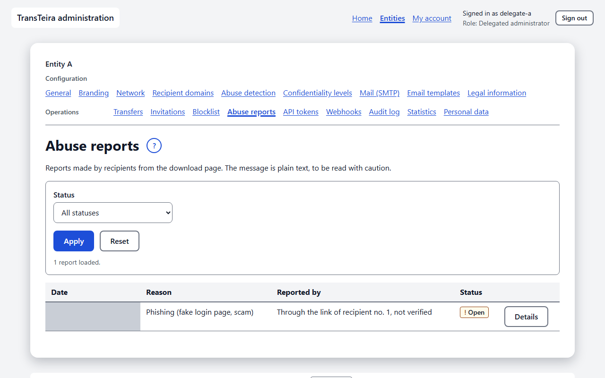

Each row shows the date, the category (**Malware**, **Phishing**, **Illegal content**, **Spam**, **Unknown sender**, **Other**), the reporter's message (shown as text), the transfer concerned and the reporter: their address if the recipient had validated their address on this browser, otherwise "via the link of recipient #n, unverified".

A report triggers **no automatic action**: examine the transfer (see [Transfers](topic:tenant-transfers)), delete it or block the sender if needed (see [Blocklist](topic:tenant-blocklist)), then click **Close** and add a note. You can **Reopen** a closed report. Openings, closings and reopenings are written to the [audit log](topic:tenant-audit). Reports are kept for 12 months; the erasure of the data of an address pseudonymises the reporter and the sender concerned (see [Personal data (GDPR)](topic:tenant-privacy)).

New reports are sent by email to the delegated administrators of the entity (to the super admins if there are none) and by webhook (`abuse.reported`).

<!-- topic: tenant-privacy -->
### Personal data (GDPR)

The Personal data screen answers the requests of people who want to know or erase the data linked to their email address in the entity (data subject rights, GDPR).

In **Search by email address**, type the **Email address** and click **Search**. The section **Data found in this entity** summarises what is linked to it: verified address record, transfers sent and received, invitations, audit log entries.

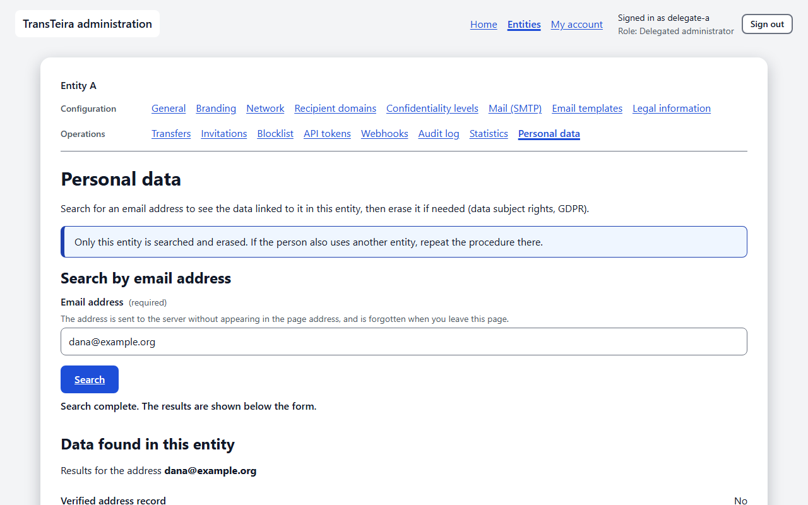

Click **Erase all data** to erase it. The screen details the effect:

- erased: verification codes, deposit sessions and the verified address; transfers sent by the address or through an invitation it received (files made unreadable, then deleted); the address in received transfers (a transfer left without recipients is deleted); invitations received (deleted) and issued (revoked); in the audit log, the address is replaced by a pseudonym;
- kept on purpose: blocklist entries, the address in the allowed senders of an API token (edit the token to remove it), IP addresses in the audit log until their 12 months are over, emails already queued, and backups, whose copies of the files become unreadable.

The erasure cannot be undone. It ends with an **Erasure report**. Only this entity is affected: if the person also uses another entity, repeat the procedure there.

## Emails you receive

As a delegated administrator, you receive at the email address of your account the quota alerts of your entities: one when 80 % of the storage quota is reached, one when the quota is full. They are sent through the mail server of the entity, so keep its [Mail (SMTP)](topic:tenant-smtp) settings working. You can adapt their wording in the [Email templates](topic:tenant-templates).
