# Sending files

This service lets you send large files to one or more people: each recipient receives an email with a download link. The files are stored encrypted on the server and deleted automatically when the transfer expires. There is no account to create. Internal users of the organisation send files directly; an external person needs an invitation. The same page also lets you pass on a password, a key or a code as a [one-time secret](topic:secret-share).

## Who can send files

Sending depends on where you connect from and on your email address.

You are an *internal user* when **both** conditions are met:

- you are connected from your organisation's network;
- your email address belongs to one of your organisation's email domains.

If one of these conditions is missing, the deposit is refused with the message **Deposits are only possible from the internal network with an address of the organisation. To send files from outside, ask an internal user to invite you.**

An external person (outside the network or with another email address) needs an invitation from an internal user: see [Sending files with an invitation](topic:invitation).

> **Note** Your administrator may also have blocked some addresses or domains. A blocked address cannot send files.

<!-- topic: rules -->
## Your organisation's rules

Your organisation has set rules for sending files; these are the ones of the entity you are using.

<!-- rules: summary -->

The rules in force are always those applied by the service when you send: they can change, and a printed copy may be outdated. The online help also offers a printable version of this documentation.

<!-- topic: deposit -->
## Sending files

Sending files takes four steps, described in detail below:

1. [Identify yourself](topic:deposit-identify) with a code received by email.
1. [Fill in the transfer](topic:deposit-options): recipients, message, duration, options and files.
1. [Follow the upload](topic:deposit-upload) of your files.
1. Wait for the [antivirus analysis](topic:deposit-antivirus): the recipients are then notified by email.

What your recipients see is described in [Downloading the files](topic:download).

To pass on a password, a key or a code, use the **Share a secret** tab of the same page instead: see [Share a secret](topic:secret-share).

> **Note** A new entity stays closed until its administrator has finished configuring it. Until then the page shows **Service being set up** and no deposit is possible: come back a little later, or contact your administrator.

<!-- topic: deposit-identify -->
### Identifying yourself with a code

This step proves that the email address you enter is really yours.

Enter **Your email address**, then click **Continue**.

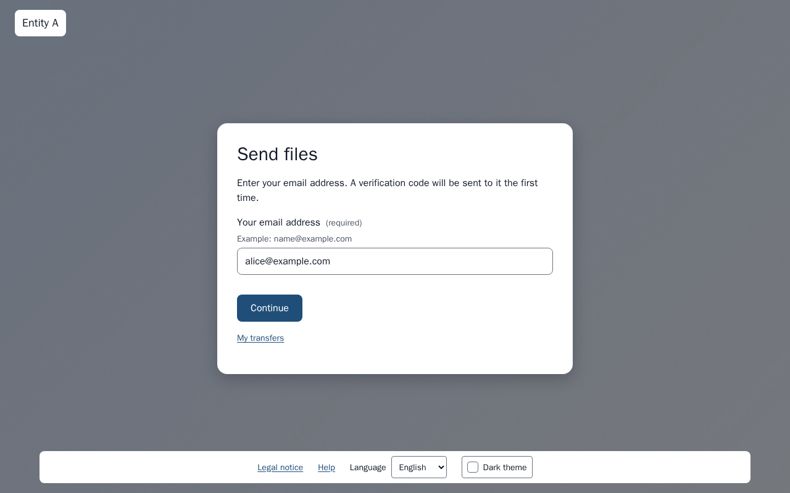

A 6-digit code is sent to that address. If you do not see it after a minute or two, look in your spam folder. Type the code in **Verification code**, then click **Verify**.

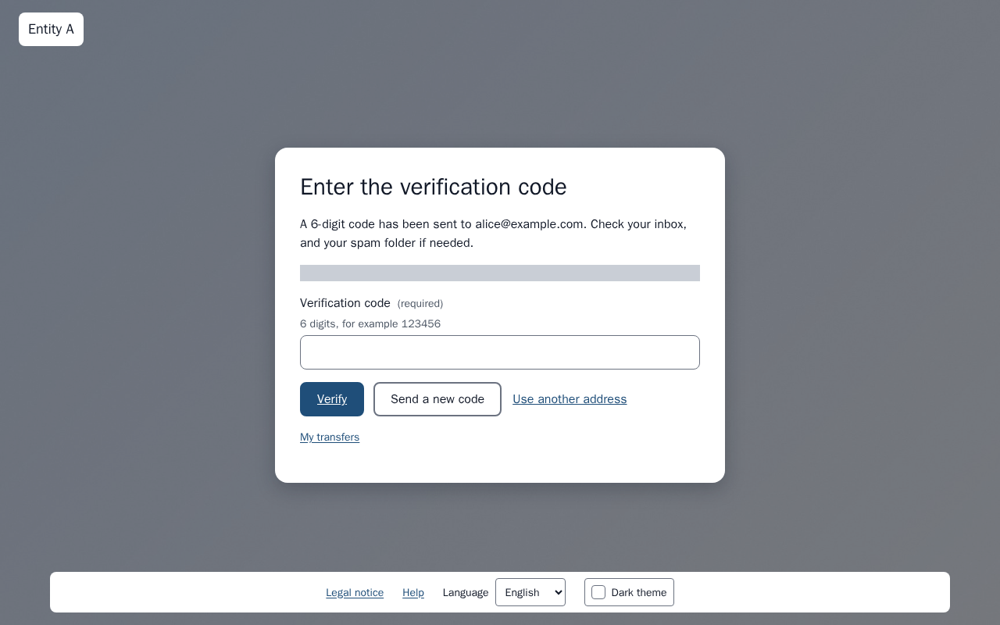

A few rules apply to the codes:

- a code is valid for 15 minutes; the page shows **The code is valid until** followed by the time;
- after 2 wrong entries, the code no longer works: click **Send a new code** to receive another one;
- you can receive at most 5 codes per hour for the same address, and 20 per hour from the same network address;
- if you made a typo in your address, click **Use another address**.

You do not have to enter a code every time. As an internal user, once you have entered a code on a browser, that browser remembers you. A code is asked again on another computer or another browser, after 12 months without using the service, and always when you send files with an invitation.

Once you are identified, the top of the page shows **Identified as** followed by your address, and an **End session** button. Click it when you have finished, especially on a shared computer. The session also ends by itself after a few hours (4 hours unless your organisation chose otherwise); the page then shows **Your session has expired. Identify yourself again to continue.**

<!-- topic: deposit-options -->
### Filling in the transfer

The **New transfer** form describes what you send, to whom and for how long.

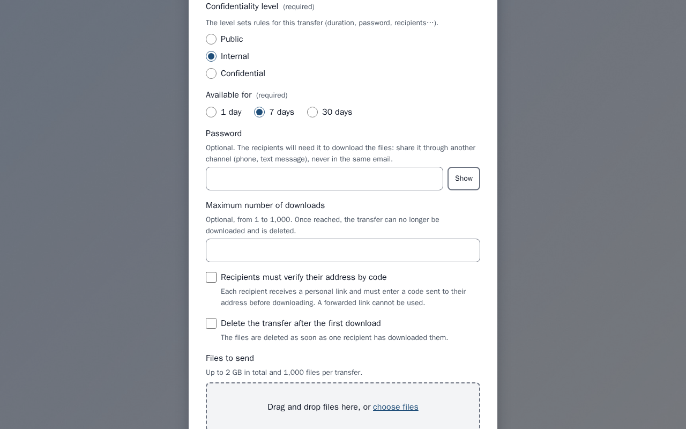

Fill in the fields:

- **Recipients**: one or more email addresses, separated by commas or line breaks. If you enter too many, the form tells you the maximum.
- **Message**: optional. It is sent to the recipients with the link.
- **Available for**: **1 day**, **7 days** or **30 days**. The period starts when the transfer becomes available, that is after the antivirus analysis.
- **Password**: optional, with no complexity rule. Send it to the recipients through another channel (phone, text message), never in the same email. After 3 wrong passwords, the transfer is locked for 15 minutes.
- **Delete the transfer after the first download**: the transfer is deleted, for all recipients, once one of them has downloaded all the files, either as one ZIP archive or file by file. The deletion happens a few minutes later.
- **Confidentiality level**: if your organisation offers several levels, choose the one that matches the sensitivity of the files; its description appears under it. A level can impose rules: it may restrict the available durations, make the password mandatory, force the deletion after the first download, limit the recipients to the organisation, or cap the maximum number of downloads. The form then limits the choices or fills in the options for you, and tells you why. If your organisation has a single level, the selector is not shown but its rules still apply.
- **Recipients must verify their address by a code**: shown when your organisation offers it. Each recipient then receives a personal link and must type a code sent to their own address before downloading, so a link forwarded to someone else is useless. Tell your recipients not to forward their link. A confidentiality level can make this option mandatory: it is then checked and cannot be changed. The recipients who have not downloaded the files receive a reminder email the day before the transfer expires.
- **Maximum number of downloads**: optional, from 1 to 1000. The transfer counts every start of a download, by all the recipients together (an interrupted download that resumes counts once). Once the number is reached, the transfer can no longer be downloaded and is deleted a few minutes later. Leave the field empty for no limit, unless the chosen level sets a cap.
- **Encrypt end to end in my browser**: offered if your organisation allows it (or required, or absent if it forbids it). Your files are encrypted before they leave your computer: see [End-to-end encryption](topic:deposit-e2e). This option does not exist for a deposit through a drop link.
- **Files to send**: drag your files onto the area **Drag and drop files here, or** click **choose files**. To remove a file from the list, use the remove button next to its name. Under the list, the form shows **Total:** followed by the size of your files and the size allowed.

<!-- rules: levels -->

A transfer can contain up to 20 GB in total; your organisation may have set a lower limit. The hint under **Files to send** shows the actual limits (total size and number of files).

<!-- rules: limits -->

To send a whole folder, drag it onto the area, or click **Add a folder** (the keyboard-friendly way) and choose it. The tree of folders is kept: the list shows the folder before each file name (for example `photos/2026/`), and the recipients find the same tree in the ZIP archive. Before sending, check the list:

- system files (`.DS_Store`, `Thumbs.db`, `desktop.ini`) are left out automatically, and the form tells you how many;
- other hidden files and files in hidden folders (whose name starts with a dot, such as `.env` or `.git`) are kept but marked **Hidden**: remove with the remove button those you do not want to send;
- empty folders are ignored;
- a file whose name or folder is not accepted (forbidden characters such as `\` or `:`, a name reserved by Windows, a folder path that is too long or nested over 16 levels) is not added, and the form lists it with the reason: rename it, then add it again;
- the limits on the number of files and the total size apply to all the files in the folders.

If your organisation does not offer folders, the **Add a folder** button is not shown: select the files, or compress the folder into a ZIP file and send that file.

When everything is ready, click **Send**. Two messages may refuse the transfer:

- a message saying that the chosen confidentiality level requires a field, does not allow a value, only allows recipients of the organisation or sets a lower maximum: correct the field named in the message, or choose another level;
- **This service does not allow sending to the domain of this address.**: your organisation does not allow this recipient domain. Remove the address, or ask your administrator.

<!-- topic: deposit-upload -->
### Following the upload

While your files are being sent, the page shows how far the upload has gone.

The **Overall progress** bar shows the whole transfer, and each file has its own progress line.

If the connection drops, the upload tries again by itself (**Connection lost, trying again…**). You can also stop it with **Pause** and continue later with **Resume**: the upload continues where it stopped, without starting again from the beginning.

If you leave the page during the upload, the browser asks you to confirm, because leaving interrupts the upload. If the page was closed or reloaded anyway, come back to the sending page on the same browser while your session lasts. The page shows **Resume the interrupted upload**: select the same files again, then click **Continue the upload**. An unfinished upload is discarded after a while without activity (24 hours unless your organisation chose otherwise).

To give up, click **Cancel the transfer** and confirm: the files already sent are deleted.

<!-- topic: deposit-antivirus -->
### Antivirus analysis and confirmation

Before your recipients are notified, every file is checked by an antivirus.

When the upload is finished, the page shows **Analysing the files**. You can close the page: you will receive an email when the transfer is ready.

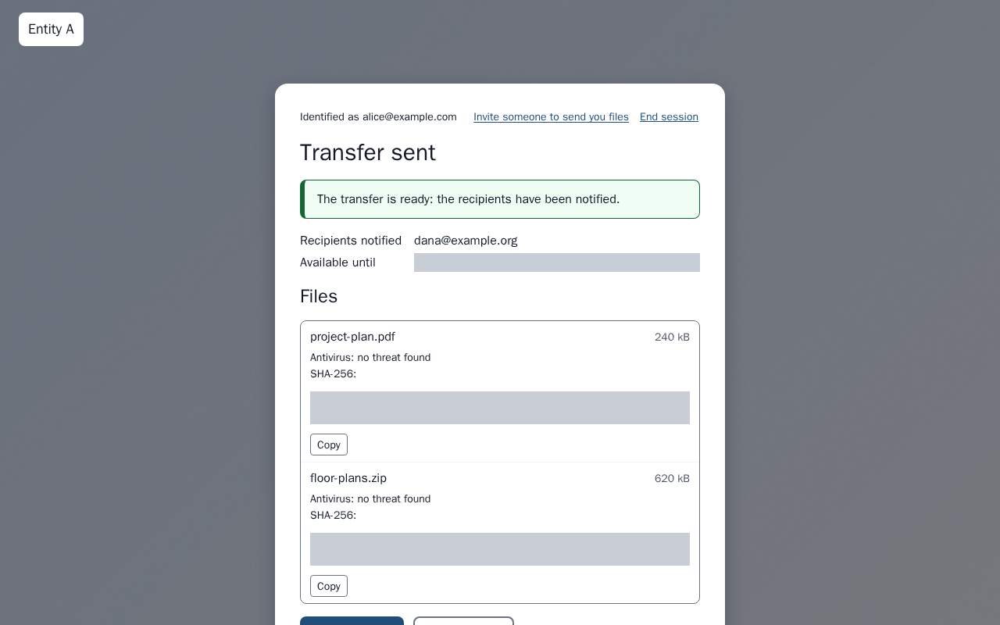

The summary **Transfer sent** lists the **Recipients notified**, the expiry date (**Available until**), a reminder to send the password if you set one, and for each file its antivirus result and SHA-256 fingerprint, with a **Copy** button.

The *SHA-256 fingerprint* is a code calculated from the content of the file: your recipients can use it to check that their copy is identical to yours.

Each file gets one of these antivirus results:

- **no threat found**: the file is delivered;
- **threat detected, file deleted**: the file is not delivered and you receive an alert by email;
- **not analysed (file too large)** or **not analysed (encrypted archive)**: the file is delivered, you are told by email and the recipients are warned on the download page;
- **not analysed (antivirus disabled)**: the antivirus is turned off for your entity (or for the whole service), so the file is delivered without being checked; you are told by email (reason "antivirus disabled") and the recipients are warned on the download page;
- **analysis failed, file withheld**: the file is not delivered.

If no file at all can be delivered, the page shows **Transfer refused** and the recipients are not notified.

By email, you also receive a confirmation of sending and a notice of the first download (only the first one).

> **Note** The download link is not shown on the screen: the recipients receive it by email, with a QR code to open it on a phone and the fingerprints of the files.

<!-- topic: deposit-remote -->
<!-- when: remoteInternalDeposit -->
## Depositing from outside

If your organisation has turned it on, you can send files when working remotely, outside the organisation's network, without an invitation. This only applies to an email address of an organisation domain that was **already verified once from the internal network**.

From outside:

- a code is asked **at every deposit**: the browser that normally recognises you is not enough, because only the possession of your mailbox then proves your identity. If a session opened on the internal network is used outside the network, it is refused: ask for a new code;
- you can send files but **cannot invite** external people: invitations remain reserved to the internal network;
- the rules on recipients and confidentiality levels apply as at the office;
- these deposits are flagged in the organisation's logs and counted by the abuse detection.

If the option is off, a deposit from outside is refused with the same message as for any person who is not allowed. If the option is on but your address is not eligible (another domain, never verified from the internal network, inactive or unknown), the service answers as for an eligible address ("a code has been sent"), but no email is sent and any code you type is refused. **If no code arrives from outside, your address is therefore not eligible**: first use the service once from the organisation's network, or ask your administrator whether the option is on.

> **Note** To be able to send from outside one day, use the service at least once from the organisation's network with the same address.

<!-- topic: receive-reply -->
<!-- when: transferReply -->
## Receiving a reply

If your organization has turned it on, your recipients can send files back to you from the download page with the **Reply** button, without an invitation. This only concerns transfers you sent yourself (web page or API token), never those of an external guest, and only through each recipient's personal link.

A reply arrives like an ordinary transfer: you receive the usual notification mail and the download page opens the same way. It carries a **warning**, however: the reply comes from outside the organization and its author's address was verified by a code, but that does not guarantee the files are safe. Be careful with unexpected files, open them only if you were expecting this reply, and if in doubt contact the author by another means. The same warning is shown at the top of the download page. The files are scanned by the antivirus like any deposit; those that cannot be scanned are flagged.

Only you receive the reply: the original sender is its only recipient. It is refused to its author if your address is blocked or no longer belongs to the organization, or if your original transfer has expired or been deleted.

<!-- topic: link-only -->
## Sending with a link only

The **Link only** option (no email sent to the recipients) lets you pass the download link on yourself, for example through an instant messenger. It is offered only if your organisation allows it, and only to internal users (including from outside when the organisation allows it) and to API tokens. An invited person, a reply to a transfer or a drop link cannot use it. The confidentiality level you choose must allow it too.

In the [New transfer](topic:deposit-options) form, tick **Link only**:

- the **Recipients** become optional. If you fill them in, they are recorded but **receive no email**;
- the option is incompatible with recipient verification: ticking one unticks the other;
- the antivirus analysis and the other rules apply as usual.

When you click **Send**, the link is shown **only once**, at the end of the deposit. Click **Copy the link** and keep it before leaving the page: it appears neither in the confirmation email nor in [My transfers](topic:my-transfers). The link works only once the antivirus analysis is over; the confirmation email then tells you. Since anyone holding the link can download, pass it on through a trusted channel and protect the transfer with a password given separately.

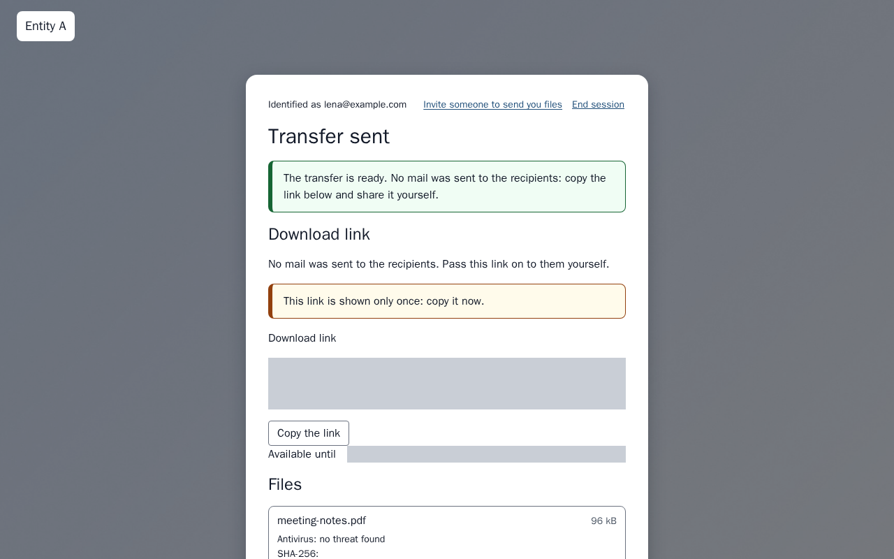

> **Good to know** With no identified recipient, the download tracking names nobody.

If you lose the link, open [My transfers](topic:my-transfers) and click **New link**: the old link stops working.

<!-- topic: deposit-e2e -->
## End-to-end encryption

End-to-end encryption protects your files even from the server. Your files are encrypted **in your browser**, before they are sent. The key is never sent to the server, so the server cannot read them. Only the people you give the key to can open them.

In the [New transfer](topic:deposit-options) form, tick **Encrypt end to end in my browser**. Depending on the rules of your organisation and of the chosen confidentiality level, the box is offered, already ticked and locked (encryption required), or absent (encryption forbidden). It is never offered for a deposit through a drop link.

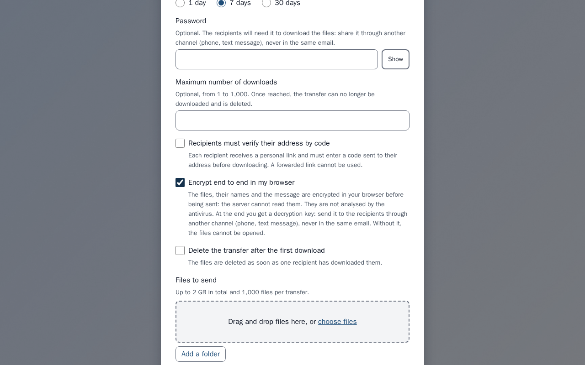

When you click **Send**:

1. The browser **first reads each file** to compute its SHA-256 fingerprint. Allow about a minute and a half per 10 GB. The page shows the progress.
2. It then encrypts the files **while they are sent**. Your computer works a little harder than usual: keep the page open.
3. File names, folders, types, sizes, fingerprints and your message are encrypted too. The server only sees generic names.

At the end, the page shows the **decryption key**. It is shown **only once**: copy it before leaving the page. The emails sent to the recipients contain the link, but **never the key**. Send it yourself **through another channel** than the one that carries the link (phone, text message, another messenger). Without it, nobody can open the files, not even you or your administrator.

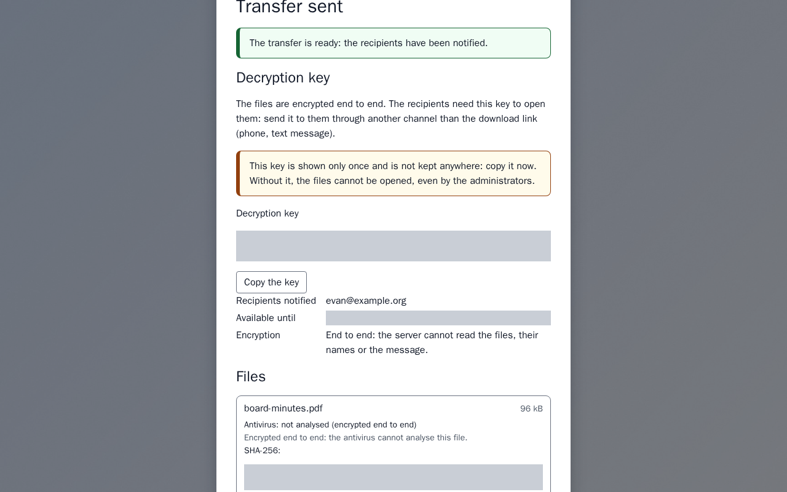

For a [link-only](topic:link-only) transfer, the screen shows the **complete link**, which ends with `#k=` followed by the key. That link is enough to open the files: pass it on carefully.

**If the page is reloaded or closed by mistake**, the upload can resume. The browser keeps the key and the resume information in the memory of the tab until the upload ends or is cancelled. Come back to the upload page in the same tab and follow [Following the upload](topic:deposit-upload).

Good to know:

- **No antivirus analysis.** The server cannot read the files, so they are never analysed. They are marked "not analysed: end-to-end encrypted", for you and for the recipients.
- **No ZIP archive on the server.** Recipients decrypt in their browser, which builds the archive itself.
- The server still sees the size and number of files, the sender, the recipients and the dates.
- A recent browser is required (encryption, background tasks and data streams). Without it, the box cannot be used.

<!-- topic: secret-share -->
## Share a secret

To pass on a password, a key or a code, prefer a one-time secret to a file transfer. The secret is encrypted in your browser: the server never sees it in clear. It can be read only once, then it is destroyed; it is also destroyed when it expires, even if nobody has read it.

Once you are identified on the sending page (see [Identifying yourself with a code](topic:deposit-identify)), choose the **Share a secret** tab. It only appears if your organisation has turned secrets on. The module is on by default for every entity, including those that existed before it was introduced, and your administrator can turn it off. The tab is not offered when you deposit through a [drop link](topic:drop-link) or a reply to a transfer.

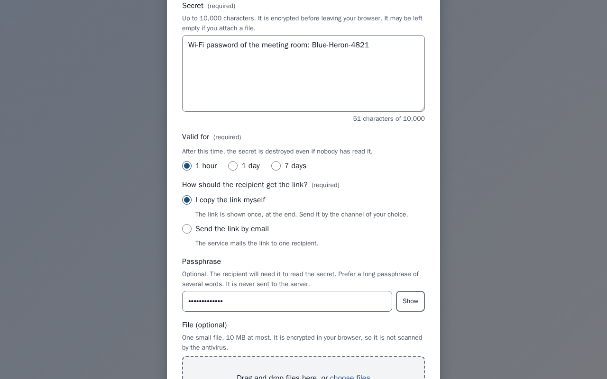

1. Enter the **Secret**: 10,000 characters at most. It can stay empty if you attach a file.
1. Choose the duration in **Valid for** (from 1 hour to 30 days, depending on the durations your organisation offers).
1. Say how the recipient gets the link: **I copy the link myself**, or **Send the link by email** to a single address (if your organisation allows it).
1. Add a **Passphrase** if you wish. The recipient will need it to read the secret, and it is never sent to the server. Give it **through another channel** than the link (phone, text message, in person): when the link is sent by email, a passphrase may be required. Prefer a long passphrase of several words.
1. Attach a **File** if needed: a small file only (the maximum size is shown under the field). It is encrypted in your browser, so the antivirus does not scan it; the recipient is told so.
1. Check **Notify me by email when the secret is read** to get a read receipt. You are also told if the secret expires unread, or is locked after too many wrong passphrases.
1. Click **Create the secret**.

If the file upload or the sending of the email fails after the secret was created, the form shows **The secret is not finished**. Click **Try again** (nothing is encrypted again) or **Start over**. An unfinished secret is kept for one hour only, then it is purged: if it has expired, the form tells you to create it again.

**Email delivery and the passphrase.** The email holds the full link, key included, and stays in a mailbox. Opening the page alone consumes nothing, but some mail security tools open the links of the messages they scan, and the mailbox can be read by someone other than the recipient. A passphrase, given through another channel, keeps the secret unreadable in these cases. If a secret shows as **Read** while the recipient did not open it, something else probably opened it: the read receipt helps you notice it. Share the secret again, with a passphrase.

With **I copy the link myself**, the **Secret created** screen shows the full link, key included. **This link is shown only once**: click **Copy the link** before leaving this screen: the link is forgotten as soon as you switch to the other tab, create another secret, end the session or leave the page. The copied link can stay in the clipboard history of your device: clear it once you have passed it on. Anyone who has the link can read the secret once, so pass it on through a trusted channel. With delivery by email, the link goes straight to the recipient and is not shown.

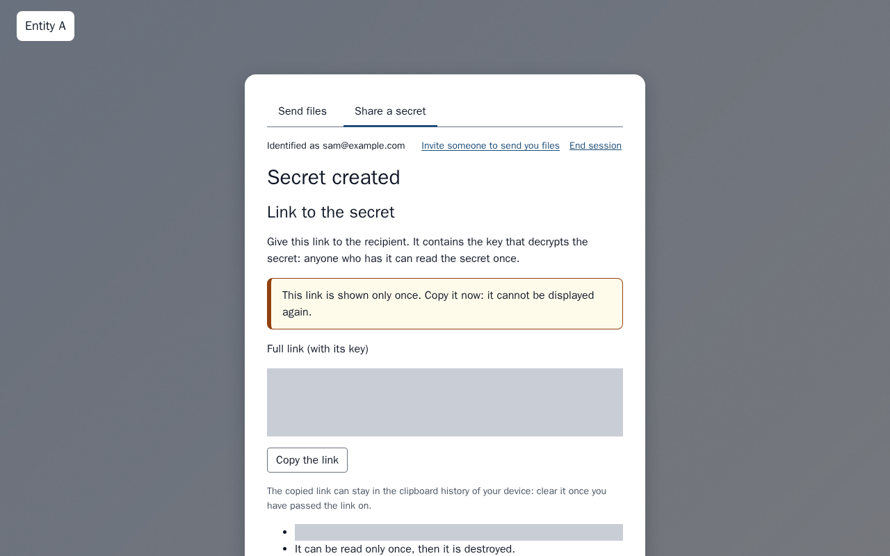

**Read receipt.** The receipt and the notices (expired unread, locked) are sent by email in the default language of your organisation, as best effort: a failure to send does not affect the secret. No receipt is sent when the secret is deleted, by you or by an administrator.

**Keep secrets short-lived.** Once the secret is read, the server destroys its content and its keys. A backup of the server made while the secret was still waiting, however, keeps the encrypted text, and cannot be erased afterwards. What protects the secret then is its key (the end of the link) and the passphrase. So choose the **shortest duration** that suits you, and use a passphrase, especially for delivery by email.

**Invited external people.** If you were invited, you can also share a secret, by email only and only to the person who invited you: the form shows **The link will be sent by email to…** followed by their address, and there is nothing to choose. The tab is absent if your organisation does not allow secrets by email. See [Sending files with an invitation](topic:invitation).

**From a script.** An API token can create secrets through the API (see `docs/api/` in the TransTeira repository). The command-line client `transteira-cli` does not handle secrets.

### My secrets

In [My transfers](topic:my-transfers), once you have created at least one secret and if your organisation offers secrets, the **My secrets** section lists your secrets, most recent first. For each one it shows the creation date, the delivery (a link to hand over, or the email address), the size of the attached file if any, the state (**Pending**, **Available**, **Read**, **Expired**, **Deleted** or **Locked**), the expiry date and the date of reading. **Pending** is a secret that is not finished (see above). Its content is never shown there, and the link cannot be recovered. As long as a secret has not been read, click **Delete**: it is destroyed at once, even if the recipient already has the link. It stays in the list with the state **Deleted**. You reach it with the same access link as your transfers.

<!-- topic: my-transfers -->
## My transfers

Without creating an account, you can manage the transfers you sent: see where they stand, delete them or keep them available longer. Your one-time secrets are listed in the same place: see [My secrets](topic:secret-share).

### Getting your access link

1. Open the **My transfers** page of the sending site (the address ends with `/me`; the confirmation email of each transfer also contains the link).
1. Enter your email address and click the button to receive a link.

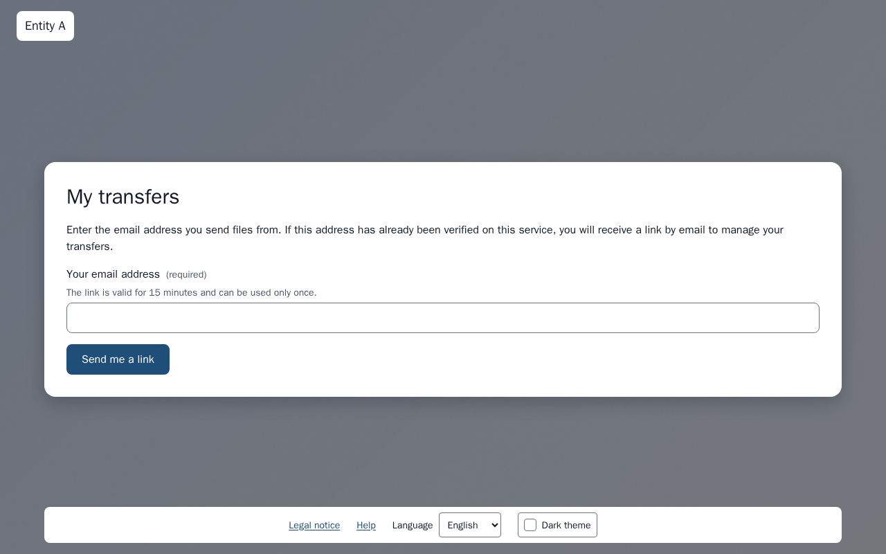

The page always shows the same message, whether or not a link was sent. A link is sent only if your address has already been verified once by a code, when you sent files. It reaches your mailbox within a few minutes.

If no email arrives, check your spam folder, then **wait one hour** before asking again: the number of links per address is limited, and further requests within the hour send nothing.

The link is valid for **15 minutes** and can be used **once**: if it has expired, or if you already opened it, ask for a new one. The link opens a session of **1 hour**; after that you are asked to request a new link. If you open a link while a My transfers session is already open in your browser, the page asks you to confirm before switching: only accept if you requested that link yourself.

### Following your transfers

The list shows your transfers with their status, their recipients, their size, their expiry date and their confidentiality level.

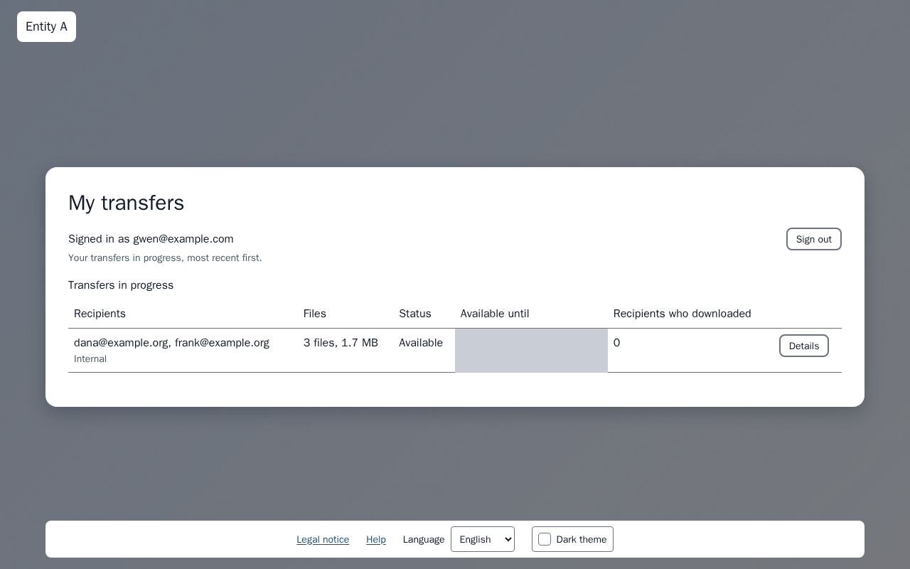

Open a transfer to see its details: the files with their size and SHA-256 fingerprint and, for each recipient, which files were downloaded and when (first and last download). The download links are never shown here.

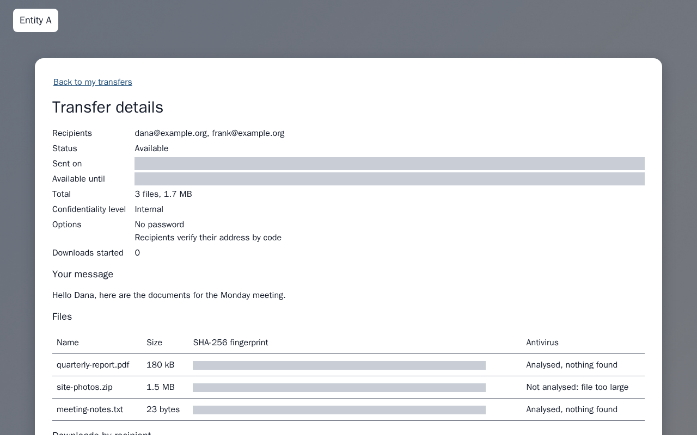

### Deleting or extending a transfer

- **Delete**: after confirmation, the files are erased for good and the download links stop working.
- **Extend**: choose a new duration among those your organisation allows for the confidentiality level of the transfer. The new expiry is counted from today and can never be earlier than the current one. A transfer cannot stay available more than **90 days** after it was created: beyond that, the page tells you the latest possible date, and you must send the files again. Recipients who have not downloaded yet receive a new reminder the day before the new expiry. A transfer whose number of downloads is reached cannot be extended.
- **New link**: for a link-only transfer (see [Sending with a link only](topic:link-only)) whose link you lost, issues a new link, shown only once, even while the antivirus is still analysing the files (the new link works as soon as the transfer is available). The old link stops working immediately.

Use **Sign out** when you have finished, especially on a shared computer.

<!-- topic: proofs -->
### Proofs of deposit and delivery

For a transfer you may need to show later that you sent the files, or that the recipients received them. Open the transfer in **My transfers**: the **Proofs** section offers PDF files signed by the service.

- **Download the proof of deposit**: available once the antivirus analysis is over. It states that you deposited these files (with their SHA-256 fingerprints) for these recipients, and when.
- **Download the proof of delivery**: available after the first download of the files. It states when they were first downloaded. When each recipient has a personal link, there is also one **proof of delivery for** each recipient, available after that person's first complete download.

Keep the PDF: what makes it a proof is the signed statement attached inside it, not the text you read on the page. Anyone can check it offline with the `transteira proof verify` command and the public keys published by the service (ask your administrator for the procedure). The proofs list no IP address.

You can download the proofs of a transfer only while it exists in **My transfers**. Your administrators can still provide them for 12 months after they were issued, even if you deleted the transfer. Downloads are limited in rate: if the page says there were too many requests, wait a minute.

<!-- topic: invite -->
## Inviting an external person

An invitation lets someone outside your organisation send you files.

Only internal users identified on the sending page can invite. Once identified, click **Invite someone to send you files** at the top of the page.

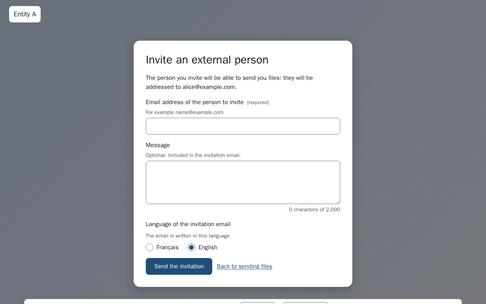

Fill in the form:

1. Enter the **Email address of the person to invite**.
1. Add a **Message** if you wish (optional). It is included in the invitation email.
1. Choose the **Language of the invitation email**.
1. Click **Send the invitation**.

The page confirms with **Invitation sent**. You can then click **Invite another person** or **Back to sending files**.

The files the person sends are addressed to you. The invitation link stays valid for 12 months if it is not used; each time it is used, it remains valid for 12 more months. You can send up to 20 invitations per hour; beyond that, the page shows **You have sent too many invitations in the last hour.**

If the page shows **Identify yourself first**, go back to the sending page and identify yourself. If it shows **Invitations not available**, you are not recognised as an internal user.

Your administrator can revoke an invitation at any time.

<!-- topic: invitation -->
## Sending files with an invitation

This section is for external people who received an invitation email.

Open the link in the email. The page **You are invited to send files** shows who invited you (**Invited by**), the address the invitation was sent to, the date until which it is valid (**Invitation valid until**) and the message of the person who invited you.

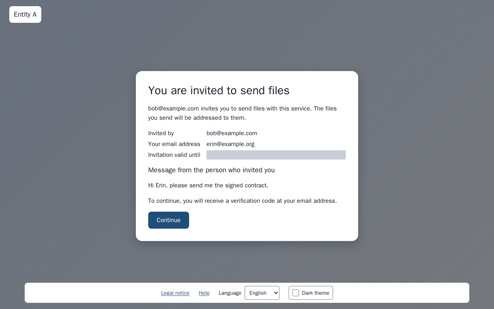

Click **Continue**. You then [identify yourself with a code](topic:deposit-identify), using the address the invitation was sent to (it is already filled in). With an invitation, a code is asked every time.

The form then shows **The files will be sent to** followed by the address of the person who invited you: there is no recipient to enter. The rest of the form works as described in [Filling in the transfer](topic:deposit-options).

The page may also offer the **Share a secret** tab: with an invitation, you can pass a secret by email to the person who invited you, and to nobody else. See [Share a secret](topic:secret-share).

If the link does not work:

- **Invitation not found**: the link is incomplete. Copy it entirely from the email, or click it directly.
- **Invitation expired**: the invitation is no longer valid. Ask the person who invited you to send a new one.

<!-- topic: drop-link -->
## Sending files through a drop link

A service of the organisation may have given you a *drop link*: a fixed address that lets you send it files without a personal invitation. The address looks like `transfer.entity-a.example.com/drop/ttd_…`.

Open the link. The landing page shows the name of the service (the **label** of the link), how long the files are kept and the confidentiality level. It never shows the addresses of the recipients. Click **Continue**, then [identify yourself with a code](topic:deposit-identify) received at your email address: the code is asked again at **every** use of the link, even if you already typed one.

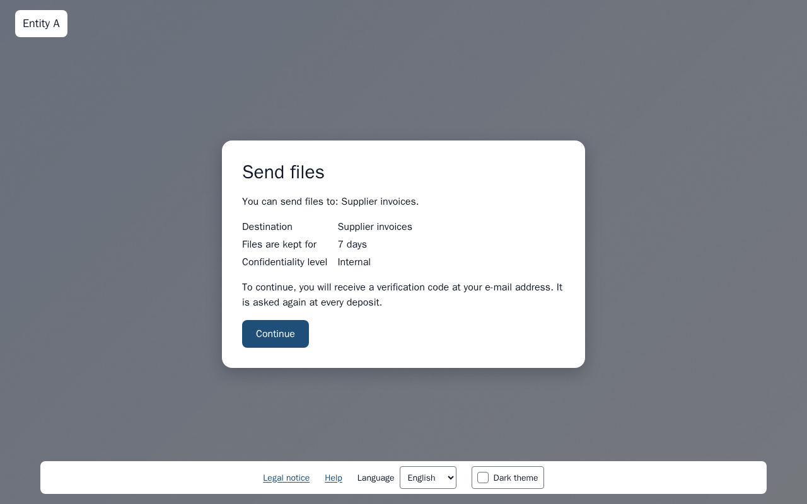

The form then shows the service the files will be sent to, with nothing to type: the recipients, the duration and the level are fixed by the link. The addresses of the recipients are never shown to you, neither here, nor in My transfers, nor in the confirmation email, which show the name of the link instead; the proofs of deposit and delivery of these transfers are for the administrators only. You can add a message and, if the level requires it, a password; the rest of the form works as described in [Filling in the transfer](topic:deposit-options). Only one transfer is possible per verification: to send more files, open the link again and type a new code. The limits specific to external users (volume and number of deposits) apply.

If the page says the link was not found, it is incomplete, disabled, revoked or replaced by a new one: ask the person who gave it to you for the current address.

## Sending from a script

To send files automatically (a nightly export, a tool that deposits files), the transfer form is not needed: ask the administrator of your entity for an **API token**. A token lets a script deposit files without a person verifying an address, within the limits the administrator set for it (allowed network addresses and senders).

A token can also create one-time secrets through the API, but the command-line client below does not handle them: see [Share a secret](topic:secret-share).

Your administrator can also give you the command-line client `transteira-cli`, which deposits and downloads from a terminal or a script, with the token, and resumes an interrupted upload by itself. Its binaries are published with each release on GitHub, with a signature to check before running them. The full guide is `docs/api/cli.md` in the TransTeira repository. Never paste a token in a message or a shared document: it gives the same access as a script of your entity.

<!-- topic: deposit-problems -->
## Common problems

Here are the messages you may meet, and what to do.

- **Deposits are only possible from the internal network with an address of the organisation…**: connect from the organisation's network, or ask an internal user to invite you.
- The code does not arrive: look in your spam folder, wait a minute, then click **Send a new code** (within the hourly limits).
- **The files exceed the maximum size of a transfer. Remove some files.**: remove files, or send them in several transfers.
- **1 file name is not accepted: rename the file and add it again.** (or several): rename the file on your computer, then add it again.
- **The storage space of this service is full. Try again later.**: try again later, or contact your administrator.
- **Some files are not accepted by this service.**: your organisation has blocked these files; contact your administrator if you think it is a mistake.
- **Your session has expired. Identify yourself again, then select the same files to resume.**: the upload then continues where it stopped.
- **You have reached the limit of secrets. Please try again later.**: a person may keep 50 secrets open and create 200 per 24 hours. Delete the secrets you no longer need in [My secrets](topic:secret-share), or wait.
- **This service does not allow sending to the domain of this address.** (secret by email): your organisation restricts the recipient domains, for secrets as for transfers. Choose **I copy the link myself** or another address.
- **A passphrase is required for a secret sent by email.**: add a passphrase, and give it through another channel.
- **The file is too large for a secret.**: a secret holds only a small file, whose maximum size is shown under the field. For a larger file, send a transfer. The files of secrets count in the storage space of your organisation, so a secret can also be refused when it is full.

<!-- topic: maintenance -->
## Service under maintenance

The service is sometimes stopped briefly for an update.

The page **Service under maintenance** is shown: new transfers, invitations and secrets are suspended, but downloads remain available. An upload in progress is paused and resumes after the maintenance. Come back later.

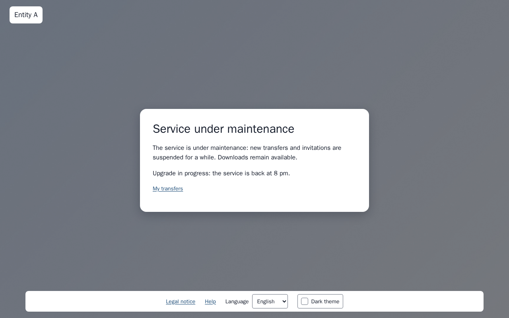

<!-- topic: legal -->
## Legal information

Your organisation writes the legal documents of the service.

At the bottom of the page, the links **Legal notice** and **Privacy policy** open these documents (a link appears only when the document has been written). If a document is missing, the page shows **This document has not been published by this service.**

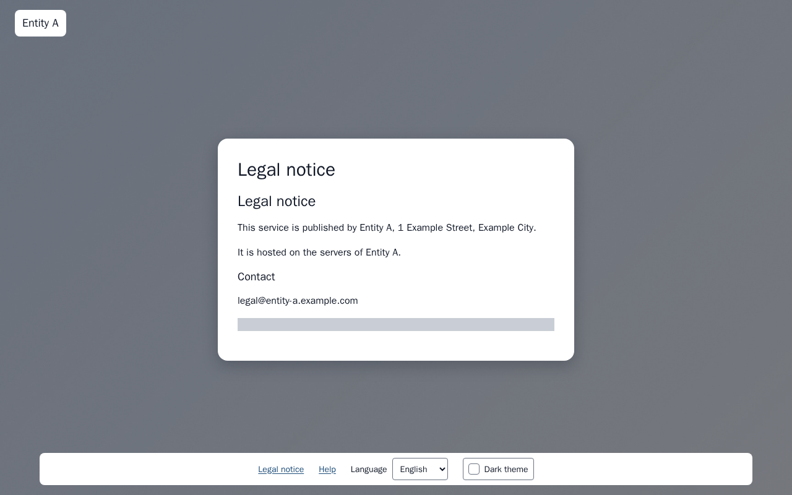

The service uses only technical cookies, with no audience measurement. The footer also holds the **Language** list, the **Dark theme** button and a **Help** link to the help of the current screen.

### Dark theme

The pages follow the light or dark setting of your device by default. The **Dark theme** button in the footer switches the theme at any time. Your choice is remembered for a year by a strictly technical cookie (`tt_theme`), which is only set when you pick a theme different from the one of your device. Choose again the theme of your device and the cookie is deleted: the pages follow your device again. Both themes meet the same accessibility requirements (RGAA).
