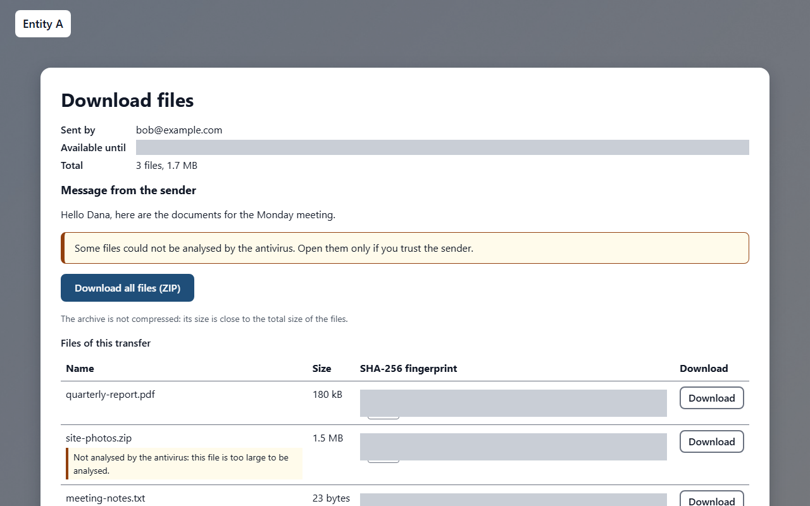
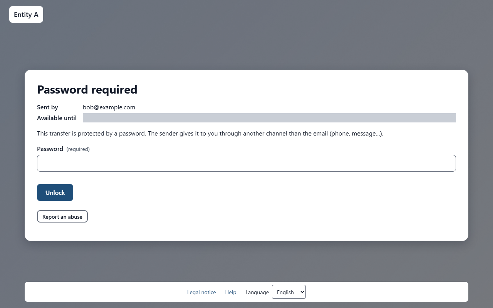
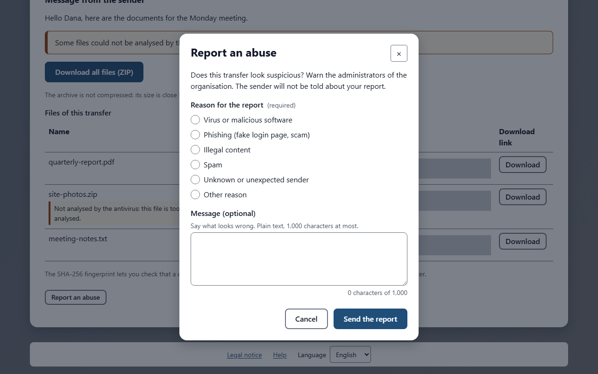

# Receiving files

Someone has sent you files with TransTeira. You received an email with a download link, and a QR code that opens the same link on a phone or tablet. You do not need an account or any software: a web browser is enough. The files stay available until the date shown in the email and on the page, then they are deleted automatically.

<!-- topic: download -->
## Downloading the files

The download page lists the files the sender has made available to you.

Open the link in the email, or scan the QR code with your phone's camera. The page **Download files** opens and shows:

- **Sent by**: the email address of the person who sent you the files;
- **Available until**: the date and time after which the files are deleted;
- **Total**: the number of files and their total size;
- **Message from the sender**: the message written by the sender, if there is one;
- **Confidentiality**: the confidentiality level chosen by the sender, if there is one;
- **Downloads left**: when the sender has limited the number of downloads, the number that remain.

The page is available in English and French: use the **Language** menu at the bottom of the page to change it. The **Help** link, also at the bottom, opens this guide.

### Personal link and address verification

The sender may have asked each recipient to confirm their email address. In that case your link is **personal**: it was created for your address only. Do not forward it. Someone else who opens it cannot download anything, because they cannot read the code sent to your mailbox.

Before anything else, the page **Confirm your address** shows your address partly hidden, for example `j***@example.com`.

1. Click **Send me a code**. A 6-digit code is sent to your address; check your spam folder if it does not arrive.
2. Type the code in the **Verification code** field, then click **Verify**. The code is valid for 15 minutes.
3. The password form appears if the transfer is also protected by a password, otherwise the list of files.

If the code is wrong, the page shows **The code is not correct.** and the number of attempts remaining. You have 2 attempts: after that, or when the code has expired, the page asks you to request a new code with **Send me a code** (or **Send a new code**). The number of codes you can request in an hour is limited: if the page asks you to wait, try again after the countdown.

Once verified, your access lasts about an hour in this browser. After that, the page shows **Your access has expired: confirm your address again with a new code.** and asks for a new code. This is normal.

> **Note** If you have not downloaded the files, you receive a reminder email the day before the transfer expires. It contains your personal link.

<!-- topic: download-password -->
### Protected transfer

The sender may have protected the transfer with a password, so that only the people who know it can get the files.

In that case the page shows **Password required** instead of the list of files. The sender gives you the password through another channel than the email, for example by phone or by text message: it is never written in the email itself. If you have not received it, ask the sender.

1. Type the password in the **Password** field.
2. Click **Unlock**.
3. The list of files appears.

If the password is wrong, the page shows **The password is not correct.**, usually followed by the number of attempts remaining. After 3 wrong passwords, the transfer is locked for 15 minutes: the page shows **Too many wrong passwords: the transfer is locked for a while.** with a countdown. When the countdown ends, the field becomes available again and you can try again.

Once unlocked, the files stay accessible for about an hour in this browser. After that, the page asks for the password again: **Your access to the files has expired: enter the password again.** This is normal; type the password once more.

<!-- topic: download-files -->
### One file or all at once

You can download the files one by one, or all of them in a single archive.

- To download one file, click **Download** on its row.
- To download everything at once, click **Download all files (ZIP)**.

The ZIP archive is not compressed: its size is close to the total size of the files. It is built while you download it, so the download starts immediately, even for very large transfers. Once it is on your computer, open or extract it as usual.

Files are always saved to your computer: they never open directly in the browser. Your browser shows the progress in its downloads list.

For large files, prefer a stable connection (a cable or a good Wi-Fi network) and keep the page and the computer awake until the download ends. If a download stops, start it again from the page while the transfer is still available.

> **Note** If the page shows **This transfer is deleted after its first complete download.**, the transfer disappears shortly after it has been downloaded once in full. To be sure to get every file, download them all at once with **Download all files (ZIP)**.

If you work for the organisation and are connected from its network, you can also send files yourself: see [Sending files](topic:deposit).

<!-- topic: download-integrity -->
## Checking that a file is intact (SHA-256)

The SHA-256 fingerprint lets you check that the file on your computer is exactly the one the sender uploaded, with nothing missing or changed.

A fingerprint is a long series of letters and digits computed from the content of a file. Two identical files always have the same fingerprint; if a single byte differs, the fingerprint is completely different.

The list of files shows each fingerprint in the **SHA-256 fingerprint** column, with a **Copy** button next to it. The same fingerprints are also written in the email you received.

To check a file, compute its fingerprint on your computer, then compare it with the one on the page or in the email:

- Windows, in the Command Prompt: `certutil -hashfile file SHA256`
- Windows, in PowerShell: `Get-FileHash file -Algorithm SHA256`
- macOS, in the Terminal: `shasum -a 256 file`
- Linux, in a terminal: `sha256sum file`

Replace `file` with the name of the downloaded file, including its folder if needed (for example, a file in your Downloads folder). Tip: in most terminals you can drag the file onto the window to insert its full path.

Upper case and lower case do not matter: Command Prompt shows the fingerprint in lower case and PowerShell in upper case, and both are correct. What matters is that the letters and digits are the same, in the same order.

If the fingerprints differ, the file was damaged during the download: download it again. If they still differ, contact the sender.

> **Note** Only individual files have a fingerprint. The ZIP archive itself has none: extract it first, then check the files it contains.

<!-- topic: download-not-scanned -->
## Files not analysed by the antivirus

Every file is analysed by an antivirus before it is made available. A file in which a threat is detected is deleted and never reaches you.

Some files, however, cannot be analysed. In that case the page shows the warning **Some files could not be analysed by the antivirus. Open them only if you trust the sender.**, and the file concerned carries one of these mentions:

- **Not analysed by the antivirus: this file is too large to be analysed.** The file is larger than the size the antivirus can check.
- **Not analysed by the antivirus: this file is encrypted or protected by a password.** The antivirus cannot look inside an encrypted file or archive.

These files are delivered anyway, because they may be perfectly legitimate. Before opening one:

- make sure you know the sender and were expecting these files;
- if in doubt, ask the sender by another means (phone, separate email) whether they really sent them;
- analyse the file with your own antivirus before opening it.

> **Note** If the sender has limited the number of downloads, every start of a download counts, whoever downloads. When the page shows **Maximum number of downloads reached**, the transfer can no longer be downloaded: ask the sender to send the files again.

<!-- topic: download-report -->
## Reporting abuse

If this transfer looks suspicious to you (malicious file, phishing, illegal content, spam, unknown sender), click **Report abuse** at the bottom of the download page.

1. Choose the category: **Malware**, **Phishing**, **Illegal content**, **Spam**, **Unknown sender** or **Other**.
1. Optionally add a message of at most 1,000 characters, in plain text.
1. Send the report.

The administrators of the entity are alerted and decide what to do: **a report does not delete or block anything automatically**. Do not use the button to ask for the deletion of a legitimate transfer: contact the sender instead.

Your address is recorded with the report only if you validated your address with a code on this browser for this link. Otherwise the report is recorded as "via the link of recipient #n, unverified". Reports are limited to 3 per day for one link and to 5 per hour from one network address.

> **Note** Reports are used only for the security of the service; they are kept for 12 months, then deleted. You can ask your administrator to erase the data linked to your address.

<!-- topic: download-reply -->
## Reply to a transfer

If the sender's organization allows it, you can send files back to the sender straight from the download page, without an invitation or an account.

The **Reply** button only appears when all these conditions are met:

- the organization has turned on replying to transfers;
- you opened your **personal link** (see above); old shared links do not allow replying;
- the transfer was sent by someone from the organization: you cannot reply to a reply, nor to a transfer sent by an external guest.

To reply:

1. Click **Reply**.
1. Confirm your address with a 6-digit code received by mail, as described in [Personal link and address verification](topic:download). This code is **always required** to reply, even if the sender did not ask for verification to download. It is valid for 15 minutes, with 2 attempts.
1. The upload form opens. The only recipient is the original sender: their address is shown ("Your reply goes to" followed by the address) and cannot be changed.
1. Choose how long the files stay available among the durations offered, add a message and the files, then send, as described in [Send files](topic:deposit).

The usual rules apply to your reply: maximum size per transfer, quotas for external people, antivirus scan (an infected file is deleted and you are told) and abuse detection. Your reply must be finished before the original transfer expires: if it expires or is deleted during the upload, the reply is refused with the message **Transfer no longer available**. It is also refused if the original sender can no longer receive it (blocked address, or no longer part of the organization).

The sender receives your reply by mail, with a warning that it comes from outside and that your address was verified by code.

Replying in a browser ends any upload session already open in that browser: finish your other uploads first.

> **Note** If the **Reply** button does not appear, or a refusal is shown, simply write to the sender by mail.

<!-- topic: download-problems -->
## Link not working

This section explains the messages you may see instead of the files, and what to do.

- **Transfer not found**: the link is incomplete or has been altered. Copy the whole link from the email, or click it directly in the email.
- **Transfer no longer available**: the transfer has expired, has been deleted by an administrator, or was deleted after its first download. Ask the sender to send the files again.
- **Maximum number of downloads reached**: the sender allowed a limited number of downloads and it has been used up, by you or by the other recipients. Ask the sender to send the files again.
- The page shows **Maintenance in progress**: only new transfers are suspended. Downloads remain available, so you can continue normally.

To answer the sender, use the **Reply** button if it is offered (see [Reply to a transfer](topic:download-reply)); otherwise, reply by email.
