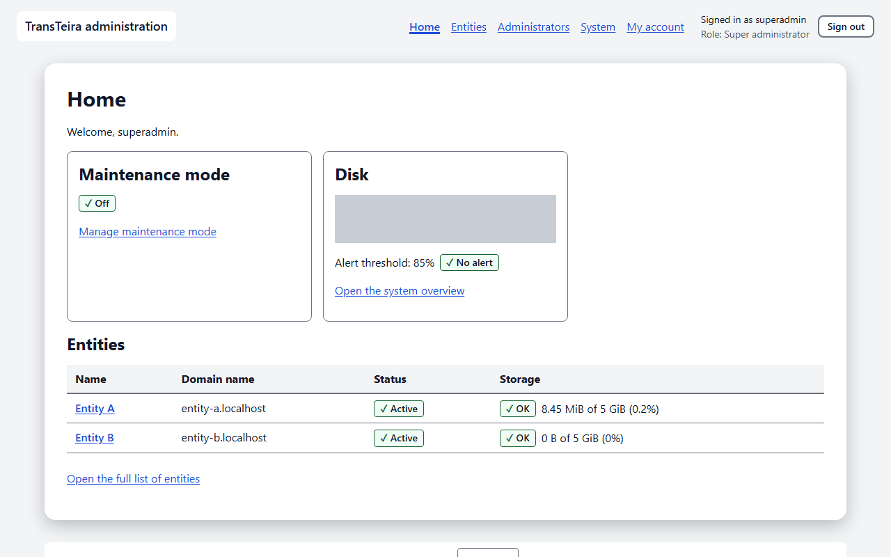
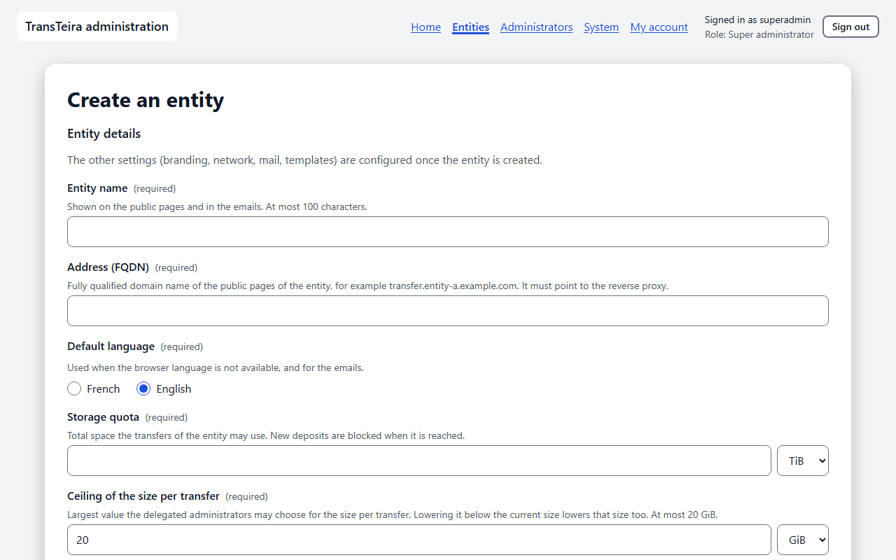
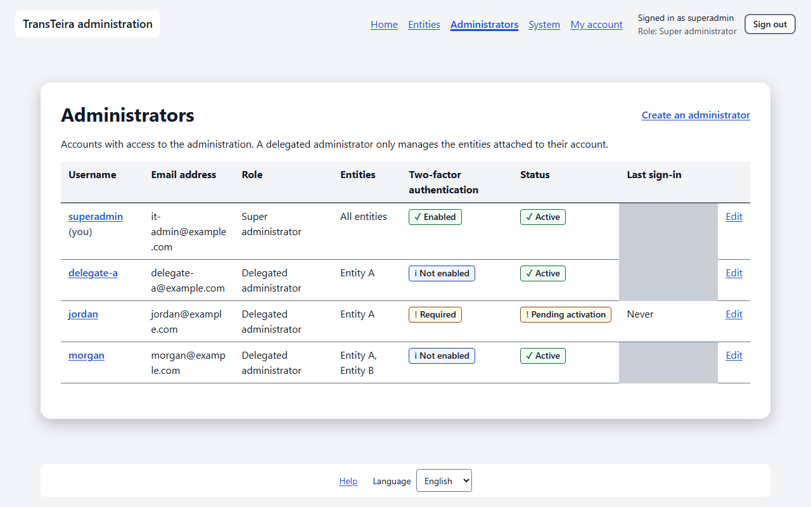
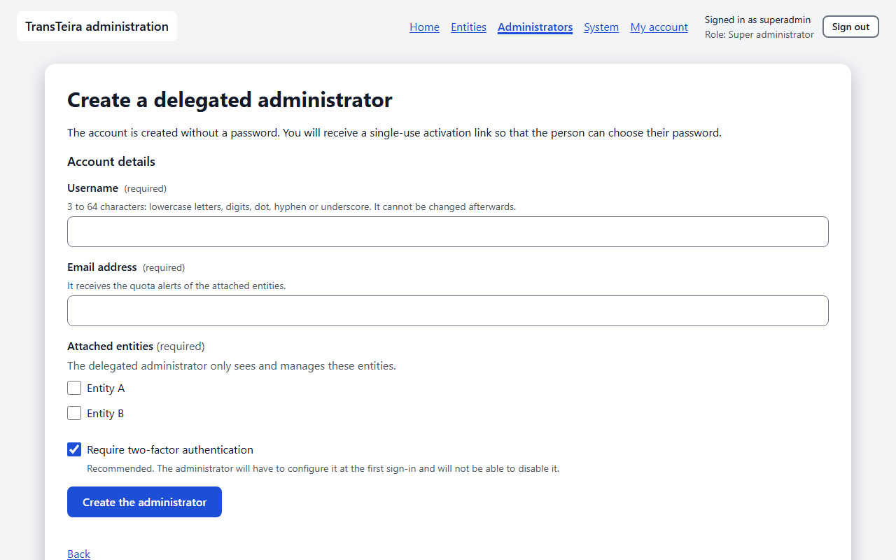
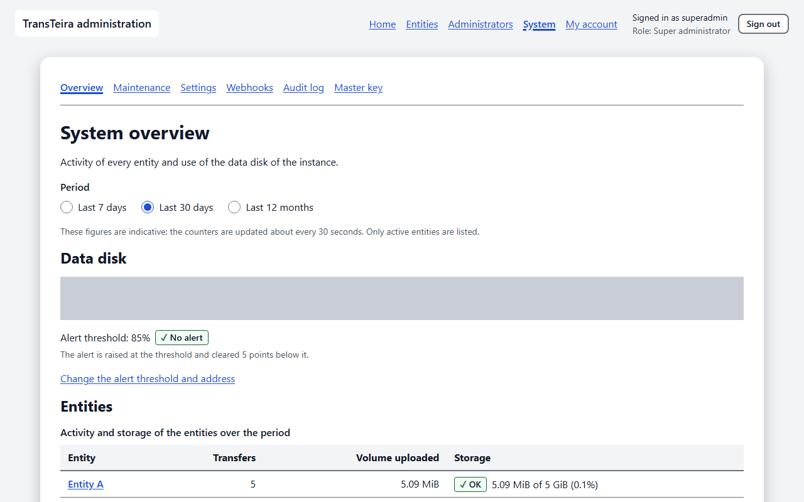
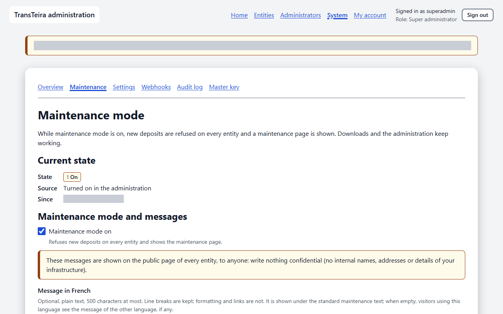
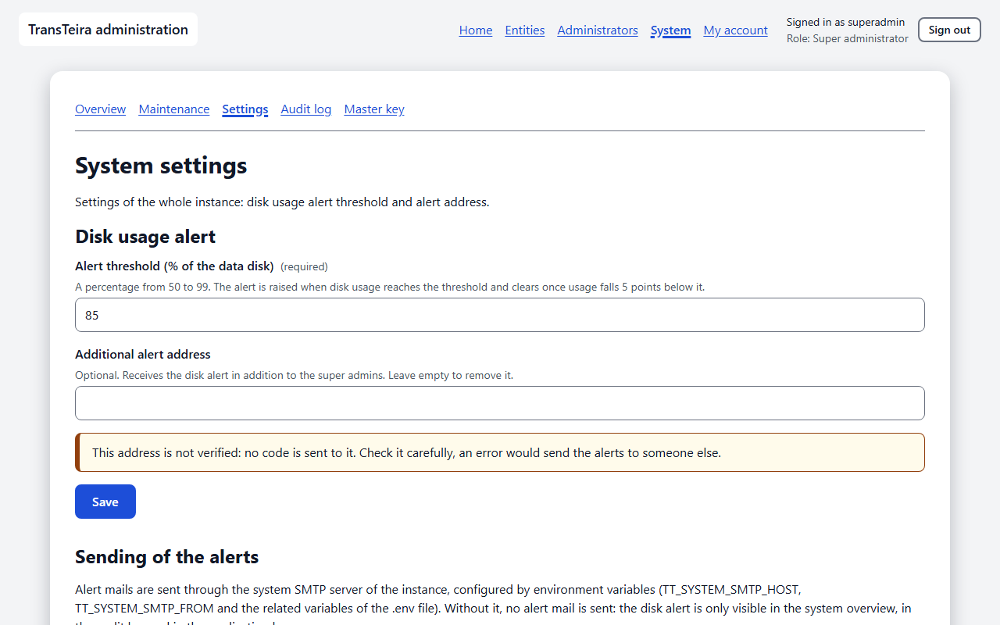
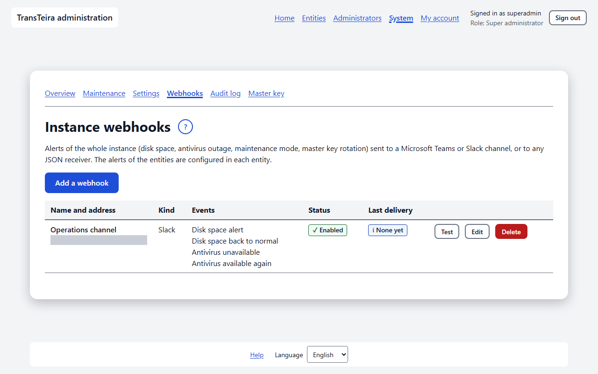
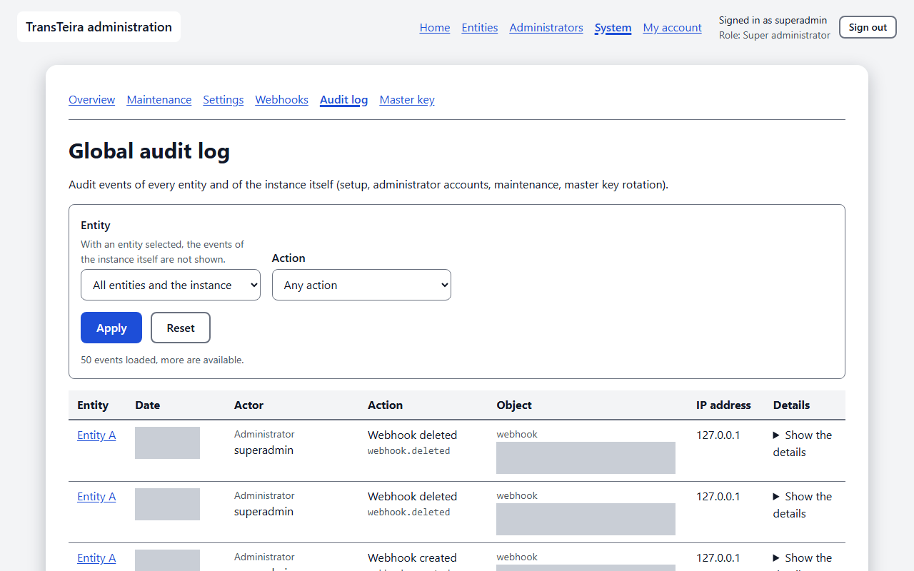
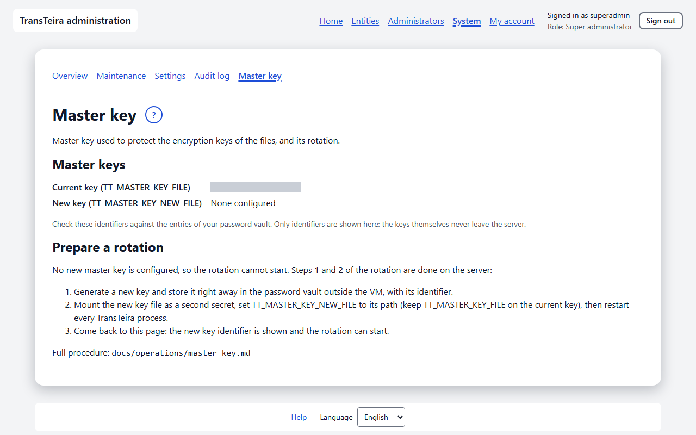

# Super administrator guide

This guide is for the operator of the TransTeira instance. As super administrator, you can do everything a delegated administrator does, on every entity: the common screens are described in the delegated administrator guide, for example [Signing in](topic:login), [My account](topic:account), [Entities](topic:tenants) and [Transfers](topic:tenant-transfers). This guide covers what only you can do: the first launch, the creation of entities and administrator accounts, the system screens, maintenance mode and the master key. Your main navigation therefore has two extra entries, **Administrators** and **System**.

<!-- topic: setup -->
## First launch

The first launch creates the super administrator account, once, on a fresh instance. While no administrator exists, every page of the administration (for example `admin.transfer.example.com/admin/`) leads to the **TransTeira setup** screen.

Fill in the form:

- **Username**: 3 to 64 characters, lowercase letters, digits, dot, hyphen or underscore, starting with a letter or a digit.
- **Email address**: it receives the super administrator alerts, such as the disk space alert.
- **Password** and **Confirm the password**: at least 12 characters. A long passphrase is easy to remember and hard to guess.
- **Setup token**: it protects the page until the first account exists. If you set `TT_SETUP_TOKEN` or `TT_SETUP_TOKEN_FILE`, use that value. Otherwise TransTeira generated a token at startup and wrote it to its log: read it with `docker logs transteira`. A generated token is valid until the next restart.

Click **Create the super administrator**. Two-factor authentication is then mandatory: nothing else in the administration is usable before it is confirmed. Scan the QR code with your authenticator app and confirm with a code within 5 minutes, as described in [Two-factor authentication](topic:admin-totp); if you wait longer or reload the page, sign in with the username and password you just chose and the enrollment starts again. The 8 recovery codes are then shown once: store them in your password vault, see [Recovery codes](topic:admin-recovery-codes).

> **Note** Once an administrator exists, the setup is closed for good: the setup address leads to the sign-in screen and no token is written to the log any more.

<!-- topic: super-admin-role -->
## Your role

The super administrator manages every entity and every administrator account, while a delegated administrator only manages the entities attached to their account (see [Roles](topic:admin-roles)). Your account always requires two-factor authentication, and you cannot disable it.

Keep **two** super administrators. TransTeira refuses to delete, disable or demote the last usable super administrator, and nobody can delete, disable, demote or reset their own account: a second super administrator is the simplest way to recover if you lose your password or your authentication device.

<!-- topic: admin-home-super -->
## Home page

Your home page gives the state of the whole instance at a glance. It starts with two cards, above the table of every entity.

- **Maintenance mode**: **On** or **Off**, with the start date and **(forced by the environment)** when the `TT_MAINTENANCE` variable imposes it; **Manage maintenance mode** opens the maintenance screen.
- **Disk**: the use of the data disk, the alert threshold and the alert state; **Open the system overview** opens the full figures.
- **Entities**: one row per entity with its **Name**, **Domain name**, **Status** and **Storage**; **Open the full list of entities** opens the list described in [Entities](topic:tenants).

## Entities

The list of entities works as described in [Entities](topic:tenants), with one extra button for you, **Create an entity**. Some settings of an entity, and its deletion, are reserved to you.

<!-- topic: tenant-create -->
### Creating an entity

An entity is an organisation (subsidiary, department) with its own public address, branding and settings. Before creating it, make sure its address (FQDN) points to the reverse proxy in the DNS and that the reverse proxy serves it with a certificate.

On the **Entities** page, click **Create an entity**, then fill in the form.

- **Entity name**: shown on the public pages and in the emails, at most 100 characters.
- **Address (FQDN)**: the domain name of the public pages of the entity, for example `transfer.entity-a.example.com`. It must be unique and cannot be the address of the administration.
- **Default language**: used when the browser language is not available, and for the emails.
- **Storage quota**: the total space the transfers of the entity may use. New deposits are blocked when it is reached.
- **Ceiling of the size per transfer**: the largest size the delegated administrators may choose, at most 20 GB.
- **Maximum size per transfer**: the size actually allowed for a transfer, up to the ceiling.

Click **Create the entity**. The other settings are configured afterwards, in this order:

1. [Network](topic:tenant-network): the internal IP address ranges and email domains, without which nobody is internal.
2. [Mail (SMTP)](topic:tenant-smtp): without it the entity sends no email; send a test email and check the DNS records.
3. [Branding](topic:tenant-branding): logo, colors and background image.
4. [Legal information](topic:tenant-legal): legal notice and privacy policy.
5. [Email templates](topic:tenant-templates): optional, the default templates work as they are.
6. Attach a delegated administrator to the entity, see [Creating a delegated administrator](topic:admin-create).

<!-- topic: tenant-general-super -->
### Settings reserved to the super administrator

On the [General](topic:tenant-general) screen of an entity, you can change the settings a delegated administrator cannot.

- **Entity name**: changed at once on the public pages and in the emails.
- **Address (FQDN)**: the change takes effect immediately and the old address stops working. Update the DNS and the reverse proxy first.
- **Storage quota**: when it is reached, new deposits are refused until space is freed. Alert emails are sent at 80 % and when the quota is reached, to the delegated administrators of the entity; when the entity has none, they go to the super administrators, through the SMTP settings of the entity. Review those settings when an entity is left without a delegated administrator.
- **Ceiling of the size per transfer**: lowering it below the current maximum size per transfer lowers that size too.

> **Note** The sum of the quotas may exceed the size of the disk. Watch the disk use in the [System overview](topic:system-overview).

<!-- topic: tenant-delete -->
### Deleting an entity

Deleting an entity erases it with all its data, for good. At the bottom of its [General](topic:tenant-general) screen, click **Delete the entity…**, type the exact name of the entity in **Text to type to confirm**, then click **Delete permanently**.

Every transfer, file, verified address, invitation, API token and setting of the entity is erased, and the files already backed up become unreadable, since their keys are destroyed. The public address of the entity stops working at once. If the deletion is interrupted, the entity stays marked **Deletion in progress** and the deletion resumes automatically. The audit log entries of the entity are kept until their 12-month retention ends.

<!-- topic: admins -->
## Administrator accounts

The **Administrators** page lists every account with access to the administration. Its columns are **Username**, **Email address**, **Role**, **Entities**, **Two-factor authentication** (**Enabled**, **Not enabled** or **Required**), **Status** (**Active**, **Disabled** or **Pending activation**) and **Last sign-in**.

<!-- topic: admin-create -->
### Creating a delegated administrator

A delegated administrator manages only the entities you attach to their account. Click **Create an administrator** and fill in the form.

- **Username**: 3 to 64 characters, lowercase letters, digits, dot, hyphen or underscore. It cannot be changed afterwards.
- **Email address**: it receives the quota alerts of the attached entities.
- **Attached entities**: select at least one entity.
- **Require two-factor authentication**: recommended and ticked by default. The person will have to configure it when activating the account and will not be able to disable it.

Click **Create the administrator**. The account is created without a password, and an **Activation link** is shown **once**: TransTeira never sends it by email. Click **Copy the link** and hand it over through another channel than the usual email (in person, by instant messaging or by phone), since anyone who gets it can set the password of the account. Then click **I have handed over the link**. The link is valid 72 hours and works once; what the person does with it is described in [Activating your account](topic:activation).

<!-- topic: admin-edit -->
### Editing an account

Click **Edit** on the row of an account to change its email address, its attached entities, the two-factor requirement or its role, then click **Save**.

- **Role**: only an activated account with two-factor authentication configured can become super administrator; its entity assignments are then removed. To demote a super administrator, select the entities to attach.
- **Account disabled**: the account can no longer sign in and its open sessions are closed.

Changing the entities, the role or the disabled state also closes the sessions of the account. On your own account, these actions are not offered: use [My account](topic:account) for your password and your authentication device.

<!-- topic: admin-reset -->
### Lost password or device

When an administrator has lost their password or their authentication device, reset their credentials. On their account, click **Reset credentials…**, then confirm: the password, two-factor authentication and recovery codes are erased, the sessions are closed, and a new activation link is shown once, to hand over as for a new account. A disabled account must be enabled first.

To remove an account, click **Delete…** and confirm with **Delete permanently**. The audit log keeps track of its actions.

If you are the only super administrator and lost your device, sign in with a recovery code (see [Recovery codes](topic:admin-recovery-codes)). If you have no recovery code left, or lost your password, an operator with access to the server can reset your account from the command line, for example `docker exec -it transteira transteira admin reset-totp <username>`: the commands are described in `docs/operations/admin.md`, sections "Losing the second factor" and "Losing the password".

## System

The **System** entry gathers the settings of the whole instance. Its sub-navigation has six screens: **Overview**, **Maintenance**, **Settings**, **Webhooks**, **Audit log** and **Master key**. Delegated administrators do not see it.

<!-- topic: system-overview -->
### System overview

The system overview shows the activity of every entity and the use of the data disk. Choose the **Period**: **Last 7 days**, **Last 30 days** or **Last 12 months**.

- **Data disk**: the space used on the disk that holds the files, the alert threshold and a badge **Alert active** or **No alert**. The alert is raised at the threshold and cleared 5 points below it; **Change the alert threshold and address** opens the [System settings](topic:system-settings).
- **Entities**: one row per active entity, with its **Transfers** and **Volume uploaded** over the period and its **Storage**.

When no system SMTP server is configured, the warning **The disk alert is not sent by mail** appears: the alert is then only visible on this page, in the audit log and in the application log. To receive it by mail, set `TT_SYSTEM_SMTP_HOST`, `TT_SYSTEM_SMTP_FROM` and the related variables (see `.env.example`), then restart the application. The figures are indicative: the counters are updated about every 30 seconds.

<!-- topic: system-maintenance -->
### Maintenance mode

Maintenance mode suspends new deposits during an update. While it is on, new deposits and invitations are refused on every entity and visitors see a maintenance page in their language; downloads, the administration and the health check keep working. Uploads in progress are suspended and resume once the mode is turned off.

**Current state** shows the **State**, the **Source** and the date the mode started (**Since**). To turn the mode on:

1. Tick **Maintenance mode on**.
2. If useful, write a **Message in French** and a **Message in English**: optional plain text, at most 500 characters, shown under the standard maintenance text. They are public on every entity: write nothing confidential. The **Preview** shows them as visitors will.
3. Save, then confirm **Turn maintenance mode on?** with **Turn on**.

To turn it off, untick the box, save and confirm with **Turn off**. While the mode is on, every administrator sees a banner at the top of the administration.

> **Note** When the instance was started with `TT_MAINTENANCE=true`, the screen shows **Forced by the environment** and the mode cannot be turned off here until the variable is removed and the instance restarted. You can still edit the messages, but saving them also records the mode as on: after removing the variable, turn it off on this screen.

A typical update: turn maintenance mode on, wait for the uploads in progress to pause, update the instance, check that it works, then turn the mode off.

<!-- topic: system-settings -->
### System settings (disk alert)

The system settings hold the disk usage alert of the whole instance.

- **Alert threshold (% of the data disk)**: a percentage from 50 to 99, 85 by default. The alert is raised when disk usage reaches the threshold and clears once it falls 5 points below.
- **Additional alert address**: optional, it receives the disk alert and the antivirus alert in addition to the super administrators. This address is not verified: type it a second time in **Alert address again** and check it carefully. Leave the field empty to remove it.

Click **Save**. The alert mails go through the system SMTP server of the instance, configured by environment variables, never through the SMTP settings of an entity. Without it, no alert mail is sent.

<!-- topic: system-webhooks -->
### Instance webhooks

The instance webhooks send the alerts of the whole instance to a Microsoft Teams or Slack channel, or to any JSON receiver, in addition to the alert emails. They work like the [webhooks of an entity](topic:tenant-webhooks), with other events: **Disk space alert**, **Disk space back to normal**, **Antivirus unavailable**, **Antivirus available again**, **Maintenance mode on**, **Maintenance mode off**, **Master key rotation completed** and **Master key rotation failed**. They never receive the events of an entity, which are configured in each entity. The instance can have at most 20 webhooks.

By default, the address of a webhook must use `https://` and lead to a public address; an address whose host name cannot be resolved is refused with the same message, so that the check reveals nothing of the internal DNS. Some networks can never be opened: unspecified addresses, link-local addresses (including the cloud metadata services), multicast, reserved and broadcast addresses, the networks of the TransTeira container itself, IPv4-compatible IPv6 addresses, and the ranges listed in `TT_WEBHOOK_DENY_NETWORKS`. The private ranges (RFC 1918, `100.64.0.0/10`, `fc00::/7` and the other reserved ranges listed in `.env.example`) are refused too, but the operator can open them for a receiver on the internal network by declaring its range in `TT_WEBHOOK_ALLOW_NETWORKS`. Plain `http://` is accepted only towards a range listed in `TT_WEBHOOK_ALLOW_HTTP_NETWORKS`, and that range must itself be reachable: a private range must also be listed in `TT_WEBHOOK_ALLOW_NETWORKS`. TransTeira refuses to start when an allowed range overlaps the networks that can never be opened, for example a range containing the Docker network of the container. These variables are described in `.env.example` and apply to the webhooks of every entity. Creating webhooks and entering new addresses is limited to 30 times per hour per administrator.

### Supervision

The instance can be monitored by Prometheus, Grafana, Zabbix or any script through the `/metrics` and `/status` endpoints. They are not configured in the administration: the operator enables them with environment variables (`TT_METRICS_TOKEN` or `TT_METRICS_TOKEN_FILE`, and optionally `TT_METRICS_ALLOWED_IPS`) and changes the token by restarting the instance. Without a token they do not exist. Uptime Kuma and load balancers use `/healthz`, which needs no token. See `docs/operations/supervision.md` for the metrics and the setup.

<!-- topic: system-audit -->
### Global audit log

The global audit log gathers the audit events of every entity and of the instance itself. It works like the [Audit log](topic:tenant-audit) of an entity, with an extra **Entity** filter and column.

With **All entities and the instance**, the log also shows the events of the instance, marked **Instance**: setup, sign-ins and administrator accounts, maintenance mode, system settings, disk alerts, antivirus alerts and master key rotations. With an entity selected, only the events of that entity are shown. Events are kept 12 months.

<!-- topic: system-master-key -->
### Master key

The master key protects the encryption key of each file and the stored secrets (envelope encryption): it never encrypts the files directly. A copy of it must be kept in a password vault outside the VM, since a VM backup is unusable without it. The screen shows only key identifiers (`mk_` followed by 16 hexadecimal characters), never the keys themselves, and the administration cannot create, upload or download a key.

Under **Master keys**, the screen shows the **Current key (TT_MASTER_KEY_FILE)** and the **New key (TT_MASTER_KEY_NEW_FILE)**, or **None configured**. Check these identifiers against the entries of your vault. After a completed rotation, a **Restart required** badge appears. **Latest rotation** gives the identifier, the **Status** (**Running**, **Completed** or **Failed**), the keys, the dates and the progress of the last rotation.

<!-- topic: master-key-rotation -->
### Rotating the master key

A rotation replaces the master key: it re-wraps the keys stored in the database with the new master key, without reading or rewriting the files, so it takes seconds to minutes even for a large volume. Rotate when you suspect the key leaked, when someone who had access to it leaves, and at least once per backup retention period. Only step 3 is done in the administration; the others change the server or the vault.

1. *On the server*: generate a new key and store it right away in the password vault, with its identifier.
2. *On the server*: mount the new key file as a second secret, set `TT_MASTER_KEY_NEW_FILE` to its path, keep `TT_MASTER_KEY_FILE` on the current key, then restart every TransTeira process. Until then, the screen shows **Prepare a rotation** and no start button.
3. *In the administration* (or with the `rotate-master-key` command): open **System**, then **Master key**, and compare both identifiers with the vault. Tick **The new key is stored in the password vault outside the VM** and **I checked both key identifiers**, click **Start the rotation**, then enter the current code of your authenticator in the **Confirm with a code** dialog and click **Start**. If you have just signed in, wait for the next code: a code already used cannot be used again. The **Re-wrapping of the keys** bar shows the progress; you can leave the page, the rotation continues on the server.
4. *On the server*: once the rotation is completed, point `TT_MASTER_KEY_FILE` to the new key file, remove `TT_MASTER_KEY_NEW_FILE` and the secret of the old key, then restart. Until then, the next start of the server is refused.
5. *In the vault*: mark the new key as current, and the old one as retired with the date of the rotation.
6. *Later*: keep the old key as long as you keep backups taken before the rotation. When the last of them has expired, delete the old key from the vault and from the host.

In the dialog, you can also use one of your recovery codes, which is then consumed. Several wrong codes in a row end your session: after the fifth, you are taken back to the sign-in page.

If the rotation is interrupted, for example by a restart of the server, the screen shows **The rotation seems interrupted**: tick both boxes again and click **Resume the rotation** with a new code; it continues where it stopped, with the same identifier. If it failed, **The latest rotation failed** gives the error reported by the server; fix the cause, then **Start the rotation again**.

The restart of step 4 affects users: open pages (deposit and administration) must be reloaded, a code being entered must be requested again, and internal depositors are asked for a verification code once more on their next visit. Restart at a quiet time; no data is lost. The full procedure, including the command line, is in `docs/operations/master-key.md`.

<!-- topic: super-admin-checklist -->
## Good practices

A few habits keep the instance safe and recoverable.

- Keep two super administrators, each with their own authenticator.
- Store your recovery codes in the password vault, not next to your phone.
- Keep a copy of the master key in the password vault outside the VM, with its identifier, and update it at each rotation.
- Configure the system SMTP server so that you receive the disk alert and the antivirus alert (sent when the antivirus has not answered for 5 minutes: deposits then stay in analysis), and watch the health check with your monitoring tool.
- When an entity is left without a delegated administrator, review its SMTP settings: its quota alerts are then sent to you through them.
- Check that the backups described in `docs/operations/backup.md` run, and rotate the master key at least once per backup retention period.
