# Super administrator guide

This guide is for the operator of the TransTeira instance. As super administrator, you can do everything a delegated administrator does, on every entity: the common screens are described in the delegated administrator guide, for example [Signing in](topic:login), [My account](topic:account), [Entities](topic:tenants) and [Transfers](topic:tenant-transfers). This guide covers what only you can do: the first launch, the creation and opening of entities, administrator accounts, the system screens, provisioning tokens, maintenance mode and the master key. Your main navigation therefore has two extra entries, **Administrators** and **System**. The customised public documentation of each entity (printable version included) is described in [Entity user documentation](topic:tenant-docs).

<!-- topic: setup -->
## First launch

The first launch creates the super administrator account, once, on a fresh instance. While no administrator exists, every page of the administration (for example `admin.transfer.example.com/admin/`) leads to the **TransTeira setup** screen.

Fill in the form:

- **Username**: 3 to 64 characters, lowercase letters, digits, dot, hyphen or underscore, starting with a letter or a digit.
- **Email address**: it receives the super administrator alerts, such as the disk space alert.
- **Password** and **Confirm the password**: at least 12 characters. A long passphrase is easy to remember and hard to guess.
- **Setup token**: it protects the page until the first account exists. If you set `TT_SETUP_TOKEN` or `TT_SETUP_TOKEN_FILE`, use that value. Otherwise TransTeira generated a token at startup and wrote it to its log: read it with `docker logs transteira`. A generated token is valid until the next restart.

Click **Create the super administrator**. Two-factor authentication is then mandatory: nothing else in the administration is usable before it is confirmed. Scan the QR code with your authenticator app and confirm with a code within 5 minutes, as described in [Two-factor authentication](topic:admin-totp); if you wait longer or reload the page, sign in with the username and password you just chose and the enrollment starts again. The 8 recovery codes are then shown once: store them in your password vault, see [Recovery codes](topic:admin-recovery-codes).

> **Note** Once an administrator exists, the setup is closed for good: the setup address leads to the sign-in screen and no token is written to the log any more.

<!-- topic: super-admin-role -->
## Your role

The super administrator manages every entity and every administrator account, while a delegated administrator only manages the entities attached to their account (see [Roles](topic:admin-roles)). Your account always requires two-factor authentication, and you cannot disable it.

Keep **two** super administrators. TransTeira refuses to delete, disable or demote the last usable super administrator, and nobody can delete, disable, demote or reset their own account: a second super administrator is the simplest way to recover if you lose your password or your authentication device.

<!-- topic: admin-home-super -->
## Home page

Your home page gives the state of the whole instance at a glance. It starts with two cards, above the table of every entity.

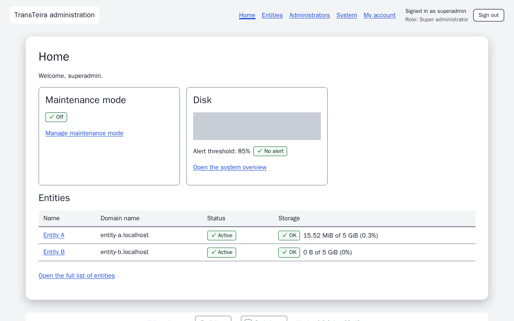

- **Maintenance mode**: **On** or **Off**, with the start date and **(forced by the environment)** when the `TT_MAINTENANCE` variable imposes it; **Manage maintenance mode** opens the maintenance screen.
- **Disk**: the use of the data disk, the alert threshold and the alert state; **Open the system overview** opens the full figures.
- **Entities**: one row per entity with its **Name**, **Domain name**, **Status** and **Storage**; **Open the full list of entities** opens the list described in [Entities](topic:tenants).

## Entities

The list of entities works as described in [Entities](topic:tenants), with one extra button for you, **Create an entity**. Some settings of an entity, and its deletion, are reserved to you.

<!-- topic: tenant-create -->
### Creating an entity

An entity is an organisation (subsidiary, department) with its own public address, branding and settings. Before creating it, make sure its address (FQDN) points to the reverse proxy in the DNS and that the reverse proxy serves it with a certificate (with Caddy, the certificate can also be obtained on demand, see [Provisioning tokens](topic:system-provisioning)).

On the **Entities** page, click **Create an entity**, then fill in the form.

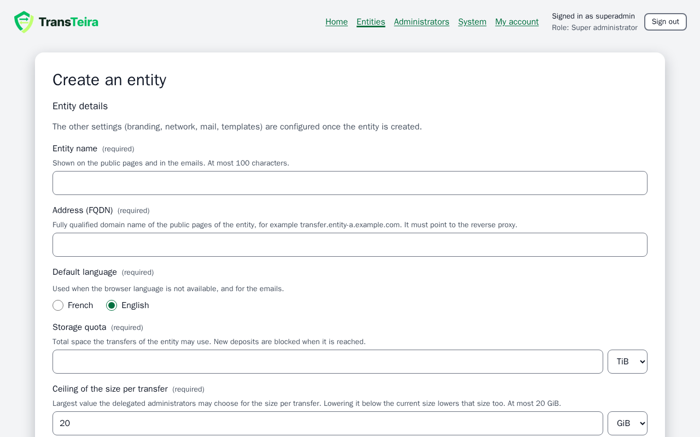

- **Entity name**: shown on the public pages and in the emails, at most 100 characters.
- **Address (FQDN)**: the domain name of the public pages of the entity, for example `transfer.entity-a.example.com`. It must be unique and cannot be the address of the administration.
- **Default language**: used when the browser language is not available, and for the emails.
- **Storage quota**: the total space the transfers of the entity may use. New deposits are blocked when it is reached.
- **Ceiling of the size per transfer**: the largest size the delegated administrators may choose, at most 20 GB.
- **Maximum size per transfer**: the size actually allowed for a transfer, up to the ceiling.
- **Background image**: the image shown behind the public pages, chosen among the images supplied with TransTeira (the default one is preselected). You can change it later in the **Background library** of the [Branding](topic:tenant-branding) screen; an uploaded image takes precedence over this choice.
- **First delegated administrator**: optional. Tick **Create the delegated administrator now**, then enter a **Username**, an **Email address** and the **Delivery of the activation link**. The administrator is attached to this entity only and is invited as described in [Creating a delegated administrator](topic:admin-create).

Click **Create the entity**. The entity is created **being set up**: its **Status** is **Being set up** in the list until the setup is complete. Meanwhile, its public pages only show a message saying that the entity is being configured, and deposits, invitations and API tokens are refused. This keeps users away from an entity that would send incomplete emails or show unfinished legal texts. The entity opens when its setup wizard is completed, or when you force the opening (see [Setup of an entity](topic:tenant-setup-super)).

Without a delegated administrator, you are taken to the setup of the entity right away, to configure it yourself. With one, a message confirms the creation and the invitation, and **Configure the entity** opens the setup. The delegated administrator can do the configuration too, with the same checklist (see [Setup of an entity](topic:tenant-setup)).

<!-- topic: tenant-setup-super -->
### Setup of an entity

The setup wizard of an entity is the **Setup** entry of its navigation (the **Configure** button of the list leads to the entity, and an entity being set up is also announced on your home page with a button to start its setup). It shows a checklist computed from the real configuration of the entity: each step is **Done** or **To do**, **Required** or **Optional**, and its **Configure** button leads to the matching screen. The steps are:

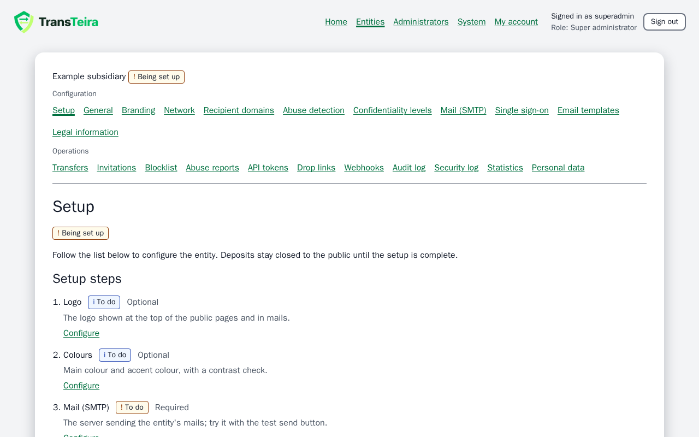

- required: **Mail (SMTP)** (settings tested successfully since their last change), **Internal IP ranges**, **Internal mail domains** (for an imported entity, done only once confirmed, see [Duplicate or import a configuration](topic:tenant-import)), **Legal notice** and **Privacy policy** (written in the default language of the entity, with no "To complete" marker left);
- optional: **Logo**, **Colours** and **Mail templates**, which counts as done once you tick **I reviewed the mail templates**.

Each step is detailed in the guide of the delegated administrator, see [Setup of an entity](topic:tenant-setup).

When all the required steps are done, click **Finish setup**: the entity opens and its public pages work. As super administrator you can also click **Force opening**, which opens the entity even if required steps are missing; a confirmation reminds you that it could then send incomplete emails or show incomplete texts. A delegated administrator cannot force the opening. The opening is recorded in the [audit log](topic:tenant-audit), and, for an entity created through the [provisioning API](topic:system-provisioning), you are notified of it by mail and by the instance webhooks.

> **Note** There is no way back: once open, an entity never returns to the setup state. The checklist stays available for information.

<!-- topic: tenant-general-super -->
### Settings reserved to the super administrator

On the [General](topic:tenant-general) screen of an entity, you can change the settings a delegated administrator cannot.

- **Entity name**: changed at once on the public pages and in the emails.
- **Address (FQDN)**: the change takes effect immediately and the old address stops working. Update the DNS and the reverse proxy first.
- **Storage quota**: when it is reached, new deposits are refused until space is freed. Alert emails are sent at 80 % and when the quota is reached, to the delegated administrators of the entity; when the entity has none, they go to the super administrators, through the SMTP settings of the entity. Review those settings when an entity is left without a delegated administrator.
- **Ceiling of the size per transfer**: lowering it below the current maximum size per transfer lowers that size too.
- **Antivirus analysis**: on by default. Turning it off (after a confirmation) delivers every file finalized from then on **without analysis**, flagged "not analysed: antivirus disabled": the sender is told by email and the download page warns the recipients. Files already waiting for analysis when you turn it off keep waiting for the antivirus; turning it back on never analyses files delivered in the meantime. The blocklist by fingerprint, the abuse detection and the forced download stay in force. Each change is recorded in the [audit log](topic:tenant-audit) (`tenant.antivirus_disabled`, `tenant.antivirus_enabled`). A delegated administrator sees the switch read-only. **Warning**: without analysis, the entity can be used to distribute malware; turn it off only knowingly. If the operator has disabled the antivirus for the whole instance (`TT_ANTIVIRUS_ENGINE=none`), the switch has no effect: no file is analysed, and the engine is shown read-only in the [system settings](topic:system-settings).
- **End-to-end encryption**: **forbidden** (default), **allowed** or **required**. This setting is reserved to you. When allowed, senders using a client that implements end-to-end encryption can encrypt their files so that the server never holds the key and cannot read them. **Consequence: an encrypted file is never analysed by the antivirus** (it is flagged "not analysed: end-to-end encrypted" for the sender and the recipients), and the blocklist by fingerprint cannot apply to it; the address and domain blocklists and the abuse detection still do. **Required** therefore amounts to turning the antivirus off for every deposit of the entity (permanent drop link deposits become impossible). We recommend allowing it only for controlled confidentiality levels, whose recipients are known (each level can then tighten the setting, never loosen it, see [Confidentiality levels](topic:tenant-confidentiality)). A delegated administrator cannot change it. Each change is recorded in the [audit log](topic:tenant-audit) (`tenant.updated`). Senders encrypt from the browser interface (a box in the transfer form), and API clients that implement the format can do it too.
- **Link only**: allows the internal senders and the API tokens of the entity to create link-only transfers, whose link is mailed to no recipient but shown once to the sender (see “Sending with a link only” (depositor guide)). Off by default. This setting is reserved to you; each confidentiality level can then forbid it (see [Confidentiality levels](topic:tenant-confidentiality)). Link-only exposes a link anyone holding it can use, with no trace per recipient: turn it on knowingly. Turning the setting off does not affect existing transfers.

> **Note** The sum of the quotas may exceed the size of the disk. Watch the disk use in the [System overview](topic:system-overview).

<!-- topic: tenant-import -->
### Duplicating or importing a configuration

You can create an entity from the configuration exported from another one, see [Exporting the configuration](topic:tenant-export). Import always creates a **new** entity, in the setup state: it never changes an existing entity.

In the list of entities, click **Duplicate** on the row of the entity to copy, or click **Import a configuration** and choose a JSON file. Then enter the **Entity name**, the **Address (FQDN)** and the **Storage quota** of the new entity, and optionally its first delegated administrator, as in [Creating an entity](topic:tenant-create). The logo and the background image are imported only if the file contains them.

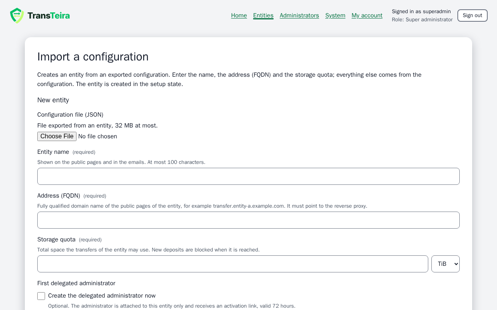

The file is checked strictly, and the creation is all or nothing. If the file is refused, the message names the place of the first error (for example `/config/settings/maxTransferBytes`): fix it or export the source entity again. A file written by a newer version of TransTeira is refused as well, and an address already used by another entity is refused. Each import is recorded in the [audit log](topic:system-audit) (`tenant.imported`).

Some things are never copied, so complete them in the [setup wizard](topic:tenant-setup-super) before opening the entity:

- **Mail (SMTP)**: enter the user name and password if the server needs them, then send a test email.
- **Webhooks**: recreate them with their addresses.
- **Single sign-on**: configure it again, see [Single sign-on of an entity](topic:sso-setup).
- **Network ranges and domains**: they are copied, but they were written for the source entity and would make the users of its networks "internal". The **Internal IP ranges** and **Internal mail domains** steps stay **To do** until they are confirmed: the wizard shows them with the message "These ranges and domains were imported: check them, then confirm." Check them, then click **Confirm** (or change them and save them in the **Network** screen, which also confirms them). Without this confirmation, **Finish setup** stays refused; only **Force opening** overrides it.

> **Warning** An imported file holds personal data (blocklist, contacts of the legal texts): keep it confidential and delete it afterwards.

<!-- topic: sso-setup -->
### Single sign-on of an entity

Only you can configure single sign-on (OpenID Connect) for an entity; delegated administrators and auditors see the configuration in read-only mode. On the entity, open **Single sign-on** and fill in:

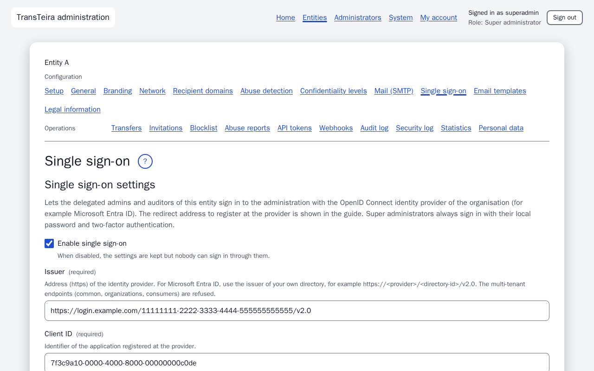

- **Issuer**: the `https` address of the identity provider. For Microsoft Entra ID, use the issuer of your directory, `login.microsoftonline.com/<directory id>/v2.0`, preceded by `https://`; the multi-tenant addresses `common`, `organizations` and `consumers` are refused.
- **Client ID** and **Client secret**: those of the application registered at the provider, with the redirect address `https://<administration host>/api/v1/admin/auth/oidc/callback`. The secret is never shown again; leave the field empty to keep the stored one. It is required again when the issuer or the client ID changes.
- **Email domains**: the domains whose administrators sign in through this provider. Each must be one of the **internal email domains** of the entity and cannot be used by another entity.
- **Require multi-factor authentication**: ticked by default. The provider must then state that a second factor was used; for Entra ID this needs the optional claim `amr` on the ID token and, ideally, a Conditional Access policy requiring MFA. Without it, sign-ins fail with **sso-mfa-required**. This setting alone governs the second factor of single sign-on logins: the "TOTP required" setting of the account does not apply to them.
- **Enforce single sign-on**: refuses the password sign-in of the delegated administrators and auditors of the entity. Their existing password sessions no longer reach the entity either, until they sign in through single sign-on. You are never affected.
- **Enable single sign-on**: turns the feature on for the entity.

Click **Test** before enabling: it checks that the provider can be reached and answers consistently, without signing anyone in. Changing the issuer or the client ID closes the single sign-on sessions of the entity and unpins the identities pinned for the previous provider (unless another entity of the account still uses it). Disabling or deleting the configuration closes the single sign-on sessions but keeps the pinned identities: they are unusable until a configuration with the same issuer and client ID returns.

If the provider is down while single sign-on is enforced, sign in with your own account (you never use single sign-on: your password and second factor always work), untick **Enforce single sign-on** on the entity and save. Delegated administrators who have a password can then sign in again. Tick it again once the provider is back.

The full procedure, the Entra ID and Keycloak steps and the troubleshooting are in `docs/operations/sso.md`.

<!-- topic: tenant-delete -->
### Deleting an entity

Deleting an entity erases it with all its data, for good. At the bottom of its [General](topic:tenant-general) screen, click **Delete the entity…**, type the exact name of the entity in **Text to type to confirm**, then click **Delete permanently**.

Every transfer, file, verified address, invitation, API token and setting of the entity is erased, and the files already backed up become unreadable, since their keys are destroyed. The public address of the entity stops working at once. If the deletion is interrupted, the entity stays marked **Deletion in progress** and the deletion resumes automatically. The audit log entries of the entity are kept until their 12-month retention ends.

<!-- topic: admins -->
## Administrator accounts

The **Administrators** page lists every account with access to the administration. Its columns are **Username**, **Email address**, **Role**, **Entities**, **Two-factor authentication** (**Enabled**, **Not enabled** or **Required**), **Status** (**Active**, **Disabled** or **Pending activation**) and **Last sign-in**.

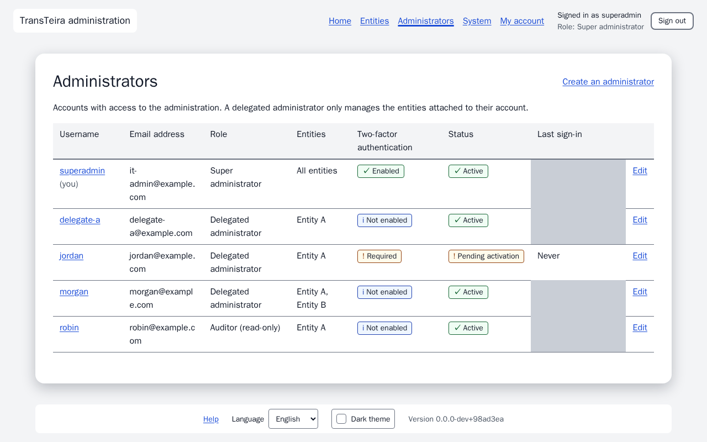

<!-- topic: admin-create -->
### Creating a delegated administrator

A delegated administrator manages only the entities you attach to their account. Click **Create an administrator** and fill in the form.

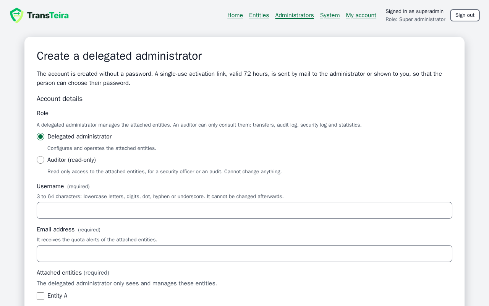

- **Username**: 3 to 64 characters, lowercase letters, digits, dot, hyphen or underscore. It cannot be changed afterwards.
- **Email address**: it receives the quota alerts of the attached entities.
- **Attached entities**: select at least one entity.
- **Require two-factor authentication**: recommended and ticked by default. The person will have to configure it when activating the account and will not be able to disable it.

Choose how the person receives the activation link, under **Delivery of the activation link**:

- **Send by mail to the administrator**: the link is sent from the system mailbox of the instance (the `TT_SYSTEM_SMTP_*` variables, see `.env.example`), in the **Language of the mail** you choose, and it is **never shown** to you. Two-factor authentication then becomes mandatory for the account: **Require two-factor authentication** is ticked and cannot be changed.
- **Show the link to copy and hand over myself**: the link is shown to you instead, as described below.

When no system SMTP server is configured, the mail delivery is refused with a message telling you to choose the other option.

Click **Create the administrator**. The account is created without a password. With the mail delivery, a message confirms **Invitation sent** to the address, with the date until which the link is valid; the link itself cannot be retrieved. With the other one, an **Activation link** is shown **once**: click **Copy the link** and hand it over through another channel than the usual email (in person, by instant messaging or by phone), since anyone who gets it can set the password of the account. Then click **I have handed over the link**. The link is valid 72 hours and works once; what the person does with it is described in [Activating your account](topic:activation).

To issue a new link for an account that is not activated yet (the mail did not arrive, the link expired), click **Send the invitation again…** on its row, choose the delivery as above, then click **Send the invitation**. The previous links are revoked, the new one is valid 72 hours, and at most 5 invitations per hour can be sent for the same account. The action is not offered once the account is activated. For a super administrator account, the link is never sent by mail: it is shown to you.

<!-- topic: admin-edit -->
### Editing an account

Click **Edit** on the row of an account to change its email address, its attached entities, the two-factor requirement or its role, then click **Save**.

- **Role**: only an activated account with two-factor authentication configured can become super administrator; its entity assignments are then removed. To demote a super administrator, select the entities to attach.
- **Account disabled**: the account can no longer sign in and its open sessions are closed.

Changing the entities, the role or the disabled state also closes the sessions of the account. On your own account, these actions are not offered: use [My account](topic:account) for your password and your authentication device.

<!-- topic: admin-sso -->
### Accounts that sign in with single sign-on

Accounts are always created by you, never by a sign-in. In the form to create a delegated administrator or an auditor, the delivery **Single sign-on only, no activation link** creates an account **without password**: the person can only sign in through single sign-on. It is offered only when every attached entity has its single sign-on enabled. It is not possible for a super administrator.

On the first single sign-on, the account is found by its verified email address and the identity of the person at the provider is **pinned** to it. From then on only this identity is accepted: someone else presenting the same address is refused. When a person changes account at the provider, open the account with **Edit**, where the **Pinned single sign-on identities** are listed, and click **Unpin** on the identity; the next sign-in pins the identity matching the email address, so check first that it is the same person. Unpinning an identity also closes the sessions opened through it, and changing the email address of an account unpins its identities. Pinning and unpinning are recorded in the audit log.

<!-- topic: admin-reset -->
### Lost password or device

When an administrator has lost their password or their authentication device, reset their credentials. On their account, click **Reset credentials…**, then confirm: the password, two-factor authentication and recovery codes are erased, the sessions are closed, and a new activation link is shown once, to hand over as for a new account. A disabled account must be enabled first.

To remove an account, click **Delete…** and confirm with **Delete permanently**. The audit log keeps track of its actions.

If you are the only super administrator and lost your device, sign in with a recovery code (see [Recovery codes](topic:admin-recovery-codes)). If you have no recovery code left, or lost your password, an operator with access to the server can reset your account from the command line, for example `docker exec -it transteira transteira admin reset-totp <username>`: the commands are described in `docs/operations/admin.md`, sections "Losing the second factor" and "Losing the password".

## System

The **System** entry gathers the settings of the whole instance. Its sub-navigation has seven screens: **Overview**, **Maintenance**, **Settings**, **Webhooks**, **Audit log**, **Master key** and **Provisioning tokens**. Delegated administrators do not see it.

<!-- topic: system-overview -->
### System overview

The system overview shows the activity of every entity and the use of the data disk. Choose the **Period**: **Last 7 days**, **Last 30 days** or **Last 12 months**.

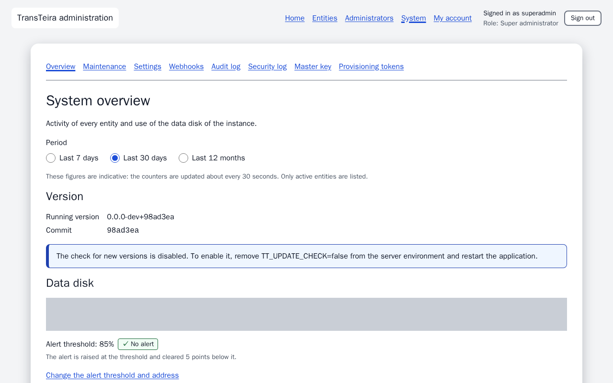

- **Data disk**: the space used on the disk that holds the files, the alert threshold and a badge **Alert active** or **No alert**. The alert is raised at the threshold and cleared 5 points below it; **Change the alert threshold and address** opens the [System settings](topic:system-settings).
- **Entities**: one row per active entity, with its **Transfers** and **Volume uploaded** over the period and its **Storage**.

When no system SMTP server is configured, the warning **The disk alert is not sent by mail** appears: the alert is then only visible on this page, in the audit log and in the application log. To receive it by mail, set `TT_SYSTEM_SMTP_HOST`, `TT_SYSTEM_SMTP_FROM` and the related variables (see `.env.example`), then restart the application. The figures are indicative: the counters are updated about every 30 seconds.

<!-- topic: system-version -->
### Version and updates

The running TransTeira version is shown in the footer of the administration, for every administrator.

The **Version** block of the [System overview](topic:system-overview) is reserved to the super administrator. It shows the running version, the **Latest published version** and the date of the **Last successful check**. The **Check now** button runs a check at once, at most once a minute for the whole instance. When a newer release exists, a notice appears with a link to its release page.

TransTeira never updates itself: read the `CHANGELOG.md`, then follow the update procedure described in the installation documentation.

To turn the check off, for example on an air-gapped installation, set `TT_UPDATE_CHECK=false` and restart the application: no outbound connection is made any more. Otherwise the check honours the `HTTPS_PROXY` variable.

<!-- topic: system-maintenance -->
### Maintenance mode

Maintenance mode suspends new deposits during an update. While it is on, new deposits and invitations are refused on every entity and visitors see a maintenance page in their language; downloads, the administration and the health check keep working. Uploads in progress are suspended and resume once the mode is turned off.

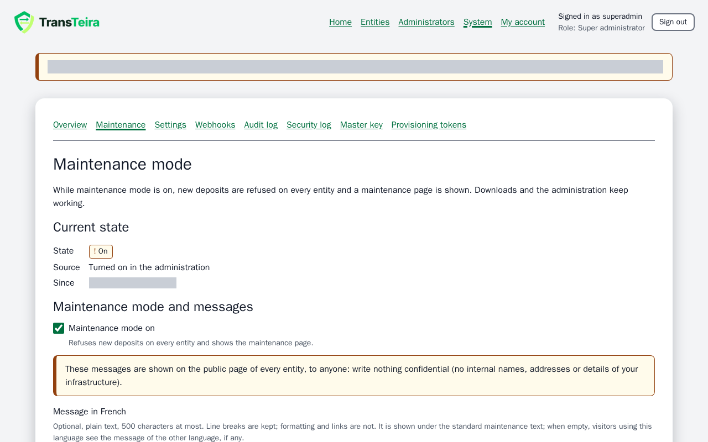

**Current state** shows the **State**, the **Source** and the date the mode started (**Since**). To turn the mode on:

1. Tick **Maintenance mode on**.
2. If useful, write a **Message in French** and a **Message in English**: optional plain text, at most 500 characters, shown under the standard maintenance text. They are public on every entity: write nothing confidential. The **Preview** shows them as visitors will.
3. Save, then confirm **Turn maintenance mode on?** with **Turn on**.

To turn it off, untick the box, save and confirm with **Turn off**. While the mode is on, every administrator sees a banner at the top of the administration.

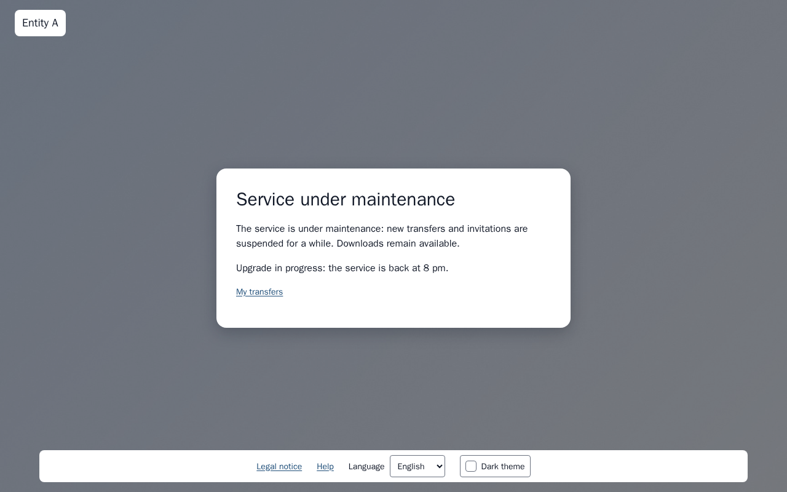

> **Note** When the instance was started with `TT_MAINTENANCE=true`, the screen shows **Forced by the environment** and the mode cannot be turned off here until the variable is removed and the instance restarted. You can still edit the messages, but saving them also records the mode as on: after removing the variable, turn it off on this screen.

A typical update: turn maintenance mode on, wait for the uploads in progress to pause, update the instance, check that it works, then turn the mode off.

<!-- topic: system-settings -->
### System settings (disk alert)

The system settings hold the disk usage alert of the whole instance.

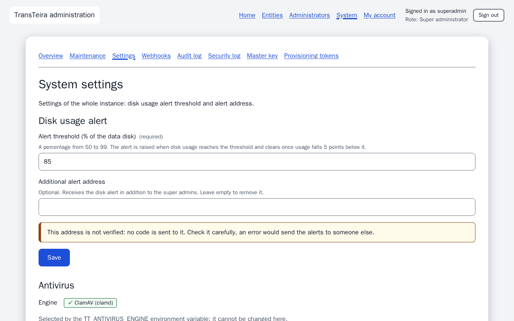

- **Alert threshold (% of the data disk)**: a percentage from 50 to 99, 85 by default. The alert is raised when disk usage reaches the threshold and clears once it falls 5 points below.
- **Additional alert address**: optional, it receives the disk alert and the antivirus alert in addition to the super administrators. This address is not verified: type it a second time in **Alert address again** and check it carefully. Leave the field empty to remove it.

Below the form, the **Antivirus** section shows the engine selected by the operator (read only) and, unless it is disabled, the result of the last **self-test**: outcome, date, signature when the test string was detected, and who started it (the instance or a super administrator). The self-test sends the harmless EICAR test string to the engine, which must report it infected. Click **Test the antivirus** to run it now; the result is announced and recorded in the [audit log](topic:system-audit) (`antivirus.self_test`). The button is not shown when the antivirus is disabled for the instance.

A result other than **Detected (passed)** means that the engine does not do its job: it is unreachable, answers something unexpected, or does not report the test string (check its configuration and, for an HTTP engine, the verdict rules). Until a self-test passes, the engine is treated as unavailable and **files wait for analysis** (the antivirus alert follows after the usual delay). The instance retries by itself after a failure at startup; after a successful test it never repeats it by itself, and a test you run that fails closes the engine again.

Click **Save**. The alert mails go through the system SMTP server of the instance, configured by environment variables, never through the SMTP settings of an entity. Without it, no alert mail is sent.

<!-- topic: system-webhooks -->
### Instance webhooks

The instance webhooks send the alerts of the whole instance to a Microsoft Teams or Slack channel, or to any JSON receiver, in addition to the alert emails. They work like the [webhooks of an entity](topic:tenant-webhooks), with other events: **Disk space alert**, **Disk space back to normal**, **Antivirus unavailable**, **Antivirus available again**, **Maintenance mode on**, **Maintenance mode off**, **Master key rotation completed**, **Master key rotation failed**, **Entity created by provisioning**, **Entity setup completed** and **Provisioning token created**. The last three concern the provisioning of entities, see [Provisioning tokens](topic:system-provisioning). They never receive the events of an entity, which are configured in each entity. The instance can have at most 20 webhooks.

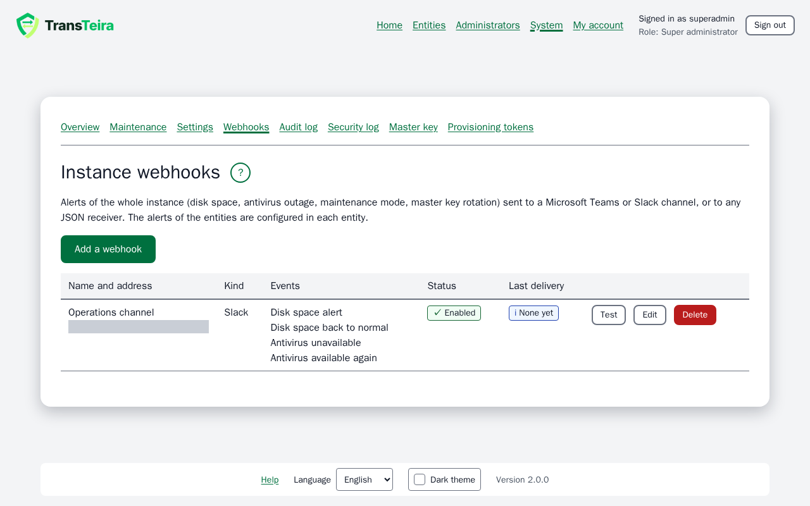

By default, the address of a webhook must use `https://` and lead to a public address; an address whose host name cannot be resolved is refused with the same message, so that the check reveals nothing of the internal DNS. Some networks can never be opened: unspecified addresses, link-local addresses (including the cloud metadata services), multicast, reserved and broadcast addresses, the networks of the TransTeira container itself, IPv4-compatible IPv6 addresses, and the ranges listed in `TT_WEBHOOK_DENY_NETWORKS`. The private ranges (RFC 1918, `100.64.0.0/10`, `fc00::/7` and the other reserved ranges listed in `.env.example`) are refused too, but the operator can open them for a receiver on the internal network by declaring its range in `TT_WEBHOOK_ALLOW_NETWORKS`. Plain `http://` is accepted only towards a range listed in `TT_WEBHOOK_ALLOW_HTTP_NETWORKS`, and that range must itself be reachable: a private range must also be listed in `TT_WEBHOOK_ALLOW_NETWORKS`. TransTeira refuses to start when an allowed range overlaps the networks that can never be opened, for example a range containing the Docker network of the container. These variables are described in `.env.example` and apply to the webhooks of every entity. Creating webhooks and entering new addresses is limited to 30 times per hour per administrator.

### Supervision

The instance can be monitored by Prometheus, Grafana, Zabbix or any script through the `/metrics` and `/status` endpoints. They are not configured in the administration: the operator enables them with environment variables (`TT_METRICS_TOKEN` or `TT_METRICS_TOKEN_FILE`, and optionally `TT_METRICS_ALLOWED_IPS`) and changes the token by restarting the instance. Without a token they do not exist. Uptime Kuma and load balancers use `/healthz`, which needs no token. See `docs/operations/supervision.md` for the metrics and the setup.

<!-- topic: system-audit -->
### Global audit log

The global audit log gathers the audit events of every entity and of the instance itself. It works like the [Audit log](topic:tenant-audit) of an entity, with an extra **Entity** filter and column.

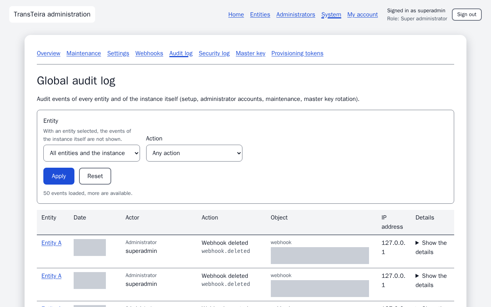

With **All entities and the instance**, the log also shows the events of the instance, marked **Instance**: setup, sign-ins and administrator accounts, maintenance mode, system settings, disk alerts, antivirus alerts, master key rotations and provisioning tokens (**Provisioning token created** and **Provisioning token revoked**). The events of an entity now include **Entity setup completed**, **Entity created by provisioning** and **Entity creation by provisioning refused**, and the sending of an invitation to a delegated administrator is recorded as **Administrator invited**. With an entity selected, only the events of that entity are shown. Events are kept 12 months.

<!-- topic: system-provisioning -->
### Provisioning tokens

A provisioning token lets a managed service provider create entities by the API, without any access to the administration. The **Provisioning tokens** screen lists the tokens with their **Name**, **Prefix**, **Allowed IP ranges**, **Allowed FQDN suffixes**, **Entities created**, **Caps**, **Created**, **Last used**, **Expires** and **Status**. Revoked tokens stay listed. The technical side, for the provider, is in `docs/api/provisioning.md`.

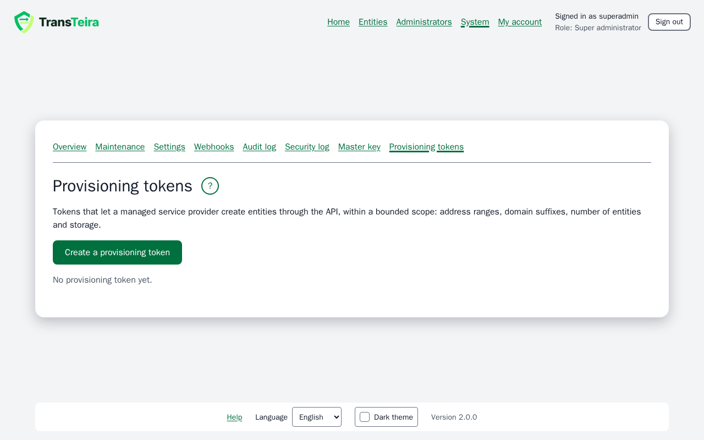

To create a token, click **Create a provisioning token** and fill in the form:

- **Name**: to recognise the token, for example the service provider it is given to.
- **Allowed IP ranges**: one range per line (CIDR), the addresses the provider connects from. A range that allows any address is refused.
- **Allowed FQDN suffixes**: one suffix per line, starting with a dot, for example `.transfer.example.com`. The token only creates entities whose address ends with one of them.
- **Maximum number of entities**: the highest number of live entities created with this token.
- **Highest storage quota per entity** and, optionally, **Highest per-transfer limit**.
- **Expiry date** (optional): the token stops working at the end of this day.

A note shows the storage committed by the token (number of entities times quota): check that your disk can host it. To confirm, enter the current code of your authenticator app, or one of your recovery codes, even though you are signed in, then click **Create the token**. The secret, which starts with `ttp_`, is shown **once**: copy it and give it to the provider through a trusted channel, never in clear by mail. If it is lost, create another token and revoke the first.

To revoke a token, click **Revoke** on its row and type its exact name to confirm. The token stops working at once; the entities it already created are kept.

Creating a token notifies all the super administrators, by mail and by the instance webhooks (**Provisioning token created**, never the secret), so that a token created from a stolen session does not go unnoticed. The creation and the revocation are recorded in the [global audit log](topic:system-audit).

An entity created with a token is created **being set up** (see [Creating an entity](topic:tenant-create)), together with its first delegated administrator, who is invited by mail: the activation link is never returned to the provider, so the invitation needs the system SMTP server (`TT_SYSTEM_SMTP_*`). You are notified by mail and by webhook when an entity is created this way and when its setup is completed. The provider can neither see nor change the entity afterwards, nor open it: the delegated administrator completes the setup (see [Setup of an entity](topic:tenant-setup)).

**Certificates.** An entity created by the API needs a certificate for its address as soon as it exists. With Caddy, the operator can have it obtained on demand at the first visit: use `integrations/reverse-proxy/caddy/Caddyfile.on-demand` and set `TT_TLS_ASK_ALLOWED_IPS` to the exact address of Caddy on the proxy network. Caddy then asks TransTeira whether the name belongs to an entity before requesting the certificate. Without this variable, the endpoint is disabled and no certificate is issued this way. With many entities under one domain, a wildcard certificate avoids the Let's Encrypt limits. See `docs/api/provisioning.md`.

### Proof signing key

Proofs of deposit and delivery (see the [delegated administrator guide](topic:tenant-proofs)) are signed by one Ed25519 key of the instance, created when the first proof is written. Its private part is sealed by the master key, so the [master key rotation](topic:master-key-rotation) covers it. There is no screen for it: on the host, `transteira proof keys` lists the keys and `transteira proof retire-key` retires the active one (suspected compromise of the database and the master key, or periodic hygiene). The private part is destroyed, the public key stays published at `/api/v1/proof-keys` so that older proofs still verify, and a new key is created with the next proof. Retiring is recorded in the audit log (`proof_key.retired`). Procedure, verification and limits: `docs/operations/proofs.md`.

<!-- topic: system-master-key -->
### Master key

The master key protects the encryption key of each file and the stored secrets (envelope encryption): it never encrypts the files directly. A copy of it must be kept in a password vault outside the VM, since a VM backup is unusable without it. The screen shows only key identifiers (`mk_` followed by 16 hexadecimal characters), never the keys themselves, and the administration cannot create, upload or download a key.

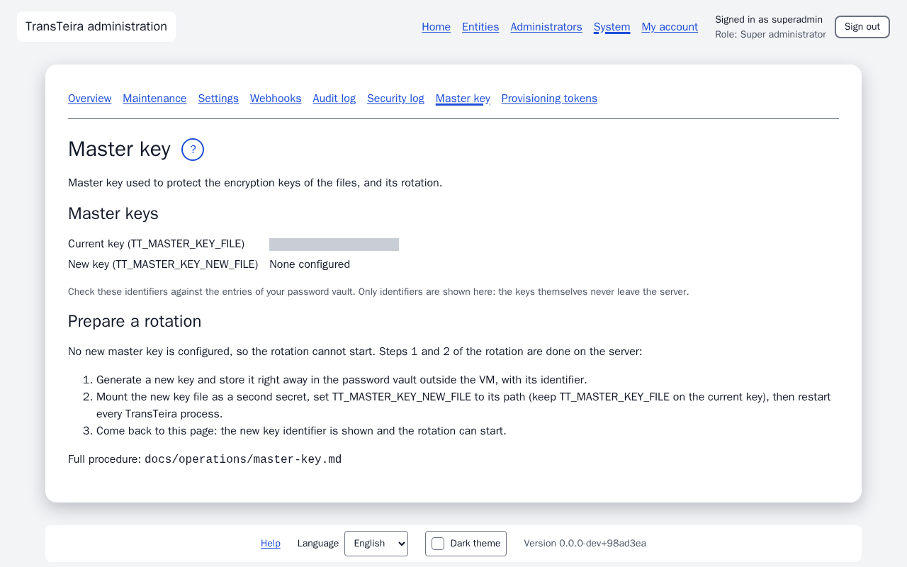

Under **Master keys**, the screen shows the **Current key (TT_MASTER_KEY_FILE)** and the **New key (TT_MASTER_KEY_NEW_FILE)**, or **None configured**. Check these identifiers against the entries of your vault. After a completed rotation, a **Restart required** badge appears. **Latest rotation** gives the identifier, the **Status** (**Running**, **Completed** or **Failed**), the keys, the dates and the progress of the last rotation.

<!-- topic: master-key-rotation -->
### Rotating the master key

A rotation replaces the master key: it re-wraps the keys stored in the database with the new master key, without reading or rewriting the files, so it takes seconds to minutes even for a large volume. Rotate when you suspect the key leaked, when someone who had access to it leaves, and at least once per backup retention period. Only step 3 is done in the administration; the others change the server or the vault.

1. *On the server*: generate a new key and store it right away in the password vault, with its identifier.
2. *On the server*: mount the new key file as a second secret, set `TT_MASTER_KEY_NEW_FILE` to its path, keep `TT_MASTER_KEY_FILE` on the current key, then restart every TransTeira process. Until then, the screen shows **Prepare a rotation** and no start button.
3. *In the administration* (or with the `rotate-master-key` command): open **System**, then **Master key**, and compare both identifiers with the vault. Tick **The new key is stored in the password vault outside the VM** and **I checked both key identifiers**, click **Start the rotation**, then enter the current code of your authenticator in the **Confirm with a code** dialog and click **Start**. If you have just signed in, wait for the next code: a code already used cannot be used again. The **Re-wrapping of the keys** bar shows the progress; you can leave the page, the rotation continues on the server.
4. *On the server*: once the rotation is completed, point `TT_MASTER_KEY_FILE` to the new key file, remove `TT_MASTER_KEY_NEW_FILE` and the secret of the old key, then restart. Until then, the next start of the server is refused.
5. *In the vault*: mark the new key as current, and the old one as retired with the date of the rotation.
6. *Later*: keep the old key as long as you keep backups taken before the rotation. When the last of them has expired, delete the old key from the vault and from the host.

In the dialog, you can also use one of your recovery codes, which is then consumed. Several wrong codes in a row end your session: after the fifth, you are taken back to the sign-in page.

If the rotation is interrupted, for example by a restart of the server, the screen shows **The rotation seems interrupted**: tick both boxes again and click **Resume the rotation** with a new code; it continues where it stopped, with the same identifier. If it failed, **The latest rotation failed** gives the error reported by the server; fix the cause, then **Start the rotation again**.

The restart of step 4 affects users: open pages (deposit and administration) must be reloaded, a code being entered must be requested again, and internal depositors are asked for a verification code once more on their next visit. Restart at a quiet time; no data is lost. The full procedure, including the command line, is in `docs/operations/master-key.md`.

<!-- topic: super-admin-checklist -->
## Good practices

A few habits keep the instance safe and recoverable.

- Keep two super administrators, each with their own authenticator.
- Store your recovery codes in the password vault, not next to your phone.
- Keep a copy of the master key in the password vault outside the VM, with its identifier, and update it at each rotation.
- Configure the system SMTP server so that you receive the disk alert and the antivirus alert (sent when the antivirus has not answered for 5 minutes: deposits then stay in analysis), and watch the health check with your monitoring tool.
- When an entity is left without a delegated administrator, review its SMTP settings: its quota alerts are then sent to you through them.
- Check that the backups described in `docs/operations/backup.md` run, and rotate the master key at least once per backup retention period.
