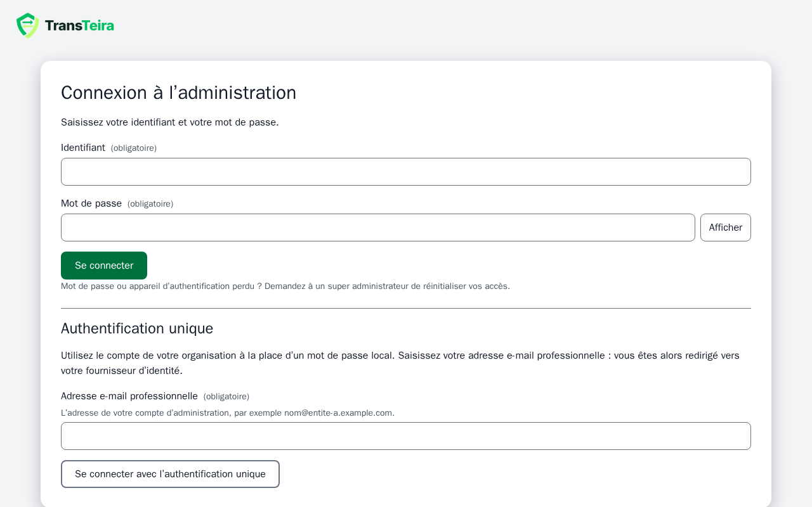
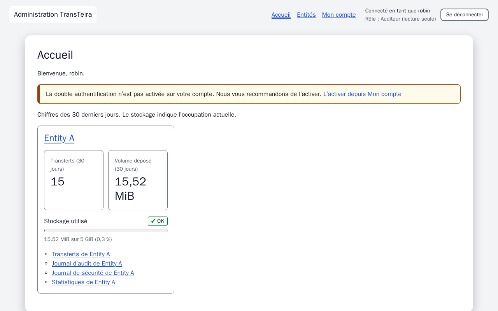
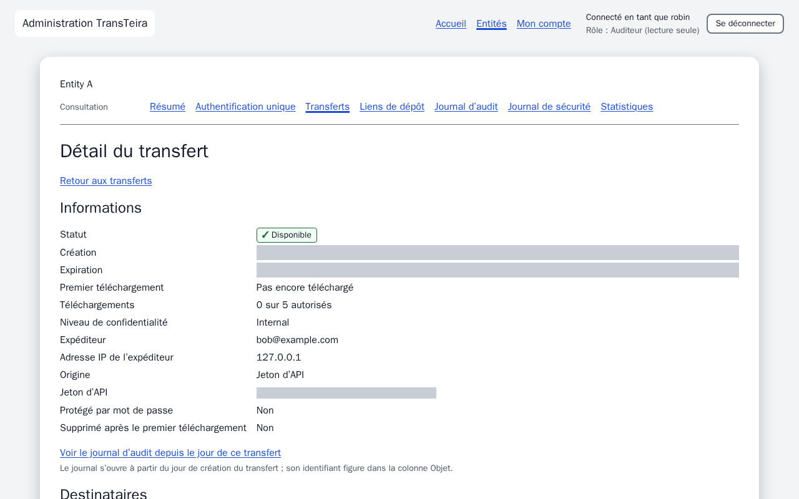
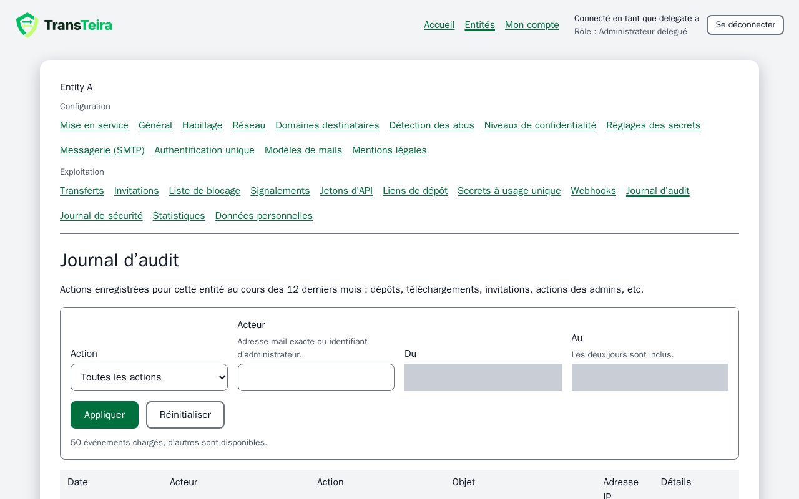
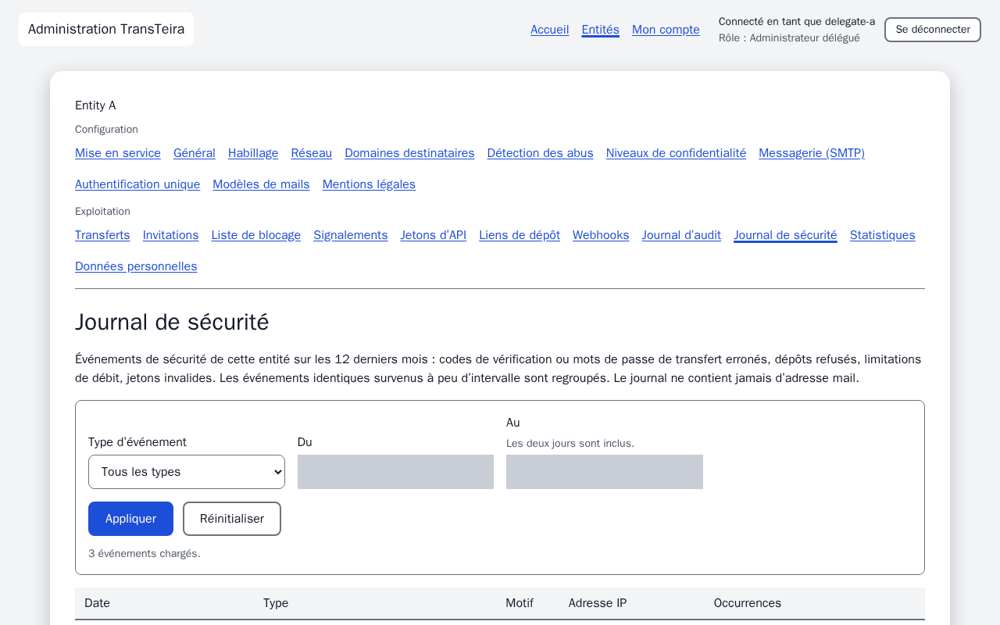
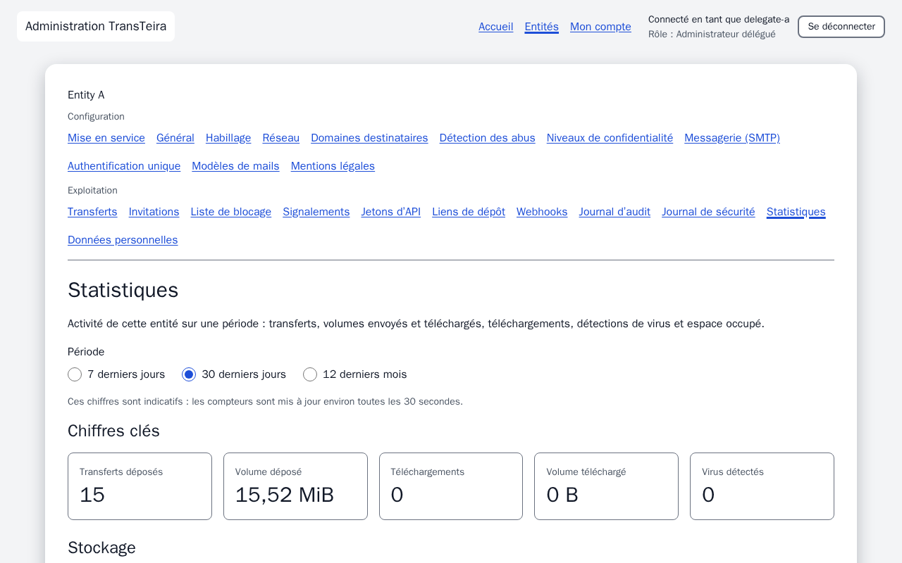
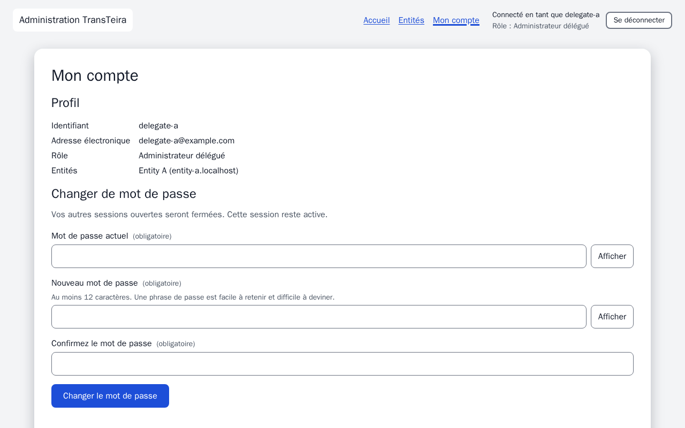

# Guide de l’auditeur

En tant qu’auditeur, vous consultez, en lecture seule, les entités rattachées à votre compte : leur résumé, leur journal d’audit, leur journal de sécurité, leurs statistiques, leurs transferts et leurs preuves, leurs secrets à usage unique (métadonnées seulement), ainsi que leurs liens de dépôt permanents. Ce rôle est destiné à un RSSI ou à un audit (par exemple ISO 27001). Vous ne pouvez rien modifier, hormis votre propre mot de passe et votre second facteur. Tout se passe dans l’administration, à l’adresse communiquée par votre organisation (par exemple `admin.transfer.example.com/admin/`). Le lien **Aide** en bas de chaque écran ouvre directement la section correspondante de ce guide.

<!-- topic: auditor-roles -->
## Votre rôle : la lecture seule

TransTeira distingue trois rôles d’administrateur ; le rôle affiché sous votre identifiant indique le vôtre.

- **Super administrateur** : gère toutes les entités, crée les entités et les comptes d’administrateurs, et s’occupe des réglages système du service.
- **Administrateur délégué** : configure et exploite les entités rattachées à son compte.
- **Auditeur** (affiché **Auditeur (lecture seule)**) : consulte les entités rattachées à son compte et ne modifie rien.

Votre compte est créé par un super administrateur, qui le rattache à une ou plusieurs entités. Une autre entité vous est invisible : si vous ouvrez son adresse, l’administration répond comme si elle n’existait pas.

Vous pouvez consulter :

- le résumé de l’entité (son nom, son adresse, sa langue, sa limite de taille et son quota de stockage) et sa configuration d’authentification unique, sans aucun secret ;
- le journal d’audit, le journal de sécurité et les statistiques de l’entité ;
- la liste de ses transferts, le détail de chaque transfert (métadonnées uniquement) et leurs preuves de dépôt et de remise, en PDF ;
- la liste de ses liens de dépôt permanents, jamais le secret d’un lien ;
- la liste de ses secrets à usage unique (métadonnées seulement), jamais leur contenu, leur lien ni leur phrase de passe.

Vous ne gérez que votre propre compte : votre mot de passe et votre double authentification. Toute autre action est refusée avec l’erreur **read-only-role**, et l’administration ne vous la propose pas.

<!-- topic: auditor-activation -->
## Activer votre compte

Un super administrateur crée votre compte, puis vous remet un lien d’activation pour choisir votre mot de passe, ou vous invite par mail. Le lien est valable 72 heures et ne fonctionne qu’une fois ; si vous recevez une seconde invitation, utilisez uniquement la dernière, car chaque nouvelle invitation révoque le lien précédent.

1. Ouvrez le lien. La page **Activation de votre compte** s’affiche.
2. Saisissez votre mot de passe dans **Nouveau mot de passe**, puis de nouveau dans **Confirmez le mot de passe**. La règle est rappelée sous le champ : au moins 12 caractères.
3. Cliquez sur **Définir le mot de passe**.
4. Si la double authentification est obligatoire pour votre compte (c’est le cas par défaut, et toujours avec une invitation par mail), vous la configurez aussitôt : voir [Double authentification](topic:auditor-totp).

Si la page affiche **Lien d’activation invalide**, le lien a expiré, a déjà servi ou a été copié de façon incomplète. Demandez-en un nouveau à un super administrateur.

Si votre organisation utilise l’authentification unique pour l’entité, votre compte a pu être créé **sans mot de passe** (« authentification unique uniquement ») : il n’y a alors pas de lien d’activation, et vous vous connectez comme indiqué ci-dessous.

<!-- topic: auditor-login -->
## Se connecter

Vous vous connectez soit avec votre identifiant, votre mot de passe et un second facteur, soit avec l’authentification unique lorsque votre compte le permet.

### Avec un mot de passe

Sur **Connexion à l’administration**, saisissez votre **Identifiant** et votre **Mot de passe**, puis cliquez sur **Se connecter**. Si la double authentification est activée, une seconde étape **Double authentification** suit :

- saisissez le **Code d’authentification** à 6 chiffres affiché par votre application d’authentification (renouvelé toutes les 30 secondes), puis cliquez sur **Vérifier** ;
- si vous n’avez plus votre application, cliquez sur **Utiliser un code de secours** et saisissez l’un de vos codes de secours.

Cette seconde étape doit être terminée dans les 5 minutes. Contre les attaques par essais successifs, 5 échecs pour un même identifiant depuis une même adresse réseau en 15 minutes bloquent la connexion pendant 15 minutes. Votre session prend fin après 30 minutes d’inactivité, et dans tous les cas après 12 heures (valeurs par défaut, réglées par l’exploitant). Pour partir plus tôt, cliquez sur **Se déconnecter** dans la navigation principale.

> **À savoir** Mot de passe ou appareil perdu ? Demandez à un super administrateur de réinitialiser vos accès : il vous remet alors un nouveau lien d’activation.

### Avec l’authentification unique

Si l’entité utilise l’authentification unique (OpenID Connect, par exemple Microsoft Entra ID), saisissez votre adresse e-mail professionnelle dans le formulaire **Authentification unique** de la page de connexion et cliquez sur **Se connecter avec l’authentification unique**. Vous vous authentifiez chez votre fournisseur, et vous arrivez dans l’administration sans mot de passe ni code d’authentification TransTeira : le second facteur est celui de votre fournisseur. La première fois, votre compte est lié à votre identité chez le fournisseur.

Un compte créé « en authentification unique uniquement » n’a pas de mot de passe : il ne peut se connecter que de cette façon. Votre session n’atteint alors que les entités qui utilisent le même fournisseur. Si l’entité impose l’authentification unique, la connexion par mot de passe est refusée avec un message qui vous demande d’utiliser l’authentification unique. Si la connexion échoue, la page affiche un message général : adressez-vous à un super administrateur, qui peut lire la raison dans le journal de sécurité.

<!-- topic: auditor-totp -->
## Double authentification

La double authentification protège votre compte même si votre mot de passe est divulgué : la connexion exige aussi un code généré par une application sur votre téléphone ou votre ordinateur. Le super administrateur décide si elle est obligatoire pour votre compte (c’est le cas par défaut). Vous la configurez à la fin de l’activation, ou plus tard depuis [Mon compte](topic:auditor-account).

Sur **Configurer la double authentification** :

1. Installez une application d’authentification sur votre téléphone ou votre ordinateur (toute application compatible TOTP, ou votre gestionnaire de mots de passe).
2. Scannez le QR code. Si vous ne le pouvez pas, saisissez la **Clé de configuration** à la main dans l’application.
3. Saisissez le code à 6 chiffres affiché par l’application dans **Code de confirmation**, puis cliquez sur **Activer la double authentification**.

Si le code est refusé, vérifiez que l’horloge de votre appareil est à l’heure : les codes dépendent de l’heure.

<!-- topic: auditor-recovery-codes -->
### Codes de secours

Les codes de secours vous permettent de vous connecter si vous perdez l’accès à votre application d’authentification. Juste après la configuration, TransTeira affiche 8 codes de secours, une seule fois.

- Enregistrez-les avec **Copier tous les codes** ou **Télécharger (fichier texte)**, et conservez-les en lieu sûr, par exemple dans votre gestionnaire de mots de passe, mais pas à côté de votre téléphone.
- Cochez **J’ai enregistré ces codes de secours dans un endroit sûr.**, puis cliquez sur **Continuer**.

Chaque code ne sert qu’une fois. La configuration d’un nouvel appareil génère de nouveaux codes, et les précédents cessent de fonctionner.

<!-- topic: auditor-admin -->
## Page d’accueil

La page d’accueil donne une vue d’ensemble des entités que vous consultez. Chaque entité dispose d’une carte avec **Transferts (30 jours)**, **Volume déposé (30 jours)**, **Stockage utilisé** (une jauge de l’espace occupé par rapport au quota) et des liens rapides vers ses transferts, son journal d’audit, son journal de sécurité et ses statistiques. Aucun appel à configurer l’entité ne vous est proposé : la configuration relève des administrateurs délégués.

Si une carte ne parvient pas à charger ses chiffres, cliquez sur **Réessayer**. Si la double authentification n’est pas activée sur votre compte, un bandeau la recommande. Si aucune entité n’est encore rattachée à votre compte, la page l’indique : demandez à un super administrateur de vous en rattacher une.

La navigation principale, en haut, comprend **Accueil**, **Entités**, **Mon compte** et **Se déconnecter**. Le pied de page contient le lien **Aide** et le sélecteur **Langue**, mémorisé dans ce navigateur.

<!-- topic: auditor-tenants -->
### Entités et résumé

La page **Entités** liste les entités rattachées à votre compte, avec leur adresse, leur statut, le stockage utilisé et leur langue par défaut. Si une seule entité est rattachée à votre compte, cette page vous y mène directement.

Une fois une entité ouverte, une barre de navigation affiche son nom et un seul groupe, **Consultation**, avec **Résumé**, **Authentification unique**, **Transferts**, **Liens de dépôt**, **Journal d’audit**, **Journal de sécurité** et **Statistiques**. Aucun écran de configuration n’est proposé.

<!-- topic: auditor-tenant-general -->
### Résumé

Le **Résumé** indique le nom et l’adresse de l’entité, sa langue par défaut, sa taille maximale par envoi, son quota de stockage et ses réglages, avec une note précisant que votre accès est en lecture seule. Rien n’est modifiable, exportable ni supprimable depuis cet écran.

<!-- topic: auditor-tenant-sso -->
### Authentification unique de l’entité

L’écran **Authentification unique** affiche les réglages d’authentification unique de l’entité en lecture seule ; seul un super administrateur peut les modifier. Le secret n’est jamais affiché.

<!-- topic: auditor-tenant-transfers -->
## Transferts et preuves

L’écran **Transferts** liste les transferts de l’entité, du plus récent au plus ancien. Filtrez par **Statut** ou par **Créés depuis le**, puis cliquez sur **Appliquer** ; **Réinitialiser** efface les filtres. Vous ne pouvez pas rechercher par adresse mail : le filtre ne vous est pas proposé, et l’API le refuse avec **read-only-role**. Les colonnes indiquent **Création**, **Expéditeur**, **Destinataires**, **Fichiers et taille**, **Statut**, **Origine**, **Téléchargements** et **Expiration**. Les longues listes montrent leurs premières lignes ; cliquez sur **Charger plus** pour voir les suivantes.

Ouvrez un transfert pour voir son **Détail du transfert** : statut, dates, premier téléchargement, expéditeur, origine, options (dont le **Niveau de confidentialité**), destinataires avec les fichiers que chacun a téléchargés et quand, et les fichiers avec leur taille, leur empreinte SHA-256 et le résultat de l’antivirus. Ce sont des métadonnées uniquement : le contenu des fichiers, les liens de téléchargement et le message de l’expéditeur ne sont jamais accessibles, et aucun bouton ne permet de renvoyer ou de supprimer un transfert.

<!-- topic: auditor-tenant-proofs -->
### Preuves de dépôt et de remise

Le détail d’un transfert comporte une section **Preuves**. Elle propose des fichiers PDF signés par l’instance : la **preuve de dépôt** (écrite à la fin de l’analyse antivirus), la **preuve de remise** (écrite au premier téléchargement complet) et, quand les destinataires ont des liens personnels, une **preuve de remise** par destinataire. Une preuve pas encore écrite est indiquée comme indisponible.

Les preuves sont conservées 12 mois après leur émission, même si le transfert a été supprimé. La déclaration signée à l’intérieur du PDF fait foi, pas son texte visible : elle indique l’entité, l’expéditeur, les destinataires, les fichiers avec leurs empreintes SHA-256 et les dates, et aucune adresse IP. Une preuve vaut la confiance accordée à l’exploitant de l’instance, car il n’y a pas d’horodatage par un tiers. Chaque téléchargement d’une preuve est enregistré dans le journal d’audit.

<!-- topic: auditor-tenant-audit -->
## Journal d’audit

L’écran **Journal d’audit** présente les actions enregistrées pour l’entité au cours des 12 derniers mois : dépôts, téléchargements, invitations, actions des administrateurs, détections de virus, secrets à usage unique, etc.

Filtrez par **Action** (regroupées par thème) et par période avec **Du** et **Au**, puis cliquez sur **Appliquer**. Le filtre **Acteur** ne vous est pas proposé, comme pour les transferts. Les colonnes indiquent la **Date**, l’**Acteur**, l’**Action**, l’**Objet**, l’**Adresse IP** et les **Détails** (cliquez sur **Afficher les détails**). Lorsque l’objet est un transfert, un lien ouvre son détail. Les filtres sont conservés dans l’adresse de la page : vous pouvez enregistrer une vue en favori ou la partager avec une autre personne ayant accès à l’entité.

Le groupe d’actions **Secrets à usage unique** contient **Secret créé**, **Lien du secret envoyé par mail** (seul le domaine du destinataire), **Secret lu**, **Fichier du secret téléchargé**, **Secret expiré sans lecture**, **Secret supprimé**, **Secret verrouillé après des preuves erronées** et **Réglages des secrets modifiés**. Aucun ne contient un contenu, une clé, une preuve ou un lien.

Une adresse effacée à la demande de la personne concernée apparaît sous la forme d’un pseudonyme commençant par `erased-`. Le journal est conservé 12 mois et ne contient que les événements des entités rattachées à votre compte.

<!-- topic: auditor-tenant-security-log -->
## Journal de sécurité

L’écran **Journal de sécurité** présente les événements de sécurité de l’entité au cours des 12 derniers mois : codes de vérification ou mots de passe de transfert erronés, dépôts refusés, limitations de débit, jetons et liens de dépôt invalides, liens de secrets inconnus et preuves de secret incorrectes (**Lien de secret inconnu**, **Preuve de secret incorrecte** : des preuves erronées répétées signalent que quelqu’un qui détient un lien de secret essaie d’en deviner la phrase de passe). Ce sont les événements sur lesquels travaillent les outils de prévention d’intrusion (fail2ban, CrowdSec), ce qui le distingue du journal d’audit. Le journal ne contient jamais d’adresse mail.

Filtrez par **Type d’événement** (choisissez un type dans la liste, ou **Autre type** et saisissez son code) et par période avec **Du** et **Au**. Les colonnes indiquent la **Date**, le **Type**, le **Motif**, l’**Adresse IP** et les **Occurrences** : les événements identiques (même type, même motif, même adresse) survenus en peu de temps sont regroupés sur une ligne, avec leur nombre et la date du dernier.

Les événements qui n’appartiennent à aucune entité (une adresse inconnue, un échec de connexion d’administrateur) n’apparaissent pas ici : ils concernent l’instance et sont réservés au super administrateur.

<!-- topic: auditor-tenant-stats -->
## Statistiques

L’écran **Statistiques** présente l’activité de l’entité sur une période. Choisissez la **Période** : **7 derniers jours**, **30 derniers jours** ou **12 derniers mois**. Les **Chiffres clés** donnent les **Transferts déposés**, le **Volume déposé**, les **Téléchargements**, le **Volume téléchargé**, les **Secrets à usage unique créés** et les **Virus détectés** ; le stockage occupé est aussi affiché, avec des graphiques par jour ou par mois. Chaque graphique dispose d’un bouton **Afficher le tableau des données** pour une version lisible. Les chiffres sont indicatifs : les compteurs sont mis à jour environ toutes les 30 secondes. Le stockage utilisé inclut les fichiers des secrets à usage unique tant qu’ils existent. **Secrets à usage unique créés** compte les secrets créés sur la période, quel que soit leur sort ensuite (inachevés compris) ; il démarre à la mise à jour vers la 2.1.

<!-- topic: auditor-tenant-drop-links -->
## Liens de dépôt

L’écran **Liens de dépôt** liste en lecture seule les liens de dépôt permanents de l’entité : des adresses fixes données à des tiers pour envoyer des fichiers à un service de l’entité. La liste indique pour chaque lien : **Libellé**, **Destinataires**, **Durée de validité**, **Statut** (**Actif**, **Expiré**, **Désactivé** ou **Révoqué**), **Fin**, **Dépôts par heure**, **Création** et **Dernière utilisation**. Un lien ni utilisé ni créé depuis 12 mois porte le badge **Inutilisé depuis 12 mois**.

Vous ne pouvez ni créer, ni modifier, ni renouveler, ni révoquer un lien. Le secret d’un lien, qui fait partie de son adresse, ne vous est jamais montré.

<!-- topic: auditor-tenant-secrets -->
## Secrets à usage unique

L’écran **Secrets à usage unique** liste, en lecture seule, les secrets de l’entité, du plus récent au plus ancien : **Création**, **Auteur**, **Remise**, **Fichier**, **État** (**En attente**, **Actif**, **Lu**, **Expiré**, **Supprimé** ou **Verrouillé**), **Expiration** et **Lecture**. Filtrez par **État**. Le filtre **Adresse de l’auteur** ne vous est pas proposé, comme pour les transferts et le journal d’audit. Un secret terminé reste listé 30 jours comme trace, sans aucun contenu, puis disparaît. Vous ne voyez jamais le contenu d’un secret, son lien ni sa phrase de passe, et vous ne pouvez supprimer aucun secret. Les réglages des secrets ne vous sont pas proposés.

<!-- topic: auditor-account -->
## Mon compte

Mon compte regroupe votre profil, votre mot de passe et votre second facteur : les seules choses que vous pouvez modifier.

- **Profil** affiche votre **Identifiant**, votre **Adresse électronique**, votre **Rôle** et vos **Entités**. Demandez à un super administrateur de modifier votre adresse mail ou vos entités.
- **Changer de mot de passe** : saisissez votre **Mot de passe actuel**, puis deux fois le **Nouveau mot de passe**, et cliquez sur **Changer le mot de passe**. Vos autres sessions ouvertes sont fermées ; celle-ci reste active. Un compte qui se connecte uniquement par authentification unique n’a pas de mot de passe à changer.
- **Double authentification** affiche son état. **Configurer un nouvel appareil** (ou **Activer la double authentification** si elle n’est pas encore activée) demande votre mot de passe actuel, puis suit les étapes de [Double authentification](topic:auditor-totp). L’ancienne application cesse de fonctionner, de nouveaux [codes de secours](topic:auditor-recovery-codes) remplacent les précédents et vos autres sessions sont fermées. L’écran ne vous propose pas de désactiver la double authentification.

<!-- topic: auditor-limits -->
## Ce que vous ne pouvez pas faire

Le rôle d’auditeur est en lecture seule à dessein, pour qu’un audit ne modifie jamais ce qu’il examine. L’administration ne vous propose pas ces actions, et le serveur les refuse avec l’erreur **read-only-role** même si une requête est envoyée par un autre moyen :

- modifier la configuration d’une entité (habillage, réseau, messagerie, modèles, textes légaux, niveaux de confidentialité, seuils d’abus, authentification unique) ;
- créer, modifier ou révoquer une invitation, une entrée de la liste de blocage, un jeton d’API, un webhook ou un lien de dépôt permanent ;
- renvoyer, prolonger ou supprimer un transfert, clore un signalement d’abus, effacer des données personnelles ;
- rechercher dans une liste par adresse mail (transferts, secrets à usage unique et journal d’audit) ;
- supprimer un secret à usage unique, ou ouvrir ou modifier les réglages des secrets ;
- consulter le contenu des fichiers, les liens de téléchargement, le secret d’un lien de dépôt, les événements de sécurité de l’instance sans entité ou les écrans système ;
- créer ou modifier des comptes d’administrateurs, y compris votre propre rôle et vos entités.

Une entité qui n’est pas rattachée à votre compte n’existe pas pour vous. Pour obtenir plus d’accès, ou pour voir une autre entité, adressez-vous à un super administrateur.
