# Guide de l’administrateur délégué

En tant qu’administrateur délégué, vous configurez et exploitez les entités rattachées à votre compte : habillage, règles réseau, serveur de messagerie, modèles de mails et mentions légales, ainsi que le suivi des transferts, des invitations, de la liste de blocage, des jetons d’API, des webhooks, du journal d’audit, des statistiques et des demandes relatives aux données personnelles. Tout se passe dans l’administration, à l’adresse communiquée par votre organisation (par exemple `admin.transfer.example.com/admin/`). Le lien **Aide** en bas de chaque écran ouvre directement la section correspondante de ce guide.

<!-- topic: admin-roles -->
## Rôles

TransTeira distingue deux rôles d’administrateur ; le rôle affiché sous votre identifiant indique le vôtre.

- **Super administrateur** : gère toutes les entités, crée les entités et les comptes d’administrateurs, et s’occupe des réglages système du service.
- **Administrateur délégué** : ne gère que les entités rattachées à son compte. Une autre entité vous est invisible : si vous ouvrez son adresse, l’administration répond comme si elle n’existait pas.

Dans vos entités, vous pouvez modifier presque tout. Quelques réglages sont réservés au super administrateur : le nom de l’entité, son adresse publique (FQDN), son quota de stockage, le plafond de la taille par envoi et la suppression de l’entité. Adressez-vous à votre super administrateur lorsque l’un d’eux doit changer.

<!-- topic: activation -->
## Activer votre compte

Votre compte est créé par un super administrateur, qui vous transmet ensuite un lien d’activation pour choisir votre mot de passe.

TransTeira n’envoie jamais ce lien par mail : le super administrateur vous le remet en main propre, par messagerie instantanée ou par téléphone. Le lien est valable 72 heures et ne fonctionne qu’une fois.

1. Ouvrez le lien. La page **Activation de votre compte** s’affiche.
2. Saisissez votre mot de passe dans **Nouveau mot de passe**, puis de nouveau dans **Confirmez le mot de passe**. La règle est rappelée sous le champ : **Au moins 12 caractères. Une phrase de passe est facile à retenir et difficile à deviner.**
3. Cliquez sur **Définir le mot de passe**.
4. Si la double authentification est obligatoire pour votre compte (c’est le cas par défaut), vous la configurez aussitôt : voir [Double authentification](topic:admin-totp).

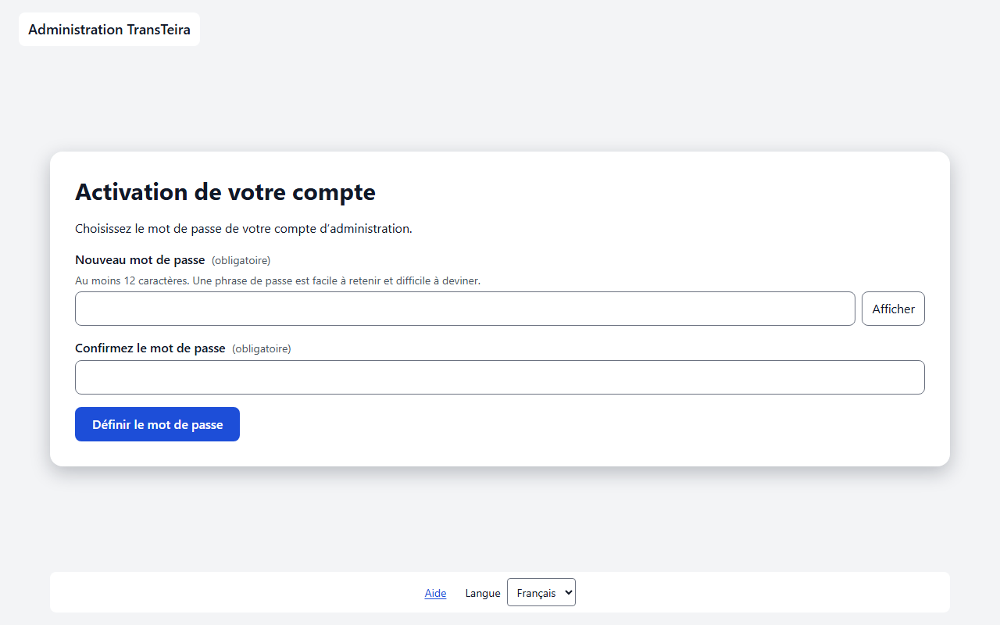

Si la page affiche **Lien d’activation invalide**, le lien a expiré, a déjà servi ou a été copié de façon incomplète. Demandez-en un nouveau à un super administrateur.

<!-- topic: login -->
## Se connecter

La page de connexion protège l’administration par votre identifiant, votre mot de passe et, s’il est activé, un second facteur.

Sur **Connexion à l’administration**, saisissez votre **Identifiant** et votre **Mot de passe**, puis cliquez sur **Se connecter**.

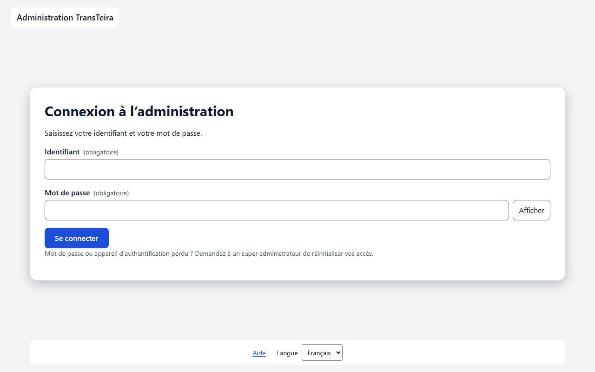

Si la double authentification est activée, une seconde étape **Double authentification** suit :

- saisissez le **Code d’authentification** à 6 chiffres affiché par votre application d’authentification (renouvelé toutes les 30 secondes), puis cliquez sur **Vérifier** ;
- si vous n’avez plus votre application, cliquez sur **Utiliser un code de secours** et saisissez l’un de vos codes de secours.

Cette seconde étape doit être terminée dans les 5 minutes. Si vous rechargez la page, vous recommencez depuis le début.

Contre les attaques par essais successifs, 5 échecs pour un même identifiant depuis une même adresse réseau en 15 minutes bloquent la connexion pendant 15 minutes ; la page affiche le temps restant. Les codes de second facteur erronés sont comptés de la même façon.

Votre session prend fin après 30 minutes d’inactivité, et dans tous les cas après 12 heures (valeurs par défaut, réglées par l’exploitant). Pour partir plus tôt, cliquez sur **Se déconnecter** dans la navigation principale.

> **À savoir** Mot de passe ou appareil perdu ? La page de connexion le rappelle : **Mot de passe ou appareil d’authentification perdu ? Demandez à un super administrateur de réinitialiser vos accès.** Le super administrateur vous remet alors un nouveau lien d’activation.

<!-- topic: admin-totp -->
## Double authentification

La double authentification protège votre compte même si votre mot de passe est divulgué : la connexion exige aussi un code généré par une application sur votre téléphone ou votre ordinateur.

Elle est obligatoire pour les super administrateurs et recommandée pour tous. Le super administrateur peut la rendre obligatoire pour votre compte, ce qui est le réglage par défaut des nouveaux comptes. Vous la configurez à la fin de l’activation, ou plus tard depuis [Mon compte](topic:account).

Sur **Configurer la double authentification** :

1. Installez une application d’authentification sur votre téléphone ou votre ordinateur (toute application compatible TOTP, ou votre gestionnaire de mots de passe).
2. Scannez le QR code. Si vous ne le pouvez pas, saisissez la **Clé de configuration** à la main dans l’application ; **Copier la clé** la copie.
3. Saisissez le code à 6 chiffres affiché par l’application dans **Code de confirmation**, puis cliquez sur **Activer la double authentification**.

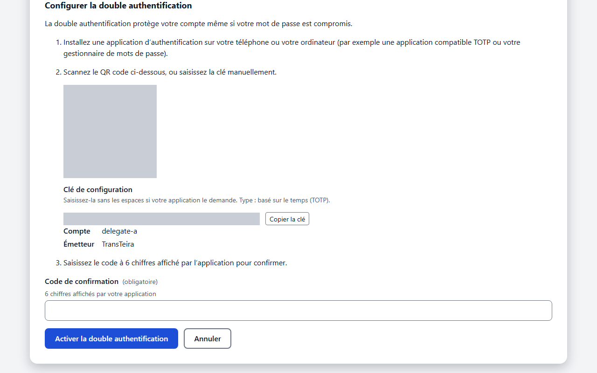

Si le code est refusé, vérifiez que l’horloge de votre appareil est à l’heure : les codes dépendent de l’heure.

<!-- topic: admin-recovery-codes -->
### Codes de secours

Les codes de secours vous permettent de vous connecter si vous perdez l’accès à votre application d’authentification.

Juste après la configuration, TransTeira affiche 8 codes de secours, une seule fois.

- Enregistrez-les avec **Copier tous les codes** ou **Télécharger (fichier texte)**.
- Conservez-les en lieu sûr, par exemple dans votre gestionnaire de mots de passe, mais pas à côté de votre téléphone.
- Enregistrez-les avant de quitter ou de recharger la page : une fois la page quittée, ils ne peuvent plus jamais être affichés.
- Cochez **J’ai enregistré ces codes de secours dans un endroit sûr.**, puis cliquez sur **Continuer**.

Chaque code ne sert qu’une fois. La configuration d’un nouvel appareil génère de nouveaux codes, et les précédents cessent de fonctionner.

<!-- topic: admin -->
## Page d’accueil

La page d’accueil donne une vue d’ensemble des entités que vous administrez.

Chaque entité dispose d’une carte avec :

- **Transferts (30 jours)** et **Volume déposé (30 jours)** ;
- **Stockage utilisé**, une jauge de l’espace occupé par rapport au quota, avec son niveau : **OK**, **Presque plein** à partir de 80 %, **Plein** à 100 % ;
- des liens rapides vers les transferts, le journal d’audit et les statistiques de l’entité.

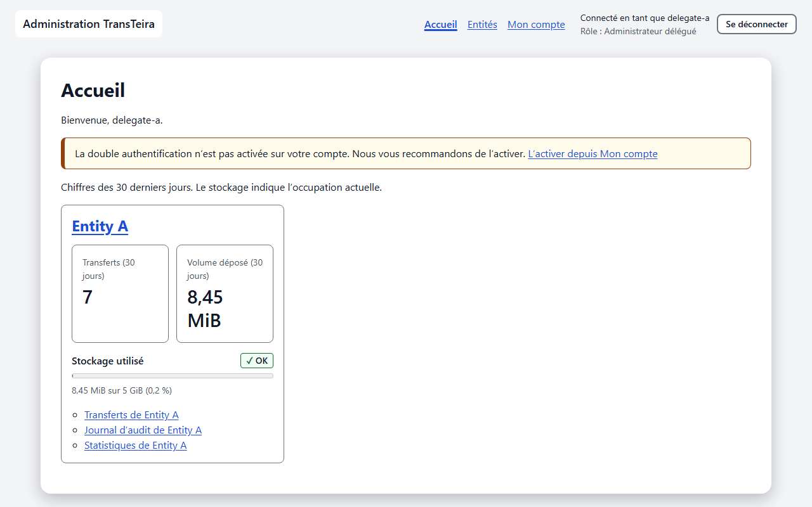

Si une carte ne parvient pas à charger ses chiffres, cliquez sur **Réessayer**.

Si la double authentification n’est pas activée sur votre compte, un bandeau la recommande, avec le lien **L’activer depuis Mon compte**. Si aucune entité n’est encore rattachée à votre compte, la page l’indique : demandez à un super administrateur de vous en rattacher une.

La navigation principale, en haut, comprend **Accueil**, **Entités**, **Mon compte** et **Se déconnecter**. Le pied de page contient le lien **Aide** et le sélecteur **Langue**, mémorisé dans ce navigateur.

<!-- topic: account -->
## Mon compte

Mon compte regroupe votre profil, votre mot de passe et votre second facteur.

- **Profil** affiche votre **Identifiant**, votre **Adresse électronique**, votre **Rôle** et vos **Entités**. L’adresse mail reçoit vos alertes ; demandez à un super administrateur de la modifier.
- **Changer de mot de passe** : saisissez votre **Mot de passe actuel**, puis deux fois le **Nouveau mot de passe**, et cliquez sur **Changer le mot de passe**. Vos autres sessions ouvertes sont fermées ; celle-ci reste active.
- **Double authentification** affiche son état.
- **Changer d’appareil d’authentification** : cliquez sur **Configurer un nouvel appareil**, saisissez votre mot de passe actuel, puis suivez les étapes décrites dans [Double authentification](topic:admin-totp) (si elle n’est pas encore activée, le bouton s’intitule **Activer la double authentification**). L’ancienne application cesse de fonctionner, de nouveaux [codes de secours](topic:admin-recovery-codes) remplacent les précédents et vos autres sessions sont fermées.
- **Désactiver la double authentification** : possible uniquement si elle n’est pas obligatoire pour votre compte. Sinon, la demande est refusée avec **La double authentification est obligatoire pour votre compte : elle ne peut pas être désactivée.**

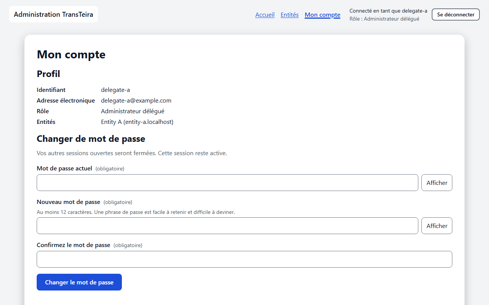

<!-- topic: tenants -->
## Entités

La page **Entités** liste les entités que vous administrez, chacune avec son adresse, son habillage et sa configuration propres.

Les colonnes indiquent le **Nom**, l’**Adresse (FQDN)** de ses pages publiques, le **Statut**, le **Stockage utilisé** et la **Langue par défaut**. Cliquez sur le nom, ou sur **Configurer** suivi du nom, pour ouvrir une entité. Si une seule entité est rattachée à votre compte, cette page vous y mène directement.

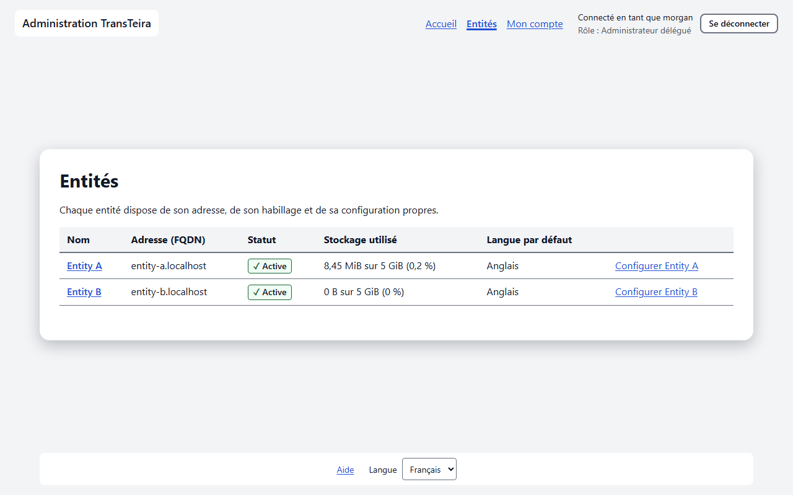

La création et la suppression d’une entité sont réservées au super administrateur : ces actions ne vous sont pas proposées.

<!-- topic: tenant-nav -->
### Navigation d’une entité

Une fois une entité ouverte, une barre de navigation affiche son nom et deux groupes d’écrans.

- **Configuration** : **Général**, **Habillage**, **Réseau**, **Domaines destinataires**, **Niveaux de confidentialité**, **Messagerie (SMTP)**, **Modèles de mails**, **Mentions légales**.
- **Exploitation** : **Transferts**, **Invitations**, **Liste de blocage**, **Jetons d’API**, **Webhooks**, **Journal d’audit**, **Statistiques**, **Données personnelles**.

Les filtres des listes sont conservés dans l’adresse de la page : vous pouvez mettre une vue filtrée en favori ou la partager avec un autre administrateur de l’entité. Les longues listes affichent leurs premières lignes ; cliquez sur **Charger plus** pour voir la suite. Si vous quittez un formulaire avec des modifications non enregistrées, l’administration vous demande d’abord confirmation.

## Configurer une entité

Les écrans de configuration déterminent l’apparence et le comportement des pages publiques de l’entité. Les modifications s’appliquent immédiatement aux pages publiques, et chacune est enregistrée dans le [journal d’audit](topic:tenant-audit).

<!-- topic: tenant-general -->
### Général

L’écran Général présente l’identité de l’entité et permet de régler sa langue et sa taille par envoi.

En haut, le statut de l’entité et la ligne **Stockage utilisé** indiquent l’espace occupé par rapport au quota. Le nom, l’adresse (FQDN), le quota de stockage et le plafond de la taille par envoi sont affichés pour information : comme le rappelle l’écran, **Seuls la langue par défaut et la taille maximale par envoi peuvent être modifiés par un administrateur délégué. Les autres réglages sont gérés par le super administrateur.**

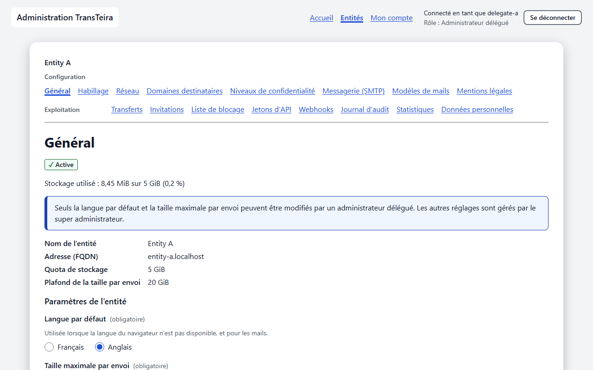

- **Langue par défaut** : utilisée sur les pages publiques lorsque la langue du navigateur du visiteur n’est pas disponible, et pour les mails.
- **Taille maximale par envoi** : somme des fichiers d’un envoi. Vous pouvez choisir toute valeur jusqu’au plafond fixé par le super administrateur, lui-même de 20 Go au plus. Abaissez-la si vos utilisateurs ne doivent pas envoyer de très gros transferts.

Cliquez sur **Enregistrer** pour appliquer.

La section **Webhooks** ci-dessous règle le contenu des alertes envoyées aux [webhooks](topic:tenant-webhooks) de l’entité. **Inclure les adresses dans les webhooks** ajoute les adresses de l’expéditeur et des destinataires concernés. Les adresses sont des données personnelles qui quittent TransTeira avec chaque alerte : cochez la case seulement si les destinataires en ont besoin et sont de confiance. Elle est décochée par défaut ; cliquez sur **Enregistrer le réglage des webhooks** sous la case pour appliquer.

<!-- topic: tenant-branding -->
### Habillage

L’écran Habillage règle le logo, les couleurs et l’image de fond des pages publiques.

**Couleurs** : choisissez la **Couleur principale** (boutons et éléments actifs) et la **Couleur d’accent** (liens et éléments secondaires) avec le sélecteur, ou saisissez leur code au format #RRGGBB, par exemple #1A5FB4. Cliquez sur **Enregistrer**.

La section **Contraste** contrôle chaque paire de couleurs utilisée par l’interface. Le rapport doit atteindre au moins 4,5:1 (niveau AA) pour que les textes restent lisibles. Une paire marquée **Insuffisant** est un avertissement : l’enregistrement reste possible, mais corrigez-la pour respecter les exigences d’accessibilité (RGAA). L’**Aperçu de la page publique** montre le résultat avant l’enregistrement.

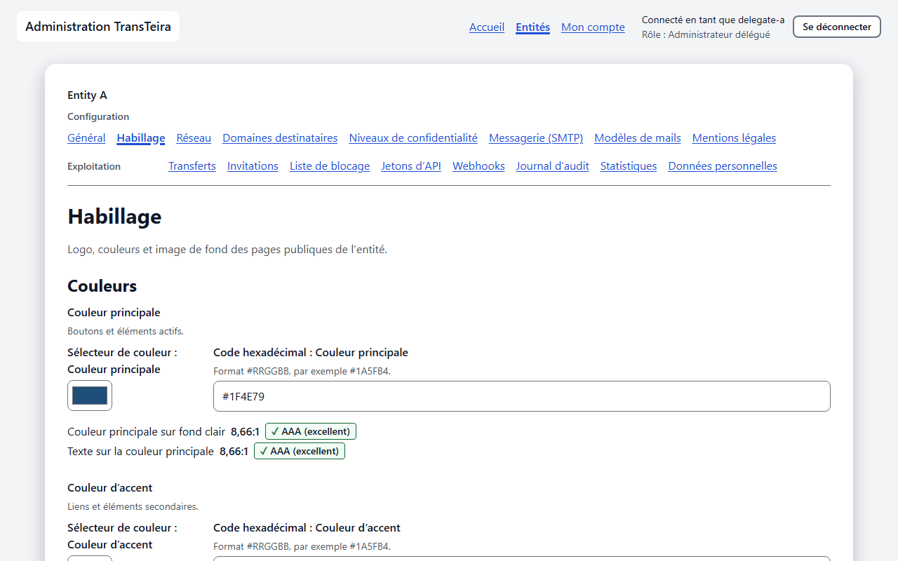

**Logo** (affiché en haut des pages publiques) et **Image de fond** (affichée en plein écran derrière la zone de dépôt) :

1. Cliquez sur **Choisir une image** et sélectionnez un fichier PNG, JPEG ou WebP : 5 Mo au plus pour le logo, 10 Mo pour l’image de fond.
2. Vérifiez l’aperçu, puis cliquez sur **Envoyer l’image**.
3. Pour retirer une image, cliquez sur **Supprimer l’image**.

Chaque image est réencodée par TransTeira, ce qui supprime ses métadonnées et tout contenu caché. Les fichiers SVG sont refusés. Une très grande photo peut être refusée à cause de ses dimensions : réduisez-la à 3840 pixels sur son plus grand côté (convertissez d’abord une image WebP en JPEG). Sans image de fond, une image par défaut est utilisée.

<!-- topic: tenant-network -->
### Réseau

L’écran Réseau définit qui est considéré comme utilisateur interne de l’entité.

Un utilisateur est interne lorsque les **deux** conditions sont réunies : son adresse IP appartient à l’une des plages internes **et** son adresse mail appartient à l’un des domaines internes. Seuls les internes peuvent envoyer librement des fichiers et inviter des personnes externes ; les autres ont besoin d’une invitation.

- **Plages d’adresses IP internes** : une plage par ligne au format CIDR, par exemple `192.0.2.0/24` ou `2001:db8::/32`.
- **Domaines de messagerie internes** : un domaine par ligne, par exemple `entity-a.example.com`.

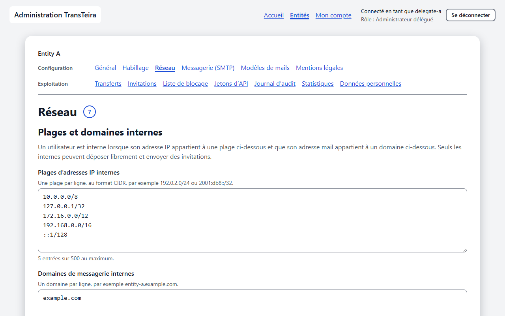

Les erreurs sont signalées ligne par ligne, parfois avec une correction proposée que vous pouvez appliquer. Les lignes répétées sont ignorées, et le serveur normalise les valeurs qu’il enregistre (les listes affichées après l’enregistrement sont celles enregistrées). Cliquez sur **Enregistrer**.

Soyez attentif aux avertissements :

- une liste de plages ou de domaines vide signifie que personne n’est interne : seules les invitations permettront de déposer ;
- une plage couvrant toutes les adresses, comme `0.0.0.0/0`, signifie que tout utilisateur d’un domaine interne pourra déposer depuis n’importe où.

TransTeira voit l’adresse du client telle que la transmet le reverse proxy. Si vous ne savez pas quelles plages saisir (sites, VPN, adresses de sortie), demandez à l’exploitant du service.

<!-- topic: tenant-recipient-rules -->
### Domaines destinataires

L’écran Domaines destinataires limite les domaines de messagerie que les expéditeurs peuvent adresser, par exemple pour éviter que des fichiers partent vers des messageries personnelles grand public.

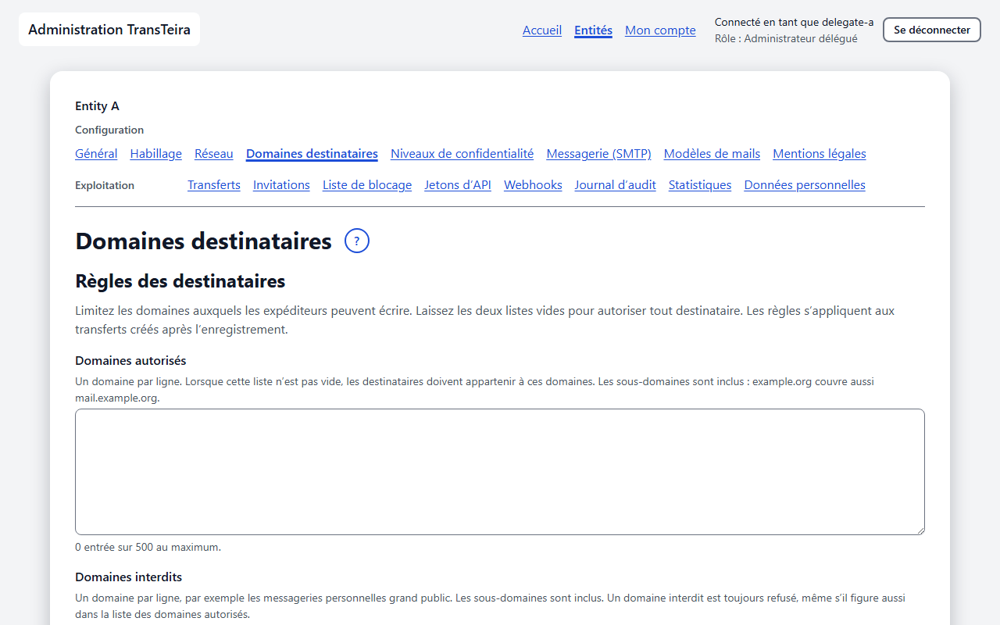

- **Domaines autorisés** : un domaine par ligne. Quand cette liste n’est pas vide, les destinataires ne peuvent appartenir qu’à ces domaines.
- **Domaines interdits** : un domaine par ligne. Un domaine interdit est toujours refusé.

Une règle sur un domaine couvre aussi ses sous-domaines : `example.org` couvre `mail.example.org`. Si un domaine figure dans les deux listes, il est interdit, car l’interdiction l’emporte. Laissez les deux listes vides pour autoriser tous les destinataires. Chaque liste compte 500 entrées au plus ; le serveur enregistre les domaines en minuscules, sans doublons, et affiche les valeurs enregistrées. L’écran avertit lorsqu’un domaine est dans les deux listes et lorsqu’une liste d’autorisations non vide restreint les destinataires. Cliquez sur **Enregistrer**.

Les règles s’appliquent à tout nouveau transfert, qu’il soit envoyé depuis la page web ou avec un jeton d’API. Un transfert adressé à un domaine refusé n’est pas créé : l’expéditeur voit un message qui nomme les adresses refusées, et le refus est enregistré dans le [journal d’audit](topic:tenant-audit) avec les domaines refusés. Il n’est pas écrit dans le journal de sécurité. Les transferts déjà créés ne sont pas touchés.

<!-- topic: tenant-confidentiality -->
### Niveaux de confidentialité

L’écran Niveaux de confidentialité définit les niveaux parmi lesquels l’expéditeur choisit en créant un transfert. Chaque niveau impose ses propres règles. Vous pouvez définir de 1 à 10 niveaux, avec exactement un **Niveau par défaut**, appliqué quand l’expéditeur n’en choisit pas. Avec un seul niveau, l’expéditeur ne voit aucun sélecteur, mais les règles du niveau s’appliquent quand même.

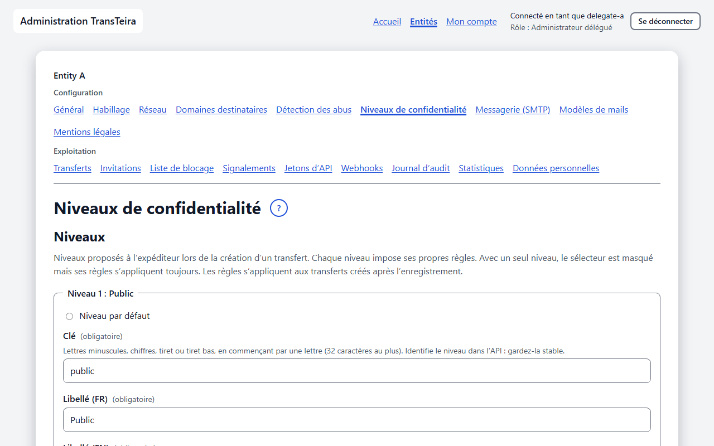

Pour chaque niveau, renseignez :

- **Clé** : lettres minuscules, chiffres, tiret ou tiret bas, en commençant par une lettre (32 caractères au plus). Elle identifie le niveau dans l’API : gardez-la stable.
- **Libellé** en français et en anglais (50 caractères au plus), et une **Description** facultative dans chaque langue (500 caractères au plus), affichée à l’expéditeur sous le niveau.
- **Règles** (chacune est un champ distinct) :
- **Durées disponibles** : les durées parmi 1, 7 et 30 jours que l’expéditeur peut choisir (au moins une).
- **Mot de passe obligatoire**.
- **Vérification du destinataire obligatoire**. Cette règle est enregistrée mais pas encore appliquée : elle prendra effet avec les liens propres à chaque destinataire.
- **Destinataires internes uniquement** : les destinataires doivent appartenir aux domaines internes de l’entité (voir [Réseau](topic:tenant-network)).
- **Suppression après le premier téléchargement (imposée)**.
- **Nombre maximal de téléchargements (plafond)** : facultatif, de 1 à 1000. Il plafonne le nombre de téléchargements que l’expéditeur peut fixer ; si l’expéditeur n’en fixe aucun, le plafond s’applique.

Utilisez les flèches pour réordonner les niveaux, **Ajouter un niveau** pour en créer un et **Enregistrer** pour appliquer. L’écran signale les erreurs niveau par niveau.

Un transfert qui enfreint une règle de son niveau est refusé, quel que soit le moyen de création (page web ou jeton d’API), et l’expéditeur est informé de la règle non respectée. Les règles du niveau sont copiées sur chaque transfert à sa création : modifier ou supprimer un niveau ne change jamais les transferts existants. Le niveau d’un transfert est montré aux destinataires dans le mail et sur la page de téléchargement, dans le détail du transfert (voir [Transferts](topic:tenant-transfers)) et dans le [journal d’audit](topic:tenant-audit).

> **Note** Vérifiez les règles du niveau par défaut : elles s’appliquent à tout expéditeur qui ne choisit pas de niveau.

<!-- topic: tenant-smtp -->
### Messagerie (SMTP)

L’écran Messagerie (SMTP) règle le serveur par lequel l’entité envoie tous ses mails : codes de vérification, notifications, invitations et alertes.

Tant qu’il n’est pas configuré, l’écran affiche **La messagerie n’est pas encore configurée : l’entité ne peut envoyer aucun mail.** et personne ne peut faire vérifier son adresse.

- **Serveur SMTP** : nom d’hôte ou adresse IP, par exemple `smtp.example.com`.
- **Port** et **Sécurité de la connexion** : **Aucune (relais sur un réseau interne)**, **STARTTLS (port 587 en général)** ou **TLS implicite (port 465 en général)**. Ne choisissez Aucune que pour un relais joignable par le réseau interne du service.
- **Nom d’utilisateur** : laissez-le vide pour un relais sans authentification. L’authentification est refusée sans chiffrement, car les identifiants circuleraient en clair.
- **Mot de passe** : **Conserver le mot de passe enregistré**, **Remplacer le mot de passe** ou **Retirer le mot de passe**. Il est chiffré et n’est jamais réaffiché. Si vous changez le serveur, le port ou le nom d’utilisateur, ressaisissez-le.
- **Adresse d’expéditeur** : l’adresse « De » des mails, par exemple `transfer@entity-a.example.com`.
- **Nom d’expéditeur** : facultatif, le nom de l’entité par défaut.

Cliquez sur **Enregistrer**.

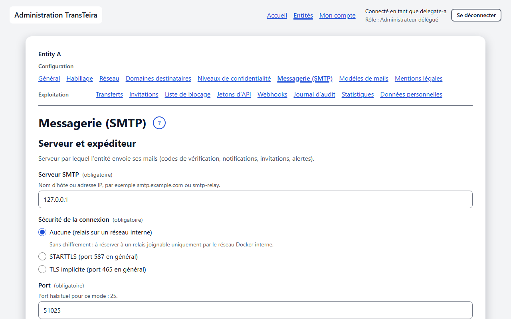

**Test d’envoi** : le test utilise la configuration enregistrée, enregistrez donc d’abord. Saisissez une **Adresse de destination** et cliquez sur **Envoyer un mail de test**. Le résultat indique si le serveur a accepté le message ou, sinon, l’étape atteinte (connexion, TLS, authentification…) et le message du serveur. Vous pouvez faire 5 tests par tranche de 10 minutes.

**Contrôle DNS (SPF, DKIM, DMARC)** : sans ces enregistrements DNS sur le domaine de l’adresse d’expéditeur, les mails risquent d’être classés comme indésirables. Les sélecteurs DKIM ne peuvent pas être découverts automatiquement : saisissez-en jusqu’à 5 dans **Sélecteurs DKIM** (par exemple `selector1, selector2` pour Microsoft 365), puis cliquez sur **Contrôler le DNS**. Chaque enregistrement est signalé **Correct**, **À vérifier**, **Absent** ou **Erreur de contrôle**. Le contrôle est indicatif.

> **À savoir** Avec un relais vers Microsoft 365, DKIM doit être activé dans Microsoft 365 pour le domaine de l’entité, et l’adresse d’expéditeur doit être autorisée dans l’application utilisée par le relais. Demandez à l’exploitant du service de le vérifier.

<!-- topic: tenant-templates -->
### Modèles de mails

L’écran Modèles de mails permet de personnaliser, pour chaque langue, les mails envoyés par l’entité.

La liste présente chaque modèle dans chaque langue, marqué **Personnalisé** ou **Par défaut**. Un modèle non personnalisé utilise le texte par défaut. Les modèles sont :

- **Code de vérification**, **Notification de transfert**, **Confirmation d’envoi**, **Accusé de premier téléchargement** ;
- **Fichier infecté ou retenu**, **Fichier non analysé**, **Invitation externe** ;
- **Alerte de quota (80 %)**, **Quota atteint**, **Antivirus indisponible**.

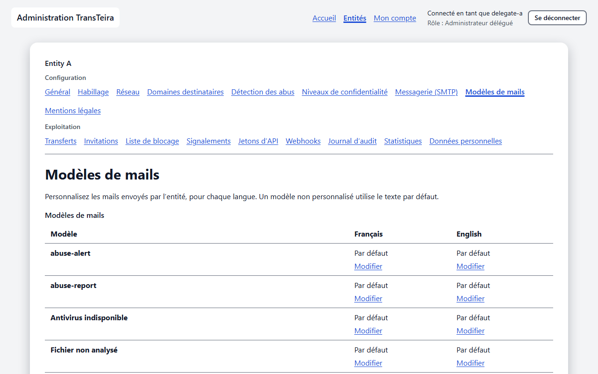

Cliquez sur un modèle pour ouvrir l’éditeur. Il comporte trois champs : **Objet**, **Corps HTML** et **Corps texte** (version en texte brut, lue par les messageries qui n’affichent pas le HTML).

- **Variables disponibles** : cliquez sur une variable pour l’insérer à la position du curseur, dans le dernier champ utilisé. Les variables s’écrivent entre doubles accolades, par exemple `{{download_link}}`. Les variables marquées obligatoires doivent figurer dans les deux corps ; une variable absente ou inconnue est signalée.
- Par sécurité, le HTML est filtré : pas de scripts, pas d’images distantes, et uniquement des liens https et mailto.
- **Prévisualiser** affiche le mail avec des données d’exemple, sans ses styles et avec les images remplacées par leur description.
- **Enregistrer le modèle** l’enregistre ; **Revenir au modèle par défaut** supprime votre personnalisation pour cette langue.

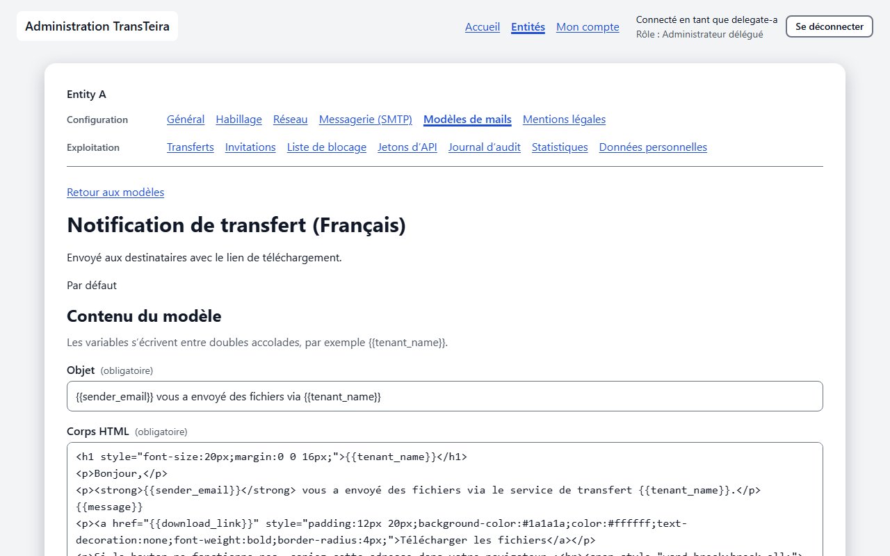

Si le serveur détecte une erreur, il indique le champ, la ligne et la colonne, avec un message rédigé en anglais. Si un modèle personnalisé échoue au moment de l’envoi, le modèle par défaut est utilisé à sa place : le mail part quand même.

<!-- topic: tenant-legal -->
### Mentions légales

L’écran Mentions légales contient les textes affichés sur la page d’informations légales de l’entité.

Il y a deux documents, **Mentions légales** et **Politique de confidentialité**, dans chaque langue, marqués **Rédigé** ou **Non rédigé**.

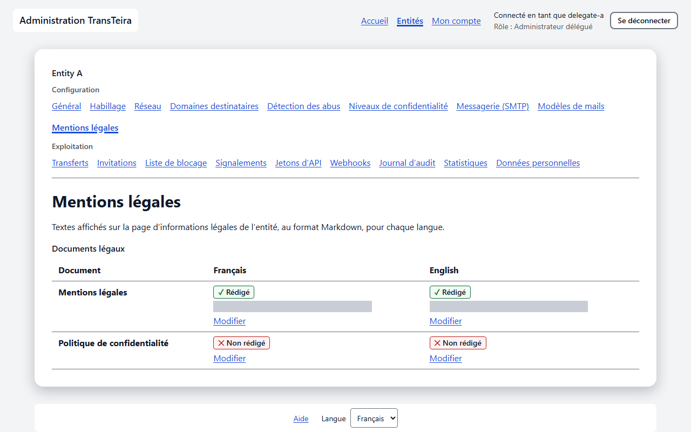

Cliquez sur un document pour le modifier dans **Texte (Markdown)** : titres avec `#`, listes avec `-`, liens avec `[texte](adresse)` (adresses https et mailto uniquement). Le HTML n’est pas interprété. Cliquez sur **Enregistrer** ; l’**Aperçu** montre le texte enregistré. Enregistrer un texte vide supprime le document, après confirmation.

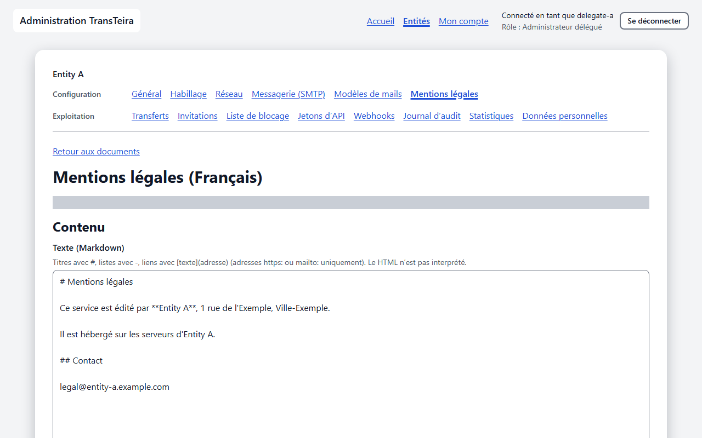

Les visiteurs voient le document dans leur langue, ou dans la langue par défaut de l’entité s’il n’est pas rédigé dans la leur. Un document absent est signalé comme non publié.

## Exploiter une entité

Les écrans d’exploitation permettent de suivre l’activité quotidienne de l’entité et d’agir sur elle. Les listes peuvent être filtrées et affichent les éléments les plus récents en premier.

<!-- topic: tenant-transfers -->
### Transferts

L’écran Transferts liste les transferts de l’entité, pour les suivre, renvoyer leur notification ou les supprimer avant leur expiration.

Filtrez par **Statut**, par **Adresse mail** (adresse exacte de l’expéditeur ou d’un destinataire) ou par **Créés depuis le**, puis cliquez sur **Appliquer** ; **Réinitialiser** efface les filtres. Les colonnes indiquent **Création**, **Expéditeur**, **Destinataires**, **Fichiers et taille**, **Statut**, **Origine**, **Téléchargements** et **Expiration**.

- Statuts : **Envoi en cours**, **Analyse en cours**, **Disponible**, **Rejeté**, **Expiré**, **Supprimé**.
- Origines : **Utilisateur interne**, **Invité externe** (dépôt par une invitation), **Jeton d’API**.

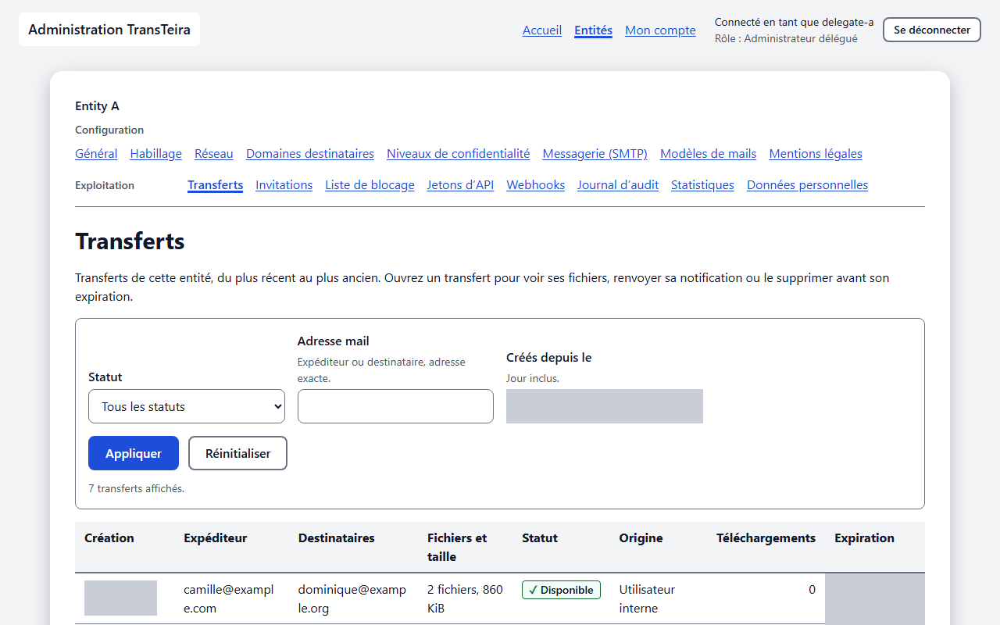

Ouvrez un transfert pour voir son **Détail du transfert** : statut, dates, premier téléchargement, expéditeur et adresse IP de l’expéditeur, origine, options (dont le **Niveau de confidentialité** et le nombre de téléchargements, affiché sur le maximum autorisé quand l’expéditeur en a fixé un), destinataires, et les fichiers avec leur taille, leur empreinte SHA-256 et le résultat de l’antivirus. Chaque nouveau transfert donne à chaque destinataire un lien personnel : le détail montre donc, pour chaque destinataire, quels fichiers ont été téléchargés et quand (premier et dernier téléchargement), jamais son adresse IP ni son navigateur. Les transferts créés avant la version 1.1 gardent un lien unique partagé et n’ont pas ce suivi. Le contenu des fichiers et les liens de téléchargement ne sont jamais accessibles aux administrateurs.

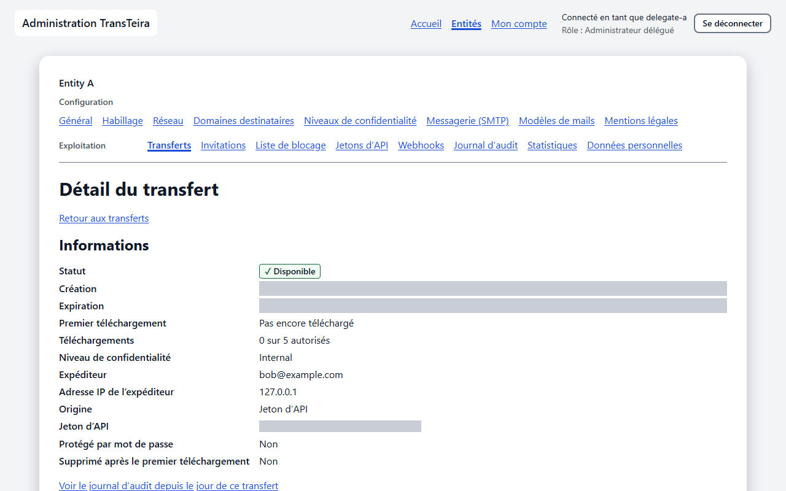

- **Renvoyer la notification** : choisissez les destinataires et cliquez sur **Renvoyer**. Le mail est renvoyé et chaque destinataire reçoit de nouveau son propre lien personnel, 5 fois par heure au plus. La veille de l’expiration d’un transfert, les destinataires qui n’ont pas encore téléchargé reçoivent automatiquement un mail de rappel (pas pour les transferts valables un jour, ni pour les adresses bloquées).
- **Supprimer le transfert** : saisissez éventuellement un **Motif (facultatif)**, enregistré dans le journal d’audit, puis confirmez. Les fichiers sont effacés définitivement, y compris des sauvegardes, car leurs clés de chiffrement sont détruites. Le lien de téléchargement cesse de fonctionner.
- **Voir le journal d’audit depuis le jour de ce transfert** ouvre le journal d’audit au jour de sa création.

<!-- topic: tenant-invitations -->
### Invitations

L’écran Invitations liste les invitations émises par les utilisateurs internes pour que des personnes externes puissent leur déposer des fichiers.

Les colonnes indiquent l’**Adresse invitée**, **Invitée par**, le **Statut** (**En attente**, **Utilisée**, **Expirée**, **Révoquée**) et les dates de création, d’expiration et de dernière utilisation. Une invitation est valable 12 mois après sa création ou sa dernière utilisation, la date la plus tardive l’emportant.

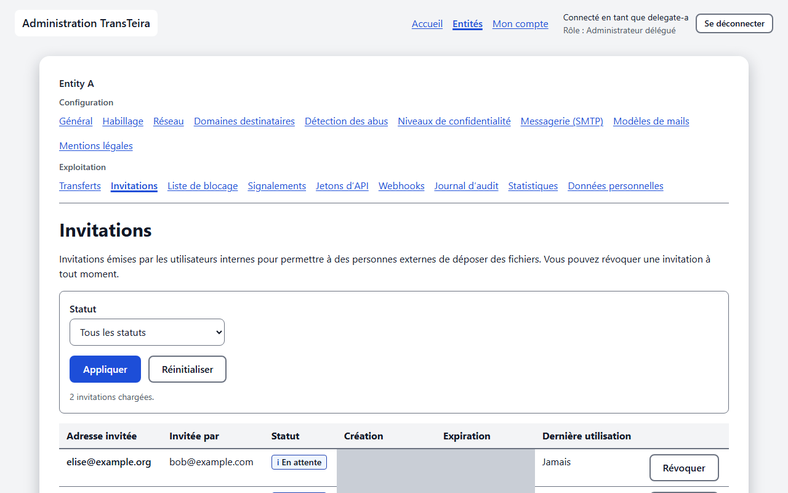

Cliquez sur **Révoquer** pour arrêter immédiatement une invitation : son lien ne permet plus de déposer, et les dépôts déjà commencés avec elle prennent fin. C’est définitif, mais une nouvelle invitation pourra être envoyée plus tard.

<!-- topic: tenant-blocklist -->
### Liste de blocage

L’écran Liste de blocage empêche des adresses, des domaines ou des fichiers d’être déposés sur l’entité.

Dans **Ajouter une entrée**, choisissez le **Type** (**Adresse mail**, **Domaine** ou **Empreinte SHA-256**), saisissez la **Valeur**, éventuellement un **Commentaire (facultatif)** pour les autres administrateurs (sans données personnelles inutiles), puis cliquez sur **Ajouter**. Une adresse ou un domaine bloqué ne peut plus déposer ; un fichier dont l’empreinte est bloquée est refusé. Cliquez sur **Retirer** pour lever un blocage.

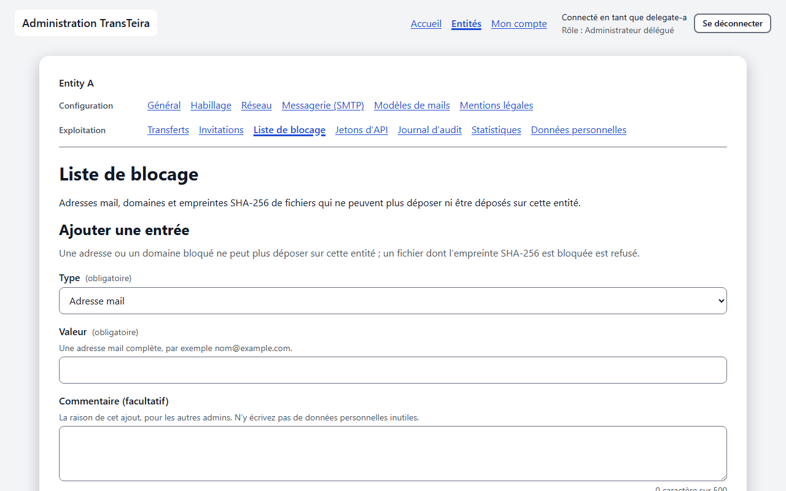

Pour bloquer un fichier, copiez son empreinte depuis le détail du transfert (voir [Transferts](topic:tenant-transfers)). Les entrées de la liste de blocage sont volontairement conservées après un effacement de données personnelles, pour ne pas débloquer un abus.

<!-- topic: tenant-tokens -->
### Jetons d’API

Les jetons d’API permettent à des scripts et à des logiciels tiers de déposer des fichiers par l’API de TransTeira, sans qu’une personne fasse vérifier son adresse.

La liste indique pour chaque jeton : **Nom**, **Préfixe**, **Plages IP autorisées**, **Expéditeurs autorisés**, **Création**, **Dernière utilisation**, **Expiration** et **Statut**.

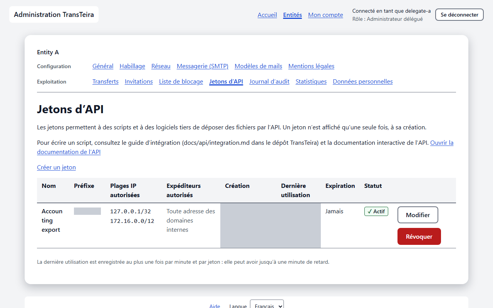

Pour en créer un, cliquez sur **Créer un jeton** :

1. **Nom** : l’usage du jeton, par exemple « Export nocturne de l’ERP ».
2. **Plages IP autorisées** : les adresses depuis lesquelles le script se connecte, vues derrière le reverse proxy, par exemple `192.0.2.10/32` (même notation que sur l’écran [Réseau](topic:tenant-network)). **Autoriser toute adresse** est possible mais déconseillé.
3. **Expéditeurs autorisés** : les adresses ou domaines au nom desquels le script peut déposer. Avec une liste vide, le jeton peut déposer au nom de n’importe quelle adresse des domaines internes : restreignez-le.
4. **Date d’expiration (facultative)** : aucune par défaut ; le jeton fonctionne alors jusqu’à sa révocation.
5. Cliquez sur **Créer le jeton**.

Le secret du jeton n’est affiché **qu’une seule fois**. Cliquez sur **Copier le secret**, cochez **J’ai conservé ce secret, il ne sera plus affiché**, puis **Fermer**. Transmettez-le à la personne responsable du script par un canal de confiance, jamais en clair par mail.

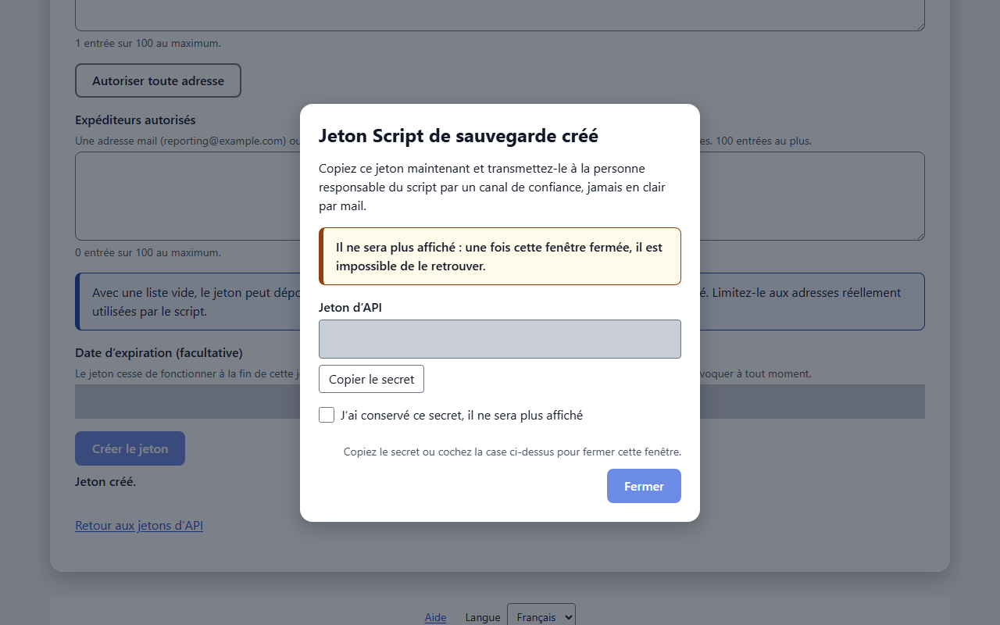

**Modifier** change le nom, les plages et les expéditeurs (pas l’expiration : créez plutôt un nouveau jeton). **Révoquer** refuse dès maintenant toute requête faite avec le jeton ; c’est définitif, et les transferts déjà créés restent disponibles pour leurs destinataires. Pour écrire un script, consultez le guide d’intégration `docs/api/integration.md` dans le dépôt TransTeira et cliquez sur **Ouvrir la documentation de l’API**.

<!-- topic: tenant-webhooks -->
### Webhooks

Les webhooks envoient les alertes de l’entité vers un canal Microsoft Teams ou Slack, ou vers tout destinataire qui accepte du JSON (un SIEM, un script), en plus des mails d’alerte.

La liste indique, pour chaque webhook, son **Nom et adresse** (seulement le schéma et l’hôte de l’adresse : l’adresse complète est conservée chiffrée et n’est plus jamais affichée), son **Type**, ses **Événements**, son **État** et son **Dernier envoi** (remis ou en échec, le statut HTTP ou la cause, la durée et la date). Une entité peut avoir 20 webhooks au plus.

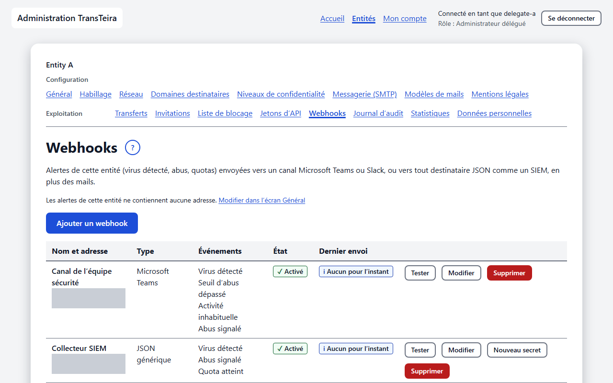

Pour en ajouter un, cliquez sur **Ajouter un webhook** :

1. **Nom** : ce qu’est le destinataire, par exemple « Canal de l’équipe sécurité ».
2. **Type** : **Microsoft Teams** ou **Slack** pour le webhook entrant d’un canal (un message mis en forme), **JSON générique** pour tout autre destinataire (un document JSON signé avec un secret).
3. **Adresse (URL)** : l’adresse `https://` complète fournie par le destinataire. Une adresse dont le nom d’hôte ne peut pas être résolu est refusée (**Cette adresse n’est pas autorisée**), comme les adresses de réseaux privés ou réservés, sauf si l’exploitant de l’instance les a autorisées. Vous pouvez créer des webhooks ou saisir de nouvelles adresses 30 fois par heure ; au-delà, le formulaire indique combien de temps attendre.
4. **Événements** : **Virus détecté**, **Seuil d’abus dépassé**, **Activité inhabituelle**, **Abus signalé**, **Quota à 80 %** et **Quota atteint**. Choisissez-en au moins un.
5. Laissez **Activé** coché, puis cliquez sur **Créer le webhook**.

Pour un webhook **JSON générique**, le secret de signature est affiché **une seule fois** : copiez-le dans la configuration du destinataire, qui s’en sert pour vérifier l’en-tête `X-TransTeira-Signature` de chaque requête (voir `docs/api/integration.md` dans le dépôt de TransTeira). Cochez ensuite **J’ai conservé ce secret, il ne sera plus affiché** et cliquez sur **Fermer**.

Les actions de chaque webhook :

- **Tester** envoie aussitôt un événement de test et affiche le résultat au-dessus de la liste : remis, avec le statut HTTP et la durée, ou en échec, avec une cause succincte (**Nom non résolu**, **Adresse refusée par les règles réseau**, **Échec de la connexion**, **Erreur TLS**, **Pas de réponse en 10 secondes**, **Réponse en erreur**). Un test n’est pas un envoi : il ne modifie ni la colonne **Dernier envoi** ni une suspension. Vous pouvez faire 10 tests par heure.
- **Modifier** change le nom, les événements et **Activé**, ou remplace l’adresse : laissez **Nouvelle adresse (URL)** vide pour conserver l’actuelle. Le type ne peut pas être changé.
- **Nouveau secret** (webhooks génériques) remplace le secret de signature : l’ancien cesse aussitôt de fonctionner, et le nouveau est affiché une seule fois.
- **Supprimer** retire le webhook et détruit son adresse et son secret chiffrés.

Supprimer ou désactiver un webhook, ou lui retirer un événement, arrête aussitôt les envois encore en attente pour lui. Après un changement d’adresse ou de secret, les alertes en cours partent vers la nouvelle adresse avec le nouveau secret, jamais vers l’ancienne adresse.

Après 5 envois en échec consécutifs, un webhook est **Suspendu** pendant 15 minutes : la liste indique jusqu’à quand. Corrigez le destinataire et vérifiez-le avec **Tester** (un test ne met pas fin à la suspension) ; le désactiver puis le réactiver dans **Modifier** reprend les envois aussitôt. Chaque envoi fait jusqu’à 5 tentatives ; les alertes en attente sont perdues si le service redémarre, mais les mails et le [journal d’audit](topic:tenant-audit) n’en dépendent pas.

Les alertes ne contiennent jamais de nom de fichier, de lien vers un transfert ni de mot de passe. Elles ne contiennent pas non plus d’adresse mail, sauf si **Inclure les adresses dans les webhooks** est coché dans l’écran [Général](topic:tenant-general).

<!-- topic: tenant-audit -->
### Journal d’audit

L’écran Journal d’audit présente les actions enregistrées pour l’entité au cours des 12 derniers mois : dépôts, téléchargements, invitations, actions des administrateurs, etc.

Filtrez par **Action** (regroupées par thème), par **Acteur** (adresse mail exacte ou identifiant d’administrateur) et par période avec **Du** et **Au**. Les colonnes indiquent la **Date**, l’**Acteur**, l’**Action**, l’**Objet**, l’**Adresse IP** et les **Détails** (cliquez sur **Afficher les détails**). Lorsque l’objet est un transfert, un lien ouvre son détail.

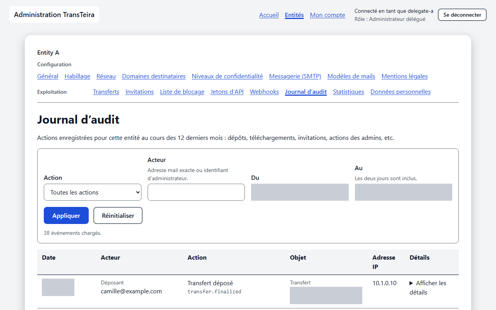

Une adresse effacée à la demande de la personne concernée apparaît sous la forme d’un pseudonyme commençant par `erased-`.

<!-- topic: tenant-stats -->
### Statistiques

L’écran Statistiques présente l’activité de l’entité sur une période.

Choisissez la **Période** : **7 derniers jours**, **30 derniers jours** ou **12 derniers mois**. Les **Chiffres clés** donnent les **Transferts déposés**, le **Volume déposé**, les **Téléchargements**, le **Volume téléchargé** et les **Virus détectés** ; le stockage occupé est aussi affiché, avec des graphiques par jour ou par mois. Chaque graphique dispose d’un bouton **Afficher le tableau des données** pour une version lisible. Les chiffres sont indicatifs : les compteurs sont mis à jour environ toutes les 30 secondes.

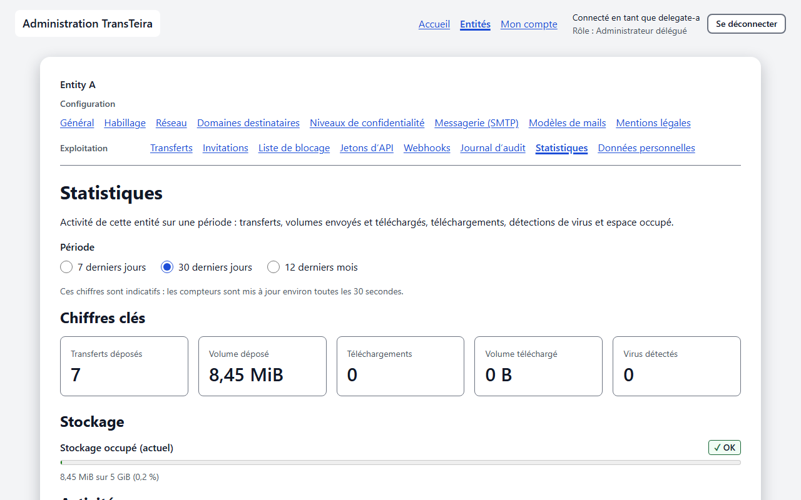

Le quota de stockage est fixé par le super administrateur. Lorsque l’entité atteint 80 % de son quota, les administrateurs délégués reçoivent un mail d’alerte ; à 100 %, ils en reçoivent un autre et les nouveaux dépôts sont refusés jusqu’à ce que de l’espace soit libéré par expiration ou suppression. Chaque alerte n’est envoyée qu’une fois par franchissement du seuil.

<!-- topic: tenant-privacy -->
### Données personnelles (RGPD)

L’écran Données personnelles répond aux demandes des personnes qui veulent connaître ou effacer les données liées à leur adresse mail dans l’entité (exercice des droits, RGPD).

Dans **Recherche par adresse mail**, saisissez l’**Adresse mail** et cliquez sur **Rechercher**. La section **Données trouvées dans cette entité** résume ce qui y est lié : adresse vérifiée, transferts envoyés et reçus, invitations, entrées du journal d’audit.

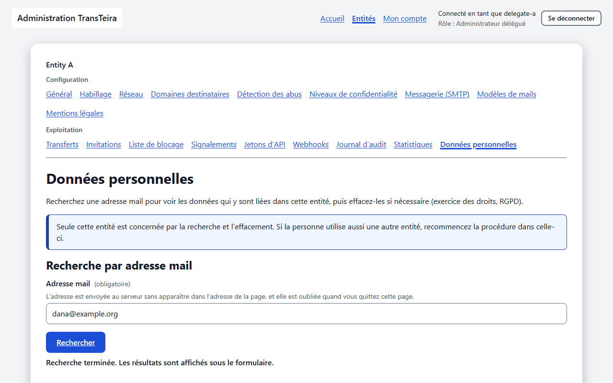

Cliquez sur **Effacer toutes les données** pour les effacer. L’écran détaille l’effet :

- effacé : les codes de vérification, les sessions de dépôt et l’adresse vérifiée ; les transferts envoyés par l’adresse ou grâce à une invitation qu’elle a reçue (fichiers rendus illisibles puis supprimés) ; l’adresse dans les transferts reçus (un transfert qui n’a plus de destinataire est supprimé) ; les invitations reçues (supprimées) et émises (révoquées) ; dans le journal d’audit, l’adresse est remplacée par un pseudonyme ;
- conservé volontairement : les entrées de la liste de blocage, l’adresse dans les expéditeurs autorisés d’un jeton d’API (modifiez le jeton pour la retirer), les adresses IP du journal d’audit jusqu’à la fin de leurs 12 mois, les mails déjà en file d’envoi, et les sauvegardes, dont les copies des fichiers deviennent illisibles.

L’effacement est irréversible. Il se termine par un **Rapport d’effacement**. Seule cette entité est concernée : si la personne utilise aussi une autre entité, recommencez la procédure dans celle-ci.

## Mails que vous recevez

En tant qu’administrateur délégué, vous recevez à l’adresse mail de votre compte les alertes de quota de vos entités : une lorsque 80 % du quota de stockage est atteint, une lorsque le quota est plein. Elles partent par le serveur de messagerie de l’entité : veillez donc au bon fonctionnement de sa [Messagerie (SMTP)](topic:tenant-smtp). Vous pouvez adapter leur texte dans les [Modèles de mails](topic:tenant-templates).
