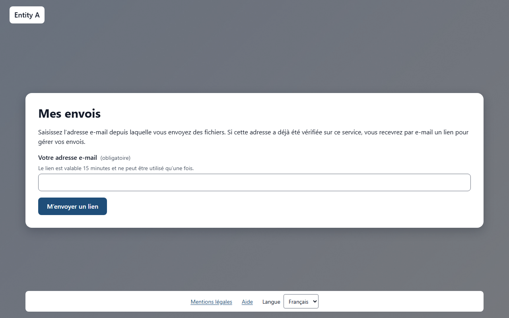
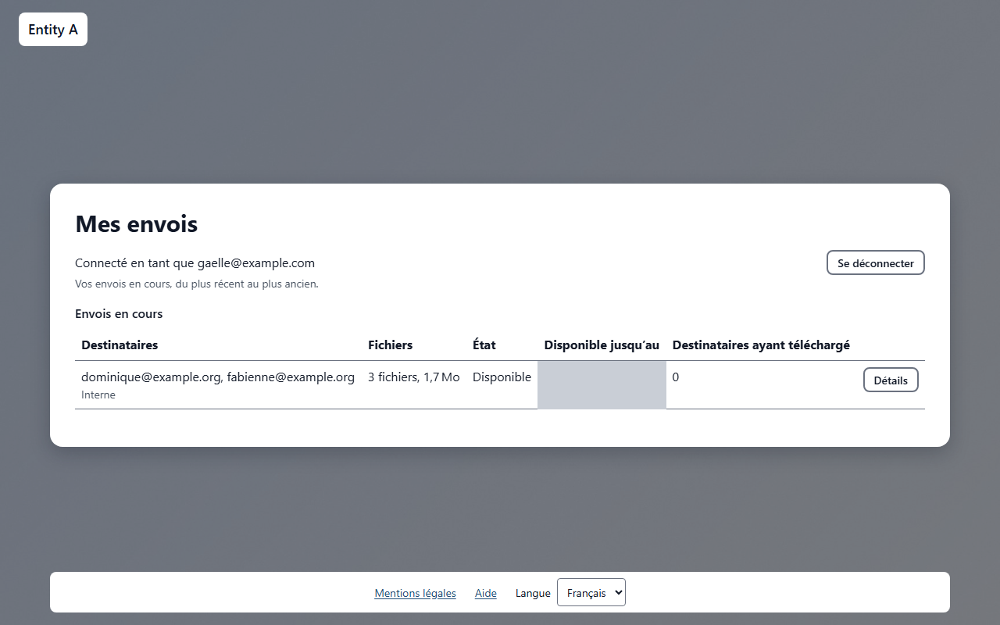
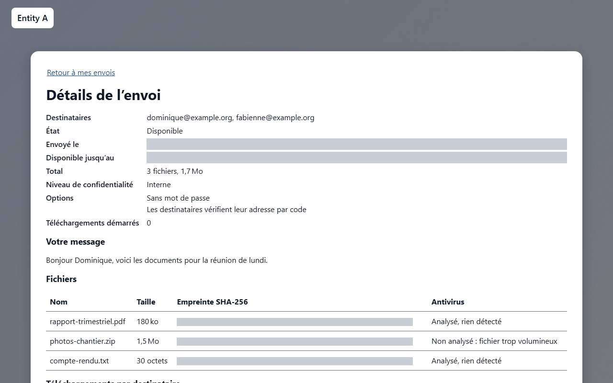

# Envoyer des fichiers

Ce service vous permet d’envoyer des fichiers volumineux à une ou plusieurs personnes : chaque destinataire reçoit un mail avec un lien de téléchargement. Les fichiers sont stockés chiffrés sur le serveur et supprimés automatiquement à l’expiration du transfert. Vous n’avez aucun compte à créer. Les utilisateurs internes de l’organisation envoient des fichiers directement ; une personne externe a besoin d’une invitation.

## Qui peut envoyer des fichiers

L’envoi dépend de l’endroit d’où vous vous connectez et de votre adresse mail.

Vous êtes un *utilisateur interne* lorsque les **deux** conditions sont réunies :

- vous êtes connecté depuis le réseau de votre organisation ;
- votre adresse mail appartient à l’un des domaines de messagerie de votre organisation.

S’il manque l’une de ces conditions, le dépôt est refusé avec le message **Le dépôt n’est possible que depuis le réseau interne avec une adresse de l’organisation. Pour envoyer des fichiers depuis l’extérieur, demandez une invitation à un utilisateur interne.**

Une personne externe (hors du réseau ou avec une autre adresse mail) a besoin d’une invitation envoyée par un utilisateur interne : voir [Envoyer des fichiers avec une invitation](topic:invitation).

> **À savoir** Votre administrateur peut aussi avoir bloqué certaines adresses ou certains domaines. Une adresse bloquée ne peut pas envoyer de fichiers.

<!-- topic: rules -->
## Règles de votre organisation

Votre organisation a fixé des règles pour l’envoi de fichiers ; voici celles de l’entité à laquelle vous accédez.

<!-- rules: summary -->

Les règles en vigueur sont toujours celles que le service applique au moment de votre envoi : elles peuvent changer, et une copie imprimée peut être périmée. L’aide en ligne propose aussi une version imprimable de cette documentation.

<!-- topic: deposit -->
## Envoyer des fichiers

Un envoi se déroule en quatre étapes, détaillées ci-dessous :

1. [Vous identifier](topic:deposit-identify) avec un code reçu par mail.
1. [Remplir le transfert](topic:deposit-options) : destinataires, message, durée, options et fichiers.
1. [Suivre l’envoi](topic:deposit-upload) de vos fichiers.
1. Attendre l’[analyse antivirus](topic:deposit-antivirus) : les destinataires sont alors prévenus par mail.

Ce que voient vos destinataires est décrit dans [Télécharger les fichiers](topic:download).

<!-- topic: deposit-identify -->
### Vous identifier par un code

Cette étape prouve que l’adresse mail que vous saisissez est bien la vôtre.

Saisissez **Votre adresse électronique**, puis cliquez sur **Continuer**.

Un code à 6 chiffres est envoyé à cette adresse. Si vous ne le voyez pas au bout d’une minute ou deux, regardez dans vos courriers indésirables. Saisissez le code dans **Code de vérification**, puis cliquez sur **Vérifier**.

Quelques règles s’appliquent aux codes :

- un code est valable 15 minutes ; la page affiche **Le code est valable jusqu’à** suivi de l’heure ;
- après 2 saisies erronées, le code ne fonctionne plus : cliquez sur **Recevoir un nouveau code** pour en obtenir un autre ;
- vous pouvez recevoir au plus 5 codes par heure pour une même adresse, et 20 par heure depuis une même adresse réseau ;
- si vous vous êtes trompé d’adresse, cliquez sur **Utiliser une autre adresse**.

Vous n’avez pas à saisir un code à chaque fois. En tant qu’utilisateur interne, une fois un code saisi sur un navigateur, celui-ci vous reconnaît. Un code vous est redemandé sur un autre ordinateur ou un autre navigateur, après 12 mois sans utiliser le service, et toujours lorsque vous déposez avec une invitation.

Une fois que vous êtes identifié, le haut de la page affiche **Identifié comme** suivi de votre adresse, ainsi qu’un bouton **Terminer la session**. Cliquez dessus quand vous avez fini, surtout sur un ordinateur partagé. La session se termine aussi d’elle-même au bout de quelques heures (4 heures, sauf réglage différent de votre organisation) ; la page affiche alors **Votre session a expiré. Identifiez-vous de nouveau pour continuer.**

<!-- topic: deposit-options -->
### Remplir le transfert

Le formulaire **Nouveau transfert** décrit ce que vous envoyez, à qui et pour combien de temps.

Remplissez les champs :

- **Destinataires** : une ou plusieurs adresses, séparées par des virgules ou des retours à la ligne. Si vous en saisissez trop, le formulaire vous indique le maximum.
- **Message** : facultatif. Il est envoyé aux destinataires avec le lien.
- **Disponible pendant** : **1 jour**, **7 jours** ou **30 jours**. La durée court à partir du moment où le transfert devient disponible, c’est-à-dire après l’analyse antivirus.
- **Mot de passe** : facultatif, sans règle de complexité. Transmettez-le aux destinataires par un autre canal (téléphone, SMS), jamais dans le même mail. Après 3 mots de passe erronés, le transfert est bloqué pendant 15 minutes.
- **Supprimer le transfert après le premier téléchargement** : le transfert est supprimé pour tous les destinataires dès que l’un d’eux a téléchargé tous les fichiers, soit en une archive ZIP, soit fichier par fichier. La suppression intervient quelques minutes plus tard.
- **Niveau de confidentialité** : si votre organisation propose plusieurs niveaux, choisissez celui qui correspond à la sensibilité des fichiers ; sa description s’affiche sous le niveau. Un niveau peut imposer des règles : restreindre les durées disponibles, rendre le mot de passe obligatoire, imposer la suppression après le premier téléchargement, limiter les destinataires à l’organisation ou plafonner le nombre maximal de téléchargements. Le formulaire limite alors les choix ou renseigne les options à votre place, et vous explique pourquoi. Si votre organisation n’a qu’un niveau, le sélecteur n’est pas affiché mais ses règles s’appliquent quand même.
- **Les destinataires doivent vérifier leur adresse par un code** : proposé si votre organisation l’offre. Chaque destinataire reçoit alors un lien personnel et doit saisir un code envoyé à sa propre adresse avant de télécharger : un lien transféré à quelqu’un d’autre est inutilisable. Demandez à vos destinataires de ne pas transférer leur lien. Un niveau de confidentialité peut rendre cette option obligatoire : elle est alors cochée et non modifiable. Les destinataires qui n’ont pas téléchargé les fichiers reçoivent un mail de rappel la veille de l’expiration du transfert.
- **Nombre maximal de téléchargements** : facultatif, de 1 à 1000. Le transfert compte chaque début de téléchargement, tous destinataires confondus (un téléchargement interrompu puis repris compte une fois). Une fois le nombre atteint, le transfert ne peut plus être téléchargé et il est supprimé quelques minutes plus tard. Laissez le champ vide pour ne pas limiter, sauf si le niveau choisi impose un plafond.
- **Fichiers à envoyer** : faites glisser vos fichiers sur la zone **Glissez-déposez des fichiers ici, ou** cliquez sur **choisissez des fichiers**. Pour retirer un fichier de la liste, utilisez le bouton de retrait à côté de son nom. Sous la liste, le formulaire affiche **Total :** suivi de la taille de vos fichiers et de la taille autorisée.

<!-- rules: levels -->

Un transfert peut contenir jusqu’à 20 Go au total ; votre organisation a pu fixer une limite plus basse. L’indication sous **Fichiers à envoyer** donne les limites réelles (taille totale et nombre de fichiers).

<!-- rules: limits -->

Pour envoyer un dossier entier, faites-le glisser sur la zone, ou cliquez sur **Ajouter un dossier** (le chemin accessible au clavier) et choisissez-le. L’arborescence est conservée : la liste affiche le dossier avant chaque nom de fichier (par exemple `photos/2026/`), et les destinataires retrouvent la même arborescence dans l’archive ZIP. Avant d’envoyer, vérifiez la liste :

- les fichiers système (`.DS_Store`, `Thumbs.db`, `desktop.ini`) sont écartés automatiquement, et le formulaire indique combien ;
- les autres fichiers cachés et les fichiers placés dans des dossiers cachés (dont le nom commence par un point, comme `.env` ou `.git`) sont conservés mais signalés **Caché** : retirez avec le bouton de retrait ceux que vous ne voulez pas envoyer ;
- les dossiers vides sont ignorés ;
- un fichier dont le nom ou le dossier n’est pas accepté (caractères interdits comme `\` ou `:`, nom réservé par Windows, chemin de dossier trop long ou imbriqué sur plus de 16 niveaux) n’est pas ajouté, et le formulaire le liste avec la raison : renommez-le, puis ajoutez-le de nouveau ;
- les limites de nombre de fichiers et de taille totale s’appliquent à l’ensemble des fichiers des dossiers.

Si votre organisation ne propose pas les dossiers, le bouton **Ajouter un dossier** n’est pas affiché : sélectionnez les fichiers, ou compressez le dossier en fichier ZIP et envoyez ce fichier.

Quand tout est prêt, cliquez sur **Envoyer**. Deux messages peuvent refuser le transfert :

- un message indiquant que le niveau de confidentialité choisi exige un champ, n’autorise pas une valeur, n’autorise que des destinataires de l’organisation ou fixe un maximum plus bas : corrigez le champ nommé dans le message, ou choisissez un autre niveau ;
- **Ce service n’autorise pas l’envoi vers le domaine de cette adresse.** : votre organisation n’autorise pas ce domaine de destinataire. Retirez l’adresse, ou interrogez votre administrateur.

<!-- topic: deposit-upload -->
### Suivre l’envoi

Pendant l’envoi de vos fichiers, la page indique où en est le transfert.

La barre **Progression globale** porte sur l’ensemble du transfert, et chaque fichier a sa propre ligne de progression.

Si la connexion est coupée, l’envoi réessaie tout seul (**Connexion perdue, nouvelle tentative…**). Vous pouvez aussi l’interrompre avec **Mettre en pause** et le poursuivre plus tard avec **Reprendre** : l’envoi continue là où il s’était arrêté, sans repartir du début.

Si vous quittez la page pendant l’envoi, le navigateur vous demande de confirmer, car quitter la page interrompt l’envoi. Si la page a malgré tout été fermée ou rechargée, revenez sur la page d’envoi avec le même navigateur, tant que votre session dure. La page affiche **Reprendre l’envoi interrompu** : sélectionnez de nouveau les mêmes fichiers, puis cliquez sur **Reprendre l’envoi**. Un envoi inachevé est abandonné après un certain temps sans activité (24 heures, sauf réglage différent de votre organisation).

Pour renoncer, cliquez sur **Annuler le transfert** et confirmez : les fichiers déjà envoyés sont supprimés.

<!-- topic: deposit-antivirus -->
### Analyse antivirus et confirmation

Avant que vos destinataires soient prévenus, chaque fichier est contrôlé par un antivirus.

À la fin de l’envoi, la page affiche **Analyse des fichiers**. Vous pouvez fermer la page : vous recevrez un mail quand le transfert sera prêt.

Le récapitulatif **Transfert envoyé** indique les **Destinataires prévenus**, la date d’expiration (**Disponible jusqu’au**), un rappel de transmettre le mot de passe si vous en avez défini un et, pour chaque fichier, le résultat de l’antivirus et son empreinte SHA-256, avec un bouton **Copier**.

L’*empreinte SHA-256* est un code calculé à partir du contenu du fichier : vos destinataires peuvent s’en servir pour vérifier que leur copie est identique à la vôtre.

Chaque fichier reçoit l’un des résultats suivants :

- **aucune menace détectée** : le fichier est remis ;
- **menace détectée, fichier supprimé** : le fichier n’est pas remis et vous recevez une alerte par mail ;
- **non analysé (fichier trop volumineux)** ou **non analysé (archive chiffrée)** : le fichier est remis, vous en êtes informé par mail et les destinataires sont avertis sur la page de téléchargement ;
- **non analysé (antivirus désactivé)** : l’antivirus est désactivé pour votre entité (ou pour tout le service), le fichier est donc remis sans contrôle ; vous en êtes informé par mail (motif « antivirus désactivé ») et les destinataires sont avertis sur la page de téléchargement ;
- **échec de l’analyse, fichier retenu** : le fichier n’est pas remis.

Si aucun fichier ne peut être remis, la page affiche **Transfert refusé** et les destinataires ne sont pas prévenus.

Par mail, vous recevez aussi une confirmation d’envoi et un avis de premier téléchargement (uniquement le premier).

> **À savoir** Le lien de téléchargement n’est pas affiché à l’écran : les destinataires le reçoivent par mail, avec un QR code pour l’ouvrir sur un téléphone et les empreintes des fichiers.

<!-- topic: deposit-remote -->
<!-- when: remoteInternalDeposit -->
## Dépôt depuis l’extérieur

Si votre organisation l’a activé, vous pouvez envoyer des fichiers en télétravail, hors du réseau de l’organisation, sans invitation. Cela ne vaut que pour une adresse mail d’un domaine de l’organisation, **déjà vérifiée une première fois depuis le réseau interne**.

Depuis l’extérieur :

- un code est demandé **à chaque dépôt** : le navigateur qui vous reconnaît d’ordinaire ne suffit pas, car seule la possession de votre boîte mail prouve alors votre identité. Si une session ouverte sur le réseau interne est utilisée hors du réseau, elle est refusée : demandez un nouveau code ;
- vous pouvez envoyer des fichiers, mais **pas inviter** de personnes externes : les invitations restent réservées au réseau interne ;
- les règles sur les destinataires et les niveaux de confidentialité s’appliquent comme au bureau ;
- ces dépôts sont signalés dans les journaux de l’organisation et comptés dans la détection des abus.

Si l’option est désactivée, le dépôt depuis l’extérieur est refusé avec le même message que pour toute personne non autorisée. Si l’option est activée mais que votre adresse n’est pas éligible (autre domaine, jamais vérifiée depuis le réseau interne, inactive ou inconnue), le service répond comme pour une adresse éligible (« un code a été envoyé »), mais aucun mail n’est envoyé et tout code saisi est refusé. **Si aucun code n’arrive depuis l’extérieur, votre adresse n’est donc pas éligible** : utilisez d’abord une fois le service depuis le réseau de l’organisation, ou demandez à votre administrateur si l’option est activée.

> **À savoir** Pour pouvoir envoyer un jour depuis l’extérieur, utilisez au moins une fois le service depuis le réseau de l’organisation avec la même adresse.

<!-- topic: receive-reply -->
<!-- when: transferReply -->
## Recevoir une réponse

Si votre organisation l’a activé, vos destinataires peuvent vous renvoyer des fichiers depuis la page de téléchargement avec le bouton **Répondre**, sans invitation. Cela ne concerne que les transferts que vous avez envoyés vous-même (page web ou jeton d’API), jamais ceux d’un invité externe, et seulement via le lien personnel de chaque destinataire.

Une réponse arrive comme un transfert ordinaire : vous recevez le mail de notification habituel et la page de téléchargement s’ouvre de la même façon. Elle porte toutefois un **avertissement** : la réponse vient de l’extérieur de l’organisation et l’adresse de son auteur a été vérifiée par un code, mais cela ne garantit pas que les fichiers sont sûrs. Soyez prudent avec les fichiers inattendus, ouvrez-les seulement si vous attendiez cette réponse, et en cas de doute contactez l’auteur par un autre moyen. Le même avertissement figure en haut de la page de téléchargement. Les fichiers sont analysés par l’antivirus comme tous les dépôts ; ceux qui ne peuvent pas l’être sont signalés.

Vous seul recevez la réponse : l’expéditeur d’origine est son unique destinataire. Elle est refusée à son auteur si votre adresse est bloquée ou n’appartient plus à l’organisation, ou si votre transfert d’origine a expiré ou a été supprimé.

<!-- topic: my-transfers -->
## Mes envois

Sans créer de compte, vous pouvez gérer les transferts que vous avez envoyés : voir où ils en sont, les supprimer ou les garder disponibles plus longtemps.

### Obtenir votre lien d’accès

1. Ouvrez la page **Mes envois** du site d’envoi (l’adresse se termine par `/me` ; le mail de confirmation de chaque transfert contient aussi le lien).
1. Saisissez votre adresse mail et cliquez sur le bouton pour recevoir un lien.

La page affiche toujours le même message, qu’un lien ait été envoyé ou non. Un lien n’est envoyé que si votre adresse a déjà été vérifiée une première fois par un code, lors d’un envoi de fichiers. Il arrive dans votre boîte mail en quelques minutes.

Si aucun mail n’arrive, regardez dans vos courriers indésirables, puis **attendez une heure** avant de redemander un lien : le nombre de liens par adresse est limité, et les demandes suivantes dans l’heure n’envoient rien.

Le lien est valable **15 minutes** et ne peut être utilisé qu’**une seule fois** : s’il a expiré, ou si vous l’avez déjà ouvert, demandez-en un nouveau. Le lien ouvre une session de **1 heure** ; ensuite, il faut demander un nouveau lien. Si vous ouvrez un lien alors qu’une session Mes envois est déjà ouverte dans votre navigateur, la page vous demande de confirmer avant de changer de session : n’acceptez que si vous avez demandé ce lien vous-même.

### Suivre vos transferts

La liste présente vos transferts avec leur état, leurs destinataires, leur taille, leur date d’expiration et leur niveau de confidentialité.

Ouvrez un transfert pour en voir le détail : les fichiers avec leur taille et leur empreinte SHA-256 et, pour chaque destinataire, quels fichiers ont été téléchargés et quand (premier et dernier téléchargement). Les liens de téléchargement ne sont jamais affichés ici.

### Supprimer ou prolonger un transfert

- **Supprimer** : après confirmation, les fichiers sont effacés définitivement et les liens de téléchargement cessent de fonctionner.
- **Prolonger** : choisissez une nouvelle durée parmi celles que votre organisation autorise pour le niveau de confidentialité du transfert. La nouvelle expiration est comptée à partir d’aujourd’hui et ne peut jamais être antérieure à l’actuelle. Un transfert ne peut pas rester disponible plus de **90 jours** après sa création : au-delà, la page indique la date la plus lointaine possible, et il faut renvoyer les fichiers. Les destinataires qui n’ont pas encore téléchargé reçoivent un nouveau rappel la veille de la nouvelle expiration. Un transfert dont le nombre de téléchargements est atteint ne peut pas être prolongé.

Cliquez sur **Se déconnecter** quand vous avez terminé, surtout sur un ordinateur partagé.

<!-- topic: invite -->
## Inviter une personne externe

Une invitation permet à une personne extérieure à votre organisation de vous envoyer des fichiers.

Seuls les utilisateurs internes identifiés sur la page d’envoi peuvent inviter. Une fois identifié, cliquez sur **Inviter une personne à vous envoyer des fichiers** en haut de la page.

Remplissez le formulaire :

1. Saisissez l’**Adresse mail de la personne à inviter**.
1. Ajoutez un **Message** si vous le souhaitez (facultatif). Il est repris dans le mail d’invitation.
1. Choisissez la **Langue du mail d’invitation**.
1. Cliquez sur **Envoyer l’invitation**.

La page confirme par **Invitation envoyée**. Vous pouvez ensuite cliquer sur **Inviter une autre personne** ou sur **Retour à l’envoi de fichiers**.

Les fichiers que la personne envoie vous sont adressés. Le lien d’invitation reste valable 12 mois s’il n’est pas utilisé ; à chaque utilisation, sa validité est prolongée de 12 mois. Vous pouvez envoyer jusqu’à 20 invitations par heure ; au-delà, la page affiche **Vous avez envoyé trop d’invitations au cours de la dernière heure.**

Si la page affiche **Identifiez-vous d’abord**, retournez sur la page d’envoi et identifiez-vous. Si elle affiche **Invitations indisponibles**, vous n’êtes pas reconnu comme utilisateur interne.

Votre administrateur peut révoquer une invitation à tout moment.

<!-- topic: invitation -->
## Envoyer des fichiers avec une invitation

Cette partie s’adresse aux personnes externes qui ont reçu un mail d’invitation.

Ouvrez le lien du mail. La page **Vous êtes invité à envoyer des fichiers** indique qui vous invite (**Invité par**), l’adresse à laquelle l’invitation a été envoyée, la date jusqu’à laquelle elle est valable (**Invitation valable jusqu’au**) et le message de la personne qui vous invite.

Cliquez sur **Continuer**. Vous devez ensuite [vous identifier par un code](topic:deposit-identify), avec l’adresse à laquelle l’invitation a été envoyée (elle est déjà remplie). Avec une invitation, un code est demandé à chaque fois.

Le formulaire affiche ensuite **Les fichiers seront envoyés à** suivi de l’adresse de la personne qui vous a invité : aucun destinataire n’est à saisir. Le reste du formulaire fonctionne comme décrit dans [Remplir le transfert](topic:deposit-options).

Si le lien ne fonctionne pas :

- **Invitation introuvable** : le lien est incomplet. Copiez-le en entier depuis le mail, ou cliquez directement dessus.
- **Invitation expirée** : l’invitation n’est plus valable. Demandez-en une nouvelle à la personne qui vous a invité.

<!-- topic: deposit-problems -->
## Problèmes courants

Voici les messages que vous pouvez rencontrer, et la conduite à tenir.

- **Le dépôt n’est possible que depuis le réseau interne avec une adresse de l’organisation…** : connectez-vous depuis le réseau de l’organisation, ou demandez une invitation à un utilisateur interne.
- Le code n’arrive pas : regardez dans vos courriers indésirables, patientez une minute, puis cliquez sur **Recevoir un nouveau code** (dans la limite des envois par heure).
- **Les fichiers dépassent la taille maximale d’un transfert. Retirez des fichiers.** : retirez des fichiers, ou envoyez-les en plusieurs transferts.
- **1 nom de fichier n’est pas accepté : renommez le fichier puis ajoutez-le de nouveau.** (ou plusieurs) : renommez le fichier sur votre ordinateur, puis ajoutez-le de nouveau.
- **L’espace de stockage de ce service est plein. Réessayez plus tard.** : réessayez plus tard, ou contactez votre administrateur.
- **Certains fichiers ne sont pas acceptés par ce service.** : votre organisation a bloqué ces fichiers ; contactez votre administrateur si vous pensez qu’il s’agit d’une erreur.
- **Votre session a expiré. Identifiez-vous à nouveau, puis sélectionnez les mêmes fichiers pour reprendre.** : l’envoi continue alors là où il s’était arrêté.

<!-- topic: maintenance -->
## Service en maintenance

Le service est parfois brièvement arrêté pour une mise à jour.

La page **Service en maintenance** s’affiche : les nouveaux transferts et les invitations sont suspendus, mais les téléchargements restent disponibles. Un envoi en cours est mis en pause et reprend après la maintenance. Revenez plus tard.

<!-- topic: legal -->
## Informations légales

Votre organisation rédige les documents légaux du service.

En bas de page, les liens **Mentions légales** et **Politique de confidentialité** ouvrent ces documents (un lien n’apparaît que si le document a été rédigé). Si un document manque, la page affiche **Ce document n’a pas été publié par ce service.**

Le service n’utilise que des cookies techniques, sans aucune mesure d’audience. Le bas de page contient aussi la liste **Langue**, le bouton **Thème sombre** et un lien **Aide** vers l’aide de l’écran en cours.

### Thème sombre

Les pages suivent par défaut le réglage clair ou sombre de votre appareil. Le bouton **Thème sombre** du bas de page change le thème à tout moment. Votre choix est mémorisé pendant un an par un cookie strictement technique (`tt_theme`), posé uniquement lorsque vous choisissez un thème différent de celui de votre appareil. Si vous rechoisissez le thème de votre appareil, le cookie est supprimé : les pages suivent de nouveau votre appareil. Les deux thèmes respectent les mêmes exigences d’accessibilité (RGAA).
