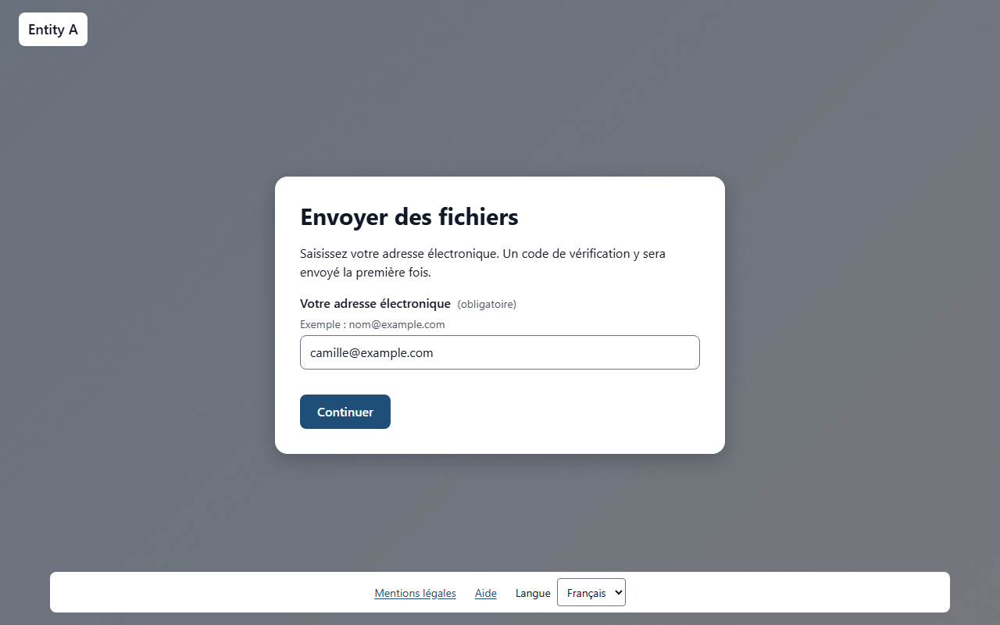
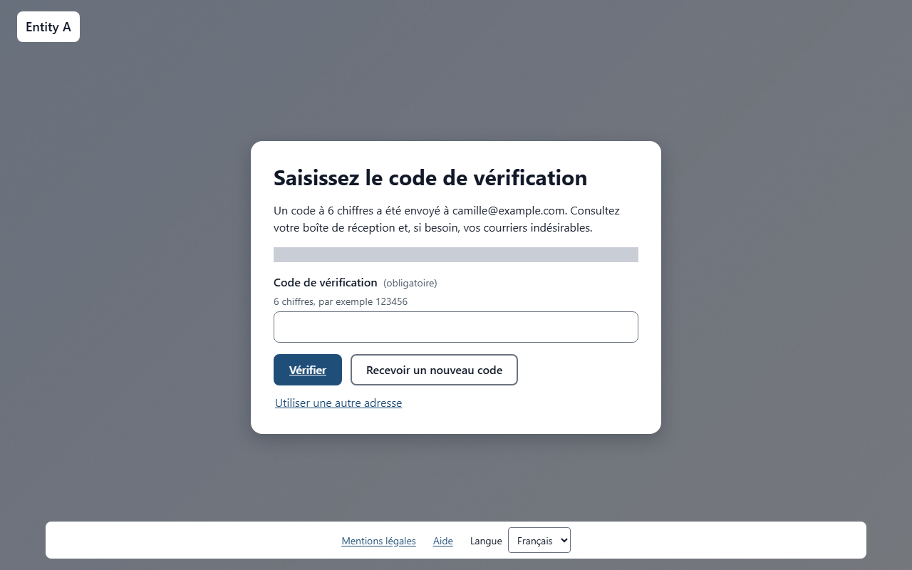
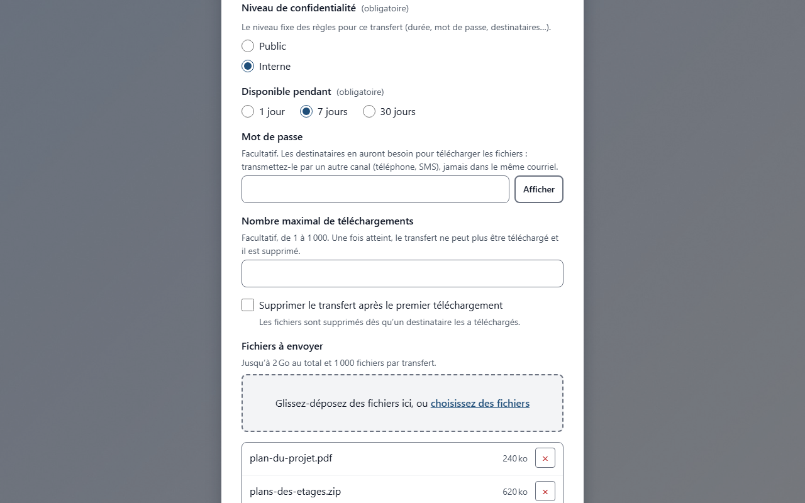
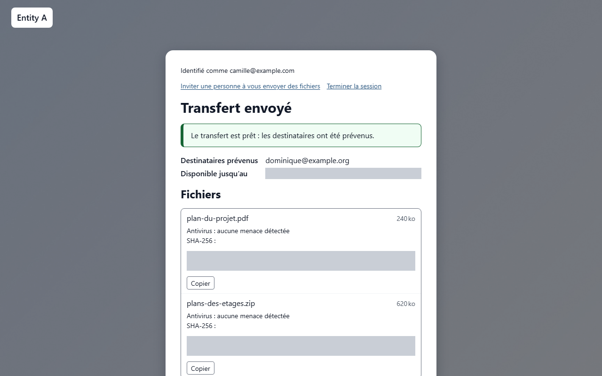
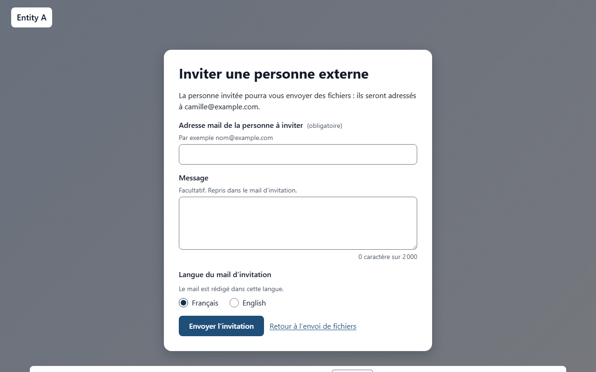
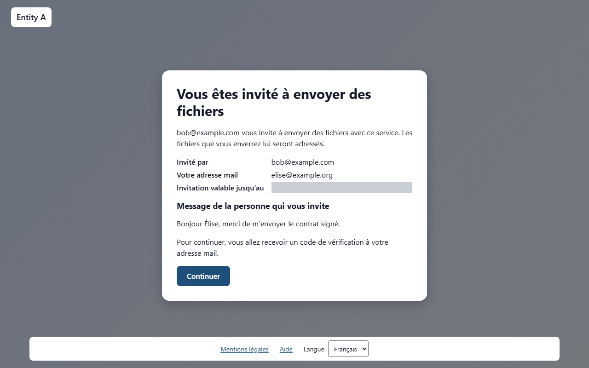
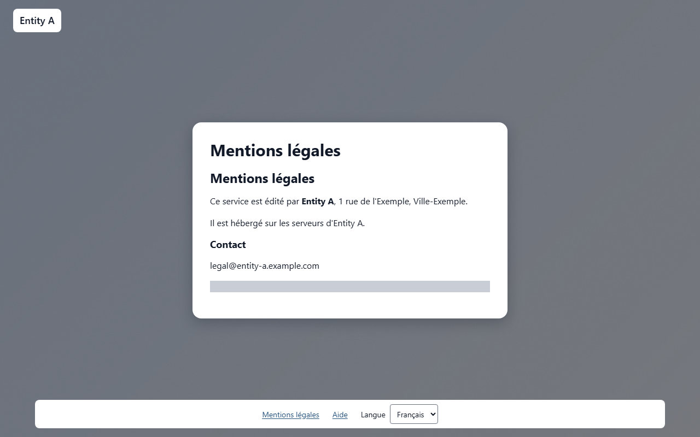

# Envoyer des fichiers

Ce service vous permet d’envoyer des fichiers volumineux à une ou plusieurs personnes : chaque destinataire reçoit un mail avec un lien de téléchargement. Les fichiers sont stockés chiffrés sur le serveur et supprimés automatiquement à l’expiration du transfert. Vous n’avez aucun compte à créer. Les utilisateurs internes de l’organisation envoient des fichiers directement ; une personne externe a besoin d’une invitation.

## Qui peut envoyer des fichiers

L’envoi dépend de l’endroit d’où vous vous connectez et de votre adresse mail.

Vous êtes un *utilisateur interne* lorsque les **deux** conditions sont réunies :

- vous êtes connecté depuis le réseau de votre organisation ;
- votre adresse mail appartient à l’un des domaines de messagerie de votre organisation.

S’il manque l’une de ces conditions, le dépôt est refusé avec le message **Le dépôt n’est possible que depuis le réseau interne avec une adresse de l’organisation. Pour envoyer des fichiers depuis l’extérieur, demandez une invitation à un utilisateur interne.**

Une personne externe (hors du réseau ou avec une autre adresse mail) a besoin d’une invitation envoyée par un utilisateur interne : voir [Envoyer des fichiers avec une invitation](topic:invitation).

> **À savoir** Votre administrateur peut aussi avoir bloqué certaines adresses ou certains domaines. Une adresse bloquée ne peut pas envoyer de fichiers.

<!-- topic: deposit -->
## Envoyer des fichiers

Un envoi se déroule en quatre étapes, détaillées ci-dessous :

1. [Vous identifier](topic:deposit-identify) avec un code reçu par mail.
1. [Remplir le transfert](topic:deposit-options) : destinataires, message, durée, options et fichiers.
1. [Suivre l’envoi](topic:deposit-upload) de vos fichiers.
1. Attendre l’[analyse antivirus](topic:deposit-antivirus) : les destinataires sont alors prévenus par mail.

Ce que voient vos destinataires est décrit dans [Télécharger les fichiers](topic:download).

<!-- topic: deposit-identify -->
### Vous identifier par un code

Cette étape prouve que l’adresse mail que vous saisissez est bien la vôtre.

Saisissez **Votre adresse électronique**, puis cliquez sur **Continuer**.

Un code à 6 chiffres est envoyé à cette adresse. Si vous ne le voyez pas au bout d’une minute ou deux, regardez dans vos courriers indésirables. Saisissez le code dans **Code de vérification**, puis cliquez sur **Vérifier**.

Quelques règles s’appliquent aux codes :

- un code est valable 15 minutes ; la page affiche **Le code est valable jusqu’à** suivi de l’heure ;
- après 2 saisies erronées, le code ne fonctionne plus : cliquez sur **Recevoir un nouveau code** pour en obtenir un autre ;
- vous pouvez recevoir au plus 5 codes par heure pour une même adresse, et 20 par heure depuis une même adresse réseau ;
- si vous vous êtes trompé d’adresse, cliquez sur **Utiliser une autre adresse**.

Vous n’avez pas à saisir un code à chaque fois. En tant qu’utilisateur interne, une fois un code saisi sur un navigateur, celui-ci vous reconnaît. Un code vous est redemandé sur un autre ordinateur ou un autre navigateur, après 12 mois sans utiliser le service, et toujours lorsque vous déposez avec une invitation.

Une fois que vous êtes identifié, le haut de la page affiche **Identifié comme** suivi de votre adresse, ainsi qu’un bouton **Terminer la session**. Cliquez dessus quand vous avez fini, surtout sur un ordinateur partagé. La session se termine aussi d’elle-même au bout de quelques heures (4 heures, sauf réglage différent de votre organisation) ; la page affiche alors **Votre session a expiré. Identifiez-vous de nouveau pour continuer.**

<!-- topic: deposit-options -->
### Remplir le transfert

Le formulaire **Nouveau transfert** décrit ce que vous envoyez, à qui et pour combien de temps.

Remplissez les champs :

- **Destinataires** : une ou plusieurs adresses, séparées par des virgules ou des retours à la ligne. Si vous en saisissez trop, le formulaire vous indique le maximum.
- **Message** : facultatif. Il est envoyé aux destinataires avec le lien.
- **Disponible pendant** : **1 jour**, **7 jours** ou **30 jours**. La durée court à partir du moment où le transfert devient disponible, c’est-à-dire après l’analyse antivirus.
- **Mot de passe** : facultatif, sans règle de complexité. Transmettez-le aux destinataires par un autre canal (téléphone, SMS), jamais dans le même mail. Après 3 mots de passe erronés, le transfert est bloqué pendant 15 minutes.
- **Supprimer le transfert après le premier téléchargement** : le transfert est supprimé pour tous les destinataires dès que l’un d’eux a téléchargé tous les fichiers, soit en une archive ZIP, soit fichier par fichier. La suppression intervient quelques minutes plus tard.
- **Niveau de confidentialité** : si votre organisation propose plusieurs niveaux, choisissez celui qui correspond à la sensibilité des fichiers ; sa description s’affiche sous le niveau. Un niveau peut imposer des règles : restreindre les durées disponibles, rendre le mot de passe obligatoire, imposer la suppression après le premier téléchargement, limiter les destinataires à l’organisation ou plafonner le nombre maximal de téléchargements. Le formulaire limite alors les choix ou renseigne les options à votre place, et vous explique pourquoi. Si votre organisation n’a qu’un niveau, le sélecteur n’est pas affiché mais ses règles s’appliquent quand même.
- **Nombre maximal de téléchargements** : facultatif, de 1 à 1000. Le transfert compte chaque début de téléchargement, tous destinataires confondus (un téléchargement interrompu puis repris compte une fois). Une fois le nombre atteint, le transfert ne peut plus être téléchargé et il est supprimé quelques minutes plus tard. Laissez le champ vide pour ne pas limiter, sauf si le niveau choisi impose un plafond.
- **Fichiers à envoyer** : faites glisser vos fichiers sur la zone **Glissez-déposez des fichiers ici, ou** cliquez sur **choisissez des fichiers**. Pour retirer un fichier de la liste, utilisez le bouton de retrait à côté de son nom. Sous la liste, le formulaire affiche **Total :** suivi de la taille de vos fichiers et de la taille autorisée.

Un transfert peut contenir jusqu’à 20 Go au total ; votre organisation a pu fixer une limite plus basse. L’indication sous **Fichiers à envoyer** donne les limites réelles (taille totale et nombre de fichiers).

> **À savoir** Un dossier ne peut pas être envoyé tel quel. Sélectionnez les fichiers qu’il contient, ou compressez vous-même le dossier en fichier ZIP et envoyez ce fichier.

Quand tout est prêt, cliquez sur **Envoyer**. Deux messages peuvent refuser le transfert :

- un message indiquant que le niveau de confidentialité choisi exige un champ, n’autorise pas une valeur, n’autorise que des destinataires de l’organisation ou fixe un maximum plus bas : corrigez le champ nommé dans le message, ou choisissez un autre niveau ;
- **Ce service n’autorise pas l’envoi vers le domaine de cette adresse.** : votre organisation n’autorise pas ce domaine de destinataire. Retirez l’adresse, ou interrogez votre administrateur.

<!-- topic: deposit-upload -->
### Suivre l’envoi

Pendant l’envoi de vos fichiers, la page indique où en est le transfert.

La barre **Progression globale** porte sur l’ensemble du transfert, et chaque fichier a sa propre ligne de progression.

Si la connexion est coupée, l’envoi réessaie tout seul (**Connexion perdue, nouvelle tentative…**). Vous pouvez aussi l’interrompre avec **Mettre en pause** et le poursuivre plus tard avec **Reprendre** : l’envoi continue là où il s’était arrêté, sans repartir du début.

Si vous quittez la page pendant l’envoi, le navigateur vous demande de confirmer, car quitter la page interrompt l’envoi. Si la page a malgré tout été fermée ou rechargée, revenez sur la page d’envoi avec le même navigateur, tant que votre session dure. La page affiche **Reprendre l’envoi interrompu** : sélectionnez de nouveau les mêmes fichiers, puis cliquez sur **Reprendre l’envoi**. Un envoi inachevé est abandonné après un certain temps sans activité (24 heures, sauf réglage différent de votre organisation).

Pour renoncer, cliquez sur **Annuler le transfert** et confirmez : les fichiers déjà envoyés sont supprimés.

<!-- topic: deposit-antivirus -->
### Analyse antivirus et confirmation

Avant que vos destinataires soient prévenus, chaque fichier est contrôlé par un antivirus.

À la fin de l’envoi, la page affiche **Analyse des fichiers**. Vous pouvez fermer la page : vous recevrez un mail quand le transfert sera prêt.

Le récapitulatif **Transfert envoyé** indique les **Destinataires prévenus**, la date d’expiration (**Disponible jusqu’au**), un rappel de transmettre le mot de passe si vous en avez défini un et, pour chaque fichier, le résultat de l’antivirus et son empreinte SHA-256, avec un bouton **Copier**.

L’*empreinte SHA-256* est un code calculé à partir du contenu du fichier : vos destinataires peuvent s’en servir pour vérifier que leur copie est identique à la vôtre.

Chaque fichier reçoit l’un des résultats suivants :

- **aucune menace détectée** : le fichier est remis ;
- **menace détectée, fichier supprimé** : le fichier n’est pas remis et vous recevez une alerte par mail ;
- **non analysé (fichier trop volumineux)** ou **non analysé (archive chiffrée)** : le fichier est remis, vous en êtes informé par mail et les destinataires sont avertis sur la page de téléchargement ;
- **échec de l’analyse, fichier retenu** : le fichier n’est pas remis.

Si aucun fichier ne peut être remis, la page affiche **Transfert refusé** et les destinataires ne sont pas prévenus.

Par mail, vous recevez aussi une confirmation d’envoi et un avis de premier téléchargement (uniquement le premier).

> **À savoir** Le lien de téléchargement n’est pas affiché à l’écran : les destinataires le reçoivent par mail, avec un QR code pour l’ouvrir sur un téléphone et les empreintes des fichiers.

<!-- topic: invite -->
## Inviter une personne externe

Une invitation permet à une personne extérieure à votre organisation de vous envoyer des fichiers.

Seuls les utilisateurs internes identifiés sur la page d’envoi peuvent inviter. Une fois identifié, cliquez sur **Inviter une personne à vous envoyer des fichiers** en haut de la page.

Remplissez le formulaire :

1. Saisissez l’**Adresse mail de la personne à inviter**.
1. Ajoutez un **Message** si vous le souhaitez (facultatif). Il est repris dans le mail d’invitation.
1. Choisissez la **Langue du mail d’invitation**.
1. Cliquez sur **Envoyer l’invitation**.

La page confirme par **Invitation envoyée**. Vous pouvez ensuite cliquer sur **Inviter une autre personne** ou sur **Retour à l’envoi de fichiers**.

Les fichiers que la personne envoie vous sont adressés. Le lien d’invitation reste valable 12 mois s’il n’est pas utilisé ; à chaque utilisation, sa validité est prolongée de 12 mois. Vous pouvez envoyer jusqu’à 20 invitations par heure ; au-delà, la page affiche **Vous avez envoyé trop d’invitations au cours de la dernière heure.**

Si la page affiche **Identifiez-vous d’abord**, retournez sur la page d’envoi et identifiez-vous. Si elle affiche **Invitations indisponibles**, vous n’êtes pas reconnu comme utilisateur interne.

Votre administrateur peut révoquer une invitation à tout moment.

<!-- topic: invitation -->
## Envoyer des fichiers avec une invitation

Cette partie s’adresse aux personnes externes qui ont reçu un mail d’invitation.

Ouvrez le lien du mail. La page **Vous êtes invité à envoyer des fichiers** indique qui vous invite (**Invité par**), l’adresse à laquelle l’invitation a été envoyée, la date jusqu’à laquelle elle est valable (**Invitation valable jusqu’au**) et le message de la personne qui vous invite.

Cliquez sur **Continuer**. Vous devez ensuite [vous identifier par un code](topic:deposit-identify), avec l’adresse à laquelle l’invitation a été envoyée (elle est déjà remplie). Avec une invitation, un code est demandé à chaque fois.

Le formulaire affiche ensuite **Les fichiers seront envoyés à** suivi de l’adresse de la personne qui vous a invité : aucun destinataire n’est à saisir. Le reste du formulaire fonctionne comme décrit dans [Remplir le transfert](topic:deposit-options).

Si le lien ne fonctionne pas :

- **Invitation introuvable** : le lien est incomplet. Copiez-le en entier depuis le mail, ou cliquez directement dessus.
- **Invitation expirée** : l’invitation n’est plus valable. Demandez-en une nouvelle à la personne qui vous a invité.

<!-- topic: deposit-problems -->
## Problèmes courants

Voici les messages que vous pouvez rencontrer, et la conduite à tenir.

- **Le dépôt n’est possible que depuis le réseau interne avec une adresse de l’organisation…** : connectez-vous depuis le réseau de l’organisation, ou demandez une invitation à un utilisateur interne.
- Le code n’arrive pas : regardez dans vos courriers indésirables, patientez une minute, puis cliquez sur **Recevoir un nouveau code** (dans la limite des envois par heure).
- **Les fichiers dépassent la taille maximale d’un transfert. Retirez des fichiers.** : retirez des fichiers, ou envoyez-les en plusieurs transferts.
- **1 nom de fichier n’est pas accepté : renommez le fichier puis ajoutez-le de nouveau.** (ou plusieurs) : renommez le fichier sur votre ordinateur, puis ajoutez-le de nouveau.
- **L’espace de stockage de ce service est plein. Réessayez plus tard.** : réessayez plus tard, ou contactez votre administrateur.
- **Certains fichiers ne sont pas acceptés par ce service.** : votre organisation a bloqué ces fichiers ; contactez votre administrateur si vous pensez qu’il s’agit d’une erreur.
- **Votre session a expiré. Identifiez-vous à nouveau, puis sélectionnez les mêmes fichiers pour reprendre.** : l’envoi continue alors là où il s’était arrêté.

<!-- topic: maintenance -->
## Service en maintenance

Le service est parfois brièvement arrêté pour une mise à jour.

La page **Service en maintenance** s’affiche : les nouveaux transferts et les invitations sont suspendus, mais les téléchargements restent disponibles. Un envoi en cours est mis en pause et reprend après la maintenance. Revenez plus tard.

<!-- topic: legal -->
## Informations légales

Votre organisation rédige les documents légaux du service.

En bas de page, les liens **Mentions légales** et **Politique de confidentialité** ouvrent ces documents (un lien n’apparaît que si le document a été rédigé). Si un document manque, la page affiche **Ce document n’a pas été publié par ce service.**

Le service n’utilise que des cookies techniques, sans aucune mesure d’audience. Le bas de page contient aussi la liste **Langue** et un lien **Aide** vers l’aide de l’écran en cours.
