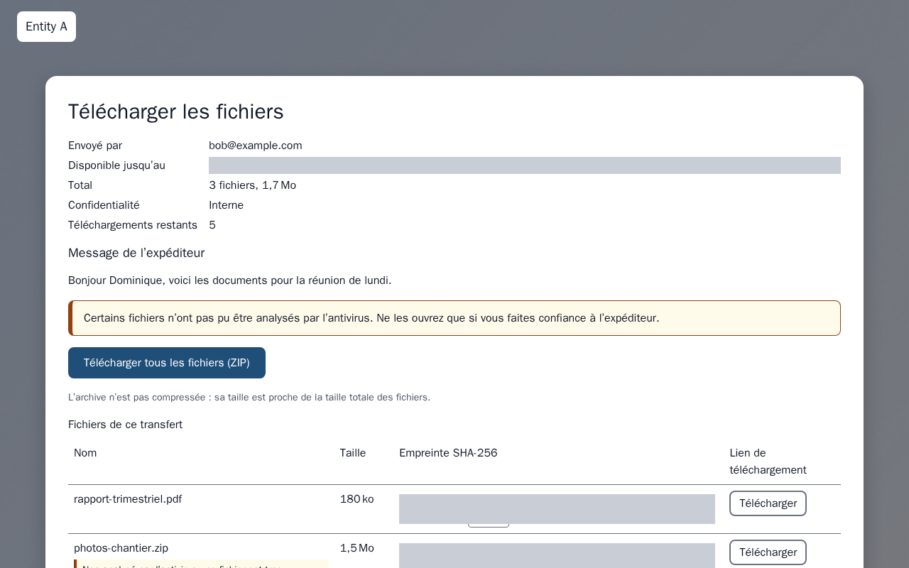
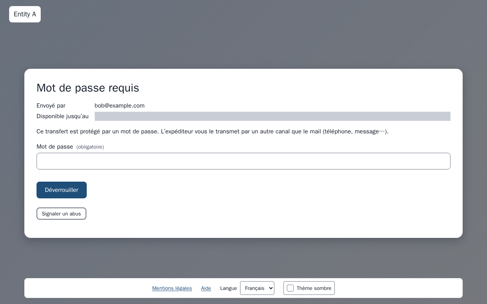
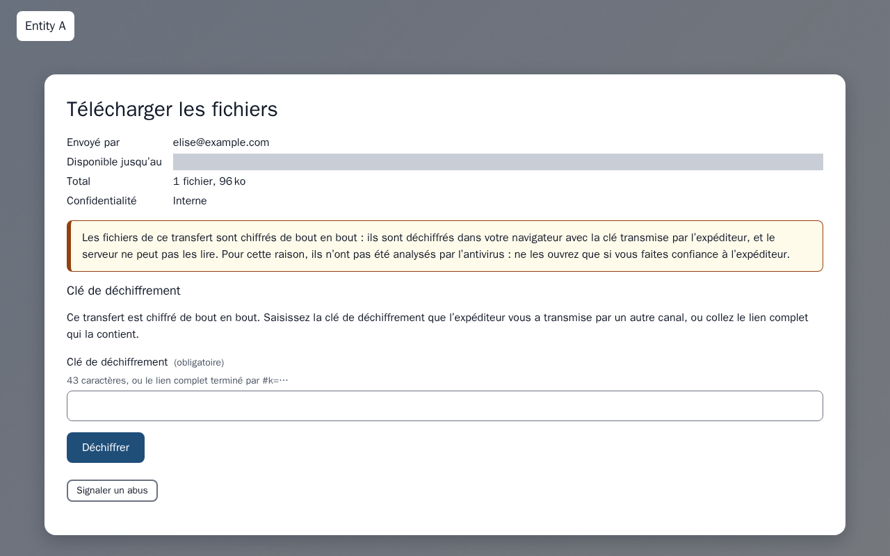
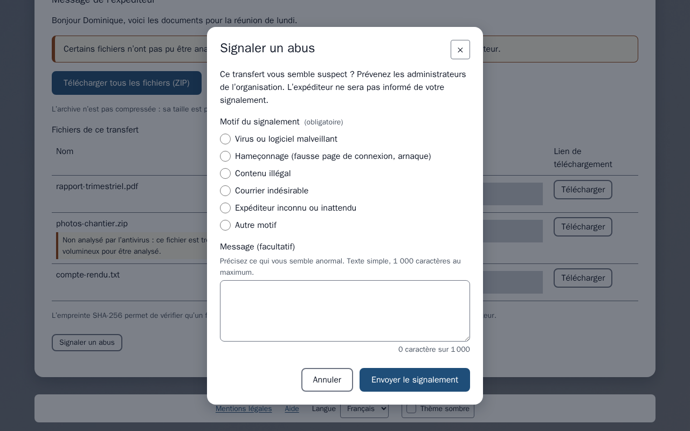
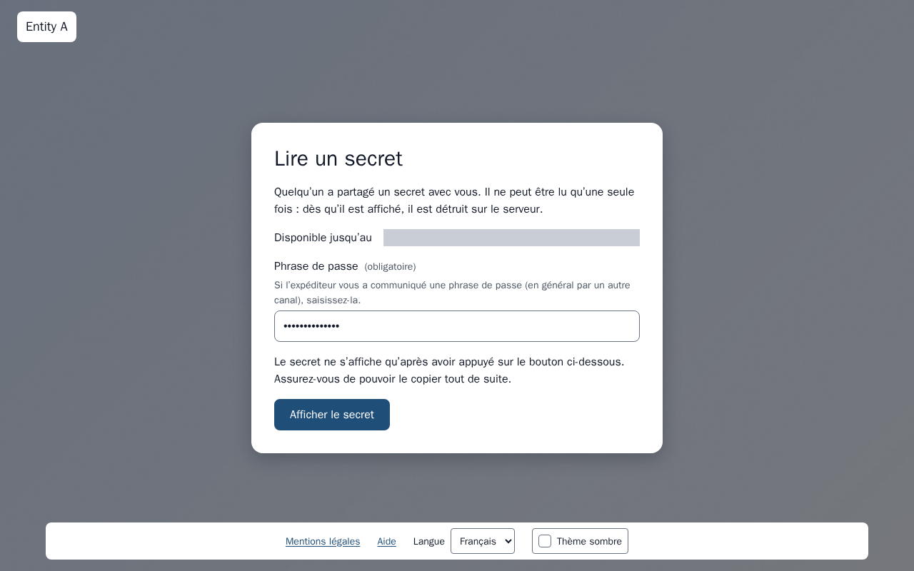
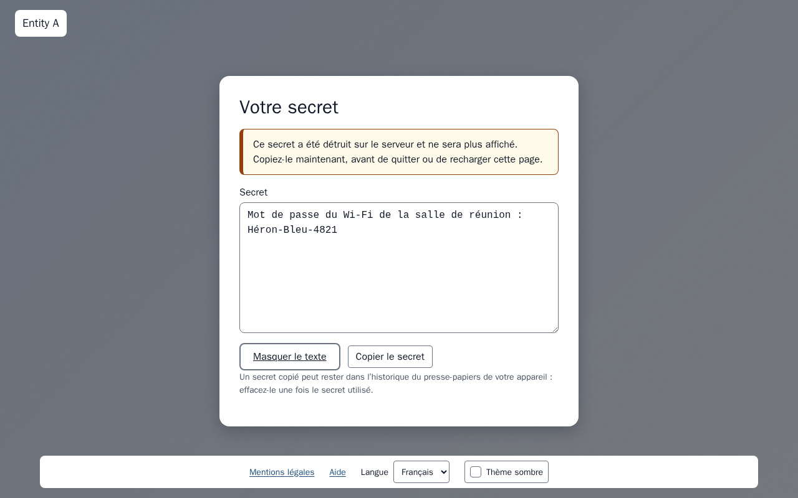

# Recevoir des fichiers

Quelqu’un vous a envoyé des fichiers avec TransTeira. Vous avez reçu un mail contenant un lien de téléchargement, ainsi qu’un QR code qui ouvre le même lien sur un téléphone ou une tablette. Vous n’avez besoin ni de compte ni de logiciel : un navigateur web suffit. Les fichiers restent disponibles jusqu’à la date indiquée dans le mail et sur la page, puis ils sont supprimés automatiquement. Si vous avez reçu à la place un lien qui commence par `/s/`, il s’agit d’un secret à usage unique : voir [Lire un secret](topic:secret-read).

<!-- topic: download -->
## Télécharger les fichiers

La page de téléchargement présente les fichiers que l’expéditeur a mis à votre disposition.

Ouvrez le lien du mail, ou scannez le QR code avec l’appareil photo de votre téléphone. La page **Télécharger les fichiers** s’ouvre et affiche :

- **Envoyé par** : l’adresse mail de la personne qui vous a envoyé les fichiers ;
- **Disponible jusqu’au** : la date et l’heure après lesquelles les fichiers sont supprimés ;
- **Total** : le nombre de fichiers et leur taille totale ;
- **Message de l’expéditeur** : le message rédigé par l’expéditeur, s’il y en a un ;
- **Confidentialité** : le niveau de confidentialité choisi par l’expéditeur, s’il y en a un ;
- **Téléchargements restants** : quand l’expéditeur a limité le nombre de téléchargements, le nombre qui reste.

La page est disponible en français et en anglais : utilisez le menu **Langue** en bas de la page pour en changer. Le lien **Aide**, également en bas de la page, ouvre ce guide.

### Lien personnel et vérification de l’adresse

L’expéditeur peut avoir demandé à chaque destinataire de confirmer son adresse mail. Dans ce cas, votre lien est **personnel** : il a été créé pour votre adresse uniquement. Ne le transférez pas. Une autre personne qui l’ouvre ne peut rien télécharger, car elle ne peut pas lire le code envoyé dans votre boîte mail.

Avant toute chose, la page **Confirmez votre adresse** affiche votre adresse en partie masquée, par exemple `j***@example.com`.

1. Cliquez sur **Envoyez-moi un code**. Un code à 6 chiffres est envoyé à votre adresse ; vérifiez vos courriers indésirables s’il n’arrive pas.
2. Saisissez le code dans le champ **Code de vérification**, puis cliquez sur **Vérifier**. Le code est valable 15 minutes.
3. Le formulaire du mot de passe s’affiche si le transfert est aussi protégé par un mot de passe, sinon la liste des fichiers.

Si le code est faux, la page affiche **Le code n’est pas correct.** et le nombre d’essais restants. Vous avez 2 essais : ensuite, ou si le code a expiré, la page vous demande un nouveau code avec **Envoyez-moi un code** (ou **Envoyer un nouveau code**). Le nombre de codes demandés par heure est limité : si la page vous demande de patienter, réessayez à la fin du décompte.

Une fois vérifié, votre accès dure environ une heure dans ce navigateur. Ensuite, la page affiche **Votre accès a expiré : confirmez à nouveau votre adresse avec un nouveau code.** et demande un nouveau code. C’est normal.

> **À savoir** Si vous n’avez pas encore téléchargé les fichiers, vous recevez un mail de rappel la veille de l’expiration du transfert. Il contient votre lien personnel.

> **Note** Une entité encore en cours de mise en service refuse aussi les téléchargements : la page affiche alors **Service en cours de mise en service**. C’est temporaire et ne concerne qu’une entité qui n’a pas encore été ouverte ; revenez un peu plus tard, ou demandez à l’expéditeur.

<!-- topic: download-password -->
### Transfert protégé

L’expéditeur a pu protéger le transfert par un mot de passe, pour que seules les personnes qui le connaissent puissent récupérer les fichiers.

Dans ce cas, la page affiche **Mot de passe requis** à la place de la liste des fichiers. L’expéditeur vous transmet le mot de passe par un autre canal que le mail, par exemple par téléphone ou par SMS : il n’est jamais écrit dans le mail lui-même. Si vous ne l’avez pas reçu, demandez-le à l’expéditeur.

1. Saisissez le mot de passe dans le champ **Mot de passe**.
2. Cliquez sur **Déverrouiller**.
3. La liste des fichiers s’affiche.

Si le mot de passe est faux, la page affiche **Le mot de passe est incorrect.**, généralement suivi du nombre d’essais restants. Après 3 mots de passe erronés, le transfert est bloqué pendant 15 minutes : la page affiche **Trop de mots de passe erronés : le transfert est bloqué pour un moment.** avec un compte à rebours. À la fin du compte à rebours, le champ redevient disponible et vous pouvez réessayer.

Une fois le transfert déverrouillé, les fichiers restent accessibles pendant environ une heure dans ce navigateur. Ensuite, la page redemande le mot de passe : **Votre accès aux fichiers a expiré : saisissez de nouveau le mot de passe.** C’est normal ; saisissez simplement le mot de passe une nouvelle fois.

<!-- topic: download-files -->
### Un fichier ou tout à la fois

Vous pouvez télécharger les fichiers un par un, ou tous ensemble dans une seule archive.

- Pour télécharger un fichier, cliquez sur **Télécharger** sur sa ligne.
- Pour tout télécharger en une fois, cliquez sur **Télécharger tous les fichiers (ZIP)**.

L’archive ZIP n’est pas compressée : sa taille est proche de la taille totale des fichiers. Elle est construite pendant le téléchargement, si bien que celui-ci commence immédiatement, même pour de très gros transferts. Une fois l’archive sur votre ordinateur, ouvrez-la ou extrayez-la comme d’habitude.

Si l’expéditeur a envoyé des dossiers, l’archive ZIP conserve l’arborescence, et la page de téléchargement affiche le dossier avant chaque nom de fichier. Quand un dossier contient plusieurs fichiers de même nom, l’archive ajoute un numéro aux suivants (`rapport (2).pdf`) pour qu’aucun ne soit écrasé à l’extraction. Un fichier téléchargé seul est enregistré sous son nom uniquement, sans son dossier : l’arborescence n’est conservée que dans l’archive ZIP.

Les fichiers sont toujours enregistrés sur votre ordinateur : ils ne s’ouvrent jamais directement dans le navigateur. Votre navigateur affiche la progression dans sa liste de téléchargements.

Pour les gros fichiers, privilégiez une connexion stable (câble ou bon réseau Wi-Fi) et gardez la page ouverte et l’ordinateur allumé jusqu’à la fin du téléchargement. Si un téléchargement s’arrête, relancez-le depuis la page tant que le transfert est disponible.

> **À savoir** Si la page affiche **Ce transfert est supprimé après son premier téléchargement complet.**, le transfert disparaît peu après avoir été téléchargé une fois en entier. Pour être sûr de récupérer tous les fichiers, téléchargez-les en une fois avec **Télécharger tous les fichiers (ZIP)**.

Si vous travaillez dans l’organisation et êtes connecté depuis son réseau, vous pouvez aussi envoyer des fichiers vous-même : voir [Envoyer des fichiers](topic:deposit).

<!-- topic: download-integrity -->
## Vérifier qu’un fichier est intact (SHA-256)

L’empreinte SHA-256 permet de vérifier que le fichier présent sur votre ordinateur est exactement celui que l’expéditeur a déposé, sans manque ni modification.

Une empreinte est une longue suite de lettres et de chiffres calculée à partir du contenu d’un fichier. Deux fichiers identiques ont toujours la même empreinte ; si un seul octet diffère, l’empreinte est complètement différente.

La liste des fichiers affiche chaque empreinte dans la colonne **Empreinte SHA-256**, avec un bouton **Copier** à côté. Les mêmes empreintes figurent aussi dans le mail que vous avez reçu.

Pour vérifier un fichier, calculez son empreinte sur votre ordinateur, puis comparez-la avec celle de la page ou du mail :

- Windows, dans l’invite de commandes : `certutil -hashfile fichier SHA256`
- Windows, dans PowerShell : `Get-FileHash fichier -Algorithm SHA256`
- macOS, dans le Terminal : `shasum -a 256 fichier`
- Linux, dans un terminal : `sha256sum fichier`

Remplacez `fichier` par le nom du fichier téléchargé, avec son dossier si nécessaire (par exemple, un fichier de votre dossier Téléchargements). Astuce : dans la plupart des terminaux, vous pouvez faire glisser le fichier sur la fenêtre pour insérer son chemin complet.

Les majuscules et les minuscules n’ont pas d’importance : l’invite de commandes affiche l’empreinte en minuscules et PowerShell en majuscules, et les deux sont correctes. Seule compte la suite de lettres et de chiffres, qui doit être identique.

Si les empreintes diffèrent, le fichier a été abîmé pendant le téléchargement : téléchargez-le de nouveau. Si elles diffèrent encore, contactez l’expéditeur.

> **À savoir** Seuls les fichiers pris un par un ont une empreinte. L’archive ZIP elle-même n’en a pas : extrayez-la d’abord, puis vérifiez les fichiers qu’elle contient.

<!-- topic: download-not-scanned -->
## Fichiers non analysés par l’antivirus

Chaque fichier est analysé par un antivirus avant d’être mis à disposition. Un fichier dans lequel une menace est détectée est supprimé et ne vous parvient jamais.

Certains fichiers ne peuvent toutefois pas être analysés. Dans ce cas, la page affiche l’avertissement **Certains fichiers n’ont pas pu être analysés par l’antivirus. Ne les ouvrez que si vous faites confiance à l’expéditeur.**, et le fichier concerné porte l’une de ces mentions :

- **Non analysé par l’antivirus : ce fichier est trop volumineux pour être analysé.** Le fichier dépasse la taille que l’antivirus peut contrôler.
- **Non analysé par l’antivirus : ce fichier est chiffré ou protégé par un mot de passe.** L’antivirus ne peut pas examiner le contenu d’un fichier ou d’une archive chiffrés.
- **Non analysé par l’antivirus : l’analyse antivirus est désactivée.** L’antivirus était désactivé pour l’entité ou pour tout le service au moment du dépôt : le fichier n’a donc pas été contrôlé. Les mêmes précautions s’appliquent, avec davantage de soin.

Ces fichiers sont tout de même transmis, car ils peuvent être parfaitement légitimes. Avant d’en ouvrir un :

- assurez-vous de connaître l’expéditeur et d’attendre ces fichiers ;
- en cas de doute, demandez à l’expéditeur par un autre moyen (téléphone, mail séparé) s’il les a bien envoyés ;
- analysez le fichier avec votre propre antivirus avant de l’ouvrir.

> **Note** Si l’expéditeur a limité le nombre de téléchargements, chaque début de téléchargement compte, quelle que soit la personne qui télécharge. Quand la page affiche **Nombre maximal de téléchargements atteint**, le transfert ne peut plus être téléchargé : demandez à l’expéditeur de renvoyer les fichiers.

<!-- topic: download-e2e -->
## Transfert chiffré de bout en bout

Certains transferts sont chiffrés de bout en bout : les fichiers ont été chiffrés dans le navigateur de l’expéditeur, et le serveur ne peut pas les lire. Pour les ouvrir, il vous faut une **clé de déchiffrement**. L’expéditeur doit vous la transmettre **par un autre canal** que le mail du lien (téléphone, SMS, autre messagerie).

Deux cas :

- si le lien que vous avez reçu se termine par `#k=` suivi de la clé, la page la lit toute seule ;
- sinon, la page affiche **Clé de déchiffrement**. Collez la clé (43 caractères) ou le lien complet qui la contient, puis cliquez sur **Déchiffrer**.

La clé n’est jamais envoyée au serveur. Si elle est fausse, la page le dit : **Cette clé n’ouvre pas ce transfert**. Vérifiez-la auprès de l’expéditeur. Si la page indique qu’un fichier a été retiré ou modifié, n’utilisez pas ce transfert et contactez l’expéditeur.

Le téléchargement se passe comme d’habitude, avec quelques différences :

- **Le navigateur déchiffre pendant le téléchargement.** Le fichier est contrôlé au fur et à mesure (taille et empreinte SHA-256). S’il est abîmé ou modifié, le téléchargement échoue : n’utilisez pas ce qui a pu être enregistré et recommencez.
- **Tous les fichiers en une archive ZIP** : c’est votre navigateur qui construit l’archive. Elle n’est pas compressée.
- **Deux empreintes** sont affichées. L’empreinte du fichier d’origine est annoncée par l’expéditeur et vérifiée pendant le téléchargement. L’empreinte du fichier chiffré est calculée par le serveur.
- **Aucune analyse antivirus** : les fichiers sont marqués « non analysé : chiffré de bout en bout ». Appliquez les précautions de la section [Fichiers non analysés par l’antivirus](topic:download-not-scanned).
- Si le nombre de téléchargements est limité, l’archive ZIP compte pour **un seul** téléchargement, et non un par fichier.

Il faut un navigateur récent, avec les services en arrière-plan (« Service Workers ») autorisés. Dans certains modes de navigation privée, ils sont désactivés : le navigateur déchiffre alors en mémoire, jusqu’à 512 Mio. Au-delà, la page vous propose d’utiliser un autre navigateur (Firefox, Chrome, Edge ou Safari, hors navigation privée).

<!-- topic: download-report -->
## Signaler un abus

Si ce transfert vous paraît suspect (fichier malveillant, hameçonnage, contenu illégal, courrier indésirable, expéditeur inconnu), cliquez sur **Signaler un abus** en bas de la page de téléchargement.

1. Choisissez la catégorie : **Logiciel malveillant**, **Hameçonnage**, **Contenu illégal**, **Courrier indésirable**, **Expéditeur inconnu** ou **Autre**.
1. Ajoutez si vous le souhaitez un message de 1 000 caractères au plus, en texte simple.
1. Envoyez le signalement.

Les administrateurs de l’entité sont alertés et décident de la suite : **le signalement ne supprime ni ne bloque rien automatiquement**. Ne vous servez pas du bouton pour demander la suppression d’un transfert légitime : contactez plutôt l’expéditeur.

Votre adresse n’est enregistrée avec le signalement que si vous avez validé votre adresse par un code sur ce navigateur pour ce lien. Sinon, le signalement est enregistré comme « via le lien du destinataire n° n, non vérifié ». Il est limité à 3 signalements par jour pour un même lien et à 5 par heure depuis une même adresse réseau.

> **À savoir** Les signalements ne servent qu’à la sécurité du service ; ils sont conservés 12 mois, puis supprimés. Vous pouvez demander à votre administrateur l’effacement des données liées à votre adresse.

<!-- topic: download-reply -->
<!-- when: transferReply -->
## Répondre à un transfert

Si l’organisation de l’expéditeur l’a autorisé, vous pouvez lui renvoyer des fichiers directement depuis la page de téléchargement, sans invitation ni compte.

Le bouton **Répondre** n’apparaît que si toutes ces conditions sont réunies :

- l’organisation a activé la réponse aux transferts ;
- vous avez ouvert votre **lien personnel** (voir ci-dessus) ; les anciens liens partagés ne permettent pas de répondre ;
- le transfert a été envoyé par une personne de l’organisation : on ne répond pas à une réponse, ni à un transfert envoyé par un invité externe.

Pour répondre :

1. Cliquez sur **Répondre**.
1. Confirmez votre adresse avec un code à 6 chiffres reçu par mail, comme décrit dans [Lien personnel et vérification de l’adresse](topic:download). Ce code est **toujours demandé** pour répondre, même si l’expéditeur n’avait pas demandé de vérification pour télécharger. Il est valable 15 minutes, avec 2 essais.
1. Le formulaire d’envoi s’ouvre. Le seul destinataire est l’expéditeur d’origine : il est affiché (« Votre réponse sera envoyée à » suivi de son adresse) et ne peut pas être modifié.
1. Choisissez la durée de disponibilité parmi celles proposées, ajoutez un message et les fichiers, puis envoyez, comme décrit dans [Envoyer des fichiers](topic:deposit).

Les règles habituelles s’appliquent à votre réponse : taille maximale par envoi, quotas réservés aux personnes externes, analyse antivirus (un fichier infecté est supprimé et vous en êtes prévenu) et détection des abus. Votre réponse doit être terminée avant l’expiration du transfert d’origine : si celui-ci expire ou est supprimé pendant l’envoi, la réponse est refusée avec le message **Transfert plus disponible**. Elle est aussi refusée si l’expéditeur d’origine ne peut plus la recevoir (adresse bloquée ou n’appartenant plus à l’organisation).

L’expéditeur reçoit votre réponse par mail, avec un avertissement lui indiquant qu’elle vient de l’extérieur et que votre adresse a été vérifiée par code.

Répondre depuis un navigateur met fin à tout envoi de fichiers déjà ouvert dans ce même navigateur : terminez d’abord vos autres envois.

> **Note** Si le bouton **Répondre** n’apparaît pas, ou si un refus s’affiche, écrivez simplement à l’expéditeur par mail.

<!-- topic: secret-read -->
## Lire un secret

Un lien commençant par `/s/` vous donne accès à un secret à usage unique (mot de passe, clé, code). Il arrive en général dans un mail intitulé « Un secret a été partagé avec vous via » suivi du nom de votre organisation, avec un bouton **Ouvrir le secret** ; l’adresse de l’expéditeur figure dans le corps du message. Le message indique que le secret ne peut être lu qu’une fois, sa date d’expiration, si une phrase de passe est nécessaire (que l’expéditeur vous donne par un autre canal) et si un fichier est joint. **Ne transférez pas ce mail** : la première personne qui ouvre le lien lit le secret. L’expéditeur peut aussi vous avoir donné le lien autrement.

Ouvrez le lien **en entier** : sa fin, après le signe `#`, contient la clé qui déchiffre le secret. Sans elle, la page affiche **Lien incomplet**. Une fois la page ouverte, la clé est retirée de la barre d’adresse par sécurité : si vous rechargez la page avant d’afficher le secret, vous obtenez **Lien incomplet**, et vous devez rouvrir le lien depuis le message d’origine.

Ouvrir la page ne consomme rien : elle indique **Disponible jusqu’au** (la date d’expiration) et, si un fichier est joint, sa taille et un avertissement précisant qu’il n’a pas été analysé. Le secret n’est lu que lorsque vous cliquez sur **Afficher le secret**. Préparez-vous donc à le copier. Si l’expéditeur l’a protégé par une phrase de passe, il vous l’a transmise par un autre canal : saisissez-la dans **Phrase de passe**. Vous avez 5 essais ; après le cinquième échec, le secret est détruit.

Le secret s’affiche alors, et il est **détruit sur le serveur** : copiez-le tout de suite avec **Copier le secret**, avant de quitter ou de recharger la page. **Masquer le texte** le cache à l’écran (pendant un partage d’écran, par exemple) sans empêcher de le copier. Un secret copié peut rester dans l’historique du presse-papiers de votre appareil : effacez-le une fois le secret utilisé.

Si un fichier est joint, cliquez sur **Télécharger le fichier** : il ne peut l’être qu’**une seule fois, dans les 10 minutes** qui suivent l’affichage, puis il est supprimé du serveur. Comme il est chiffré par l’expéditeur, il n’est **pas analysé par l’antivirus** : ne l’ouvrez que si vous avez confiance en lui. Votre navigateur vérifie le fichier de lui-même pendant le déchiffrement, et n’enregistre rien s’il est endommagé. La page affiche aussi l’empreinte SHA-256 du fichier, avec un bouton pour la copier : vous pouvez la comparer à une empreinte que l’expéditeur vous a donnée séparément (voir [Vérifier qu’un fichier est intact (SHA-256)](topic:download-integrity)). Si la page indique **Le fichier n’est plus disponible**, il a déjà été téléchargé ou les 10 minutes sont écoulées. Si elle indique **Le fichier est endommagé**, rien n’a été enregistré : prévenez l’expéditeur. Après une erreur réseau, vous pouvez réessayer dans les 10 minutes.

Les pages d’erreur possibles :

- **Secret indisponible** : le secret a **déjà été lu** (si ce n’est pas vous, prévenez l’expéditeur), il a **expiré**, il a été **supprimé** par son expéditeur ou un administrateur, ou il a été **détruit après trop de phrases de passe erronées**. Demandez à l’expéditeur de le partager de nouveau.
- **Lien incomplet** ou **Lien incorrect** : recopiez ou rouvrez le lien en entier depuis le message d’origine. Rien n’a été consommé.
- **Lien inconnu** : le lien est faux ou incomplet.
- **Secret illisible** : les données reçues du serveur sont endommagées. Prévenez l’expéditeur.
- **Navigateur non pris en charge** : votre navigateur ne peut pas déchiffrer le secret. Utilisez un navigateur à jour, sur une connexion sécurisée (HTTPS). Rien n’a été consommé.

## Thème sombre

La page de téléchargement suit le réglage clair ou sombre de votre appareil. Le bouton **Thème sombre** du bas de page change le thème ; votre choix est mémorisé pendant un an par un cookie strictement technique (`tt_theme`), posé uniquement si vous choisissez un thème différent de celui de votre appareil. Rechoisir le thème de votre appareil supprime le cookie.

<!-- topic: download-problems -->
## Le lien ne fonctionne pas

Cette section explique les messages que vous pouvez voir à la place des fichiers, et ce qu’il faut faire.

- **Transfert introuvable** : le lien est incomplet ou a été modifié. Copiez le lien en entier depuis le mail, ou cliquez directement dessus dans le mail.
- **Transfert plus disponible** : le transfert a expiré, a été supprimé par un administrateur, ou a été supprimé après son premier téléchargement. Demandez à l’expéditeur de renvoyer les fichiers.
- **Nombre maximal de téléchargements atteint** : l’expéditeur avait autorisé un nombre limité de téléchargements et il est épuisé, par vous ou par les autres destinataires. Demandez à l’expéditeur de renvoyer les fichiers.
- La page affiche **Maintenance en cours** : seuls les nouveaux transferts sont suspendus. Les téléchargements restent disponibles, vous pouvez donc continuer normalement.

Pour répondre à l’expéditeur, utilisez le bouton **Répondre** s’il est proposé ; sinon, répondez-lui par mail.
