# Guide du super administrateur

Ce guide s’adresse à l’exploitant de l’instance TransTeira. En tant que super administrateur, vous pouvez faire tout ce que fait un administrateur délégué, sur toutes les entités : les écrans communs sont décrits dans le guide de l’administrateur délégué, par exemple [Se connecter](topic:login), [Mon compte](topic:account), [Entités](topic:tenants) et [Transferts](topic:tenant-transfers). Ce guide couvre ce que vous seul pouvez faire : le premier lancement, la création des entités et des comptes administrateurs, les écrans du système, le mode maintenance et la clé maître. Votre navigation principale comporte donc deux entrées de plus, **Administrateurs** et **Système**. La documentation publique personnalisée de chaque entité (version imprimable comprise) est décrite dans [Documentation de l’entité](topic:tenant-docs).

<!-- topic: setup -->
## Premier lancement

Le premier lancement crée le compte du super administrateur, une seule fois, sur une instance neuve. Tant qu’aucun administrateur n’existe, toutes les pages de l’administration (par exemple `admin.transfer.example.com/admin/`) mènent à l’écran **Initialisation de TransTeira**.

Remplissez le formulaire :

- **Identifiant** : de 3 à 64 caractères, lettres minuscules, chiffres, point, tiret ou tiret bas, en commençant par une lettre ou un chiffre.
- **Adresse électronique** : elle reçoit les alertes du super administrateur, par exemple l’alerte d’espace disque.
- **Mot de passe** et **Confirmez le mot de passe** : au moins 12 caractères. Une longue phrase de passe est facile à retenir et difficile à deviner.
- **Jeton d’initialisation** : il protège la page jusqu’à la création du premier compte. Si vous avez défini `TT_SETUP_TOKEN` ou `TT_SETUP_TOKEN_FILE`, utilisez cette valeur. Sinon, TransTeira a généré un jeton au démarrage et l’a écrit dans son journal : lisez-le avec `docker logs transteira`. Un jeton généré reste valable jusqu’au prochain redémarrage.

Cliquez sur **Créer le super administrateur**. La double authentification est alors obligatoire : rien d’autre n’est utilisable dans l’administration avant sa confirmation. Scannez le QR code avec votre application d’authentification et confirmez avec un code dans les 5 minutes, comme décrit dans [Double authentification](topic:admin-totp) ; si vous attendez plus longtemps ou rechargez la page, connectez-vous avec l’identifiant et le mot de passe que vous venez de choisir et la configuration recommence. Les 8 codes de secours s’affichent ensuite une seule fois : rangez-les dans votre coffre de mots de passe, voir [Codes de secours](topic:admin-recovery-codes).

> **À savoir** Dès qu’un administrateur existe, l’initialisation est fermée définitivement : son adresse mène à l’écran de connexion et plus aucun jeton n’est écrit dans le journal.

<!-- topic: super-admin-role -->
## Votre rôle

Le super administrateur gère toutes les entités et tous les comptes administrateurs, alors qu’un administrateur délégué ne gère que les entités rattachées à son compte (voir [Rôles](topic:admin-roles)). Votre compte exige toujours la double authentification, et vous ne pouvez pas la désactiver.

Gardez **deux** super administrateurs. TransTeira refuse de supprimer, de désactiver ou de rétrograder le dernier super administrateur utilisable, et personne ne peut supprimer, désactiver, rétrograder ni réinitialiser son propre compte : un second super administrateur est le moyen le plus simple de vous dépanner si vous perdez votre mot de passe ou votre appareil d’authentification.

<!-- topic: admin-home-super -->
## Page d’accueil

Votre page d’accueil donne l’état de toute l’instance en un coup d’œil. Elle commence par deux cartes, au-dessus du tableau de toutes les entités.

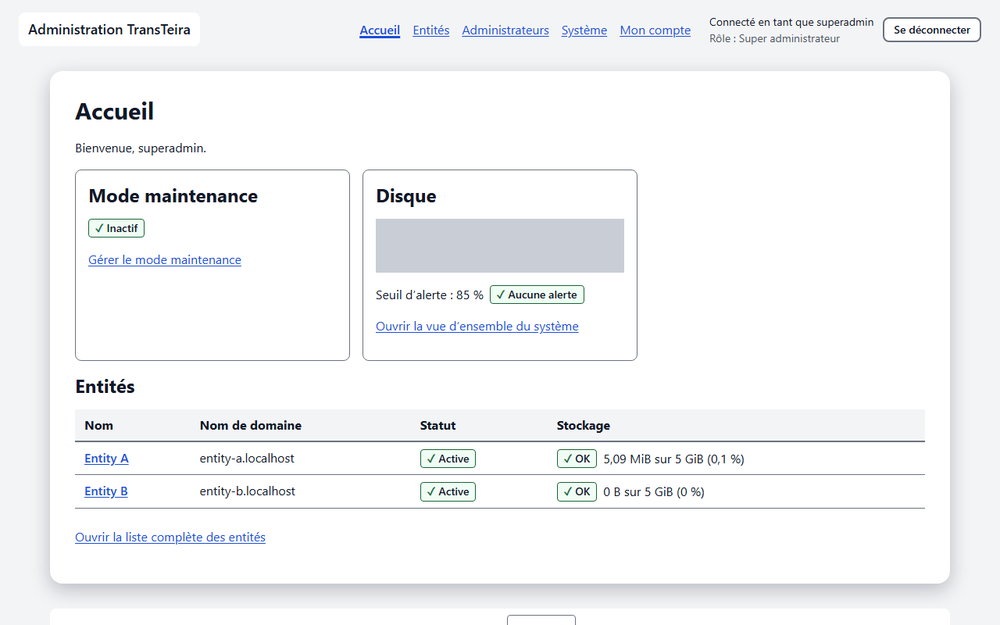

- **Mode maintenance** : **Actif** ou **Inactif**, avec la date de début et **(imposé par l’environnement)** lorsque la variable `TT_MAINTENANCE` l’impose ; **Gérer le mode maintenance** ouvre l’écran de maintenance.
- **Disque** : l’occupation du disque de données, le seuil d’alerte et l’état de l’alerte ; **Ouvrir la vue d’ensemble du système** affiche le détail.
- **Entités** : une ligne par entité avec son **Nom**, son **Nom de domaine**, son **Statut** et son **Stockage** ; **Ouvrir la liste complète des entités** ouvre la liste décrite dans [Entités](topic:tenants).

## Entités

La liste des entités fonctionne comme décrit dans [Entités](topic:tenants), avec un bouton de plus pour vous, **Créer une entité**. Certains réglages d’une entité, ainsi que sa suppression, vous sont réservés.

<!-- topic: tenant-create -->
### Créer une entité

Une entité est une organisation (filiale, service) qui dispose de son adresse publique, de son habillage et de ses réglages propres. Avant de la créer, vérifiez que son adresse (FQDN) pointe vers le reverse proxy dans le DNS et que le reverse proxy la sert avec un certificat.

Sur la page **Entités**, cliquez sur **Créer une entité**, puis remplissez le formulaire.

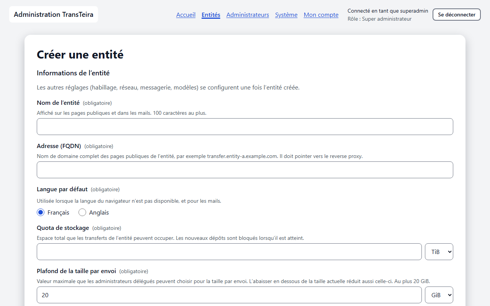

- **Nom de l’entité** : affiché sur les pages publiques et dans les mails, 100 caractères au plus.
- **Adresse (FQDN)** : le nom de domaine des pages publiques de l’entité, par exemple `transfer.entity-a.example.com`. Elle doit être unique et ne peut pas être l’adresse de l’administration.
- **Langue par défaut** : utilisée lorsque la langue du navigateur n’est pas disponible, et pour les mails.
- **Quota de stockage** : l’espace total que les transferts de l’entité peuvent occuper. Les nouveaux dépôts sont bloqués lorsqu’il est atteint.
- **Plafond de la taille par envoi** : la taille la plus grande que les administrateurs délégués peuvent choisir, 20 Go au plus.
- **Taille maximale par envoi** : la taille réellement autorisée pour un envoi, dans la limite du plafond.

Cliquez sur **Créer l’entité**. Les autres réglages se configurent ensuite, dans cet ordre :

1. [Réseau](topic:tenant-network) : les plages d’adresses IP et les domaines de messagerie internes, sans lesquels personne n’est interne.
2. [Messagerie (SMTP)](topic:tenant-smtp) : sans elle, l’entité n’envoie aucun mail ; envoyez un mail de test et contrôlez les enregistrements DNS.
3. [Habillage](topic:tenant-branding) : logo, couleurs et image de fond.
4. [Mentions légales](topic:tenant-legal) : mentions légales et politique de confidentialité.
5. [Modèles de mails](topic:tenant-templates) : facultatif, les modèles par défaut fonctionnent tels quels.
6. [Domaines destinataires](topic:tenant-recipient-rules) et [Niveaux de confidentialité](topic:tenant-confidentiality) : facultatifs ; par défaut, tout domaine destinataire est autorisé et l’entité dispose de niveaux de confidentialité par défaut. Les administrateurs délégués peuvent les ajuster.
   La réponse aux transferts, désactivée par défaut, se règle sur l’écran [Réseau](topic:tenant-network) : lisez-y les risques (hameçonnage, quotas des externes, audit) avant de l’activer.
7. Rattachez un administrateur délégué à l’entité, voir [Créer un administrateur délégué](topic:admin-create).

<!-- topic: tenant-general-super -->
### Réglages réservés au super administrateur

Sur l’écran [Général](topic:tenant-general) d’une entité, vous pouvez modifier les réglages qu’un administrateur délégué ne peut pas changer.

- **Nom de l’entité** : modifié aussitôt sur les pages publiques et dans les mails.
- **Adresse (FQDN)** : le changement prend effet immédiatement et l’ancienne adresse cesse de fonctionner. Mettez d’abord à jour le DNS et le reverse proxy.
- **Quota de stockage** : lorsqu’il est atteint, les nouveaux dépôts sont refusés jusqu’à ce que de l’espace soit libéré. Des mails d’alerte partent à 80 % et lorsque le quota est atteint, vers les administrateurs délégués de l’entité ; si elle n’en a aucun, ils vont aux super administrateurs, par la messagerie de l’entité. Contrôlez ces réglages lorsqu’une entité se retrouve sans administrateur délégué.
- **Plafond de la taille par envoi** : l’abaisser en dessous de la taille maximale par envoi actuelle réduit aussi celle-ci.
- **Analyse antivirus** : activée par défaut. La désactiver (après confirmation) fait remettre tous les fichiers finalisés à partir de ce moment **sans analyse**, avec la mention « non analysé : antivirus désactivé » : l’expéditeur est prévenu par mail et la page de téléchargement avertit les destinataires. Les fichiers déjà en attente d’analyse au moment de la désactivation continuent d’attendre l’antivirus ; la réactivation n’analyse jamais les fichiers remis entre-temps. La liste de blocage par empreinte, la détection des abus et le téléchargement forcé restent appliqués. Chaque changement est enregistré dans le [journal d’audit](topic:tenant-audit) (`tenant.antivirus_disabled`, `tenant.antivirus_enabled`). Un administrateur délégué voit l’interrupteur en lecture seule. **Attention** : sans analyse, l’entité peut servir à distribuer des logiciels malveillants ; ne la désactivez qu’en connaissance de cause. Si l’exploitant a désactivé l’antivirus pour toute l’instance (`TT_ANTIVIRUS_ENGINE=none`), l’interrupteur n’a aucun effet : aucun fichier n’est analysé, et le moteur est affiché en lecture seule dans les [paramètres du système](topic:system-settings).

> **À savoir** La somme des quotas peut dépasser la taille du disque. Surveillez l’occupation du disque dans la [vue d’ensemble du système](topic:system-overview).

<!-- topic: tenant-delete -->
### Supprimer une entité

La suppression d’une entité l’efface avec toutes ses données, définitivement. En bas de son écran [Général](topic:tenant-general), cliquez sur **Supprimer l’entité…**, saisissez le nom exact de l’entité dans **Texte à saisir pour confirmer**, puis cliquez sur **Supprimer définitivement**.

Tous les transferts, fichiers, adresses vérifiées, invitations, jetons d’API et réglages de l’entité sont effacés, et les fichiers déjà sauvegardés deviennent illisibles, puisque leurs clés sont détruites. L’adresse publique de l’entité cesse aussitôt de répondre. Si la suppression est interrompue, l’entité reste marquée **Suppression en cours** et la suppression reprend automatiquement. Les entrées du journal d’audit de l’entité sont conservées jusqu’à la fin de leur durée de conservation de 12 mois.

<!-- topic: admins -->
## Comptes administrateurs

La page **Administrateurs** liste tous les comptes qui ont accès à l’administration. Ses colonnes sont **Identifiant**, **Adresse électronique**, **Rôle**, **Entités**, **Double authentification** (**Activée**, **Non activée** ou **Obligatoire**), **Statut** (**Actif**, **Désactivé** ou **En attente d’activation**) et **Dernière connexion**.

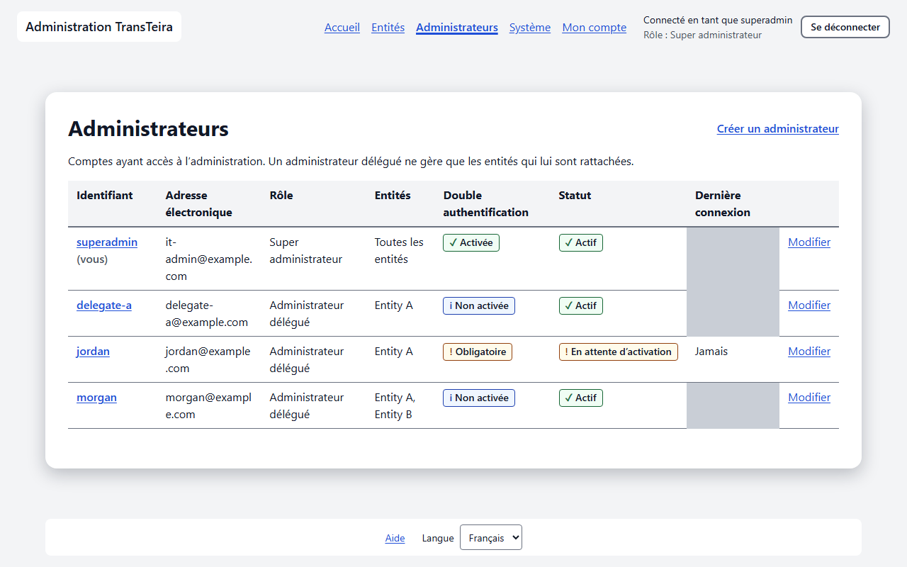

<!-- topic: admin-create -->
### Créer un administrateur délégué

Un administrateur délégué ne gère que les entités que vous rattachez à son compte. Cliquez sur **Créer un administrateur** et remplissez le formulaire.

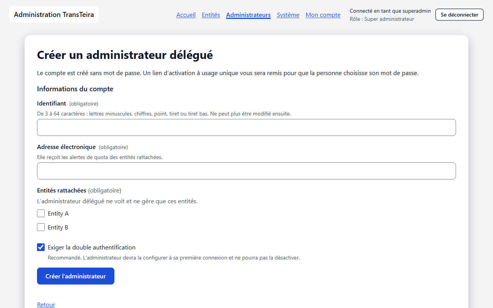

- **Identifiant** : de 3 à 64 caractères, lettres minuscules, chiffres, point, tiret ou tiret bas. Il ne peut plus être modifié ensuite.
- **Adresse électronique** : elle reçoit les alertes de quota des entités rattachées.
- **Entités rattachées** : sélectionnez au moins une entité.
- **Exiger la double authentification** : recommandé et coché par défaut. La personne devra la configurer lors de l’activation du compte et ne pourra pas la désactiver.

Cliquez sur **Créer l’administrateur**. Le compte est créé sans mot de passe, et un **Lien d’activation** s’affiche **une seule fois** : TransTeira ne l’envoie jamais par mail. Cliquez sur **Copier le lien** et transmettez-le par un autre canal que la messagerie habituelle (de vive voix, par messagerie instantanée ou par téléphone), car toute personne qui l’obtient peut définir le mot de passe du compte. Cliquez ensuite sur **J’ai transmis le lien**. Le lien est valable 72 heures et ne sert qu’une fois ; ce que la personne en fait est décrit dans [Activer votre compte](topic:activation).

<!-- topic: admin-edit -->
### Modifier un compte

Cliquez sur **Modifier** sur la ligne d’un compte pour changer son adresse électronique, ses entités rattachées, l’exigence de double authentification ou son rôle, puis cliquez sur **Enregistrer**.

- **Rôle** : seul un compte activé, avec la double authentification configurée, peut devenir super administrateur ; ses rattachements aux entités sont alors retirés. Pour rétrograder un super administrateur, sélectionnez les entités à lui rattacher.
- **Compte désactivé** : le compte ne peut plus se connecter et ses sessions ouvertes sont fermées.

Modifier les entités, le rôle ou la désactivation ferme aussi les sessions du compte. Sur votre propre compte, ces actions ne sont pas proposées : passez par [Mon compte](topic:account) pour votre mot de passe et votre appareil d’authentification.

<!-- topic: admin-reset -->
### Mot de passe ou appareil perdu

Lorsqu’un administrateur a perdu son mot de passe ou son appareil d’authentification, réinitialisez ses accès. Sur son compte, cliquez sur **Réinitialiser les accès…**, puis confirmez : le mot de passe, la double authentification et les codes de secours sont effacés, les sessions sont fermées, et un nouveau lien d’activation s’affiche une seule fois, à transmettre comme pour un nouveau compte. Un compte désactivé doit d’abord être réactivé.

Pour retirer un compte, cliquez sur **Supprimer…** et confirmez avec **Supprimer définitivement**. Le journal d’audit garde la trace de ses actions.

Si vous êtes le seul super administrateur et que vous avez perdu votre appareil, connectez-vous avec un code de secours (voir [Codes de secours](topic:admin-recovery-codes)). S’il ne vous en reste aucun, ou si vous avez perdu votre mot de passe, un exploitant ayant accès au serveur peut réinitialiser votre compte en ligne de commande, par exemple avec `docker exec -it transteira transteira admin reset-totp <identifiant>` : les commandes sont décrites dans `docs/operations/admin.md`, sections « Losing the second factor » et « Losing the password ».

## Système

L’entrée **Système** regroupe les réglages de toute l’instance. Sa sous-navigation comporte six écrans : **Vue d’ensemble**, **Maintenance**, **Paramètres**, **Webhooks**, **Journal d’audit** et **Clé maître**. Les administrateurs délégués ne la voient pas.

<!-- topic: system-overview -->
### Vue d’ensemble du système

La vue d’ensemble montre l’activité de toutes les entités et l’occupation du disque de données. Choisissez la **Période** : **7 derniers jours**, **30 derniers jours** ou **12 derniers mois**.

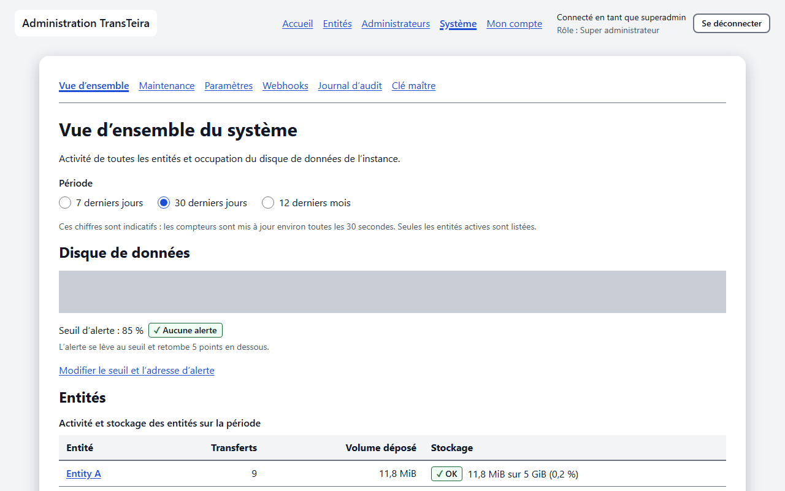

- **Disque de données** : l’espace occupé sur le disque qui contient les fichiers, le seuil d’alerte et un badge **Alerte active** ou **Aucune alerte**. L’alerte se lève au seuil et retombe 5 points en dessous ; **Modifier le seuil et l’adresse d’alerte** ouvre les [paramètres du système](topic:system-settings).
- **Entités** : une ligne par entité active, avec ses **Transferts** et son **Volume déposé** sur la période, et son **Stockage**.

Lorsqu’aucun serveur SMTP système n’est configuré, l’avertissement **L’alerte disque n’est pas envoyée par mail** s’affiche : l’alerte n’est alors visible que sur cette page, dans le journal d’audit et dans le journal applicatif. Pour la recevoir par mail, renseignez `TT_SYSTEM_SMTP_HOST`, `TT_SYSTEM_SMTP_FROM` et les variables associées (voir `.env.example`), puis redémarrez l’application. Les chiffres sont indicatifs : les compteurs sont mis à jour environ toutes les 30 secondes.

<!-- topic: system-maintenance -->
### Mode maintenance

Le mode maintenance suspend les nouveaux dépôts pendant une mise à jour. Tant qu’il est actif, les nouveaux dépôts et les invitations sont refusés sur toutes les entités et les visiteurs voient une page de maintenance dans leur langue ; les téléchargements, l’administration et le health check restent disponibles. Les envois en cours sont suspendus et reprennent après la désactivation du mode.

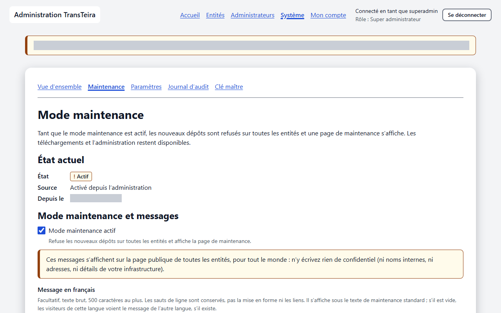

**État actuel** indique l’**État**, la **Source** et la date de début du mode (**Depuis le**). Pour activer le mode :

1. Cochez **Mode maintenance actif**.
2. Si besoin, rédigez un **Message en français** et un **Message en anglais** : texte brut facultatif, 500 caractères au plus, affiché sous le texte de maintenance standard. Ces messages sont publics sur toutes les entités : n’y écrivez rien de confidentiel. L’**Aperçu** les montre tels que les visiteurs les verront.
3. Enregistrez, puis confirmez **Activer le mode maintenance ?** avec **Activer**.

Pour le désactiver, décochez la case, enregistrez et confirmez avec **Désactiver**. Tant que le mode est actif, chaque administrateur voit un bandeau en haut de l’administration.

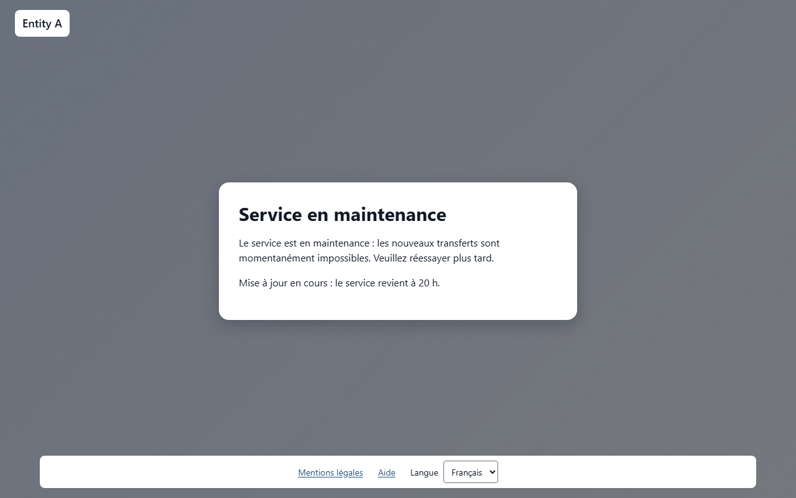

> **À savoir** Lorsque l’instance a été démarrée avec `TT_MAINTENANCE=true`, l’écran affiche **Imposé par l’environnement** et le mode ne peut pas être désactivé ici tant que la variable n’a pas été retirée et l’instance redémarrée. Vous pouvez tout de même modifier les messages, mais les enregistrer active aussi le mode dans l’administration : après le retrait de la variable, désactivez-le sur cet écran.

Une mise à jour type : activez le mode maintenance, attendez que les envois en cours se suspendent, mettez l’instance à jour, vérifiez qu’elle fonctionne, puis désactivez le mode.

<!-- topic: system-settings -->
### Paramètres du système (alerte disque)

Les paramètres du système portent l’alerte d’occupation du disque de toute l’instance.

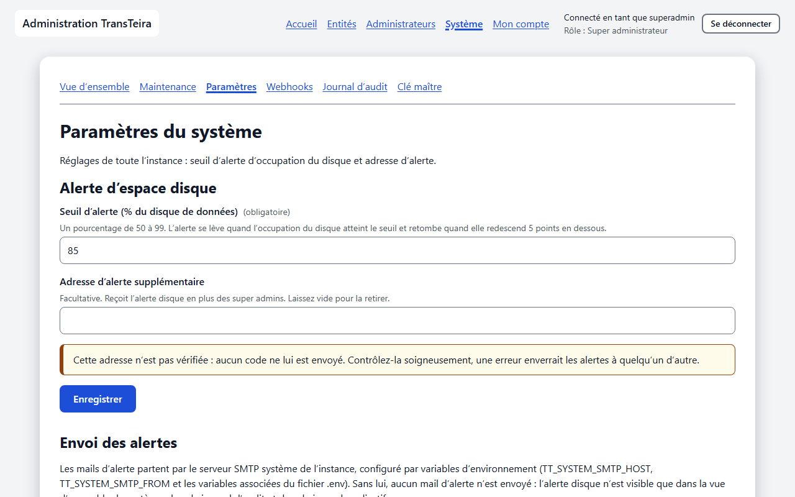

- **Seuil d’alerte (% du disque de données)** : un pourcentage de 50 à 99, 85 par défaut. L’alerte se lève quand l’occupation du disque atteint le seuil et retombe quand elle redescend 5 points en dessous.
- **Adresse d’alerte supplémentaire** : facultative, elle reçoit l’alerte disque et l’alerte antivirus en plus des super administrateurs. Cette adresse n’est pas vérifiée : saisissez-la une seconde fois dans **Adresse d’alerte, de nouveau** et contrôlez-la soigneusement. Laissez le champ vide pour la retirer.

Sous le formulaire, la section **Antivirus** affiche le moteur choisi par l’exploitant (en lecture seule) et, sauf s’il est désactivé, le résultat du dernier **auto-test** : résultat, date, signature lorsque la chaîne de test a été détectée, et qui l’a lancé (l’instance ou un super administrateur). L’auto-test envoie au moteur la chaîne de test EICAR (inoffensive), qu’il doit signaler comme infectée. Cliquez sur **Tester l’antivirus** pour le lancer maintenant ; le résultat est annoncé et consigné dans le [journal d’audit](topic:system-audit) (`antivirus.self_test`). Le bouton n’apparaît pas lorsque l’antivirus est désactivé pour l’instance.

Un résultat autre que **Détecté (réussi)** signifie que le moteur ne remplit pas son rôle : il est injoignable, répond de façon inattendue ou ne signale pas la chaîne de test (vérifiez sa configuration et, pour un moteur HTTP, les règles de verdict). Tant qu’un auto-test n’a pas réussi, le moteur est considéré comme indisponible et **les fichiers attendent leur analyse** (l’alerte antivirus suit après le délai habituel). L’instance réessaie d’elle-même après un échec au démarrage ; après un test réussi, elle ne le répète jamais seule, et un test que vous lancez et qui échoue referme le moteur.

Cliquez sur **Enregistrer**. Les mails d’alerte partent par le serveur SMTP système de l’instance, configuré par variables d’environnement, jamais par la messagerie d’une entité. Sans lui, aucun mail d’alerte n’est envoyé.

<!-- topic: system-webhooks -->
### Webhooks de l’instance

Les webhooks de l’instance envoient les alertes de toute l’instance vers un canal Microsoft Teams ou Slack, ou vers tout destinataire JSON, en plus des mails d’alerte. Ils fonctionnent comme les [webhooks d’une entité](topic:tenant-webhooks), avec d’autres événements : **Alerte d’espace disque**, **Espace disque revenu à la normale**, **Antivirus indisponible**, **Antivirus de nouveau disponible**, **Mode maintenance activé**, **Mode maintenance désactivé**, **Rotation de la clé maître terminée** et **Échec de la rotation de la clé maître**. Ils ne reçoivent jamais les événements d’une entité, qui se configurent dans chaque entité. L’instance peut avoir 20 webhooks au plus.

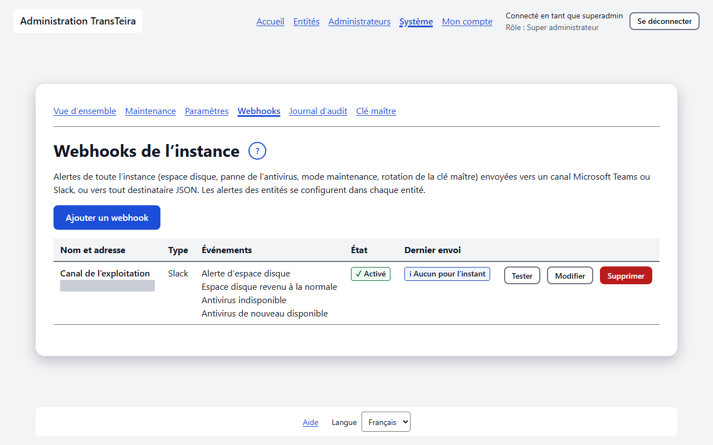

Par défaut, l’adresse d’un webhook doit utiliser `https://` et mener à une adresse publique ; une adresse dont le nom d’hôte ne peut pas être résolu est refusée avec le même message, pour que le contrôle ne révèle rien du DNS interne. Certains réseaux ne peuvent jamais être ouverts : les adresses non spécifiées, les adresses lien-local (dont les services de métadonnées des clouds), le multicast, les adresses réservées et de diffusion, les réseaux du conteneur TransTeira lui-même, les adresses IPv6 compatibles IPv4, et les plages listées dans `TT_WEBHOOK_DENY_NETWORKS`. Les plages privées (RFC 1918, `100.64.0.0/10`, `fc00::/7` et les autres plages réservées listées dans `.env.example`) sont refusées elles aussi, mais l’exploitant peut les ouvrir pour un destinataire du réseau interne en déclarant sa plage dans `TT_WEBHOOK_ALLOW_NETWORKS`. Le `http://` simple n’est accepté que vers une plage listée dans `TT_WEBHOOK_ALLOW_HTTP_NETWORKS`, et cette plage doit elle-même être joignable : une plage privée doit aussi figurer dans `TT_WEBHOOK_ALLOW_NETWORKS`. TransTeira refuse de démarrer lorsqu’une plage autorisée chevauche les réseaux qui ne peuvent jamais être ouverts, par exemple une plage contenant le réseau Docker du conteneur. Ces variables sont décrites dans `.env.example` et s’appliquent aussi aux webhooks des entités. La création de webhooks et la saisie de nouvelles adresses sont limitées à 30 par heure et par administrateur.

### Supervision

L’instance peut être supervisée par Prometheus, Grafana, Zabbix ou tout script grâce aux points d’accès `/metrics` et `/status`. Ils ne se configurent pas dans l’administration : l’exploitant les active par des variables d’environnement (`TT_METRICS_TOKEN` ou `TT_METRICS_TOKEN_FILE`, et éventuellement `TT_METRICS_ALLOWED_IPS`) et change le jeton en redémarrant l’instance. Sans jeton, ils n’existent pas. Uptime Kuma et les répartiteurs de charge utilisent `/healthz`, qui n’exige aucun jeton. Les métriques et la mise en place sont décrites dans `docs/operations/supervision.md`.

<!-- topic: system-audit -->
### Journal d’audit global

Le journal d’audit global regroupe les événements d’audit de toutes les entités et de l’instance elle-même. Il fonctionne comme le [journal d’audit](topic:tenant-audit) d’une entité, avec un filtre et une colonne **Entité** en plus.

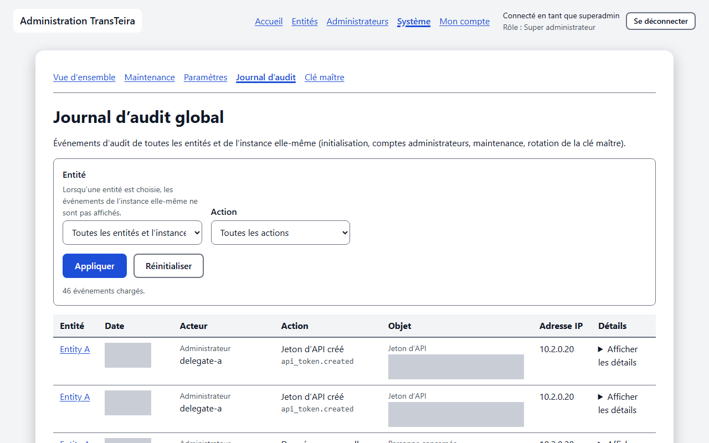

Avec **Toutes les entités et l’instance**, le journal montre aussi les événements de l’instance, marqués **Instance** : initialisation, connexions et comptes administrateurs, mode maintenance, paramètres du système, alertes disque, alertes antivirus et rotations de la clé maître. Lorsqu’une entité est choisie, seuls ses événements s’affichent. Les événements sont conservés 12 mois.

<!-- topic: system-master-key -->
### Clé maître

La clé maître protège la clé de chiffrement de chaque fichier et les secrets enregistrés (chiffrement par enveloppe) : elle ne chiffre jamais directement les fichiers. Une copie doit être conservée dans un coffre de mots de passe hors de la VM, car une sauvegarde de la VM est inexploitable sans elle. L’écran n’affiche que les identifiants des clés (`mk_` suivi de 16 caractères hexadécimaux), jamais les clés elles-mêmes, et l’administration ne peut ni créer, ni importer, ni télécharger une clé.

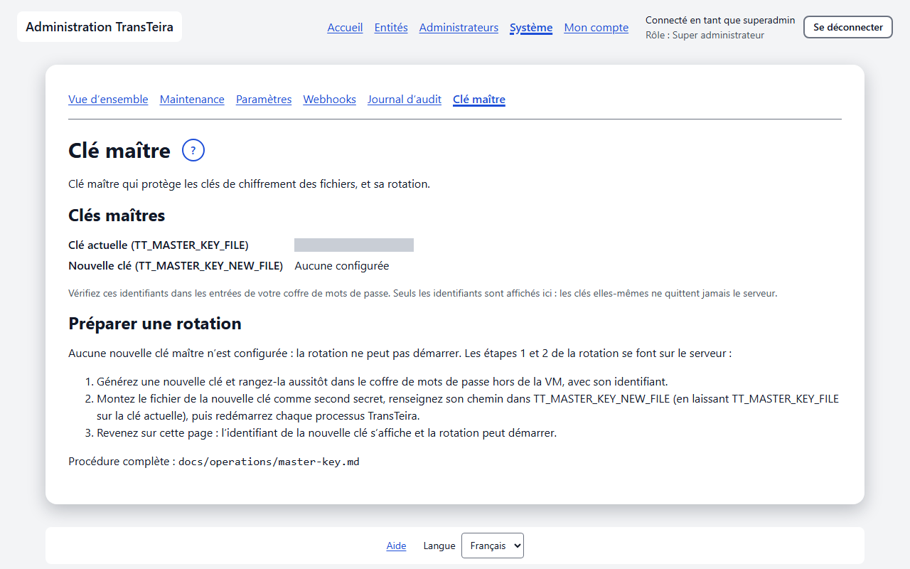

Sous **Clés maîtres**, l’écran affiche la **Clé actuelle (TT_MASTER_KEY_FILE)** et la **Nouvelle clé (TT_MASTER_KEY_NEW_FILE)**, ou **Aucune configurée**. Vérifiez ces identifiants dans les entrées de votre coffre. Après une rotation terminée, un badge **Redémarrage requis** apparaît. **Dernière rotation** donne l’identifiant, le **Statut** (**En cours**, **Terminée** ou **Échouée**), les clés, les dates et la progression de la dernière rotation.

<!-- topic: master-key-rotation -->
### Rotation de la clé maître

Une rotation remplace la clé maître : elle rechiffre les clés enregistrées en base avec la nouvelle clé maître, sans relire ni réécrire les fichiers, et ne prend donc que quelques secondes à quelques minutes, même pour un gros volume. Faites-la si vous soupçonnez une fuite de la clé, au départ d’une personne qui y avait accès, et au moins une fois par durée de conservation des sauvegardes. Seule l’étape 3 se fait dans l’administration ; les autres modifient le serveur ou le coffre.

1. *Sur le serveur* : générez une nouvelle clé et rangez-la aussitôt dans le coffre de mots de passe, avec son identifiant.
2. *Sur le serveur* : montez le fichier de la nouvelle clé comme second secret, renseignez son chemin dans `TT_MASTER_KEY_NEW_FILE`, laissez `TT_MASTER_KEY_FILE` sur la clé actuelle, puis redémarrez chaque processus TransTeira. D’ici là, l’écran affiche **Préparer une rotation** et aucun bouton de démarrage.
3. *Dans l’administration* (ou avec la commande `rotate-master-key`) : ouvrez **Système**, puis **Clé maître**, et comparez les deux identifiants avec le coffre. Cochez **La nouvelle clé est rangée dans le coffre de mots de passe hors de la VM** et **J’ai vérifié les deux identifiants de clé**, cliquez sur **Démarrer la rotation**, puis saisissez le code actuel de votre application d’authentification dans la fenêtre **Confirmer avec un code** et cliquez sur **Démarrer**. Si vous venez de vous connecter, attendez le code suivant : un code déjà utilisé ne peut pas resservir. La barre **Rechiffrement des clés** montre la progression ; vous pouvez quitter la page, la rotation continue sur le serveur.
4. *Sur le serveur* : une fois la rotation terminée, faites pointer `TT_MASTER_KEY_FILE` vers le fichier de la nouvelle clé, retirez `TT_MASTER_KEY_NEW_FILE` et le secret de l’ancienne clé, puis redémarrez. D’ici là, le prochain démarrage du serveur est refusé.
5. *Dans le coffre* : marquez la nouvelle clé comme actuelle, et l’ancienne comme retirée, avec la date de la rotation.
6. *Plus tard* : conservez l’ancienne clé tant que vous gardez des sauvegardes antérieures à la rotation. Quand la dernière a expiré, supprimez l’ancienne clé du coffre et de l’hôte.

Dans la fenêtre de confirmation, vous pouvez aussi utiliser l’un de vos codes de secours, qui est alors consommé. Plusieurs codes faux de suite ferment votre session : après le cinquième, vous revenez à la page de connexion.

Si la rotation est interrompue, par exemple par un redémarrage du serveur, l’écran affiche **La rotation semble interrompue** : cochez de nouveau les deux cases et cliquez sur **Reprendre la rotation** avec un nouveau code ; elle continue là où elle s’est arrêtée, avec le même identifiant. Si elle a échoué, **La dernière rotation a échoué** donne l’erreur signalée par le serveur ; corrigez la cause, puis cliquez sur **Relancer la rotation**.

Le redémarrage de l’étape 4 a un effet pour les utilisateurs : les pages ouvertes (dépôt et administration) doivent être rechargées, un code en cours de saisie doit être redemandé, et les déposants internes doivent de nouveau saisir un code de vérification à leur prochaine visite. Redémarrez à un moment calme ; aucune donnée n’est perdue. La procédure complète, y compris en ligne de commande, se trouve dans `docs/operations/master-key.md`.

<!-- topic: super-admin-checklist -->
## Bonnes pratiques

Quelques habitudes gardent l’instance sûre et restaurable.

- Gardez deux super administrateurs, chacun avec sa propre application d’authentification.
- Rangez vos codes de secours dans le coffre de mots de passe, pas à côté de votre téléphone.
- Conservez une copie de la clé maître dans le coffre de mots de passe hors de la VM, avec son identifiant, et mettez-la à jour à chaque rotation.
- Configurez le serveur SMTP système pour recevoir l’alerte disque et l’alerte antivirus (envoyée quand l’antivirus ne répond plus depuis 5 minutes : les dépôts restent alors en analyse), et surveillez le health check avec votre outil de supervision.
- Lorsqu’une entité se retrouve sans administrateur délégué, contrôlez sa messagerie : ses alertes de quota vous sont alors envoyées par elle.
- Vérifiez que les sauvegardes décrites dans `docs/operations/backup.md` fonctionnent, et faites une rotation de la clé maître au moins une fois par durée de conservation des sauvegardes.
